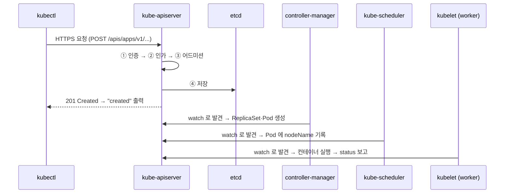

# 18강 · 아키텍처 (컨트롤플레인)

> 영상: **18강 컨트롤플레인 안을 열어 보기** (구조 개요는 1강) · 이어서 풀 채점 세트: `18-architecture`

## 실습 목표

- 컨트롤플레인 구성 요소가 **어디에서 어떻게** 떠 있는지 직접 찾는다.
- 스태틱 파드가 일반 파드와 **무엇이 다른지** 확인하고, 워커 노드에 스태틱 파드를 **직접 하나 띄워** 본다.
- `kubectl` 한 줄이 API 서버에서 **인증 → 인가 → 어드미션 → etcd** 를 거치는 과정을 `-v=6` 과 `--raw` 로 들여다본다.
- 스케줄러·컨트롤러 매니저를 잠깐 멈춰서 **각 구성 요소가 맡은 일**을 눈으로 확인한다.
- kubectl 이 안 될 때도 쓸 수 있는 **구성 요소 상태 점검** 방법(`/readyz`, `crictl`, `journalctl`)을 익힌다.
- 원하는 상태와 실제 상태를 맞추는 **선언적 모델**을 확인한다.

---

## 0) 준비

```bash
kubectl create namespace guide-arch
```

이 페이지의 2) · 4) · 5) 는 컨트롤플레인 노드의 파일을 봅니다. **컨트롤플레인 노드(`control-plane`, 192.168.56.10)에 접속한 상태**에서 진행하세요.
2) 의 마지막 실습은 `worker-1` 에도 잠깐 접속합니다.

!!! tip "`$do` 가 있는지 먼저 확인"
    ```bash
    echo $do          # --dry-run=client -o yaml 이 나오면 준비 완료
    ```
    비어 있으면 `export do="--dry-run=client -o yaml"` 을 한 번 실행해 둡니다. 시험장에서도 첫 문제 전에 만들어 두면 좋습니다.

---

## 1) 컨트롤플레인은 어디에 떠 있나

**왜** — 트러블슈팅은 "어느 부품이 멈췄나" 를 찾는 일입니다. 부품이 어디에, 어떤 형태로 떠 있는지 모르면 찾을 수가 없습니다.

```bash
kubectl get pods -n kube-system -o wide
```

```text
NAME                                    READY   STATUS    NODE
cilium-4xq7b                            1/1     Running   worker-1
cilium-operator-5c7d9f8b6-2kq8m         1/1     Running   worker-2
cilium-r8w2p                            1/1     Running   control-plane
cilium-z9m3k                            1/1     Running   worker-2
coredns-668d6bf9bc-7xk2p                1/1     Running   worker-1
coredns-668d6bf9bc-q4n8d                1/1     Running   worker-2
etcd-control-plane                      1/1     Running   control-plane
kube-apiserver-control-plane            1/1     Running   control-plane
kube-controller-manager-control-plane   1/1     Running   control-plane
kube-proxy-4hq9z                        1/1     Running   control-plane
kube-proxy-m2n8c                        1/1     Running   worker-1
kube-proxy-t6v1s                        1/1     Running   worker-2
kube-scheduler-control-plane            1/1     Running   control-plane
```

이름을 두 부류로 나눠 봅니다.

| 이름 모양 | 예 | 누가 만들었나 |
|-----------|----|---------------|
| `<구성요소>-<노드이름>` | `etcd-control-plane` | 노드의 **kubelet** 이 파일을 보고 직접 띄운 **스태틱 파드** |
| `<이름>-<무작위 해시>` | `kube-proxy-4hq9z`, `coredns-…` | DaemonSet · Deployment 같은 **컨트롤러** |

이름 끝에 노드 이름이 붙은 네 개가 컨트롤플레인입니다. 어떤 리소스가 소유하는지도 확인할 수 있습니다.

```bash
kubectl get pod kube-scheduler-control-plane -n kube-system -o jsonpath='{.metadata.ownerReferences[0].kind}{"\n"}'
kubectl get pod -n kube-system -l k8s-app=kube-proxy -o jsonpath='{.items[0].metadata.ownerReferences[0].kind}{"\n"}'
```

```text
Node          ← 스태틱 파드: 노드가 주인
DaemonSet     ← 일반 파드: 컨트롤러가 주인
```

한 번에 전부 보고 싶으면 `custom-columns` 로 원하는 칸만 뽑습니다. 시험에서 "어떤 값만 뽑아 적어라" 는 문제에 그대로 쓰는 기술입니다.

```bash
kubectl get pods -n kube-system \
  -o custom-columns='NAME:.metadata.name,NODE:.spec.nodeName,OWNER:.metadata.ownerReferences[0].kind'
```

```text
NAME                                    NODE            OWNER
cilium-4xq7b                            worker-1        DaemonSet
cilium-operator-5c7d9f8b6-2kq8m         worker-2        ReplicaSet
coredns-668d6bf9bc-7xk2p                worker-1        ReplicaSet
etcd-control-plane                      control-plane   Node
kube-apiserver-control-plane            control-plane   Node
...
```

**관찰 포인트** — OWNER 가 `Node` 인 것은 컨트롤러가 없는 스태틱 파드, `ReplicaSet` 은 Deployment 가, `DaemonSet` 은 노드마다 하나씩 띄운 것입니다.

| 부품 | 어디에 | 형태 | 죽으면 |
|------|--------|------|--------|
| kube-apiserver | control-plane | 스태틱 파드 | kubectl 전부 실패 (돌던 파드는 계속 돈다) |
| etcd | control-plane | 스태틱 파드 | API 서버도 사실상 마비 |
| kube-scheduler | control-plane | 스태틱 파드 | 새 파드가 `Pending` |
| kube-controller-manager | control-plane | 스태틱 파드 | 자동 복구 · 스케일 · 롤아웃이 멈춤 |
| kubelet | **모든 노드** | systemd 서비스 | 그 노드가 `NotReady` |
| containerd | **모든 노드** | systemd 서비스 | 그 노드에서 컨테이너 실행 불가 |
| kube-proxy | 모든 노드 | DaemonSet | 그 노드에서 Service 통신 실패 |
| CoreDNS | 아무 노드 | Deployment | 이름으로 Service 를 못 찾음 |

!!! note "kube-proxy 가 안 보인다면"
    Cilium 을 **kube-proxy 대체 모드**로 설치한 클러스터에서는 kube-proxy DaemonSet 이 아예 없습니다.
    `kubectl get ds -n kube-system` 으로 어느 구성인지 확인하세요. 이 페이지의 7) 에서 다시 봅니다.

---

## 2) 스태틱 파드 — kubelet 이 파일을 보고 띄운다

**왜** — API 서버도 컨테이너입니다. 그런데 API 서버가 없는데 누가 API 서버를 띄울까요? kubelet 이 **로컬 디렉터리의 파일만 보고** 직접 띄웁니다. 그래서 컨트롤플레인 설정을 바꾸는 일은 곧 **파일을 고치는 일**입니다.

kubelet 은 정해진 디렉터리를 계속 지켜봅니다. 그 디렉터리가 어디인지는 kubelet 설정에 있습니다.

```bash
sudo grep staticPodPath /var/lib/kubelet/config.yaml
ls /etc/kubernetes/manifests/
```

```text
staticPodPath: /etc/kubernetes/manifests
etcd.yaml  kube-apiserver.yaml  kube-controller-manager.yaml  kube-scheduler.yaml
```

**이 파일 네 개가 컨트롤플레인 전부입니다.** API 서버가 어떤 옵션으로 떠 있는지도 여기서 읽습니다.
예를 들어 서비스 IP 대역은:

```bash
sudo grep -- --service-cluster-ip-range /etc/kubernetes/manifests/kube-apiserver.yaml
```

```text
    - --service-cluster-ip-range=10.96.0.0/12
```

같은 옵션을 **kubectl 로도** 읽을 수 있습니다. 파일에 접근할 수 없을 때 쓰는 두 번째 길입니다.
스태틱 파드에는 `component=<이름>` 레이블이 붙어 있어서 이름을 몰라도 고를 수 있습니다.

```bash
kubectl get pods -n kube-system -l tier=control-plane --show-labels
kubectl -n kube-system get pod -l component=kube-apiserver -o yaml | grep -- --secure-port
```

```text
NAME                                    READY   STATUS    LABELS
etcd-control-plane                      1/1     Running   component=etcd,tier=control-plane
kube-apiserver-control-plane            1/1     Running   component=kube-apiserver,tier=control-plane
kube-controller-manager-control-plane   1/1     Running   component=kube-controller-manager,tier=control-plane
kube-scheduler-control-plane            1/1     Running   component=kube-scheduler,tier=control-plane

    - --secure-port=6443
```

!!! tip "파일도 kubectl 도 못 쓸 때"
    같은 옵션이 실행 중인 프로세스 인자에도 있습니다.
    ```bash
    ps -ef | grep kube-apiserver | tr ' ' '\n' | grep -- --service-cluster-ip-range
    ```

### 거울(mirror) 파드의 표시

API 서버에 보이는 스태틱 파드는 kubelet 이 "이런 파드가 돌고 있다" 고 **보고용으로 만든 거울**입니다. 어노테이션에 표시가 있습니다.

```bash
kubectl get pod kube-scheduler-control-plane -n kube-system \
  -o jsonpath='{.metadata.annotations}' | tr ',' '\n'
```

```text
{"kubernetes.io/config.hash":"3f1c9e...",
"kubernetes.io/config.mirror":"3f1c9e...",       ← 거울 파드라는 표시
"kubernetes.io/config.seen":"2026-09-29T05:40:12.345678901Z",
"kubernetes.io/config.source":"file"}             ← 파일에서 왔다
```

### 스태틱 파드는 kubectl 로 지워지지 않는다

```bash
kubectl delete pod kube-scheduler-control-plane -n kube-system
kubectl get pod kube-scheduler-control-plane -n kube-system
```

지웠는데 곧바로 다시 보입니다. API 서버에 보이는 것은 **거울 파드**일 뿐이고, 진짜 컨테이너는 kubelet 이 파일을 기준으로 관리하기 때문입니다.
스태틱 파드를 없애려면 **파일을 치워야** 합니다.

### 직접 만들어 보기 — worker-1 에 스태틱 파드 하나

스태틱 파드는 컨트롤플레인 전용이 아닙니다. **어느 노드든 kubelet 의 감시 디렉터리에 파일을 두면** 뜹니다.

먼저 control-plane 에서 매니페스트 뼈대를 뽑습니다.

```bash
kubectl run static-demo -n guide-arch --image=nginx:1.27 $do > static-demo.yaml
cat static-demo.yaml
```

```yaml
apiVersion: v1
kind: Pod
metadata:
  labels:
    run: static-demo
  name: static-demo            # ← API 서버에는 static-demo-<노드이름> 으로 보인다
  namespace: guide-arch        # ← 이 네임스페이스가 있어야 거울 파드가 생긴다
spec:
  containers:
  - image: nginx:1.27
    name: static-demo
    resources: {}
  dnsPolicy: ClusterFirst
  restartPolicy: Always
status: {}
```

`-n` 을 줬으므로 `namespace:` 칸이 들어 있습니다. 혹시 빠져 있으면 직접 추가하세요.
`worker-1` 에 접속해서(`ssh worker-1` — control-plane 에서, 또는 호스트 PC 에서 `ssh vboxuser@192.168.56.11`) 같은 내용을 감시 디렉터리에 둡니다.

```bash
# worker-1 에서
sudo grep staticPodPath /var/lib/kubelet/config.yaml     # 워커도 경로가 같은지 먼저 확인
sudo vi /etc/kubernetes/manifests/static-demo.yaml       # 위 YAML 을 붙여 넣고 저장
```

control-plane 으로 돌아와 확인합니다.

```bash
kubectl get pods -n guide-arch -o wide
```

```text
NAME                   READY   STATUS    NODE
static-demo-worker-1   1/1     Running   worker-1     ← 이름 끝에 노드 이름이 붙었다
```

**관찰 포인트** — 스케줄러를 거치지 않았습니다. 파일이 놓인 노드가 곧 실행 노드입니다.
`kubectl delete pod static-demo-worker-1 -n guide-arch` 를 해 봐도 다시 생깁니다. **worker-1 에서 파일을 지워야** 사라집니다.

```bash
# worker-1 에서
sudo rm /etc/kubernetes/manifests/static-demo.yaml
```

!!! tip "시험 팁"
    "노드 X 에 스태틱 파드를 만들라" 는 문제는 **그 노드에 접속해서** 그 노드 kubelet 의 `staticPodPath` 에 파일을 두는 문제입니다.
    경로는 노드마다 다를 수 있으니 반드시 `/var/lib/kubelet/config.yaml` 에서 확인하세요. 파일을 둔 뒤 kubelet 재시작은 필요 없습니다.

---

## 3) kubectl 한 줄의 여정 — 인증 · 인가 · 어드미션

**왜** — `kubectl` 은 REST 클라이언트일 뿐입니다. 모든 요청은 API 서버의 HTTPS 엔드포인트로 가고, 거기서 네 관문을 통과해야 etcd 에 저장됩니다.
에러 메시지를 보고 **어느 관문에서 막혔는지** 알면 원인이 바로 좁혀집니다.



| 관문 | 하는 일 | 우리 클러스터 설정 | 막히면 |
|------|---------|--------------------|--------|
| ① 인증 (Authentication) | 누구인가 — 인증서 · 토큰 | kubeconfig 의 클라이언트 인증서 | `Unauthorized` (401) |
| ② 인가 (Authorization) | 그 일을 해도 되는가 | `--authorization-mode=Node,RBAC` | `Forbidden` (403) |
| ③ 어드미션 (Admission) | 요청을 고치거나(변경) 거절(검증) | `--enable-admission-plugins=...` + 기본 활성 플러그인 | 플러그인마다 다른 거절 메시지 |
| ④ 저장 | 형식 검사 후 etcd 에 기록 | — | `BadRequest` · `Invalid` |

### `-v=6` — kubectl 이 실제로 보내는 요청

```bash
kubectl get pods -n guide-arch -v=6 2>&1 | grep -E 'GET|POST|Config loaded'
```

```text
I0929 06:12:41.482113   23145 loader.go:402] Config loaded from file:  /home/vboxuser/.kube/config
I0929 06:12:41.498741   23145 round_trippers.go:560] GET https://192.168.56.10:6443/api/v1/namespaces/guide-arch/pods?limit=500 200 OK in 11 milliseconds
```

- 목적지는 `192.168.56.10:6443` — control-plane 의 API 서버입니다.
- 경로가 곧 리소스입니다. 코어 그룹은 `/api/v1/...`, 그 밖의 그룹은 `/apis/<그룹>/<버전>/...` 입니다.

!!! note "로그 형식은 버전마다 조금 다릅니다"
    kubectl 버전에 따라 `"Response" verb="GET" url="..." status="200 OK"` 같은 구조화된 형식으로 찍히기도 합니다. 보는 것은 **메서드 · URL · 상태 코드** 세 가지입니다.
    `-v=8` 이면 요청·응답 본문까지 보입니다.

리소스가 어느 그룹에 속하는지는 `api-resources` 에 있습니다.

```bash
kubectl api-resources | grep -E '^NAME|^pods |^deployments |^leases '
```

```text
NAME          SHORTNAMES   APIVERSION               NAMESPACED   KIND
pods          po           v1                       true         Pod
deployments   deploy       apps/v1                  true         Deployment
leases                     coordination.k8s.io/v1   true         Lease
```

### `--raw` — kubectl 을 거치되 가공 없이

`kubectl get --raw` 는 kubeconfig 의 인증 정보를 그대로 쓰면서 **경로를 직접** 부릅니다.

```bash
kubectl get --raw /api/v1/namespaces/guide-arch
```

```text
{"kind":"Namespace","apiVersion":"v1","metadata":{"name":"guide-arch","uid":"b6d1...","resourceVersion":"48213","creationTimestamp":"2026-09-29T06:10:02Z","labels":{"kubernetes.io/metadata.name":"guide-arch"},...},"spec":{"finalizers":["kubernetes"]},"status":{"phase":"Active"}}
```

### ① 인증 → ② 인가를 따로 떼어 보기

kubeconfig 없이, 즉 **아무 인증서도 없이** API 서버를 불러 봅니다.

```bash
curl -sk https://192.168.56.10:6443/version
curl -sk https://192.168.56.10:6443/api/v1/namespaces
```

```text
{
  "major": "1",
  "minor": "32",
  "gitVersion": "v1.32.x",
  ...
}
{
  "kind": "Status",
  "apiVersion": "v1",
  "status": "Failure",
  "message": "namespaces is forbidden: User \"system:anonymous\" cannot list resource \"namespaces\" in API group \"\" at the cluster scope",
  "reason": "Forbidden",
  "code": 403
}
```

**관찰 포인트** — 두 번째 요청은 **인증은 통과**했습니다(`system:anonymous` 라는 익명 사용자로). 막힌 곳은 **인가**입니다.
`/version` 은 익명에게도 허용된 경로라서 통과했습니다.

kubectl 로 같은 비교를 합니다. `--as` 로 다른 사용자인 척 요청할 수 있습니다.

```bash
kubectl auth whoami
kubectl auth can-i list pods -n guide-arch
kubectl auth can-i list pods -n guide-arch --as=system:serviceaccount:guide-arch:default
kubectl get pods -n guide-arch --as=system:serviceaccount:guide-arch:default
```

```text
ATTRIBUTE   VALUE
Username    kubernetes-admin
Groups      [kubeadm:cluster-admins system:authenticated]
yes
no
Error from server (Forbidden): pods is forbidden: User "system:serviceaccount:guide-arch:default" cannot list resource "pods" in API group "" in the namespace "guide-arch"
```

### ③ 어드미션 — 요청을 고치고, 거절한다

API 서버가 어떤 인가 모드 · 어드미션 플러그인으로 떠 있는지 봅니다.

```bash
sudo grep -E -- '--(authorization-mode|enable-admission-plugins)' /etc/kubernetes/manifests/kube-apiserver.yaml
```

```text
    - --authorization-mode=Node,RBAC
    - --enable-admission-plugins=NodeRestriction
```

`NodeRestriction` 하나만 적혀 있지만 `NamespaceLifecycle` · `ServiceAccount` · `LimitRanger` · `ResourceQuota` 같은 플러그인은 **적지 않아도 기본으로 켜져** 있습니다.

**거절(검증) 실험** — 없는 네임스페이스에 만들어 봅니다. `NamespaceLifecycle` 이 막습니다.

```bash
kubectl run probe -n no-such-ns --image=nginx:1.27
```

```text
Error from server (NotFound): namespaces "no-such-ns" not found
```

**변경(mutating) 실험** — 우리가 적지 않은 필드가 저장될 때 끼워 넣어집니다.

```bash
kubectl run probe -n guide-arch --image=nginx:1.27 $do | grep -E 'serviceAccount|kube-api-access'   # 보낸 것
kubectl run probe -n guide-arch --image=nginx:1.27
kubectl get pod probe -n guide-arch -o yaml | grep -E 'serviceAccountName|kube-api-access'           # 저장된 것
```

```text
                                          ← 보낸 YAML 에는 아무것도 없다
  serviceAccountName: default             ← ServiceAccount 어드미션이 채웠다
    name: kube-api-access-7x2kq
  - name: kube-api-access-7x2kq           ← API 토큰 볼륨까지 자동으로 붙었다
```

**④ 형식 검사 실험** — 오타가 있는 필드를 보냅니다.

```bash
cat <<'EOF' | kubectl apply -f -
apiVersion: v1
kind: Pod
metadata:
  name: typo
  namespace: guide-arch
spec:
  containers:
    - name: app
      imagee: nginx:1.27          # ← 오타: image 가 아니라 imagee
EOF
```

```text
Error from server (BadRequest): error when creating "STDIN": Pod in version "v1" cannot be handled as a Pod: strict decoding error: unknown field "spec.containers[0].imagee"
```

| 에러 첫머리 | 막힌 관문 | 먼저 볼 것 |
|-------------|-----------|------------|
| `Unauthorized` | ① 인증 | kubeconfig · 인증서 만료 |
| `Forbidden: User "..." cannot ...` | ② 인가 | RBAC (15강) — `kubectl auth can-i` |
| `NotFound: namespaces ...`, `exceeded quota`, `forbidden: ...` | ③ 어드미션 | 네임스페이스 · ResourceQuota · LimitRange |
| `BadRequest ... unknown field`, `Invalid value` | ④ 형식 검사 | YAML 필드 이름 — `kubectl explain` |

### watch — 부품들은 묻지 않고 지켜본다

컨트롤러 · 스케줄러 · kubelet 은 API 서버에 "바뀐 게 있나" 를 반복해서 묻지 않습니다. **watch** 로 연결을 열어 두고 변경을 통지받습니다. 직접 열어 봅니다.

=== "터미널 1 — watch 열기"
    ```bash
    kubectl get --raw "/api/v1/namespaces/guide-arch/pods?watch=true" | cut -c1-90
    ```
=== "터미널 2 — 파드 지우기"
    ```bash
    kubectl delete pod probe -n guide-arch
    ```

```text
{"type":"ADDED","object":{"kind":"Pod","apiVersion":"v1","metadata":{"name":"probe","n
{"type":"MODIFIED","object":{"kind":"Pod","apiVersion":"v1","metadata":{"name":"probe"
{"type":"MODIFIED","object":{"kind":"Pod","apiVersion":"v1","metadata":{"name":"probe"
{"type":"DELETED","object":{"kind":"Pod","apiVersion":"v1","metadata":{"name":"probe",
```

**관찰 포인트** — 처음 연결하면 현재 있는 것이 `ADDED` 로 오고, 이후엔 바뀔 때마다 `MODIFIED` · `DELETED` 가 밀려옵니다. `kubectl get -w` 가 바로 이것입니다. 확인했으면 터미널 1 은 `Ctrl+C` 로 닫습니다.

---

## 4) 스케줄러를 멈추면 무엇이 멈추나

**왜** — "파드가 Pending 이다" 와 "파드가 아예 안 생긴다" 는 다른 부품의 문제입니다. 하나씩 멈춰 보면 그 경계가 분명해집니다.

!!! warning "반드시 끝까지 진행해서 파일을 되돌리세요"
    스케줄러가 멈춘 동안에는 새 파드가 배치되지 않습니다. 이 실습은 자기 VM 에서만 하세요.
    파일을 `/etc/kubernetes/manifests/` 안의 다른 이름(예: `.bak`)으로 바꾸면 **안 됩니다** — kubelet 은 그 디렉터리의 파일을 모두 읽으려 합니다. 반드시 **디렉터리 밖으로** 옮기세요.

스케줄러 매니페스트를 감시 디렉터리 밖으로 옮깁니다.

```bash
sudo mv /etc/kubernetes/manifests/kube-scheduler.yaml /tmp/
kubectl get pods -n kube-system | grep scheduler     # 30초쯤 뒤 사라진다
```

이 상태에서 Deployment 를 만듭니다.

```bash
kubectl create deployment hello -n guide-arch --image=nginx:1.27 --replicas=2
kubectl get deploy,rs,pods -n guide-arch -o wide
```

```text
NAME                    READY   UP-TO-DATE   AVAILABLE
deployment.apps/hello   0/2     2            0

NAME                               DESIRED   CURRENT   READY
replicaset.apps/hello-5d9c7f8b6c   2         2         0

NAME                         READY   STATUS    NODE
pod/hello-5d9c7f8b6c-8kq2w   0/1     Pending   <none>
pod/hello-5d9c7f8b6c-t7m4x   0/1     Pending   <none>
```

- Deployment → ReplicaSet → Pod 까지는 **만들어졌습니다.** 이것은 **컨트롤러 매니저**의 일입니다.
- 파드의 `NODE` 가 `<none>` 입니다. 노드를 정하는 **스케줄러**가 없기 때문입니다.

```bash
kubectl describe pod -n guide-arch -l app=hello | grep -A3 Events
```

Events 가 비어 있습니다. 스케줄러가 없으니 "배치 실패" 이벤트조차 쓰는 주체가 없습니다.

### 스케줄러 없이 파드를 띄우는 법 — `nodeName`

스케줄러가 하는 일은 결국 파드에 `spec.nodeName` 을 **적어 주는 것**뿐입니다. 그럼 우리가 직접 적으면요?

`manual.yaml`:

```yaml
apiVersion: v1
kind: Pod
metadata:
  name: manual
  namespace: guide-arch
spec:
  nodeName: worker-2           # ← 스케줄러가 적었어야 할 칸을 직접 채운다
  containers:
    - name: web
      image: nginx:1.27
```

```bash
kubectl apply -f manual.yaml
kubectl get pods -n guide-arch -o wide
```

```text
NAME                     READY   STATUS    NODE
hello-5d9c7f8b6c-8kq2w   0/1     Pending   <none>
hello-5d9c7f8b6c-t7m4x   0/1     Pending   <none>
manual                   1/1     Running   worker-2      ← 스케줄러 없이 떴다
```

**관찰 포인트** — `nodeName` 이 채워진 파드는 스케줄러를 건너뛰고 곧장 그 노드의 kubelet 이 받아 갑니다. 대신 Taint · 자원 검사도 건너뛰니 실무에서는 쓰지 않습니다.

이제 파일을 되돌립니다.

```bash
sudo mv /tmp/kube-scheduler.yaml /etc/kubernetes/manifests/
kubectl get pods -n guide-arch -o wide -w
```

스케줄러가 다시 뜨면 Pending 이던 파드에 노드가 정해지고, 그 노드의 **kubelet** 이 컨테이너를 띄워 `Running` 이 됩니다.

```bash
kubectl get events -n guide-arch --field-selector reason=Scheduled
```

```text
LAST SEEN   TYPE     REASON      OBJECT                       MESSAGE
20s         Normal   Scheduled   pod/hello-5d9c7f8b6c-8kq2w   Successfully assigned guide-arch/hello-5d9c7f8b6c-8kq2w to worker-1
20s         Normal   Scheduled   pod/hello-5d9c7f8b6c-t7m4x   Successfully assigned guide-arch/hello-5d9c7f8b6c-t7m4x to worker-2
```

`manual` 파드에는 `Scheduled` 이벤트가 **없습니다.** 스케줄러를 거치지 않았으니까요.

### 대조 실험 — 컨트롤러 매니저를 멈추면

이번에는 컨트롤러 매니저를 멈춥니다. 같은 경고가 적용됩니다.

```bash
sudo mv /etc/kubernetes/manifests/kube-controller-manager.yaml /tmp/
kubectl get pods -n kube-system | grep controller-manager     # 사라질 때까지 기다린다

kubectl create deployment ctl-test -n guide-arch --image=nginx:1.27 --replicas=2
kubectl get deploy,rs,pods -n guide-arch -l app=ctl-test
```

```text
NAME                       READY   UP-TO-DATE   AVAILABLE
deployment.apps/ctl-test   0/2     0            0

No resources found ...        ← ReplicaSet 도, 파드도 없다
```

**관찰 포인트** — Deployment 오브젝트는 etcd 에 저장됐지만(API 서버의 일), **ReplicaSet 을 만들 주체가 없습니다.** 스케줄러 때와 멈춘 지점이 한 칸 앞입니다.

```bash
sudo mv /tmp/kube-controller-manager.yaml /etc/kubernetes/manifests/
kubectl get deploy,rs,pods -n guide-arch -l app=ctl-test -w     # 곧 RS 와 파드가 생긴다
```

| 단계 | 담당 | 이 부품이 멈추면 보이는 모습 |
|------|------|------------------------------|
| 요청을 받아 etcd 에 저장 | kube-apiserver → etcd | kubectl 자체가 실패 (`connection refused`) |
| ReplicaSet · Pod 오브젝트 생성 | kube-controller-manager | Deployment 만 있고 RS · 파드가 없다 |
| Pod 에 노드 지정 | kube-scheduler | 파드가 `Pending`, `NODE <none>`, 이벤트 없음 |
| 실제 컨테이너 실행 | 그 노드의 kubelet + 컨테이너 런타임 | 노드 `NotReady`, 파드가 `ContainerCreating` 이나 `Unknown` |

---

## 5) 구성 요소 상태 점검 — 살아 있는지 어떻게 아나

**왜** — "파드가 Running 이다" 와 "그 부품이 제대로 일한다" 는 다릅니다. API 서버는 자기 상태를 엔드포인트로 알려 주고, kubectl 이 안 되면 노드에서 직접 볼 수 있어야 합니다.

### API 서버의 건강 엔드포인트

```bash
kubectl get --raw='/readyz?verbose'
```

```text
[+]ping ok
[+]log ok
[+]etcd ok                         ← API 서버가 보기에 etcd 도 정상
[+]etcd-readiness ok
[+]informer-sync ok
[+]poststarthook/start-apiserver-admission-initializer ok
...
[+]shutdown ok
readyz check passed
```

```bash
kubectl get --raw='/livez'
kubectl get --raw='/readyz/etcd'
```

```text
ok
ok
```

| 엔드포인트 | 뜻 | 쓰는 곳 |
|------------|----|---------|
| `/livez` | 프로세스가 살아 있나 (죽었으면 재시작 대상) | 스태틱 파드의 `livenessProbe` |
| `/readyz` | 요청을 받을 준비가 됐나 (etcd 연결 등) | `readinessProbe`, 로드밸런서 |
| `/readyz?verbose` | 항목별 결과 | 사람이 볼 때 |

### 스케줄러 · 컨트롤러 매니저의 건강 엔드포인트

이 둘은 kubectl 로 부를 수 있는 경로가 없습니다. 대신 매니페스트의 `livenessProbe` 에 **kubelet 이 어디를 찔러 보는지** 적혀 있습니다.

```bash
sudo grep -A7 livenessProbe /etc/kubernetes/manifests/kube-scheduler.yaml
```

```text
    livenessProbe:
      failureThreshold: 8
      httpGet:
        host: 127.0.0.1
        path: /healthz           ← kubeadm 버전에 따라 /livez 로 보일 수도 있다
        port: 10259              ← 스케줄러 (컨트롤러 매니저는 10257)
        scheme: HTTPS
```

control-plane 에서 같은 곳을 찔러 봅니다.

```bash
curl -sk https://127.0.0.1:10259/healthz; echo
curl -sk https://127.0.0.1:10257/healthz; echo
```

```text
ok
ok
```

!!! note "`kubectl get componentstatuses` 는?"
    예전 자료에 자주 나오지만 v1.19 부터 **폐기 예정(deprecated)** 입니다. 지금도 결과는 나오지만 경고가 붙습니다.
    ```text
    Warning: v1 ComponentStatus is deprecated in v1.19+
    NAME                 STATUS    MESSAGE   ERROR
    scheduler            Healthy   ok
    controller-manager   Healthy   ok
    etcd-0               Healthy   ok
    ```
    시험 답으로는 `/readyz?verbose` 나 `kubectl get pods -n kube-system` 을 쓰세요.

### kubectl 이 안 될 때 — 노드에서 직접

API 서버가 죽으면 kubectl 은 아무것도 못 합니다. 그때는 **노드의 컨테이너 런타임에게 직접** 묻습니다.

```bash
sudo crictl ps --name 'kube-apiserver|etcd|kube-scheduler|kube-controller-manager'
```

```text
CONTAINER      IMAGE          CREATED        STATE     NAME                      ATTEMPT   POD ID         POD
a1b2c3d4e5f6   c2e17b8d0f4a   2 hours ago    Running   kube-scheduler            1         7f8e9d0c1b2a   kube-scheduler-control-plane
...
```

```bash
sudo crictl ps -a --name kube-apiserver          # -a: 죽은 컨테이너까지 (ATTEMPT 가 계속 늘면 재시작 반복 중)
sudo crictl logs <컨테이너ID> 2>&1 | tail -20      # 죽은 이유
sudo journalctl -u kubelet -n 30 --no-pager      # kubelet 이 매니페스트를 못 읽었다면 여기에
```

**관찰 포인트** — 4) 에서 매니페스트를 옮겼을 때 `crictl ps` 에서도 스케줄러가 사라졌을 것입니다. kubectl 과 crictl 이 같은 것을 서로 다른 층에서 보고 있습니다.

!!! tip "시험 팁"
    API 서버 매니페스트를 고친 뒤 kubectl 이 한동안 안 되는 것은 정상입니다(재시작 중). 1~2분이 지나도 안 되면
    `sudo crictl ps -a | grep apiserver` → `sudo crictl logs <ID>` 순서로 봅니다. 대부분 YAML 들여쓰기나 오타입니다.

---

## 6) 노드마다 무엇이 돌고 있나

```bash
kubectl get nodes -o wide
```

```text
NAME            STATUS   VERSION   INTERNAL-IP     OS-IMAGE             CONTAINER-RUNTIME
control-plane   Ready    v1.32.x   192.168.56.10   Ubuntu 24.04 LTS     containerd://1.7.x
worker-1        Ready    v1.32.x   192.168.56.11   Ubuntu 24.04 LTS     containerd://1.7.x
worker-2        Ready    v1.32.x   192.168.56.12   Ubuntu 24.04 LTS     containerd://1.7.x
```

`VERSION` 은 그 노드 **kubelet 의 버전**입니다. kubelet 은 파드가 아니라 **systemd 서비스**로 돕니다.

```bash
systemctl status kubelet --no-pager | head -5
systemctl status containerd --no-pager | head -5
```

!!! question "kubelet 은 왜 파드가 아닐까요?"
    파드를 띄우는 주체가 kubelet 이기 때문입니다. 스태틱 파드인 API 서버도 kubelet 이 띄웁니다.
    그래서 kubelet 이 죽으면 그 노드는 `NotReady` 가 되고, 컨트롤플레인 노드라면 클러스터 전체가 멈춥니다.

### 노드는 어떻게 "살아 있다" 고 알리나 — Lease

kubelet 은 약 10초마다 `kube-node-lease` 네임스페이스의 **Lease** 오브젝트를 갱신합니다. 노드 컨트롤러는 이 갱신이 일정 시간(`--node-monitor-grace-period`, 40~50초 — 버전에 따라 기본값이 다릅니다) 넘게 끊기면 노드의 Ready 상태를 `Unknown` 으로 바꿉니다. `kubectl get nodes` 에는 `NotReady` 로 보입니다.

```bash
kubectl get lease -n kube-node-lease
kubectl explain lease.spec
```

```text
NAME            HOLDER          AGE
control-plane   control-plane   3d
worker-1        worker-1        3d
worker-2        worker-2        3d

GROUP:      coordination.k8s.io
KIND:       Lease
VERSION:    v1

FIELD: spec <LeaseSpec>
...
FIELDS:
  acquireTime	<MicroTime>
  holderIdentity	<string>
  leaseDurationSeconds	<integer>
  ...
  renewTime	<MicroTime>          ← kubelet 이 계속 갱신하는 칸
```

```bash
watch -n2 "kubectl get lease worker-1 -n kube-node-lease -o jsonpath='{.spec.renewTime}'"
```

`renewTime` 이 10초 간격으로 바뀌는 것이 보입니다. `Ctrl+C` 로 나옵니다.

노드의 자세한 상태는 `describe` 의 `Conditions` 에 있습니다.

```bash
kubectl describe node worker-1 | sed -n '/^Conditions/,/^Addresses/p'
```

```text
Conditions:
  Type             Status  Reason                       Message
  ----             ------  ------                       -------
  MemoryPressure   False   KubeletHasSufficientMemory   kubelet has sufficient memory available
  DiskPressure     False   KubeletHasNoDiskPressure     kubelet has no disk pressure
  PIDPressure      False   KubeletHasSufficientPID      kubelet has sufficient PID available
  Ready            True    KubeletReady                 kubelet is posting ready status
Addresses:
```

노드 정보는 `status.nodeInfo` 에 모여 있습니다. jsonpath 로 필요한 것만 뽑습니다.

```bash
kubectl get nodes -o jsonpath='{range .items[*]}{.metadata.name}{"\t"}{.status.nodeInfo.osImage}{"\t"}{.status.nodeInfo.kernelVersion}{"\n"}{end}'
```

```text
control-plane	Ubuntu 24.04 LTS	6.8.0-xx-generic
worker-1	Ubuntu 24.04 LTS	6.8.0-xx-generic
worker-2	Ubuntu 24.04 LTS	6.8.0-xx-generic
```

!!! tip "시험 팁 — 필드 경로를 모를 때"
    `kubectl get node worker-1 -o yaml | less` 로 실제 값을 보면서 경로를 찾거나, `kubectl explain node.status --recursive | less` 로 구조를 봅니다.
    `range ... end` 는 목록의 항목마다 한 줄씩 찍을 때 씁니다.

---

## 7) kube-proxy 와 CoreDNS — 노드 위의 네트워크 부품

**왜** — "파드는 Running 인데 Service 로 접속이 안 된다" 는 1)~6) 의 부품이 아니라 이 둘의 문제일 때가 많습니다. 5강에서 깊게 다뤘고, 여기서는 **어디에 무엇이 있는지만** 확인합니다.

```bash
kubectl get ds,deploy -n kube-system
```

```text
NAME                        DESIRED   CURRENT   READY   NODE SELECTOR
daemonset.apps/cilium       3         3         3       kubernetes.io/os=linux
daemonset.apps/kube-proxy   3         3         3       kubernetes.io/os=linux

NAME                              READY   UP-TO-DATE   AVAILABLE
deployment.apps/cilium-operator   1/1     1            1
deployment.apps/coredns           2/2     2            2
```

| 부품 | 형태 | 하는 일 |
|------|------|---------|
| kube-proxy | DaemonSet (노드마다) | Service IP → 파드 IP 규칙을 노드 커널(iptables)에 심는다. **트래픽을 직접 나르지 않는다** |
| Cilium | DaemonSet (노드마다) | CNI — 파드에 IP 를 주고 노드 간 파드 통신을 잇는다 |
| CoreDNS | Deployment (2개) | `이름.네임스페이스.svc.cluster.local` → Service IP |

kube-proxy 의 동작 모드는 ConfigMap 에 있습니다.

```bash
kubectl get cm kube-proxy -n kube-system -o yaml | grep -E '^\s+mode:'
```

```text
    mode: ""          ← 비어 있으면 리눅스 기본값 iptables
```

### 파드는 DNS 서버를 어떻게 아나

```bash
kubectl get svc kube-dns -n kube-system
kubectl run dns-test -n guide-arch --image=busybox:1.36 --restart=Never -- sleep 3600
kubectl exec dns-test -n guide-arch -- cat /etc/resolv.conf
```

```text
NAME       TYPE        CLUSTER-IP   PORT(S)
kube-dns   ClusterIP   10.96.0.10   53/UDP,53/TCP,9153/TCP

search guide-arch.svc.cluster.local svc.cluster.local cluster.local
nameserver 10.96.0.10          ← kube-dns Service 의 IP (kubelet 이 넣어 준다)
options ndots:5
```

```bash
kubectl exec dns-test -n guide-arch -- nslookup kubernetes.default.svc.cluster.local
```

```text
Server:		10.96.0.10
Address:	10.96.0.10:53

Name:	kubernetes.default.svc.cluster.local
Address: 10.96.0.1               ← API 서버의 Service IP
```

### 깨 보기 — CoreDNS 를 0 으로

!!! warning "클러스터 전체의 이름 풀이가 멈춥니다"
    자기 VM 에서만 하고, 바로 되돌리세요.

```bash
kubectl scale deployment coredns -n kube-system --replicas=0
kubectl exec dns-test -n guide-arch -- nslookup kubernetes.default.svc.cluster.local
```

```text
;; connection timed out; no servers could be reached
command terminated with exit code 1
```

```bash
kubectl scale deployment coredns -n kube-system --replicas=2
kubectl rollout status deployment coredns -n kube-system
kubectl exec dns-test -n guide-arch -- nslookup kubernetes.default.svc.cluster.local    # 다시 된다
```

**관찰 포인트** — `nameserver 10.96.0.10` 은 그대로인데 답이 없습니다. Service IP 는 살아 있어도 **그 뒤의 파드가 0개**면 아무도 응답하지 않습니다.

---

## 8) 선언적 모델 — 원하는 상태로 되돌아온다

**왜** — 쿠버네티스의 모든 컨트롤러는 "원하는 상태(`spec`)와 실제 상태(`status`)를 비교해서 맞춘다" 는 같은 루프입니다. 이것이 자동 복구 · 스케일 · 롤링 업데이트의 공통 원리입니다.

먼저 `spec.replicas` 가 무엇인지 문서로 확인합니다.

```bash
kubectl explain deployment.spec.replicas
```

```text
GROUP:      apps
KIND:       Deployment
VERSION:    v1

FIELD: replicas <integer>

DESCRIPTION:
    Number of desired pods. This is a pointer to distinguish between explicit
    zero and not specified. Defaults to 1.
```

"desired" — **원하는** 파드 수입니다. 4) 에서 만든 `hello` 를 그대로 씁니다. 터미널을 둘로 나눕니다.

=== "터미널 1 — 지켜보기"
    ```bash
    kubectl get pods -n guide-arch -l app=hello -w
    ```
=== "터미널 2 — 파드 지우기"
    ```bash
    kubectl delete pod -n guide-arch -l app=hello --wait=false
    ```

지운 파드가 `Terminating` 이 되는 동안 **새 이름의 파드가 곧바로** 생깁니다.
우리는 "파드 2개" 라는 원하는 상태만 적어 두었고, 컨트롤러가 실제 상태를 계속 거기에 맞춥니다.

누가 새 파드를 만들었는지는 소유 관계를 따라가면 보입니다.

```bash
POD=$(kubectl get pods -n guide-arch -l app=hello -o jsonpath='{.items[0].metadata.name}')
kubectl get pod $POD -n guide-arch -o jsonpath='{.metadata.ownerReferences[0].kind}/{.metadata.ownerReferences[0].name}{"\n"}'
kubectl get rs -n guide-arch -l app=hello -o jsonpath='{.items[0].metadata.ownerReferences[0].kind}/{.items[0].metadata.ownerReferences[0].name}{"\n"}'
```

```text
ReplicaSet/hello-5d9c7f8b6c     ← 파드의 주인
Deployment/hello                ← ReplicaSet 의 주인
```

원하는 상태를 바꾸면 실제 상태가 따라옵니다.

```bash
kubectl scale deployment hello -n guide-arch --replicas=4
kubectl get deployment hello -n guide-arch \
  -o jsonpath='spec={.spec.replicas} ready={.status.readyReplicas} generation={.metadata.generation} observed={.status.observedGeneration}{"\n"}'
```

```text
spec=4 ready=4 generation=2 observed=2
```

- `spec.replicas` 는 **우리가 적은 것**, `status.readyReplicas` 는 **컨트롤러가 보고한 것**입니다.
- `generation` 은 spec 이 바뀔 때마다 올라가고, `observedGeneration` 은 컨트롤러가 그 변경을 **처리했음**을 뜻합니다. 두 값이 같으면 컨트롤러가 따라잡은 상태입니다.

!!! note "파드를 직접 만들면?"
    `kubectl run` 으로 만든 파드는 지켜보는 컨트롤러가 없습니다. 지우면 그대로 사라집니다.
    ```bash
    kubectl run lonely -n guide-arch --image=nginx:1.27
    kubectl delete pod lonely -n guide-arch
    kubectl get pods -n guide-arch      # lonely 는 돌아오지 않는다
    ```

!!! warning "컨트롤러와 싸우지 마세요"
    Deployment 가 관리하는 파드를 `kubectl edit pod` 로 고쳐도, 그 파드가 다시 만들어지면 **템플릿 기준으로 되돌아갑니다.**
    바꾸고 싶은 것은 항상 **주인(Deployment)의 spec** 에서 바꿉니다. 컨트롤플레인 스태틱 파드라면 주인은 **매니페스트 파일**입니다.

---

## 시험에서 빠르게

```bash
# 어디에 무엇이 떠 있나
kubectl get pods -n kube-system -o wide
kubectl get pods -n kube-system -l tier=control-plane
kubectl get ds,deploy -n kube-system

# 스태틱 파드
sudo grep staticPodPath /var/lib/kubelet/config.yaml     # 감시 디렉터리 (노드마다 확인)
ls /etc/kubernetes/manifests/
sudo grep -- --<옵션이름> /etc/kubernetes/manifests/kube-apiserver.yaml
kubectl -n kube-system get pod -l component=kube-apiserver -o yaml | grep -- --<옵션이름>

# 원하는 칸만 뽑기
kubectl get <리소스> -o custom-columns='A:.metadata.name,B:.spec.nodeName' --no-headers
kubectl get <리소스> -o jsonpath='{range .items[*]}{.metadata.name}{"\t"}{...}{"\n"}{end}'

# API 요청 · 권한
kubectl get <리소스> -v=6                     # 실제 URL · 상태 코드
kubectl get --raw /api/v1/namespaces/<ns>
kubectl auth can-i <동사> <리소스> [--as=<사용자>] -n <ns>

# 상태 점검
kubectl get --raw='/readyz?verbose'
sudo crictl ps -a | grep <구성요소>
sudo crictl logs <컨테이너ID>
sudo journalctl -u kubelet -n 50 --no-pager
kubectl describe node <노드> | sed -n '/^Conditions/,/^Addresses/p'
```

!!! tip "시험 팁"
    - 결과를 파일로 저장하라는 문제는 `--no-headers` 를 붙여야 머리글 줄이 섞이지 않습니다. 저장한 뒤 `cat` 으로 꼭 확인하세요.
    - 매니페스트를 고칠 때는 먼저 `sudo cp <파일> ~/<파일>.orig` 로 **감시 디렉터리 밖에** 백업을 둡니다.

---

## 정리

`worker-1` 의 `static-demo.yaml` 을 아직 안 지웠다면 **먼저** 지웁니다(네임스페이스를 먼저 지우면 kubelet 이 거울 파드를 못 만들어 로그에 에러가 쌓입니다).

```bash
# worker-1 에서
sudo rm -f /etc/kubernetes/manifests/static-demo.yaml
```

```bash
# control-plane 에서
kubectl delete namespace guide-arch
rm -f static-demo.yaml manual.yaml
ls /etc/kubernetes/manifests/                     # 네 파일(etcd·apiserver·controller-manager·scheduler)이 모두 있는지 꼭 확인
kubectl get deploy coredns -n kube-system         # 2/2 로 돌아와 있는지 확인
```

---

## 확인 질문

??? question "1. `kube-scheduler-control-plane` 을 kubectl 로 지웠는데 다시 생깁니다. 왜 그런가요?"
    스태틱 파드이기 때문입니다. kubelet 이 `/etc/kubernetes/manifests/` 의 파일을 기준으로 띄우고,
    API 서버에 보이는 것은 거울 파드일 뿐입니다. 없애려면 파일을 옮겨야 합니다.

??? question "2. 스케줄러가 멈춘 상태에서 Deployment 를 만들면 어디까지 진행되나요? 컨트롤러 매니저가 멈췄다면요?"
    스케줄러가 멈추면 Deployment · ReplicaSet · Pod 오브젝트까지 만들어지고 파드가 `Pending` 에 머뭅니다.
    컨트롤러 매니저가 멈추면 Deployment 만 저장되고 ReplicaSet 과 파드가 아예 생기지 않습니다.

??? question "3. etcd 와 직접 통신하는 구성 요소는 무엇인가요?"
    kube-apiserver 하나뿐입니다. 다른 구성 요소는 모두 API 서버를 거칩니다(watch 포함).

??? question "4. API 서버의 실행 옵션을 확인하는 방법 세 가지는?"
    `/etc/kubernetes/manifests/kube-apiserver.yaml` 파일,
    `kubectl -n kube-system get pod -l component=kube-apiserver -o yaml`,
    `ps -ef | grep kube-apiserver`.

??? question "5. `Error from server (Forbidden): pods is forbidden: User ... cannot list resource ...` 는 어느 관문에서 막힌 것인가요?"
    인가(Authorization) 입니다. 누구인지는 이미 확인됐고(인증 통과), 그 사용자에게 권한이 없는 것입니다.
    `kubectl auth can-i list pods --as=<사용자> -n <ns>` 로 재현하고 RBAC 을 봅니다.

??? question "6. 스케줄러가 없어도 파드를 특정 노드에 띄울 수 있나요?"
    네. `spec.nodeName` 을 직접 적으면 스케줄러를 건너뛰고 그 노드의 kubelet 이 바로 실행합니다.
    스태틱 파드도 스케줄러와 무관하게 파일이 놓인 노드에서 뜹니다.

??? question "7. kubectl 이 `connection refused` 로 전혀 동작하지 않습니다. 무엇으로 상태를 보나요?"
    control-plane 노드에서 `sudo crictl ps -a | grep apiserver` 로 컨테이너 상태와 재시작 횟수를 보고,
    `sudo crictl logs <ID>` 로 죽은 이유를, `sudo journalctl -u kubelet` 으로 kubelet 쪽 문제를 봅니다.

??? question "8. `kubectl get nodes` 의 VERSION 은 무엇의 버전이고, 노드가 NotReady 가 되는 기준은 무엇인가요?"
    그 노드에서 돌고 있는 kubelet 의 버전입니다. kubelet 이 `kube-node-lease` 의 Lease 를 일정 시간(40~50초) 동안 갱신하지 못하면
    노드 컨트롤러가 그 노드를 NotReady(Unknown) 로 바꿉니다.

---

## 다음 단계 — 채점 실습

```bash
cd ~/cka-lab/18-architecture
bash exam.sh start
```

| 문제 | 이 페이지에서 연습한 것 |
|------|------------------------|
| Q1 컨트롤플레인 구성 요소 | 1) 2) — 스태틱 파드 찾기 · `custom-columns` · `--no-headers` |
| Q2 API 서버는 상태를 어디에 두는가 | 2) 3) — 매니페스트 · kubectl 로 옵션 찾는 법 |
| Q3 노드마다 무엇이 돌고 있나 | 6) — `get nodes -o wide` · `status.nodeInfo` · jsonpath |
| Q4 선언적 모델 | 8) |
