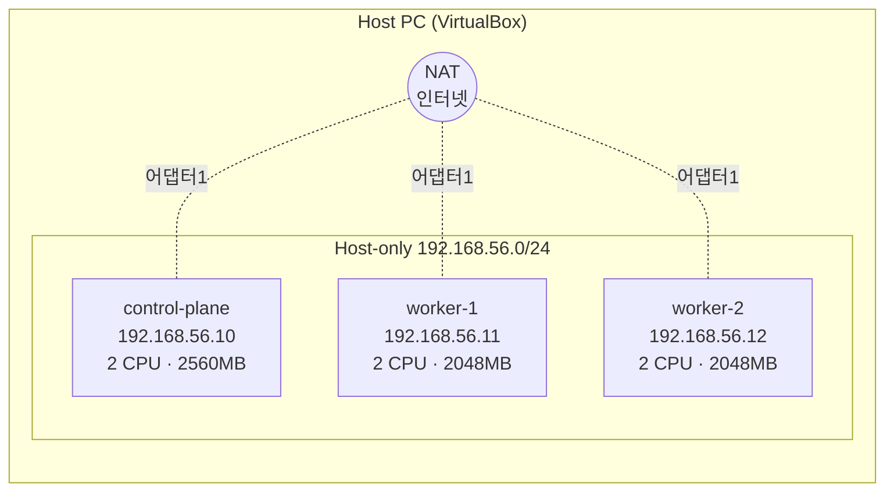
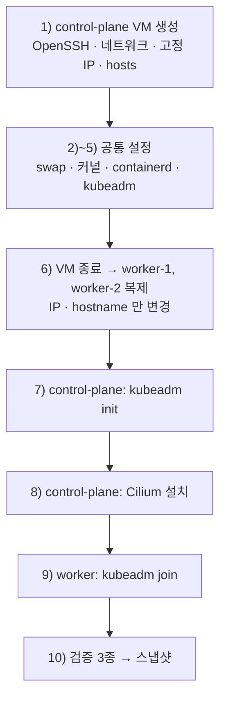

# 4강 · 클러스터 구축 (VirtualBox)

> 영상: **04강-VirtualBox클러스터구축** · 채점 세트 없음 — 이 클러스터 위에서 나머지 모든 실습을 합니다

VirtualBox 로 **control-plane 1대 + worker 2대** 클러스터를 직접 만듭니다.
이 페이지를 끝내면 [시작하기](../start.md)의 환경이 준비되고, 이후 모든 페이지와 채점 실습(`cka-lab`)을 이 클러스터에서 진행합니다.

!!! info "기준 버전"
    Kubernetes **v1.32** · Ubuntu Server **24.04 LTS** · **containerd** · **Cilium** (기본 모드, kube-proxy 유지)

## 실습 목표

- VM 한 대에 **공통 설정을 끝낸 뒤 복제**해서, worker 는 IP 와 hostname 만 바꾸는 방식으로 3대를 만든다.
- swap · 커널 모듈 · cgroup 드라이버 같은 설정이 **왜 필요한지**, 빠뜨리면 어디서 실패하는지 확인한다.
- `kubeadm init` → CNI(Cilium) → `kubeadm join` 순서로 클러스터를 세우고, 단계마다 **노드 상태가 어떻게 바뀌는지** 본다.
- 스케줄링 · CNI · kube-proxy · CoreDNS 를 **세 가지 검증**으로 확인하고 스냅샷을 찍는다.
- 호스트 PC 의 kubectl 로도 클러스터를 조작할 수 있게 kubeconfig 를 병합한다.

---

## 전체 그림



각 VM 은 네트워크 어댑터를 **두 개** 씁니다.

| 어댑터 | 종류 | 주소 | 용도 |
|--------|------|------|------|
| 어댑터 1 | NAT | 10.0.2.15 (모든 VM 이 같음) | 인터넷 — 패키지·이미지 받기 |
| 어댑터 2 | 호스트 전용 (vboxnet0) | 192.168.56.10 / .11 / .12 | 노드끼리, 그리고 호스트 PC 에서 SSH |

!!! warning "NAT 주소는 세 대가 모두 10.0.2.15 입니다"
    VirtualBox NAT 는 VM 마다 따로 있는 작은 공유기라서 주소가 겹칩니다. 그래서 **노드끼리는 반드시 192.168.56.x 로** 통신해야 합니다.
    나중에 `kubectl get nodes -o wide` 의 INTERNAL-IP 가 10.0.2.15 로 나오면 설정이 잘못된 것입니다 (→ 10) 검증).

작업 순서입니다.



!!! tip "공통 설정을 복제 **전에** 끝내는 것이 핵심입니다"
    2)~5) 를 control-plane 한 대에서만 하고 복제하면, 같은 작업을 세 번 반복하지 않아도 됩니다.

---

## 0) 사전 준비

### 사양

| 노드 | 공식 최소 (kubeadm) | 이 가이드 | 판정 |
|------|--------------------|-----------|------|
| control-plane | 2 CPU · 2 GB | 2 CPU · **2560 MB** · 20 GB | 여유 있음 |
| worker-1 | 1 CPU · 1 GB (권장 2 GB) | 2 CPU · **2048 MB** · 20 GB | 빠듯함 |
| worker-2 | 1 CPU · 1 GB (권장 2 GB) | 2 CPU · **2048 MB** · 20 GB | 빠듯함 |

!!! warning "2 GB 는 정말 최솟값입니다"
    OS · kubelet · containerd · Cilium 에이전트만으로 1.5 GB 가까이 씁니다. 실습 중 메모리가 모자라면 노드가 NotReady 로 흔들립니다.

    - 호스트 PC RAM **16 GB 이상**: worker 를 2560 MB 로 올리는 것을 권장합니다.
    - 호스트 PC RAM **8 GB**: 2048 MB 로 하되, 실습 중에는 다른 프로그램을 모두 닫으세요.

`control-plane` 이 CPU 2 개 미만이면 `kubeadm init` 이 아예 거부합니다.

```text
[ERROR NumCPU]: the number of available CPUs 1 is less than the required 2
```

### 설치할 것

1. **VirtualBox** — <https://www.virtualbox.org/wiki/Downloads> (Extension Pack 도 함께)
2. **Ubuntu Server 24.04 LTS ISO** — <https://releases.ubuntu.com/24.04/>
    - **Server** 버전입니다. Desktop 은 GUI 모듈 때문에 노드 자원을 낭비합니다.
    - Apple Silicon 맥이면 **arm64** 이미지 (아래 FAQ 참고)

??? note "공식 문서 모음"
    | 문서 | URL |
    |------|-----|
    | kubeadm 설치 | <https://kubernetes.io/docs/setup/production-environment/tools/kubeadm/install-kubeadm/> |
    | 클러스터 생성 (init/join) | <https://kubernetes.io/docs/setup/production-environment/tools/kubeadm/create-cluster-kubeadm/> |
    | containerd | <https://kubernetes.io/docs/setup/production-environment/container-runtimes/#containerd> |
    | Cilium 설치 | <https://docs.cilium.io/en/stable/gettingstarted/k8s-install-default/> |
    | v1.32 릴리스 노트 | <https://github.com/kubernetes/kubernetes/blob/master/CHANGELOG/CHANGELOG-1.32.md> |

    이 중 앞의 두 문서는 **CKA 시험 중에도 열 수 있습니다.** 어디에 무엇이 있는지 한 번 훑어 두세요.

---

## 1) control-plane VM 만들기

### 1-1. VM 생성

VirtualBox → **새로 만들기**

| 항목 | 값 |
|------|----|
| 이름 | `control-plane` |
| ISO | Ubuntu Server 24.04 ISO |
| 무인 설치 | **Skip Unattended Installation** 체크 |
| 메모리 · CPU · 디스크 | 2560 MB · 2 · 20 GB |

설치 화면에서 사용자 이름을 정합니다. 이 가이드는 **`vboxuser`** 로 가정합니다. 다른 이름을 썼다면 이후 명령의 `vboxuser` 를 바꿔서 입력하세요.

### 1-2. 네트워크 어댑터 두 개

먼저 호스트 전용 네트워크를 만듭니다.
VirtualBox → **도구 → 네트워크 → Host-only Networks → 생성** (보통 `vboxnet0`, 192.168.56.1/24)

VM **설정 → 네트워크**:

- 어댑터 1: **NAT**
- 어댑터 2: **호스트 전용 어댑터** → `vboxnet0`

### 1-3. OpenSSH 서버

VirtualBox 콘솔 창은 복사·붙여넣기가 불편합니다. SSH 를 켜 두면 이후 모든 작업을 **호스트 PC 터미널에서** 할 수 있습니다.

```bash
# control-plane 콘솔에서
sudo apt-get update
sudo apt-get install -y openssh-server
sudo systemctl enable --now ssh
systemctl is-active ssh
```

```text
active
```

### 1-4. 고정 IP (netplan)

DHCP 는 재부팅마다 주소가 바뀔 수 있습니다. 쿠버네티스 노드는 **고정 IP** 가 있어야 합니다.

먼저 인터페이스 이름을 확인합니다. 환경에 따라 `enp0s3`/`enp0s8` 이 아닐 수 있습니다.

```bash
ip -br a
```

```text
lo        UNKNOWN   127.0.0.1/8 ::1/128
enp0s3    UP        10.0.2.15/24 ...       ← 어댑터 1 (NAT)
enp0s8    UP                                ← 어댑터 2 (아직 주소 없음)
```

`/etc/netplan/` 아래의 설정 파일을 엽니다 (파일 이름은 `00-installer-config.yaml` 또는 `50-cloud-init.yaml` 등).

```bash
ls /etc/netplan/
sudo vi /etc/netplan/00-installer-config.yaml
```

```yaml
network:
  version: 2
  ethernets:
    enp0s3:              # ← 어댑터 1 - NAT (인터넷)
      dhcp4: true
    enp0s8:              # ← 어댑터 2 - Host-only (노드 간 통신)
      dhcp4: false
      addresses:
        - 192.168.56.10/24   # ← worker-1 은 .11, worker-2 는 .12
```

```bash
sudo chmod 600 /etc/netplan/*.yaml     # 권한이 넓으면 경고가 나온다
sudo netplan apply
ip -br a | grep 192.168.56
```

```text
enp0s8    UP    192.168.56.10/24 ...
```

!!! warning "Host-only 어댑터에 gateway 를 넣지 마세요"
    기본 경로(default route)는 **NAT 쪽 하나만** 있어야 인터넷이 됩니다. `enp0s8` 에 `routes`/`gateway4` 를 넣으면 인터넷이 끊길 수 있습니다.

    ```bash
    ip route | grep default     # default via 10.0.2.2 dev enp0s3 한 줄이어야 정상
    ```

### 1-5. hosts 파일

DNS 서버 없이도 노드 이름으로 서로를 찾을 수 있게 합니다.

```bash
sudo tee -a /etc/hosts <<'EOF'
192.168.56.10  control-plane
192.168.56.11  worker-1
192.168.56.12  worker-2
EOF
```

!!! note "hosts 파일이 노드 IP 를 정합니다"
    kubelet 은 `--node-ip` 가 없으면 **자기 hostname 을 해석한 주소**를 노드 IP 로 씁니다.
    hosts 파일에 `192.168.56.10 control-plane` 이 있으니 NAT 주소(10.0.2.15) 대신 192.168.56.10 이 선택됩니다.
    이 한 단계가 빠지면 노드 IP 가 10.0.2.15 가 되어 `kubectl logs` · `exec` 가 worker 파드에서 실패합니다.

### 1-6. 이제 호스트 PC 에서 SSH 로

=== "macOS / Linux 터미널"
    ```bash
    ssh vboxuser@192.168.56.10
    ```
=== "Windows PowerShell"
    ```powershell
    ssh vboxuser@192.168.56.10
    ```

여기부터는 SSH 창에서 복사·붙여넣기로 진행합니다.

---

## 2) swap 끄기

kubelet 은 파드의 메모리 요청(requests)을 기준으로 노드를 관리합니다. swap 이 켜져 있으면 "실제로 얼마나 남았는가" 가 흐려지기 때문에, 기본 설정의 kubelet 은 swap 이 있으면 **시작하지 않습니다.**

```bash
sudo swapoff -a                                     # 지금 끄기
sudo sed -i.bak -r 's/(.+ swap .+)/#\1/' /etc/fstab  # 재부팅 후에도 꺼져 있게
free -h
```

```text
               total        used        free      shared  buff/cache   available
Mem:           2.4Gi       310Mi       1.6Gi       1.0Mi       620Mi       2.1Gi
Swap:             0B          0B          0B        ← 0B 여야 정상
```

!!! warning "Ubuntu 24.04 는 swap 파일(/swap.img)을 씁니다"
    `/etc/fstab` 에 `/swap.img none swap sw 0 0` 한 줄이 있고, 위 `sed` 가 이것을 주석 처리합니다.
    재부팅 후에도 `Swap: 0B` 인지 확인하세요. 안 꺼져 있으면 `kubeadm init` 이 `[ERROR Swap]` 으로 멈춥니다.

---

## 3) 커널 모듈과 sysctl

| 설정 | 하는 일 | 빠지면 |
|------|---------|--------|
| `overlay` 모듈 | 컨테이너 이미지 레이어를 겹쳐 하나의 파일시스템으로 보이게 한다 | containerd 가 컨테이너를 못 만든다 |
| `br_netfilter` 모듈 | 리눅스 브리지를 지나는 트래픽도 iptables 를 거치게 한다 | kube-proxy 의 Service 규칙이 적용되지 않는다 |
| `net.bridge.bridge-nf-call-iptables = 1` | 위 동작을 켠다 | 같음 |
| `net.ipv4.ip_forward = 1` | 노드가 패킷을 다른 인터페이스로 넘겨 준다 | 파드 → 다른 노드 통신이 안 된다. `[ERROR FileContent--proc-sys-net-ipv4-ip_forward]` |

```bash
sudo tee /etc/modules-load.d/k8s.conf <<'EOF'
overlay
br_netfilter
EOF
sudo modprobe overlay
sudo modprobe br_netfilter

sudo tee /etc/sysctl.d/kubernetes.conf <<'EOF'
net.bridge.bridge-nf-call-ip6tables = 1
net.bridge.bridge-nf-call-iptables = 1
net.ipv4.ip_forward = 1
EOF
sudo sysctl --system
```

확인합니다.

```bash
lsmod | grep -E 'overlay|br_netfilter'
sysctl net.bridge.bridge-nf-call-iptables net.ipv4.ip_forward
```

```text
br_netfilter           32768  0
bridge                421888  1 br_netfilter
overlay               212992  0

net.bridge.bridge-nf-call-iptables = 1
net.ipv4.ip_forward = 1
```

!!! note "왜 Cilium 인데 br_netfilter 가 필요한가요?"
    이 가이드는 `cilium install` **기본 모드**를 씁니다. 이 모드에서는 kubeadm 이 설치한 **kube-proxy 가 그대로 남아** Service 규칙을 iptables 로 씁니다.
    `cilium install --set kubeProxyReplacement=true` 로 kube-proxy 를 eBPF 로 대체하면 br_netfilter 가 필요 없어지지만, 이 과정은 CKA 시험 환경과 같은 **kube-proxy 가 있는 구성**을 유지합니다.

---

## 4) containerd 설치

kubelet 은 컨테이너를 직접 만들지 않고 **CRI(Container Runtime Interface)** 로 런타임에게 시킵니다. 그 런타임이 containerd 입니다.

```bash
sudo apt-get update && sudo apt-get install -y containerd
sudo mkdir -p /etc/containerd
containerd config default | sudo tee /etc/containerd/config.toml > /dev/null
sudo sed -i 's/SystemdCgroup = false/SystemdCgroup = true/' /etc/containerd/config.toml
sudo systemctl restart containerd
sudo systemctl enable containerd
```

### SystemdCgroup = true 가 왜 필요한가

cgroup 은 리눅스 커널이 프로세스의 CPU·메모리를 제한하는 기능이고, 그 cgroup 트리를 관리하는 주체를 **cgroup 드라이버**라고 합니다.

| | 기본 드라이버 |
|---|---|
| containerd | `cgroupfs` |
| kubelet (kubeadm 설치) | `systemd` |

둘이 다르면 **한 노드에서 cgroup 관리자가 둘**이 되어 서로의 설정을 모른 채 충돌합니다. 증상은 "처음엔 잘 되다가 어느 순간 파드가 재시작을 반복하고 노드가 NotReady" 처럼 애매하게 나타납니다.

```bash
grep -n SystemdCgroup /etc/containerd/config.toml
systemctl is-active containerd
```

```text
139:            SystemdCgroup = true
active
```

??? tip "선택: pause 이미지 버전 맞추기"
    Ubuntu 패키지 containerd 의 기본 설정은 `sandbox_image = "registry.k8s.io/pause:3.8"` 입니다.
    kubeadm v1.32 는 `pause:3.10` 을 기대해서 init 때 아래 **경고**가 나옵니다. 동작에는 문제가 없습니다.

    ```text
    W0929 ... detected that the sandbox image "registry.k8s.io/pause:3.8" of the container runtime is inconsistent with that used by kubeadm. It is recommended to use "registry.k8s.io/pause:3.10" as the CRI sandbox image.
    ```

    경고를 없애려면:

    ```bash
    sudo sed -i 's#registry.k8s.io/pause:3.8#registry.k8s.io/pause:3.10#' /etc/containerd/config.toml
    sudo systemctl restart containerd
    ```

---

## 5) kubeadm · kubelet · kubectl (v1.32)

| 도구 | 설치 위치 | 역할 |
|------|-----------|------|
| **kubeadm** | 모든 노드 | 클러스터를 **세울 때만** 쓰는 도구. `init` · `join` · `token` · `upgrade` |
| **kubelet** | 모든 노드 (control-plane 포함) | systemd 서비스로 항상 도는 노드 에이전트. 파드를 실제로 띄우고 상태를 보고한다. `/etc/kubernetes/manifests/` 의 스태틱 파드도 이것이 띄운다 |
| **kubectl** | control-plane 또는 내 PC | `~/.kube/config` 를 읽어 API 서버에 요청하는 CLI |

```bash
sudo apt-get install -y apt-transport-https ca-certificates curl gpg
sudo mkdir -p -m 755 /etc/apt/keyrings

curl -fsSL https://pkgs.k8s.io/core:/stable:/v1.32/deb/Release.key | \
  sudo gpg --dearmor -o /etc/apt/keyrings/kubernetes-apt-keyring.gpg

echo "deb [signed-by=/etc/apt/keyrings/kubernetes-apt-keyring.gpg] \
https://pkgs.k8s.io/core:/stable:/v1.32/deb/ /" | \
  sudo tee /etc/apt/sources.list.d/kubernetes.list

sudo apt-get update
sudo apt-get install -y kubelet kubeadm kubectl
sudo apt-mark hold kubelet kubeadm kubectl
```

```bash
kubeadm version -o short
kubectl version --client
apt-mark showhold
systemctl is-active kubelet
```

```text
v1.32.x
Client Version: v1.32.x
Kustomize Version: v5.5.0
kubeadm
kubectl
kubelet
activating        ← 정상입니다
```

**관찰 포인트:** kubelet 이 `activating`(재시작 반복) 인 것은 **아직 설정 파일(`/var/lib/kubelet/config.yaml`)이 없어서**입니다. `kubeadm init`/`join` 이 이 파일을 만들어 주면 그때 `active` 가 됩니다.

!!! note "저장소 주소의 `v1.32` 가 설치할 **마이너 버전**을 정합니다"
    pkgs.k8s.io 는 마이너 버전마다 저장소가 따로 있습니다. 나중에 1.33 으로 업그레이드할 때는 이 파일의 `v1.32` 를 `v1.33` 으로 바꾸는 것부터 시작합니다 ([15강 유지보수](15-maintenance.md) 참고).
    `apt-mark hold` 는 `apt upgrade` 가 실수로 버전을 올리지 못하게 막습니다.

!!! tip "복제 전 체크리스트"
    ```bash
    free -h | grep Swap                                   # 0B
    sysctl -n net.ipv4.ip_forward                         # 1
    grep -c 'SystemdCgroup = true' /etc/containerd/config.toml   # 1
    kubeadm version -o short                              # v1.32.x
    ```
    모두 맞으면 VM 을 끕니다: `sudo poweroff`

---

## 6) worker 복제

공통 설정이 끝난 VM 을 그대로 찍어 냅니다.

1. `control-plane` 이 **꺼진 상태**에서 우클릭 → **복제**
2. 이름 `worker-1`, MAC 주소 정책 **모든 네트워크 어댑터의 새 MAC 주소 생성**, **완전한 복제**
3. `worker-2` 도 똑같이
4. 복제된 VM 의 메모리를 2048 MB 로 조정

!!! warning "MAC 주소를 새로 만들지 않으면"
    kubeadm 은 노드마다 **MAC 주소와 product_uuid 가 달라야** 한다고 요구합니다. 같은 MAC 이면 Host-only 네트워크에서 두 VM 이 서로의 패킷을 가로채 통신이 불안정해집니다.

### worker 에서 IP 와 hostname 바꾸기

복제된 VM 은 아직 192.168.56.10 을 쓰고 있으므로 **한 대씩** 켜서 VirtualBox 콘솔에서 바꿉니다.

=== "worker-1"
    ```bash
    sudo sed -i 's#192.168.56.10/24#192.168.56.11/24#' /etc/netplan/*.yaml
    sudo netplan apply
    sudo hostnamectl set-hostname worker-1
    sudo sed -i 's/^127.0.1.1 .*/127.0.1.1 worker-1/' /etc/hosts
    exec bash
    ```
=== "worker-2"
    ```bash
    sudo sed -i 's#192.168.56.10/24#192.168.56.12/24#' /etc/netplan/*.yaml
    sudo netplan apply
    sudo hostnamectl set-hostname worker-2
    sudo sed -i 's/^127.0.1.1 .*/127.0.1.1 worker-2/' /etc/hosts
    exec bash
    ```

!!! warning "`127.0.1.1` 줄도 함께 고치세요"
    Ubuntu 는 설치할 때 `/etc/hosts` 에 `127.0.1.1 control-plane` 을 넣어 둡니다. `hostnamectl` 은 이 줄을 바꾸지 않습니다.
    그대로 두면 worker 에서 `ping control-plane` 이 **자기 자신(127.0.1.1)** 으로 가고, `sudo` 가 느려지는 등 헷갈리는 증상이 생깁니다.

??? tip "선택: machine-id 새로 만들기"
    완전 복제는 `/etc/machine-id` 까지 똑같이 복사합니다. 쿠버네티스 동작에는 영향이 없지만, 로그나 DHCP 식별자가 겹치는 것이 신경 쓰이면 worker 에서 다시 만듭니다.
    ```bash
    sudo rm /etc/machine-id && sudo systemd-machine-id-setup && sudo reboot
    ```

### 세 대가 서로 보이는지

```bash
# control-plane 에서
ping -c 2 worker-1
ping -c 2 worker-2
```

```text
PING worker-1 (192.168.56.11) 56(84) bytes of data.
64 bytes from worker-1 (192.168.56.11): icmp_seq=1 ttl=64 time=0.412 ms
...
```

```bash
# worker-1 에서
ping -c 2 control-plane         # 192.168.56.10 이 나와야 한다 (127.0.1.1 이면 위 경고 참고)
cat /sys/class/dmi/id/product_uuid   # 세 대 모두 달라야 한다
```

---

## 7) control-plane 초기화 — `kubeadm init`

```bash
# control-plane 에서만
sudo kubeadm init \
  --apiserver-advertise-address=192.168.56.10 \
  --pod-network-cidr=10.244.0.0/16
```

| 옵션 | 의미 | 빠지면 |
|------|------|--------|
| `--apiserver-advertise-address` | API 서버가 **어느 주소로** 자신을 알릴지 | NAT 주소(10.0.2.15)로 알려서 worker 가 조인하지 못한다 |
| `--pod-network-cidr` | 파드 IP 대역 (노드별 `podCIDR` 을 나눠 준다) | 이 값을 요구하는 CNI(Flannel 등)가 동작하지 않는다 |

출력은 단계(phase) 순서대로 나옵니다.

```text
[preflight] Running pre-flight checks
[certs] Generating "ca" certificate and key
...
[kubeconfig] Writing "admin.conf" kubeconfig file
...
[control-plane] Creating static Pod manifest for "kube-apiserver"
[control-plane] Creating static Pod manifest for "kube-controller-manager"
[control-plane] Creating static Pod manifest for "kube-scheduler"
[etcd] Creating static Pod manifest for local etcd in "/etc/kubernetes/manifests"
[wait-control-plane] Waiting for the kubelet to boot up the control plane as static Pods ...
...
[addons] Applied essential addon: CoreDNS
[addons] Applied essential addon: kube-proxy

Your Kubernetes control-plane has initialized successfully!
...
kubeadm join 192.168.56.10:6443 --token abcdef.0123456789abcdef \
	--discovery-token-ca-cert-hash sha256:1234...cdef
```

**마지막의 `kubeadm join ...` 두 줄을 메모장에 복사해 두세요.** 잃어버려도 다시 뽑을 수 있습니다(→ 9)).

kubectl 이 관리자 권한으로 API 서버에 접속하도록 kubeconfig 를 복사합니다.

```bash
mkdir -p $HOME/.kube
sudo cp -i /etc/kubernetes/admin.conf $HOME/.kube/config
sudo chown $(id -u):$(id -g) $HOME/.kube/config
```

```bash
kubectl get nodes
kubectl get pods -n kube-system
```

```text
NAME            STATUS     ROLES           AGE   VERSION
control-plane   NotReady   control-plane   1m    v1.32.x

NAME                                    READY   STATUS    RESTARTS   AGE
coredns-668d6bf9bc-4xk2p                0/1     Pending   0          1m
coredns-668d6bf9bc-9m7qz                0/1     Pending   0          1m
etcd-control-plane                      1/1     Running   0          1m
kube-apiserver-control-plane            1/1     Running   0          1m
kube-controller-manager-control-plane   1/1     Running   0          1m
kube-proxy-7wq4k                        1/1     Running   0          1m
kube-scheduler-control-plane            1/1     Running   0          1m
```

**관찰 포인트:** 노드가 **NotReady**, CoreDNS 가 **Pending** 인 것이 정상입니다. 파드 네트워크(CNI)가 아직 없기 때문입니다.
반면 etcd · API 서버 등은 Running 입니다. 이들은 **hostNetwork 로 도는 스태틱 파드**라서 CNI 가 필요 없습니다.

```bash
kubectl describe node control-plane | grep -E 'Ready|NetworkReady'
```

```text
  Ready            False   ...   KubeletNotReady   container runtime network not ready: NetworkReady=false reason:NetworkPluginNotReady message:Network plugin returns error: cni plugin not initialized
```

??? note "init 이 만든 것들"
    ```bash
    ls /etc/kubernetes/                 # admin.conf, kubelet.conf, manifests/, pki/ ...
    ls /etc/kubernetes/manifests/       # etcd · apiserver · controller-manager · scheduler
    ls /etc/kubernetes/pki/             # 클러스터 CA 와 인증서들
    kubectl -n kube-system get cm kubeadm-config -o yaml | grep -A3 networking
    ```
    ```text
      networking:
        dnsDomain: cluster.local
        podSubnet: 10.244.0.0/16
        serviceSubnet: 10.96.0.0/12
    ```
    각 파일의 의미는 [3강 아키텍처](03-architecture.md)와 [13강 클러스터 구축](13-cluster-setup.md)에서 자세히 봅니다.

---

## 8) Cilium 설치

### CNI 는 무엇을 하나

쿠버네티스는 파드 네트워크를 직접 구현하지 않고 **CNI 플러그인**에 맡깁니다. CNI 는 파드에 IP 를 주고, 다른 노드의 파드까지 가는 길을 만듭니다.

| CNI | 방식 | 특징 |
|-----|------|------|
| Flannel | VXLAN 오버레이 | 가장 단순. NetworkPolicy 미지원 |
| Calico | BGP / 오버레이 | NetworkPolicy 지원, 기업 환경에서 많이 씀 |
| **Cilium** | **eBPF** | 커널에서 직접 패킷 처리, NetworkPolicy · L7 정책 · Hubble 관찰 도구 |

이 과정이 Cilium 을 쓰는 이유는 **NetworkPolicy 가 실제로 동작**해야 하기 때문입니다([10강 NetworkPolicy](10-networkpolicy.md)). Flannel 은 정책을 만들어도 아무 효과가 없습니다.

### cilium CLI 설치 → Cilium 설치

```bash
# control-plane 에서
CILIUM_CLI_VERSION=$(curl -s https://raw.githubusercontent.com/cilium/cilium-cli/main/stable.txt)
CLI_ARCH=$(dpkg --print-architecture)
curl -L --fail --remote-name-all \
  https://github.com/cilium/cilium-cli/releases/download/${CILIUM_CLI_VERSION}/cilium-linux-${CLI_ARCH}.tar.gz
sudo tar xzvfC cilium-linux-${CLI_ARCH}.tar.gz /usr/local/bin
rm cilium-linux-${CLI_ARCH}.tar.gz

cilium install
cilium status --wait
```

```text
    /¯¯\
 /¯¯\__/¯¯\    Cilium:             OK
 \__/¯¯\__/    Operator:           OK
 /¯¯\__/¯¯\    Envoy DaemonSet:    OK
 \__/¯¯\__/    Hubble Relay:       disabled
    \__/       ClusterMesh:        disabled

DaemonSet              cilium             Desired: 1, Ready: 1/1, Available: 1/1
Deployment             cilium-operator    Desired: 1, Ready: 1/1, Available: 1/1
...
```

```bash
kubectl get nodes
kubectl get pods -n kube-system -o wide | grep -E 'coredns|cilium'
cilium version
```

```text
NAME            STATUS   ROLES           AGE   VERSION
control-plane   Ready    control-plane   6m    v1.32.x

cilium-7pq2x                       1/1   Running   ...   192.168.56.10   control-plane
cilium-envoy-...                   1/1   Running   ...   192.168.56.10   control-plane
cilium-operator-...                1/1   Running   ...   192.168.56.10   control-plane
coredns-668d6bf9bc-4xk2p           1/1   Running   ...   10.0.0.123      control-plane
coredns-668d6bf9bc-9m7qz           1/1   Running   ...   10.0.0.45       control-plane

cilium-cli: v0.x.y compiled with go...
cilium image (default): v1.x.y
cilium image (running): v1.x.y
```

**관찰 포인트:** 노드가 Ready 로 바뀌었고 CoreDNS 가 IP 를 받았습니다. CoreDNS 는 control-plane 의 Taint 를 견디는 Toleration 이 있어서 여기에 뜹니다.

!!! note "파드 IP 가 10.244.x.x 가 아니라 10.0.x.x 입니다"
    `cilium install` 기본값은 **Cilium 자체 IPAM(cluster-pool, 10.0.0.0/8)** 을 씁니다. `--pod-network-cidr=10.244.0.0/16` 은 kubeadm 설정에 기록되지만 Cilium 은 그 값을 쓰지 않습니다.
    그래서 이 가이드의 예시 출력에 나오는 파드 IP 는 모두 `10.0.<노드번호>.x` 모양입니다. 동작에는 문제가 없습니다.

!!! note "Cilium 버전"
    `cilium install` 은 **CLI 에 들어 있는 기본 버전**을 설치합니다. 강의 자료와 버전이 다를 수 있으니 `cilium version` 으로 실제 버전을 확인하세요.
    버전을 고정하려면 `cilium install --version 1.x.y` 처럼 지정합니다.

---

## 9) worker 조인 — `kubeadm join`

worker 가 control-plane 의 API 서버를 **신뢰하고**, API 서버가 worker 를 **받아들이는** 과정입니다.

| 조인 명령의 부분 | 누가 누구를 확인하나 |
|------------------|----------------------|
| `192.168.56.10:6443` | 접속할 API 서버 주소 |
| `--token` | API 서버가 worker 를 확인 — "조인해도 되는 노드인가" (기본 24시간 유효) |
| `--discovery-token-ca-cert-hash` | worker 가 API 서버를 확인 — "진짜 우리 클러스터의 CA 인가" (중간자 방지) |

```bash
# worker-1, worker-2 에서 각각 (반드시 sudo)
sudo kubeadm join 192.168.56.10:6443 --token abcdef.0123456789abcdef \
  --discovery-token-ca-cert-hash sha256:1234...cdef
```

```text
[preflight] Running pre-flight checks
[preflight] Reading configuration from the "kubeadm-config" ConfigMap in namespace "kube-system"...
[kubelet-start] Writing kubelet configuration to file "/var/lib/kubelet/config.yaml"
[kubelet-start] Starting the kubelet
[kubelet-start] Waiting for the kubelet to perform the TLS Bootstrap

This node has joined the cluster:
* Certificate signing request was sent to apiserver and a response was received.
* The Kubelet was informed of the new secure connection details.
```

토큰을 잃어버렸거나 24시간이 지났으면 control-plane 에서 새로 뽑습니다.

```bash
# control-plane 에서
kubeadm token create --print-join-command
kubeadm token list
```

control-plane 에서 지켜보면 두 노드가 **NotReady → Ready** 로 바뀝니다. 그 사이 Cilium DaemonSet 이 새 노드에 에이전트를 띄웁니다.

```bash
kubectl get nodes -w
```

```text
NAME            STATUS     ROLES           AGE   VERSION
control-plane   Ready      control-plane   12m   v1.32.x
worker-1        NotReady   <none>          10s   v1.32.x
worker-1        Ready      <none>          40s   v1.32.x
worker-2        NotReady   <none>          5s    v1.32.x
worker-2        Ready      <none>          38s   v1.32.x
```

!!! warning "조인을 다시 해야 할 때"
    한 번 실패한 worker 는 이전 상태를 지워야 다시 조인됩니다. 안 지우면 `[ERROR FileAvailable--etc-kubernetes-kubelet.conf]` 로 멈춥니다.
    ```bash
    # 해당 worker 에서
    sudo kubeadm reset -f
    sudo rm -rf /etc/cni/net.d
    ```

---

## 10) 검증 — 세 가지를 통과하면 완성

### ① 노드 세 대가 Ready, 버전이 같고, IP 가 192.168.56.x

```bash
kubectl get nodes -o wide
```

```text
NAME            STATUS   ROLES           AGE   VERSION   INTERNAL-IP     OS-IMAGE             CONTAINER-RUNTIME
control-plane   Ready    control-plane   15m   v1.32.x   192.168.56.10   Ubuntu 24.04.x LTS   containerd://1.7.x
worker-1        Ready    <none>          3m    v1.32.x   192.168.56.11   Ubuntu 24.04.x LTS   containerd://1.7.x
worker-2        Ready    <none>          2m    v1.32.x   192.168.56.12   Ubuntu 24.04.x LTS   containerd://1.7.x
```

!!! danger "INTERNAL-IP 가 10.0.2.15 인 노드가 있다면"
    그 노드의 hosts 파일에 자기 이름이 192.168.56.x 로 없거나, 127.0.1.1 줄이 다른 이름을 가리키고 있습니다. 1-5) · 6) 을 다시 확인하세요.
    hosts 로 해결되지 않으면 kubelet 에 노드 IP 를 직접 알려 줍니다.
    ```bash
    # 해당 노드에서 (worker-1 예시)
    echo 'KUBELET_EXTRA_ARGS=--node-ip=192.168.56.11' | sudo tee /etc/default/kubelet
    sudo systemctl restart kubelet
    ```

### ② 파드가 뜨고 Service 로 통신이 되는가

스케줄러 · CNI · kube-proxy 가 모두 정상인지 한 번에 확인합니다.

```bash
kubectl create namespace guide-build
kubectl create deployment hello -n guide-build --image=nginx:1.27 --replicas=2
kubectl rollout status deployment/hello -n guide-build
kubectl get pods -n guide-build -o wide
```

```text
NAME                     READY   STATUS    IP           NODE
hello-7c5b9d6f8d-2xk8p   1/1     Running   10.0.1.87    worker-1
hello-7c5b9d6f8d-q4m7t   1/1     Running   10.0.2.19    worker-2
```

파드가 **worker 두 대에 나뉘어** 뜬 것을 확인합니다. control-plane 은 Taint 때문에 일반 파드를 받지 않습니다.

```bash
kubectl expose deployment hello -n guide-build --port=80
kubectl run probe -n guide-build --rm -it --image=busybox:1.36 --restart=Never -- wget -qO- -T 3 http://hello
```

```text
<!DOCTYPE html>
<html>
<head>
<title>Welcome to nginx!</title>
...
```

### ③ 이름이 해석되는가 (CoreDNS)

```bash
kubectl run probe -n guide-build --rm -it --image=busybox:1.36 --restart=Never -- nslookup hello.guide-build.svc.cluster.local
```

```text
Server:    10.96.0.10
Address:   10.96.0.10:53

Name:      hello.guide-build.svc.cluster.local
Address:   10.10x.x.x
```

| 통과한 검증 | 정상이라는 뜻 |
|-------------|---------------|
| ① | kubelet · containerd · CNI 가 세 노드에서 모두 동작 |
| ② | 스케줄러 · 노드 간 파드 통신(CNI) · Service 규칙(kube-proxy) |
| ③ | CoreDNS 와 파드의 DNS 설정 |

검증에 쓴 것을 지웁니다.

```bash
kubectl delete namespace guide-build
```

### 스냅샷 찍기

세 가지를 통과한 지금이 **돌아올 기준점**입니다. 세 VM 을 모두 끄고 각각 스냅샷을 찍습니다.

```bash
# 각 노드에서
sudo poweroff
```

| 시점 | 스냅샷 이름 | 쓸 때 |
|------|-------------|-------|
| 구축 직후 · 검증 통과 | `clean-cluster` | 실습을 망쳤을 때 돌아올 기준점 |
| 업그레이드 직전 | `before-upgrade` | [15강 유지보수](15-maintenance.md) 업그레이드를 반복 연습할 때 |
| etcd 백업을 만든 뒤 | `before-etcd-restore` | 복원 연습은 되돌릴 수 없으므로 필수 |

!!! warning "세 대를 함께 찍고, 함께 되돌립니다"
    control-plane 만 되돌리면 etcd 에 기록된 상태와 worker 의 실제 상태가 어긋납니다.

---

## 11) 내 PC 의 kubectl 로 접속하기 (선택)

control-plane 의 `admin.conf` 를 내 PC 의 `~/.kube/config` 에 **병합**하면, 기존 컨텍스트(AKS · minikube 등)를 유지한 채 이 클러스터로 전환해서 쓸 수 있습니다.

!!! warning "admin.conf 는 클러스터 최고 권한입니다"
    복사한 파일을 다른 곳에 올리거나 공유하지 마세요. 병합이 끝나면 임시 파일을 지웁니다.

**Step 1. 복사**

`/etc/kubernetes/admin.conf` 는 root 만 읽을 수 있으므로, 7) 에서 만든 **사용자 홈의 사본**을 가져옵니다.

=== "macOS / Linux"
    ```bash
    scp vboxuser@192.168.56.10:~/.kube/config ~/admin.conf
    ```
=== "Windows PowerShell"
    ```powershell
    scp vboxuser@192.168.56.10:~/.kube/config $env:USERPROFILE\admin.conf
    ```

**Step 2. 병합**

=== "macOS / Linux"
    ```bash
    cp ~/.kube/config ~/.kube/config.bak     # 백업
    KUBECONFIG=~/.kube/config:~/admin.conf kubectl config view --flatten > /tmp/merged.yaml
    mv /tmp/merged.yaml ~/.kube/config
    chmod 600 ~/.kube/config
    rm ~/admin.conf
    ```
=== "Windows PowerShell"
    ```powershell
    Copy-Item $env:USERPROFILE\.kube\config $env:USERPROFILE\.kube\config.bak
    $env:KUBECONFIG = "$env:USERPROFILE\.kube\config;$env:USERPROFILE\admin.conf"
    kubectl config view --flatten > $env:USERPROFILE\.kube\merged.yaml
    Move-Item $env:USERPROFILE\.kube\merged.yaml $env:USERPROFILE\.kube\config -Force
    Remove-Item $env:USERPROFILE\admin.conf
    Remove-Item Env:KUBECONFIG
    ```

!!! note "내 PC 에 ~/.kube/config 가 아직 없다면"
    병합할 필요 없이 `admin.conf` 를 `~/.kube/config` 로 옮기기만 하면 됩니다.

**Step 3. 전환**

```bash
kubectl config get-contexts
kubectl config use-context kubernetes-admin@kubernetes
kubectl get nodes
```

```text
CURRENT   NAME                          CLUSTER      AUTHINFO           NAMESPACE
          my-aks                        my-aks       clusterUser_...
*         kubernetes-admin@kubernetes   kubernetes   kubernetes-admin
```

문제가 생기면 백업으로 되돌립니다: `cp ~/.kube/config.bak ~/.kube/config`

!!! tip "시험 팁 — 컨텍스트 전환은 시험의 첫 동작입니다"
    CKA 는 문제마다 "이 컨텍스트에서 풀라" 는 `kubectl config use-context ...` 명령을 줍니다.
    컨텍스트를 안 바꾸고 풀면 **다른 클러스터에 답을 만들어** 0점이 됩니다. 여기서 전환을 손에 익혀 두세요.

---

## 12) 셸 설정 (추천)

```bash
# control-plane 에서 (bash)
cat <<'EOF' >> ~/.bashrc
source <(kubectl completion bash)
alias k=kubectl
complete -o default -F __start_kubectl k
export do="--dry-run=client -o yaml"
EOF
source ~/.bashrc
```

=== "macOS (zsh)"
    ```bash
    cat <<'EOF' >> ~/.zshrc
    autoload -Uz compinit && compinit
    source <(kubectl completion zsh)
    alias k=kubectl
    EOF
    source ~/.zshrc
    ```

`k get po<Tab>` 이 `pods` 로 완성되면 성공입니다. 자세한 것은 [시작하기](../start.md)를 보세요.

---

## 트러블슈팅

| 증상 | 먼저 볼 것 | 해결 |
|------|-----------|------|
| `kubeadm init` 이 `[ERROR Swap]` | `free -h` | 2) 다시. fstab 주석 확인 |
| `[ERROR CRI]` · `container runtime is not running` | `systemctl status containerd` | 4) 다시, `sudo systemctl restart containerd` |
| `[ERROR FileContent--proc-sys-net-ipv4-ip_forward]` | `sysctl net.ipv4.ip_forward` | 3) 다시 (`sudo sysctl --system`) |
| `[ERROR NumCPU]` · `[ERROR Mem]` | VM 설정 | CPU 2 이상, 메모리 늘리기 |
| `[ERROR Port-6443]` | 이전 init 흔적 | `sudo kubeadm reset -f` 후 재시도 |
| join 이 멈춤 · 타임아웃 | worker 에서 `ping 192.168.56.10`, `nc -zv 192.168.56.10 6443` | 어댑터 2 · netplan · 토큰 만료 확인 |
| 노드가 계속 NotReady | `cilium status`, `kubectl describe node <노드>` | Cilium 파드 상태, `journalctl -u kubelet -n 50` |
| 파드가 재시작 반복, 노드가 가끔 NotReady | `grep SystemdCgroup /etc/containerd/config.toml` | `true` 로 고치고 containerd · kubelet 재시작 |
| INTERNAL-IP 가 10.0.2.15 | `/etc/hosts` | 10) ① 의 danger 박스 |
| worker 에서 `ping control-plane` 이 127.0.1.1 | `/etc/hosts` 의 127.0.1.1 줄 | 6) 의 경고 박스 |

### 노드 간 통신 확인

```bash
ip -br a | grep 192.168.56
ip route | grep default
ping -c 2 192.168.56.10
```

### 처음부터 다시 (control-plane)

!!! danger "클러스터가 통째로 사라집니다"
    스냅샷이 있다면 스냅샷으로 되돌리는 것이 훨씬 빠릅니다.

```bash
sudo kubeadm reset -f
sudo rm -rf /etc/cni/net.d $HOME/.kube
sudo iptables -F && sudo iptables -t nat -F && sudo iptables -X
# 이후 7) 부터 다시. worker 도 각각 kubeadm reset -f 후 9) 부터
```

---

## 자주 묻는 질문

??? question "Windows 에서 VirtualBox VM 이 안 켜지거나 매우 느려요"
    Hyper-V 나 Windows Hypervisor Platform 이 켜져 있으면 VirtualBox 와 충돌합니다.

    - 관리자 PowerShell 에서 `bcdedit /set hypervisorlaunchtype off` 후 재부팅
    - 또는 제어판 → 프로그램 → Windows 기능 켜기/끄기 → **Hyper-V · Windows Hypervisor Platform · Virtual Machine Platform** 체크 해제 후 재부팅

    WSL2 도 Hyper-V 기반이라 이렇게 끄면 WSL2 가 동작하지 않습니다. WSL2 를 계속 써야 한다면 VMware Workstation Player 를 대안으로 쓸 수 있습니다.

??? question "Apple Silicon(M1~M4) 맥에서는 어떻게 하나요?"
    VirtualBox 의 Apple Silicon 지원은 제한적입니다. **UTM** 이나 **Multipass** 로 Ubuntu 24.04 **arm64** VM 을 만든 뒤, 이 페이지의 2) 부터 똑같이 진행합니다.
    kubeadm · kubelet · kubectl · containerd · Cilium 모두 arm64 패키지가 있고, 위 명령의 `$(dpkg --print-architecture)` 가 자동으로 arm64 를 고릅니다.
    네트워크 어댑터 이름과 대역은 도구마다 다르니 1-4) 의 IP 를 그 환경에 맞게 바꾸세요.

??? question "`kubeadm init` 을 한 번 실패했는데 다시 하면 또 실패해요"
    이전 실행이 남긴 파일과 포트 때문입니다. `sudo kubeadm reset -f` 로 지운 뒤 다시 실행합니다.
    `reset` 은 `~/.kube/config` 와 `/etc/cni/net.d` 는 지우지 않으니 필요하면 직접 지웁니다.

??? question "worker 를 조인했는데 control-plane 에서 안 보여요"
    조인 명령을 **sudo 없이** 실행했거나, 토큰이 만료됐거나, worker 에서 swap 이 켜져 있는 경우가 대부분입니다.
    worker 에서 `free -h`, `ping 192.168.56.10` 을 확인하고, control-plane 에서 `kubeadm token create --print-join-command` 로 새 명령을 받아 `sudo` 로 실행합니다.

??? question "왜 kubeadm 인가요? minikube 나 kind 로는 안 되나요?"
    CKA 는 **kubeadm 으로 만든 클러스터**를 다룹니다. 스태틱 파드, `/etc/kubernetes/manifests`, etcd 백업, `kubeadm upgrade`, 노드 조인은 모두 이 구조를 전제로 합니다.
    minikube · kind 에서는 이 파일들을 직접 만지기 어렵거나 구조가 다릅니다.

---

## 확인 질문

??? question "1. 공통 설정을 복제 **전에** 끝내는 이유는?"
    swap · 커널 모듈 · containerd · kubeadm 설치는 세 노드가 모두 똑같아야 합니다. 한 번 해 두고 복제하면 worker 에서는 IP 와 hostname 만 바꾸면 됩니다.

??? question "2. VM 마다 어댑터를 두 개 쓰는 이유는?"
    NAT 는 인터넷(패키지·이미지)용이고, 모든 VM 이 같은 10.0.2.15 를 받습니다. 노드끼리는 고정 IP 가 있는 Host-only(192.168.56.x)로 통신해야 합니다.

??? question "3. containerd 에 `SystemdCgroup = true` 를 주지 않으면?"
    kubelet(systemd 드라이버)과 containerd(cgroupfs)가 서로 다른 방식으로 cgroup 을 관리해 충돌합니다. 파드 재시작 반복이나 노드 NotReady 처럼 애매한 증상으로 나타납니다.

??? question "4. `kubeadm init` 직후 노드가 NotReady 인데 etcd · API 서버는 Running 인 이유는?"
    CNI 가 없어서 파드 네트워크가 준비되지 않았기 때문입니다. 컨트롤플레인 구성 요소는 hostNetwork 로 도는 스태틱 파드라서 CNI 없이도 뜹니다.

??? question "5. join 명령의 `--token` 과 `--discovery-token-ca-cert-hash` 는 각각 무엇을 확인하나요?"
    `--token` 은 API 서버가 worker 를 확인하는 값이고, `--discovery-token-ca-cert-hash` 는 worker 가 API 서버의 CA 가 진짜인지 확인하는 값입니다.

??? question "6. 토큰이 만료됐을 때 새 조인 명령을 얻는 방법은?"
    control-plane 에서 `kubeadm token create --print-join-command`

??? question "7. `kubectl get nodes -o wide` 에서 INTERNAL-IP 가 10.0.2.15 로 나오면 무엇이 문제인가요?"
    kubelet 이 NAT 주소를 노드 IP 로 골랐습니다. hosts 파일에 자기 이름이 192.168.56.x 로 있어야 하고, 안 되면 `/etc/default/kubelet` 에 `--node-ip` 를 줍니다.

??? question "8. 검증 ②(Service 로 wget)가 통과하면 어떤 구성 요소가 정상이라는 뜻인가요?"
    스케줄러(파드 배치), CNI(노드 간 파드 통신), kube-proxy(Service 규칙)입니다.

---

## 다음 단계

- 클러스터가 준비됐습니다. [시작하기](../start.md)의 셸 설정을 확인하고 [3강 · 아키텍처](03-architecture.md)부터 시작하세요.
- `kubeadm init` · `join` · CNI 를 **더 깊이** 다루는 것은 [13강 · 클러스터 구축](13-cluster-setup.md)입니다 (채점 세트 `13-cluster-setup`).
- 채점 실습 저장소를 받습니다.

```bash
# control-plane 에서
git clone https://github.com/skilleat-labs/cka-lab.git ~/cka-lab
cd ~/cka-lab && bash setup-shell.sh
```
