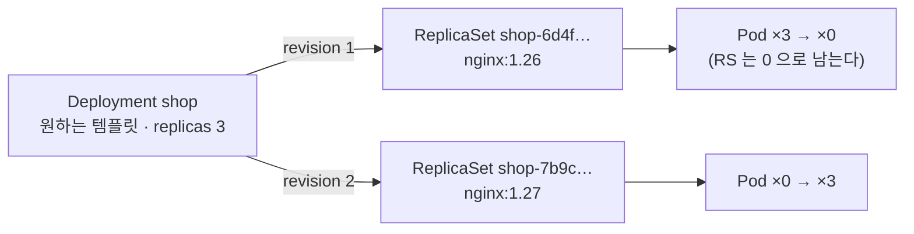

# 6강 · 워크로드

> 영상: **06강-워크로드** · 이어서 풀 채점 세트: `06-workloads`

## 실습 목표

- 명령으로 **YAML 뼈대를 뽑고**(`$do`), 필드를 `kubectl explain` 으로 찾아 채우고, `apply` · `edit` · `replace --force` 를 상황에 맞게 고른다.
- Deployment 가 **ReplicaSet 을 갈아 끼우는 방식**으로 업데이트·롤백하고, **레이블이 소유 관계를 정한다**는 것을 눈으로 확인한다.
- `maxSurge` · `maxUnavailable` · `Recreate` 를 바꿔 가며 **롤아웃 모양이 어떻게 달라지는지** 비교하고, `pause` · `resume` 으로 변경을 묶는다.
- ConfigMap · Secret 을 환경변수로 넣을 때와 볼륨으로 넣을 때 **값이 바뀌는 시점이 다르다**는 것을 확인한다.
- Job(`completions` · `parallelism` · `backoffLimit`) · CronJob · DaemonSet(`updateStrategy`) 이 Deployment 와 **무엇이 다른지** 직접 띄워 보고 비교한다.
- 일반 initContainer 와 **네이티브 사이드카**의 차이를 확인한다.

---

## 0) 준비

이 페이지의 모든 리소스는 `guide-wl` 네임스페이스에 만듭니다.

```bash
kubectl create namespace guide-wl
mkdir -p ~/guide-wl && cd ~/guide-wl        # 이 페이지에서 만드는 YAML 파일을 모아 둔다
echo $do                                    # --dry-run=client -o yaml 이 나오면 준비 완료
```

`$do` 가 비어 있으면 한 번 정의합니다.

```bash
export do="--dry-run=client -o yaml"
```

!!! tip "매번 `-n guide-wl` 을 붙입니다"
    `kubectl config set-context --current --namespace=...` 로 기본 네임스페이스를 바꿀 수도 있지만,
    시험에서는 문제마다 네임스페이스가 달라서 **`-n` 을 직접 붙이는 습관**이 더 안전합니다.

---

## 1) 명령으로 뼈대 뽑고, 고치기 — `$do` · `explain` · `apply` / `edit`

**왜** — 시험에서 YAML 을 처음부터 쓰면 들여쓰기 하나로 몇 분이 날아갑니다. **명령으로 뼈대를 뽑고, 명령으로 못 넣는 필드만 손으로 추가**하는 것이 가장 빠르고 안전합니다.

### 뼈대 뽑기

```bash
kubectl run probe -n guide-wl --image=busybox:1.36 --restart=Never $do -- sleep 3600
```

```yaml
apiVersion: v1
kind: Pod
metadata:
  creationTimestamp: null        # ← 지워도 되고 둬도 된다
  labels:
    run: probe                   # ← kubectl run 은 run=<이름> 레이블을 붙인다
  name: probe
  namespace: guide-wl
spec:
  containers:
  - args:                        # ← `--` 뒤는 args 로 들어간다 (command 가 아니다)
    - sleep
    - "3600"
    image: busybox:1.36
    name: probe
    resources: {}
  dnsPolicy: ClusterFirst
  restartPolicy: Never           # ← --restart=Never 가 없으면 Always
status: {}
```

| 명령 | 만들어지는 것 | `--` 뒤의 명령이 들어가는 곳 |
|------|---------------|------------------------------|
| `kubectl run <이름> --image=...` | Pod | `args` (`--command` 를 붙이면 `command`) |
| `kubectl create deployment <이름> --image=... --replicas=N` | Deployment | `command` |
| `kubectl create job <이름> --image=...` | Job | `command` |
| `kubectl create cronjob <이름> --image=... --schedule='...'` | CronJob | `command` |
| `kubectl create configmap` / `secret generic` | ConfigMap / Secret | — |
| `kubectl expose deployment <이름> --port=...` | Service | — |
| (없음) | **DaemonSet · StatefulSet** | Deployment 뼈대를 뽑아 고친다 → 7) |

### 필드 이름은 `explain` 으로

인터넷 없이, 클러스터 안에서 필드 구조와 설명을 봅니다.

```bash
kubectl explain pod.spec.containers.envFrom
```

```text
KIND:       Pod
VERSION:    v1

FIELD: envFrom <[]EnvFromSource>

DESCRIPTION:
    List of sources to populate environment variables in the container. ...

FIELDS:
  configMapRef	<ConfigMapEnvSource>
    The ConfigMap to select from
  prefix	<string>
    An optional identifier to prepend to each key in the ConfigMap. ...
  secretRef	<SecretEnvSource>
    The Secret to select from
```

```bash
kubectl explain deployment.spec --recursive | head -30      # 구조를 통째로
kubectl create cronjob --help | grep -A1 -- '--schedule'   # 플래그가 기억 안 날 때
```

### 고치는 세 가지 방법

| 방법 | 무엇을 기준으로 | 언제 |
|------|-----------------|------|
| `kubectl apply -f <파일>` | **파일** — 파일과 클러스터의 차이만 반영 | 파일로 관리할 때. 여러 번 실행해도 안전 |
| `kubectl edit <리소스> <이름>` | **클러스터의 현재 상태** — 에디터에서 바로 고침 | 한두 줄 빠르게 고칠 때 |
| `kubectl replace --force -f <파일>` | 파일 — **지우고 다시 만든다** | 파드처럼 바꿀 수 없는 필드를 바꿔야 할 때 |

### 깨 보기 — 파드는 대부분의 필드를 바꿀 수 없다

```bash
kubectl run probe -n guide-wl --image=busybox:1.36 --restart=Never -- sleep 3600
kubectl edit pod probe -n guide-wl
#   spec.containers[0] 아래에 아래 두 줄을 추가하고 저장
#   env:
#   - {name: GREETING, value: hi}
```

저장하면 에디터가 **다시 열리고** 맨 위에 거절 이유가 주석으로 붙어 있습니다.

```text
# pods "probe" was not valid:
# * spec: Forbidden: pod updates may not change fields other than `spec.containers[*].image`, ...
```

그대로 `:q!` 로 나오면 kubectl 이 고친 내용을 파일로 남겨 줍니다.

```text
A copy of your changes has been stored to "/tmp/kubectl-edit-1234567890.yaml"
error: Edit cancelled, no valid changes were saved.
```

`kubectl apply` 로 해도 같은 이유로 거절됩니다.
파드는 이미지 · `activeDeadlineSeconds` · toleration 추가 등 **일부 필드만** 바꿀 수 있습니다. 저장된 사본으로 **지우고 다시 만듭니다.**

```bash
kubectl replace --force -f /tmp/kubectl-edit-1234567890.yaml     # 실제 파일 이름은 에러 메시지에서 복사
kubectl exec probe -n guide-wl -- env | grep GREETING
```

```text
pod "probe" deleted
pod/probe replaced
GREETING=hi
```

**관찰 포인트** — Deployment 는 파드 템플릿을 바꾸면 **새 파드로 교체**해 주므로 이런 제약이 없습니다. 파드를 직접 고칠 일이 생기면 `replace --force` 를 떠올리세요.

!!! warning "`create` 로 만든 것을 나중에 `apply` 하면"
    처음 한 번은 `Warning: resource ... is missing the kubectl.kubernetes.io/last-applied-configuration annotation ...` 경고가 뜹니다.
    동작은 정상이고 kubectl 이 어노테이션을 알아서 붙입니다. 두 번째부터는 뜨지 않습니다.

```bash
kubectl delete pod probe -n guide-wl --now
```

---

## 2) Deployment — 업데이트와 롤백은 ReplicaSet 교체다

**왜** — Deployment 는 파드를 직접 만들지 않습니다. ReplicaSet 을 만들고, ReplicaSet 이 파드를 만듭니다. 이 3단 구조를 알면 업데이트 · 롤백 · 레이블 문제가 전부 설명됩니다.



### Deployment 만들기

```bash
kubectl create deployment shop -n guide-wl --image=nginx:1.26 --replicas=3
kubectl rollout status deployment/shop -n guide-wl
```

Deployment 를 만들면 ReplicaSet 이 하나 생기고, 그 ReplicaSet 이 파드 3개를 만듭니다.

```bash
kubectl get deploy,rs,pods -n guide-wl
```

```text
NAME                   READY   UP-TO-DATE   AVAILABLE
deployment.apps/shop   3/3     3            3

NAME                              DESIRED   CURRENT   READY
replicaset.apps/shop-6d4f8b7c9d   3         3         3

NAME                        READY   STATUS
pod/shop-6d4f8b7c9d-2xk8p   1/1     Running
...
```

파드 이름 가운데의 `6d4f8b7c9d` 는 **ReplicaSet 의 해시**입니다. 파드 템플릿이 바뀌면 이 해시도 바뀝니다.

```bash
kubectl get pods -n guide-wl -l app=shop --show-labels
```

```text
NAME                    READY   STATUS    LABELS
shop-6d4f8b7c9d-2xk8p   1/1     Running   app=shop,pod-template-hash=6d4f8b7c9d
...
```

`pod-template-hash` 레이블 덕분에 새 ReplicaSet 과 옛 ReplicaSet 이 **서로의 파드를 헷갈리지 않습니다.**

### 변경 이유 남기기

`rollout history` 의 `CHANGE-CAUSE` 칸은 `kubernetes.io/change-cause` 어노테이션에서 옵니다.
(예전의 `--record` 옵션은 폐기되었습니다.)

```bash
kubectl annotate deployment/shop -n guide-wl kubernetes.io/change-cause="최초 배포 nginx:1.26"
```

### 롤링 업데이트

터미널을 하나 더 열어 ReplicaSet 을 지켜보면서 업데이트합니다.

=== "터미널 1 — 지켜보기"
    ```bash
    kubectl get rs -n guide-wl -w
    ```
=== "터미널 2 — 업데이트"
    ```bash
    kubectl set image deployment/shop -n guide-wl nginx=nginx:1.27
    kubectl annotate deployment/shop -n guide-wl kubernetes.io/change-cause="nginx:1.27 로 업데이트" --overwrite
    kubectl rollout status deployment/shop -n guide-wl
    ```

!!! info "`nginx=` 는 컨테이너 이름입니다"
    `kubectl create deployment` 는 이미지 이름으로 컨테이너 이름을 짓습니다. 확실하지 않으면 먼저 확인하세요.
    ```bash
    kubectl get deploy shop -n guide-wl -o jsonpath='{.spec.template.spec.containers[*].name}'
    ```

터미널 1 에서 **새 ReplicaSet 의 DESIRED 가 1 → 2 → 3 으로 늘고, 옛 ReplicaSet 은 3 → 2 → 1 → 0 으로 줄어드는** 것이 보입니다.
이것이 롤링 업데이트의 실체입니다.

```bash
kubectl get rs -n guide-wl
```

```text
NAME              DESIRED   CURRENT   READY
shop-6d4f8b7c9d   0         0         0      ← nginx:1.26 (지워지지 않고 0 으로 남는다)
shop-7b9c5d6f8a   3         3         3      ← nginx:1.27
```

옛 ReplicaSet 이 **0 으로 남아 있는 이유**가 바로 롤백 때문입니다. 몇 개까지 남길지는 `spec.revisionHistoryLimit`(기본 10) 이 정합니다.

!!! note "무엇을 바꿔야 새 ReplicaSet 이 생기나"
    **파드 템플릿(`spec.template`)** 이 바뀔 때만 생깁니다. `kubectl scale` 로 replicas 만 바꾸면 기존 ReplicaSet 의 숫자만 바뀌고 리비전도 늘지 않습니다.

### 롤백

```bash
kubectl rollout history deployment/shop -n guide-wl
```

```text
REVISION  CHANGE-CAUSE
1         최초 배포 nginx:1.26
2         nginx:1.27 로 업데이트
```

```bash
kubectl rollout undo deployment/shop -n guide-wl
kubectl rollout status deployment/shop -n guide-wl
kubectl get rs -n guide-wl
```

이번에는 **0 이던 옛 ReplicaSet 이 다시 3 으로** 올라갑니다. 새 ReplicaSet 을 만들지 않고 보관해 둔 것을 되살린 것입니다.

```bash
kubectl rollout history deployment/shop -n guide-wl
```

```text
REVISION  CHANGE-CAUSE
2         nginx:1.27 로 업데이트
3         최초 배포 nginx:1.26
```

리비전 1 이 사라지고 3 이 생겼습니다. 롤백도 **"옛 템플릿으로 새 리비전을 만드는 일"** 이기 때문입니다.

!!! question "특정 리비전으로 돌아가려면?"
    ```bash
    kubectl rollout history deployment/shop -n guide-wl --revision=2   # 내용 확인
    kubectl rollout undo deployment/shop -n guide-wl --to-revision=2
    ```

### 레이블이 소유 관계를 정한다

ReplicaSet 은 파드를 **이름이 아니라 레이블(셀렉터)로** 셉니다. 파드 하나에서 레이블을 떼어 봅니다.

```bash
POD=$(kubectl get pods -n guide-wl -l app=shop -o jsonpath='{.items[0].metadata.name}')
kubectl label pod $POD -n guide-wl app-              # 키 뒤에 하이픈 = 레이블 삭제
kubectl get pods -n guide-wl -L app
```

```text
NAME                    READY   STATUS    APP
shop-6d4f8b7c9d-2xk8p   1/1     Running             ← 레이블이 없어져 셀렉터에서 빠졌다
shop-6d4f8b7c9d-9pl4n   1/1     Running   shop
shop-6d4f8b7c9d-h7wqs   1/1     Running   shop
shop-6d4f8b7c9d-x2m5r   1/1     Running   shop      ← ReplicaSet 이 "2개뿐" 이라 보고 새로 만들었다
```

**관찰 포인트** — 레이블을 뗀 파드는 **주인 없는 파드**가 되어 계속 돌고(ownerReferences 도 빠집니다), ReplicaSet 은 3개를 맞추려고 하나를 더 만듭니다.

```bash
kubectl get pod $POD -n guide-wl -o jsonpath='{.metadata.ownerReferences}{"\n"}'    # 비어 있다
kubectl delete pod $POD -n guide-wl
```

레이블을 다루는 명령은 이것이 전부입니다.

```bash
kubectl label pod <이름> tier=web env=dev -n guide-wl          # 붙이기 (여러 개 한 번에)
kubectl label pod <이름> env=prod --overwrite -n guide-wl      # 고치기 — --overwrite 필수
kubectl label pod <이름> env- -n guide-wl                      # 지우기
kubectl get pods -l 'env in (dev,prod)' -n guide-wl            # 여러 값 중 하나
kubectl get pods -l 'app=shop,env!=prod' -n guide-wl           # 여러 조건 AND
```

### 깨 보기 — selector 와 template labels 가 다르면

```bash
kubectl create deployment mismatch -n guide-wl --image=nginx:1.27 $do > mismatch.yaml
awk '/app: mismatch/{n++; if(n==3) sub(/app: mismatch/,"app: other")} 1' mismatch.yaml > m.tmp && mv m.tmp mismatch.yaml
grep -n 'app:' mismatch.yaml          # 세 번째(template 쪽) 레이블만 바뀌었는지 확인
kubectl apply -f mismatch.yaml
```

```text
6:    app: mismatch          ← metadata.labels
13:      app: mismatch       ← spec.selector.matchLabels
19:        app: other        ← spec.template.metadata.labels
The Deployment "mismatch" is invalid: spec.template.metadata.labels: Invalid value: map[string]string{"app":"other"}: `selector` does not match template `labels`
```

!!! warning "selector 는 만든 뒤 바꿀 수 없습니다"
    `apps/v1` 의 Deployment · DaemonSet 은 `spec.selector` 가 **불변(immutable)** 입니다. 레이블 설계를 바꾸려면 지우고 다시 만들어야 합니다.
    `$do` 로 뽑은 뼈대는 selector 와 template labels 가 처음부터 맞춰져 있으니 **한쪽만 고치지 마세요.**

---

## 3) 롤아웃 전략 — 속도와 안전 사이

**왜** — 롤링 업데이트는 "한꺼번에 몇 개까지 더 띄우고(`maxSurge`), 몇 개까지 줄여도 되는가(`maxUnavailable`)" 두 숫자로 모양이 정해집니다. 잘못된 이미지를 배포했을 때 서비스가 살아남는 것도 이 숫자 덕분입니다.

```bash
kubectl explain deployment.spec.strategy.rollingUpdate
```

```text
GROUP:      apps
KIND:       Deployment
VERSION:    v1

FIELD: rollingUpdate <RollingUpdateDeployment>

DESCRIPTION:
    Rolling update config params. Present only if DeploymentStrategyType =
    RollingUpdate.
    ...
FIELDS:
  maxSurge	<IntOrString>
    The maximum number of pods that can be scheduled above the desired number of
    pods. Value can be an absolute number (ex: 5) or a percentage of desired
    pods (ex: 10%). ... Defaults to 25%. ...
  maxUnavailable	<IntOrString>
    The maximum number of pods that can be unavailable during the update. ...
    Defaults to 25%. ...
```

| 설정 | replicas 4 일 때 | 모양 |
|------|------------------|------|
| 기본 (`25%` / `25%`) | 최대 5개, 최소 3개 Ready | 하나 올리고 하나 내리기를 겹쳐서 |
| `maxSurge: 1`, `maxUnavailable: 0` | 최대 5개, **항상 4개 Ready** | 가장 안전, 자원이 1개분 더 필요 |
| `maxSurge: 0`, `maxUnavailable: 1` | **최대 4개**, 최소 3개 Ready | 자원이 빠듯할 때, 용량이 잠깐 준다 |
| `type: Recreate` | 4 → 0 → 4 | 전부 내리고 전부 올린다. **중단 시간 있음** |

`maxSurge` 는 **올림**, `maxUnavailable` 은 **내림**으로 계산합니다. replicas 3 에 25% 면 surge = ⌈0.75⌉ = 1, unavailable = ⌊0.75⌋ = 0 입니다.

### 깨 보기 — 없는 이미지로 업데이트하면

2) 의 `shop` (replicas 3, 기본 전략) 에 존재하지 않는 태그를 넣습니다.

```bash
kubectl set image deployment/shop -n guide-wl nginx=nginx:9.99-nope
kubectl rollout status deployment/shop -n guide-wl --timeout=30s
kubectl get pods -n guide-wl -l app=shop
```

```text
Waiting for deployment "shop" rollout to finish: 1 out of 3 new replicas have been updated...
error: timed out waiting for the condition

NAME                    READY   STATUS             RESTARTS
shop-5f7c8d9b4a-kx2wq   0/1     ImagePullBackOff   0          ← 새 파드 1개만 시도
shop-6d4f8b7c9d-9pl4n   1/1     Running            0          ← 옛 파드 3개는 그대로
shop-6d4f8b7c9d-h7wqs   1/1     Running            0
shop-6d4f8b7c9d-x2m5r   1/1     Running            0
```

**관찰 포인트** — replicas 3 의 기본 전략은 `maxUnavailable` 이 0 이라서 **새 파드가 Ready 가 되기 전에는 옛 파드를 하나도 내리지 않습니다.** 잘못된 배포가 서비스를 멈추지 않았습니다.

```bash
kubectl rollout undo deployment/shop -n guide-wl
kubectl rollout status deployment/shop -n guide-wl
```

!!! note "그대로 두면?"
    `spec.progressDeadlineSeconds`(기본 600초) 가 지나면 Deployment 의 `Progressing` 조건이 `False` / `ProgressDeadlineExceeded` 가 됩니다.
    쿠버네티스가 **자동으로 롤백하지는 않습니다.** 사람이 `rollout undo` 해야 합니다.

### 전략을 바꿔 가며 비교하기

비교하기 쉽게 replicas 4 의 새 Deployment 를 YAML 로 만듭니다.

`surge.yaml`:

```yaml
apiVersion: apps/v1
kind: Deployment
metadata:
  name: surge
  namespace: guide-wl
spec:
  replicas: 4
  minReadySeconds: 5            # ← Ready 후 5초를 더 지켜봐야 "사용 가능". 교체를 눈으로 볼 수 있게 느리게 만든다
  selector:
    matchLabels:
      app: surge
  strategy:
    type: RollingUpdate
    rollingUpdate:
      maxSurge: 1               # ← 원하는 수보다 최대 1개 더
      maxUnavailable: 0         # ← 사용 가능한 파드가 4개 밑으로 내려가지 않게
  template:
    metadata:
      labels:
        app: surge
    spec:
      containers:
        - name: nginx
          image: nginx:1.26
```

```bash
kubectl apply -f surge.yaml
kubectl rollout status deployment/surge -n guide-wl
```

=== "터미널 1 — 지켜보기"
    ```bash
    kubectl get rs -n guide-wl -l app=surge -w
    ```
=== "터미널 2 — 업데이트"
    ```bash
    kubectl set image deployment/surge -n guide-wl nginx=nginx:1.27
    ```

```text
NAME               DESIRED   CURRENT   READY
surge-7c9f6d5b8d   4         4         4       ← 옛 RS
surge-6b8d4f7c9a   1         1         0       ← 새 RS 가 먼저 1개 (합계 5)
surge-6b8d4f7c9a   1         1         1
surge-7c9f6d5b8d   3         4         4       ← 새 것이 사용 가능해진 뒤에야 옛 것을 1개 줄인다
...
surge-6b8d4f7c9a   4         4         4
surge-7c9f6d5b8d   0         0         0
```

이번에는 반대로 `maxSurge: 0`, `maxUnavailable: 1` 로 바꾸고 다시 업데이트합니다.

```bash
kubectl patch deployment surge -n guide-wl \
  -p '{"spec":{"strategy":{"rollingUpdate":{"maxSurge":0,"maxUnavailable":1}}}}'
kubectl set image deployment/surge -n guide-wl nginx=nginx:1.26
```

터미널 1 에서 **옛 RS 가 먼저 4 → 3 으로 줄고**, 그다음 새 RS 가 1 로 느는 순서가 보입니다. 파드 합계가 4 를 넘지 않습니다.

### 깨 보기 — Recreate 로 바꾸려는데 거절된다

```bash
kubectl patch deployment surge -n guide-wl -p '{"spec":{"strategy":{"type":"Recreate"}}}'
```

```text
The Deployment "surge" is invalid: spec.strategy.rollingUpdate: Forbidden: may not be specified when strategy `type` is 'Recreate'
```

`rollingUpdate` 칸이 남아 있기 때문입니다. **같이 지워야** 합니다.

```bash
kubectl patch deployment surge -n guide-wl --type=merge \
  -p '{"spec":{"strategy":{"type":"Recreate","rollingUpdate":null}}}'
kubectl set image deployment/surge -n guide-wl nginx=nginx:1.27
kubectl get pods -n guide-wl -l app=surge -w
```

**관찰 포인트** — 네 파드가 **한꺼번에 `Terminating`** 이 되고, 다 사라진 다음에야 새 파드 네 개가 `ContainerCreating` 으로 뜹니다. 그 사이에는 서비스할 파드가 0개입니다.

### 여러 변경을 한 번의 롤아웃으로 — `pause` / `resume`

이미지와 리소스를 둘 다 바꾸면 보통은 **롤아웃이 두 번** 일어납니다. 일시정지해 두면 한 번으로 묶입니다.

```bash
kubectl rollout pause deployment/surge -n guide-wl
kubectl set image deployment/surge -n guide-wl nginx=nginx:1.26
kubectl set resources deployment/surge -n guide-wl -c nginx --requests=cpu=50m,memory=32Mi
kubectl get rs -n guide-wl -l app=surge          # 새 RS 가 생기지 않았다
kubectl rollout history deployment/surge -n guide-wl
```

```text
NAME               DESIRED   CURRENT   READY
surge-6b8d4f7c9a   4         4         4      ← 그대로 (nginx:1.27)
surge-7c9f6d5b8d   0         0         0
```

일시정지 중에는 되돌리기도 막힙니다.

```bash
kubectl rollout undo deployment/surge -n guide-wl
```

```text
error: cannot rollback a paused deployment; resume it first with 'kubectl rollout resume deployment/surge' and try again
```

```bash
kubectl rollout resume deployment/surge -n guide-wl
kubectl rollout status deployment/surge -n guide-wl
kubectl rollout history deployment/surge -n guide-wl      # 리비전이 하나만 늘었다
```

!!! tip "시험 팁"
    - 롤아웃 문제는 마지막에 **`kubectl rollout status`** 로 완료를 확인하고 넘어갑니다. 채점은 Ready 파드 수를 봅니다.
    - "이전 버전으로" 는 `rollout undo`, "리비전 N 으로" 는 `--to-revision=N`. 리비전 번호는 `rollout history` 로 먼저 확인합니다.
    - 전략 필드는 `kubectl explain deployment.spec.strategy --recursive` 로 이름을 확인하면 오타가 없습니다.

---

## 4) ConfigMap — 환경변수와 볼륨은 반영 시점이 다르다

**왜** — 설정이 이미지 안에 있으면 환경마다 이미지를 새로 만들어야 합니다. ConfigMap 으로 빼면 같은 이미지를 dev · prod 에 그대로 씁니다. 넣는 방법에 따라 **값이 바뀌었을 때의 동작**이 다릅니다.

### ConfigMap 만들기

```bash
kubectl create configmap app-settings -n guide-wl \
  --from-literal=MODE=dev \
  --from-literal=LOG_LEVEL=debug
kubectl get configmap app-settings -n guide-wl -o yaml
```

파일에서 만드는 방법도 두 가지입니다. **키가 어떻게 정해지는지**가 다릅니다.

```bash
printf 'server {\n  listen 8080;\n}\n' > site.conf
printf 'COLOR=blue\nSIZE=large\n' > ui.env

kubectl create configmap from-file -n guide-wl --from-file=site.conf       # 파일 이름이 키, 파일 내용이 값
kubectl create configmap from-env  -n guide-wl --from-env-file=ui.env      # 줄마다 KEY=VALUE 가 키 하나
kubectl get configmap from-file from-env -n guide-wl -o jsonpath='{range .items[*]}{.metadata.name}: {.data}{"\n"}{end}'
```

```text
from-file: {"site.conf":"server {\n  listen 8080;\n}\n"}
from-env: {"COLOR":"blue","SIZE":"large"}
```

### 세 가지 방법으로 한 파드에 넣기

`settings-check.yaml`:

```yaml
apiVersion: v1
kind: Pod
metadata:
  name: settings-check
  namespace: guide-wl
spec:
  containers:
    - name: app
      image: busybox:1.36
      command: ["sh", "-c", "sleep 3600"]
      env:                          # ① 키 하나만 골라서, 이름을 바꿔 넣기
        - name: APP_MODE            # ←   컨테이너 안에서 쓸 변수 이름
          valueFrom:
            configMapKeyRef:
              name: app-settings    # ←   ConfigMap 이름
              key: MODE             # ←   그 안의 키
      envFrom:                      # ② 모든 키를 그대로 넣기
        - configMapRef:
            name: app-settings
      volumeMounts:                 # ③ 키마다 파일 하나로 넣기
        - name: settings            # ←   아래 volumes 의 이름과 같아야 한다
          mountPath: /etc/settings
  volumes:
    - name: settings
      configMap:
        name: app-settings
```

```bash
kubectl apply -f settings-check.yaml
kubectl exec settings-check -n guide-wl -- env | grep -E 'MODE|LOG_LEVEL'
kubectl exec settings-check -n guide-wl -- ls /etc/settings
kubectl exec settings-check -n guide-wl -- cat /etc/settings/MODE
```

```text
APP_MODE=dev       ← ① env
MODE=dev           ← ② envFrom
LOG_LEVEL=debug    ← ② envFrom
LOG_LEVEL  MODE    ← ③ 볼륨: 키 이름이 파일 이름
dev
```

### 값을 바꾸면?

```bash
kubectl patch configmap app-settings -n guide-wl -p '{"data":{"MODE":"prod"}}'
```

1분쯤 기다린 뒤 다시 확인합니다.

```bash
kubectl exec settings-check -n guide-wl -- env | grep MODE
kubectl exec settings-check -n guide-wl -- cat /etc/settings/MODE
```

```text
APP_MODE=dev       ← 그대로
MODE=dev           ← 그대로
prod               ← 볼륨만 바뀌었다
```

| 넣는 방법 | 값이 바뀌면 |
|-----------|-------------|
| `env` / `envFrom` | **파드를 다시 만들어야** 반영됩니다. 환경변수는 컨테이너가 시작할 때 한 번 정해집니다 |
| 볼륨 | kubelet 이 주기적으로 파일을 갱신합니다 (보통 1분 이내). 단 `subPath` 로 마운트하면 갱신되지 않습니다 |

!!! tip "Deployment 라면"
    `kubectl rollout restart deployment/<이름>` 으로 파드를 새로 만들면 환경변수에도 새 값이 들어갑니다.

### 깨 보기 — 없는 ConfigMap 을 참조하면

```bash
kubectl run cm-missing -n guide-wl --image=busybox:1.36 --restart=Never $do -- sleep 3600 > cm-missing.yaml
#   spec.containers[0] 아래에 추가:
#   envFrom:
#   - configMapRef:
#       name: no-such-config
kubectl apply -f cm-missing.yaml
kubectl get pod cm-missing -n guide-wl
kubectl describe pod cm-missing -n guide-wl | tail -3
```

```text
NAME         READY   STATUS                       RESTARTS
cm-missing   0/1     CreateContainerConfigError   0

  Warning  Failed     5s (x3 over 20s)  kubelet  Error: configmap "no-such-config" not found
```

**관찰 포인트** — 파드는 **만들어지고 스케줄도 됐지만**, 컨테이너를 만들 설정을 못 구해서 멈췄습니다. 참조하는 ConfigMap 을 만들면 kubelet 이 재시도해서 저절로 `Running` 이 됩니다.

```bash
kubectl create configmap no-such-config -n guide-wl --from-literal=K=V
kubectl get pod cm-missing -n guide-wl -w       # 잠시 뒤 Running
```

`configMapRef` 아래에 `optional: true` 를 주면 ConfigMap 이 없어도 그냥 시작합니다.

---

## 5) Secret — 문법은 ConfigMap 과 같고, base64 는 암호화가 아니다

**왜** — 비밀번호 · 토큰 · 인증서는 ConfigMap 이 아니라 Secret 에 둡니다. 넣는 방법은 같지만 **누가 읽을 수 있는지(RBAC)** 를 따로 관리할 수 있고, 노드에서는 디스크가 아니라 메모리(tmpfs) 에 올라갑니다.

### 만들고, 되돌려 보기

```bash
kubectl create secret generic api-cred -n guide-wl \
  --from-literal=username=svc-bot \
  --from-literal=token='s3cr3t!'
kubectl get secret api-cred -n guide-wl -o yaml | grep -A2 '^data'
kubectl get secret api-cred -n guide-wl -o jsonpath='{.data.token}' | base64 -d; echo
```

```text
data:
  token: czNjcjN0IQ==
  username: c3ZjLWJvdA==
s3cr3t!                    ← 누구나 되돌릴 수 있다
```

!!! warning "base64 는 인코딩이지 암호화가 아닙니다"
    Secret 을 `get` 할 수 있는 사람은 값을 읽을 수 있습니다. 실제 보호는 **RBAC 으로 Secret 읽기 권한을 제한**하는 것(14강)과 etcd 저장 암호화 설정입니다.
    `--from-literal` 에 쓴 값은 셸 히스토리에도 남습니다.

YAML 로 직접 쓸 때는 `stringData` 를 쓰면 평문으로 적어도 됩니다.

`api-cred-yaml.yaml`:

```yaml
apiVersion: v1
kind: Secret
metadata:
  name: api-cred-yaml
  namespace: guide-wl
type: Opaque                     # ← 일반 키-값 Secret (generic 으로 만들면 이 타입)
stringData:                      # ← 평문으로 적으면 저장할 때 base64 로 바꿔 data 에 넣는다
  username: svc-bot
  token: "s3cr3t!"
```

```bash
kubectl apply -f api-cred-yaml.yaml
kubectl get secret api-cred-yaml -n guide-wl -o jsonpath='{.data}{"\n"}'
```

```text
{"token":"czNjcjN0IQ==","username":"c3ZjLWJvdA=="}     ← stringData 는 사라지고 data 로 저장됐다
```

`data:` 에 평문을 그대로 적으면 `illegal base64 data` 에러가 납니다. 직접 인코딩할 때는 `echo -n` 으로 줄바꿈을 빼야 합니다(`echo -n 's3cr3t!' | base64`).

### Secret 의 타입

```bash
kubectl create secret docker-registry regcred -n guide-wl \
  --docker-server=registry.example.com --docker-username=demo --docker-password=demo $do | grep -E '^type|^  \.'

openssl req -x509 -nodes -newkey rsa:2048 -days 1 -subj "/CN=demo.local" -keyout tls.key -out tls.crt 2>/dev/null
kubectl create secret tls demo-tls -n guide-wl --cert=tls.crt --key=tls.key
kubectl get secrets -n guide-wl
```

```text
  .dockerconfigjson: eyJhdXRocyI6...
type: kubernetes.io/dockerconfigjson

NAME            TYPE                DATA   AGE
api-cred        Opaque              2      3m
api-cred-yaml   Opaque              2      1m
demo-tls        kubernetes.io/tls   2      2s
```

| 만드는 명령 | 타입 | 키 | 쓰는 곳 |
|-------------|------|----|---------|
| `create secret generic` | `Opaque` | 마음대로 | 앱 설정 · 비밀번호 |
| `create secret tls` | `kubernetes.io/tls` | `tls.crt`, `tls.key` | Ingress TLS (11강) |
| `create secret docker-registry` | `kubernetes.io/dockerconfigjson` | `.dockerconfigjson` | 파드의 `imagePullSecrets` |

### 파드에 넣기

`cred-check.yaml`:

```yaml
apiVersion: v1
kind: Pod
metadata:
  name: cred-check
  namespace: guide-wl
spec:
  containers:
    - name: app
      image: busybox:1.36
      command: ["sh", "-c", "sleep 3600"]
      env:
        - name: API_TOKEN
          valueFrom:
            secretKeyRef:           # ← configMapKeyRef 자리에 이것만 바뀐다
              name: api-cred
              key: token
      volumeMounts:
        - name: cred
          mountPath: /etc/cred
          readOnly: true
  volumes:
    - name: cred
      secret:                       # ← configMap: 자리에 secret:
        secretName: api-cred        # ← 주의: ConfigMap 은 name, Secret 은 secretName
        defaultMode: 0400           # ← 파일 권한 (소유자만 읽기)
```

```bash
kubectl apply -f cred-check.yaml
kubectl exec cred-check -n guide-wl -- sh -c 'echo $API_TOKEN; ls -l /etc/cred/; mount | grep /etc/cred'
```

```text
s3cr3t!                               ← 컨테이너 안에서는 디코딩된 평문
total 0
lrwxrwxrwx    1 root     root   ... token -> ..data/token
lrwxrwxrwx    1 root     root   ... username -> ..data/username
tmpfs on /etc/cred type tmpfs (ro,relatime,...)      ← 디스크가 아니라 메모리
```

| | ConfigMap | Secret |
|---|---|---|
| 한 키 → 환경변수 | `configMapKeyRef` | `secretKeyRef` |
| 전체 → 환경변수 | `envFrom.configMapRef` | `envFrom.secretRef` |
| 볼륨 | `configMap.name` | `secret.secretName` |
| 저장 형태 | 평문 | base64 (암호화 아님) |
| 노드에서 | 디스크 | tmpfs (메모리) |

### 깨 보기 — 키 이름 오타

`cred-check.yaml` 의 `key: token` 을 `key: tokn` 으로 바꾸고 이름도 `cred-typo` 로 바꿔 적용해 봅니다.

```bash
sed -e 's/key: token/key: tokn/' -e 's/name: cred-check/name: cred-typo/' cred-check.yaml | kubectl apply -f -
kubectl get pod cred-typo -n guide-wl
kubectl describe pod cred-typo -n guide-wl | grep -m1 'Error:'
```

```text
NAME        READY   STATUS                       RESTARTS
cred-typo   0/1     CreateContainerConfigError   0
    Warning  Failed  ...  kubelet  Error: couldn't find key tokn in Secret guide-wl/api-cred
```

4) 와 같은 `CreateContainerConfigError` 입니다. **이 상태를 보면 ConfigMap · Secret 참조부터** 의심하세요.

---

## 6) Job 과 CronJob — 끝나는 것이 정상인 워크로드

**왜** — Deployment 의 파드는 끝나면 다시 띄웁니다. Job 의 파드는 **성공적으로 끝나면 그걸로 완료**입니다. 배치 · 마이그레이션 · 백업처럼 "한 번 하고 끝" 인 일에 씁니다.

### Job

```bash
kubectl create job count -n guide-wl --image=busybox:1.36 -- sh -c 'for i in 1 2 3; do echo $i; sleep 1; done'
kubectl get job,pods -n guide-wl -l job-name=count
```

```text
NAME              STATUS     COMPLETIONS   DURATION
job.batch/count   Complete   1/1           8s

NAME              READY   STATUS
pod/count-x7k2m   0/1     Completed
```

```bash
kubectl logs job/count -n guide-wl
```

### 여러 번, 동시에 — `completions` · `parallelism`

`kubectl create job` 에는 이 필드들의 플래그가 없습니다. 뼈대를 뽑아 추가합니다.

```bash
kubectl create job batch-sq -n guide-wl --image=busybox:1.36 $do -- sh -c 'echo "work on $HOSTNAME"; sleep 5' > batch-sq.yaml
```

완성본 `batch-sq.yaml`:

```yaml
apiVersion: batch/v1
kind: Job
metadata:
  name: batch-sq
  namespace: guide-wl
spec:
  completions: 5                   # ← 성공한 파드가 5개가 되면 완료
  parallelism: 2                   # ← 동시에 최대 2개까지
  backoffLimit: 3                  # ← 실패 재시도 한도 (기본 6)
  activeDeadlineSeconds: 120       # ← 전체가 120초 안에 안 끝나면 실패 처리
  ttlSecondsAfterFinished: 600     # ← 끝나고 10분 뒤 Job 과 파드를 자동 삭제
  template:
    spec:
      restartPolicy: Never         # ← Job 은 Never 또는 OnFailure 만 허용
      containers:
        - name: batch-sq
          image: busybox:1.36
          command: ["sh", "-c", "echo \"work on $HOSTNAME\"; sleep 5"]
```

```bash
kubectl apply -f batch-sq.yaml
kubectl get pods -n guide-wl -l job-name=batch-sq -w
```

```text
NAME             READY   STATUS              AGE
batch-sq-4kq2x   0/1     ContainerCreating   0s     ← 처음엔 2개만
batch-sq-p8m3n   0/1     ContainerCreating   0s
batch-sq-4kq2x   1/1     Running             2s
batch-sq-p8m3n   1/1     Running             2s
batch-sq-4kq2x   0/1     Completed           7s
batch-sq-w9t6r   0/1     ContainerCreating   7s     ← 하나 끝나면 하나 추가
...
```

```bash
kubectl get job batch-sq -n guide-wl
```

```text
NAME       STATUS     COMPLETIONS   DURATION
batch-sq   Complete   5/5           18s
```

**관찰 포인트** — `Running` 인 파드가 **2개를 넘지 않고**, 5개가 `Completed` 가 되면 Job 이 끝납니다. 대략 5초 × ⌈5/2⌉ = 15초 남짓 걸립니다.

### 깨 보기 — 계속 실패하면

`fail-demo.yaml`:

```yaml
apiVersion: batch/v1
kind: Job
metadata:
  name: fail-demo
  namespace: guide-wl
spec:
  backoffLimit: 2                  # ← 두 번까지만 다시 시도
  template:
    spec:
      restartPolicy: Never         # ← 실패하면 파드를 새로 만든다 (OnFailure 면 같은 파드 안에서 재시작)
      containers:
        - name: boom
          image: busybox:1.36
          command: ["sh", "-c", "echo boom; exit 1"]
```

```bash
kubectl apply -f fail-demo.yaml
kubectl get pods -n guide-wl -l job-name=fail-demo -w        # 재시도 간격이 10초, 20초 … 로 늘어난다. 1분쯤 기다린다
kubectl get job fail-demo -n guide-wl
kubectl describe job fail-demo -n guide-wl | tail -5
```

```text
NAME              READY   STATUS
fail-demo-6xk2p   0/1     Error
fail-demo-b4m9q   0/1     Error
fail-demo-t2w7z   0/1     Error          ← 처음 1번 + 재시도 2번 = 3개

NAME        STATUS   COMPLETIONS   DURATION
fail-demo   Failed   0/1           45s

  Warning  BackoffLimitExceeded  10s   job-controller  Job has reached the specified backoff limit
```

Job 에 `restartPolicy: Always` 를 적으면 **만들 때부터 거절**됩니다. 이름을 바꿔 새로 만들어 봅니다(이미 있는 Job 의 템플릿은 바꿀 수 없어서 다른 에러가 섞입니다).

```bash
sed -e 's/name: fail-demo/name: always-demo/' -e 's/restartPolicy: Never/restartPolicy: Always/' fail-demo.yaml | kubectl apply -f -
```

```text
The Job "always-demo" is invalid: spec.template.spec.restartPolicy: Unsupported value: "Always": supported values: "OnFailure", "Never"
```

| `restartPolicy` | 동작 | 쓸 수 있는 곳 |
|-----------------|------|---------------|
| `Always` (기본) | 종료 코드와 무관하게 항상 재시작 | Pod · Deployment · DaemonSet |
| `OnFailure` | 실패했을 때만 **같은 파드 안에서** 재시작 | Pod · Job · CronJob |
| `Never` | 재시작 안 함 (Job 이면 새 파드로 재시도) | Pod · Job · CronJob |

### CronJob

CronJob 은 **정해진 시각마다 Job 을 만드는** 리소스입니다. 파드를 직접 만들지 않습니다.

```bash
kubectl create cronjob tick -n guide-wl --image=busybox:1.36 --schedule='*/1 * * * *' -- date
```

1~2분 기다리면 CronJob → Job → Pod 순서로 생긴 것이 보입니다.

```bash
kubectl get cronjob,job,pods -n guide-wl
```

```text
NAME                 SCHEDULE      LAST SCHEDULE
cronjob.batch/tick   */1 * * * *   25s

NAME                      STATUS     COMPLETIONS
job.batch/tick-29321520   Complete   1/1

NAME                            READY   STATUS
pod/tick-29321520-4hq9z         0/1     Completed
```

!!! tip "1분을 기다리기 싫다면"
    CronJob 에서 Job 을 바로 하나 뽑아 테스트할 수 있습니다. 스케줄과 상관없이 즉시 실행됩니다.
    ```bash
    kubectl create job tick-now -n guide-wl --from=cronjob/tick
    kubectl logs job/tick-now -n guide-wl
    ```

CronJob 이 Job 을 무한히 쌓아 두지는 않습니다. 기본값으로 성공 3개, 실패 1개만 남깁니다.

```bash
kubectl get cronjob tick -n guide-wl -o jsonpath='{.spec.successfulJobsHistoryLimit} {.spec.failedJobsHistoryLimit}{"\n"}'
```

```text
3 1
```

| cron 표현식 | 뜻 |
|-------------|----|
| `*/5 * * * *` | 5분마다 |
| `0 3 * * *` | 매일 03:00 |
| `30 9 * * 1-5` | 평일 09:30 |
| `0 0 1 * *` | 매월 1일 00:00 |

순서는 **분 · 시 · 일 · 월 · 요일**입니다. 시각은 기본적으로 kube-controller-manager 의 시간대(보통 UTC)를 따르고, `spec.timeZone: "Asia/Seoul"` 로 바꿀 수 있습니다.

CronJob 에서 자주 쓰는 필드입니다.

```bash
kubectl explain cronjob.spec.concurrencyPolicy
```

| 필드 | 값 | 뜻 |
|------|----|----|
| `concurrencyPolicy` | `Allow` (기본) | 앞 Job 이 안 끝나도 새 Job 을 만든다 |
| | `Forbid` | 앞 Job 이 돌고 있으면 이번 회차를 건너뛴다 |
| | `Replace` | 앞 Job 을 지우고 새 Job 으로 바꾼다 |
| `suspend` | `true` | 새 Job 을 만들지 않는다 (이미 돌던 것은 계속) |
| `startingDeadlineSeconds` | 초 | 그 시각을 놓쳤을 때 몇 초까지는 늦게라도 실행 |

일시정지해 봅니다.

```bash
kubectl patch cronjob tick -n guide-wl -p '{"spec":{"suspend":true}}'
kubectl get cronjob tick -n guide-wl
```

```text
NAME   SCHEDULE      TIMEZONE   SUSPEND   ACTIVE   LAST SCHEDULE
tick   */1 * * * *   <none>     True      0        40s
```

1~2분이 지나도 새 Job 이 생기지 않습니다. 다시 켜려면 `"suspend":false`.

!!! tip "시험 팁"
    CronJob 의 파드 템플릿은 `spec.jobTemplate.spec.template.spec` 으로 **한 단계 더 깊습니다.** 필드를 추가할 때 들여쓰기 위치를 `kubectl explain cronjob.spec.jobTemplate.spec.template.spec` 로 확인하세요.

---

## 7) DaemonSet — 노드마다 하나씩, 그리고 Taint

**왜** — 로그 수집기 · 모니터링 에이전트 · CNI 처럼 **노드마다 정확히 하나** 있어야 하는 것은 개수를 적지 않고 노드 수를 따라가게 합니다. 노드가 늘면 자동으로 따라 붙습니다.

DaemonSet 은 `kubectl create` 명령이 없습니다. Deployment YAML 을 뽑아서 고칩니다.

```bash
kubectl create deployment node-agent -n guide-wl --image=busybox:1.36 $do -- sh -c 'sleep infinity' > node-agent.yaml
```

`node-agent.yaml` 을 열어 세 군데를 고칩니다.

- `kind: Deployment` → `kind: DaemonSet`
- `spec.replicas` 줄 삭제 (노드 수가 곧 파드 수입니다)
- `spec.strategy` 줄 삭제 (DaemonSet 은 `updateStrategy` 를 씁니다)

완성본:

```yaml
apiVersion: apps/v1
kind: DaemonSet                  # ← Deployment 에서 바꿨다
metadata:
  labels:
    app: node-agent
  name: node-agent
  namespace: guide-wl
spec:                            # ← replicas · strategy 는 지웠다
  selector:
    matchLabels:
      app: node-agent            # ← 아래 template labels 와 같아야 한다
  template:
    metadata:
      labels:
        app: node-agent
    spec:
      containers:
        - name: busybox
          image: busybox:1.36
          command: ["sh", "-c", "sleep infinity"]
```

```bash
kubectl apply -f node-agent.yaml
kubectl get ds -n guide-wl
kubectl get pods -n guide-wl -l app=node-agent -o wide
```

```text
NAME         DESIRED   CURRENT   READY
node-agent   2         2         2

NAME               READY   STATUS    NODE
node-agent-7wq4k   1/1     Running   worker-1
node-agent-m2n8c   1/1     Running   worker-2
```

!!! warning "`replicas` 를 지우지 않으면"
    `kubectl apply` 가 `strict decoding error: unknown field "spec.replicas"` 로 거절합니다. `strategy` 도 마찬가지입니다.

노드는 3대인데 파드는 **2개**입니다. 컨트롤플레인에 무엇이 붙어 있는지 봅니다.

```bash
kubectl describe node control-plane | grep -A2 Taints
```

```text
Taints:  node-role.kubernetes.io/control-plane:NoSchedule
```

이 Taint 를 견디는 Toleration 을 `spec.template.spec` 에 추가합니다.

```yaml
    spec:
      tolerations:
        - key: node-role.kubernetes.io/control-plane   # ← Taint 의 키
          operator: Exists                             # ← 값은 따지지 않는다
          effect: NoSchedule                           # ← Taint 의 효과와 같게
      containers:
        ...
```

```bash
kubectl apply -f node-agent.yaml
kubectl get pods -n guide-wl -l app=node-agent -o wide
```

이제 컨트롤플레인까지 **3개**입니다. `kube-proxy` 나 CNI 에이전트가 모든 노드에 떠 있는 것도 같은 원리입니다.

```bash
kubectl get ds -n kube-system
kubectl get ds kube-proxy -n kube-system -o jsonpath='{.spec.template.spec.tolerations}{"\n"}'
```

### 업데이트 전략 — `RollingUpdate` 와 `OnDelete`

```bash
kubectl get ds node-agent -n guide-wl -o jsonpath='{.spec.updateStrategy}{"\n"}'
```

```text
{"rollingUpdate":{"maxSurge":0,"maxUnavailable":1},"type":"RollingUpdate"}
```

기본은 **노드 하나씩** 옛 파드를 지우고 새 파드를 띄우는 `RollingUpdate` 입니다. 이미지를 바꿔 봅니다.

```bash
kubectl set image ds/node-agent -n guide-wl busybox=busybox:1.37
kubectl rollout status ds/node-agent -n guide-wl
kubectl rollout history ds/node-agent -n guide-wl
```

```text
Waiting for daemon set "node-agent" rollout to finish: 1 out of 3 new pods have been updated...
Waiting for daemon set "node-agent" rollout to finish: 2 out of 3 new pods have been updated...
daemon set "node-agent" successfully rolled out

REVISION  CHANGE-CAUSE
1         <none>
2         <none>
3         <none>
```

`rollout status` · `history` · `undo` 가 DaemonSet 에도 똑같이 동작합니다(리비전 1·2 는 toleration 추가 전후).

**대조 실험 — `OnDelete`**: 파드를 지워야만 새 템플릿이 적용됩니다.

```bash
kubectl patch ds node-agent -n guide-wl -p '{"spec":{"updateStrategy":{"type":"OnDelete","rollingUpdate":null}}}'
kubectl set image ds/node-agent -n guide-wl busybox=busybox:1.36
kubectl get pods -n guide-wl -l app=node-agent -o custom-columns='NAME:.metadata.name,NODE:.spec.nodeName,IMAGE:.spec.containers[0].image'
```

```text
NAME               NODE            IMAGE
node-agent-4tq8z   control-plane   busybox:1.37     ← 템플릿은 1.36 인데 그대로
node-agent-9vk2m   worker-1        busybox:1.37
node-agent-r6p3x   worker-2        busybox:1.37
```

```bash
kubectl delete pod -n guide-wl -l app=node-agent --field-selector spec.nodeName=worker-1
kubectl get pods -n guide-wl -l app=node-agent -o custom-columns='NAME:.metadata.name,NODE:.spec.nodeName,IMAGE:.spec.containers[0].image'
```

```text
NAME               NODE            IMAGE
node-agent-4tq8z   control-plane   busybox:1.37
node-agent-xw5n7   worker-1        busybox:1.36     ← 지운 노드만 새 이미지
node-agent-r6p3x   worker-2        busybox:1.37
```

**관찰 포인트** — `OnDelete` 는 노드별로 **사람이 시점을 고르며** 바꿀 때 씁니다(예: 노드 점검 순서에 맞춰 에이전트 교체).

| | Deployment | DaemonSet | Job |
|---|---|---|---|
| 파드 수 | `replicas` | 노드 수 (Taint · nodeSelector 로 거른) | `completions` |
| 끝나면 | 다시 띄운다 | 다시 띄운다 | 완료 |
| 업데이트 | `strategy` (RollingUpdate · Recreate) | `updateStrategy` (RollingUpdate · OnDelete) | 템플릿 대부분 불변 |
| `kubectl create` | 있음 | **없음** | 있음 |

---

## 8) 네이티브 사이드카 — initContainer 인데 끝나지 않는다

**왜** — 로그 수집기나 프록시처럼 **본 앱보다 먼저 뜨고, 본 앱보다 나중에 내려가야** 하는 보조 컨테이너가 있습니다. `containers` 에 나란히 넣으면 시작 순서가 보장되지 않습니다. 1.29 부터 기본 활성화된 네이티브 사이드카가 이 문제를 풉니다.

```bash
kubectl explain pod.spec.initContainers.restartPolicy
```

```text
FIELD: restartPolicy <string>

DESCRIPTION:
    RestartPolicy defines the restart behavior of individual containers in a
    pod. This field may only be set for init containers, and the only allowed
    value is "Always". ...
```

### 로그를 쓰는 앱

`writer.yaml`:

```yaml
apiVersion: apps/v1
kind: Deployment
metadata:
  name: writer
  namespace: guide-wl
spec:
  replicas: 1
  selector:
    matchLabels: { app: writer }
  template:
    metadata:
      labels: { app: writer }
    spec:
      containers:
        - name: app
          image: busybox:1.36
          command: ["sh", "-c", "while true; do date >> /data/out.log; sleep 2; done"]
          volumeMounts:
            - name: shared            # ← 사이드카와 같은 볼륨을 쓴다
              mountPath: /data
      volumes:
        - name: shared
          emptyDir: {}                # ← 파드가 살아 있는 동안만 있는 빈 디렉터리
```

```bash
kubectl apply -f writer.yaml
kubectl get pods -n guide-wl -l app=writer
```

`READY 1/1` 입니다.

### 먼저, 일반 initContainer 로 붙여 보기

`spec.template.spec` 에 아래를 넣고 적용해 봅니다. (`containers` 와 같은 높이)

```yaml
      initContainers:
        - name: reader
          image: busybox:1.36
          command: ["sh", "-c", "tail -F /data/out.log"]
          volumeMounts:
            - name: shared
              mountPath: /data
```

```bash
kubectl apply -f writer.yaml
kubectl get pods -n guide-wl -l app=writer
```

```text
NAME                      READY   STATUS
writer-5c8d7b9f6-q2wzx    0/1     Init:0/1   ← 새 파드
writer-8b4c6d7e9-lp4rn    1/1     Running    ← 옛 파드 (롤링 업데이트가 안 끝나서 남아 있다)
```

새 파드가 **영원히 `Init:0/1`** 입니다. 일반 initContainer 는 **끝나야** 본 컨테이너가 시작하는데, `tail -F` 는 끝나지 않습니다.
새 파드가 Ready 가 되지 않으니 Deployment 는 옛 파드를 지우지 못하고 기다립니다. 3) 에서 본 `maxUnavailable` 의 보호가 여기서도 작동한 것입니다.

### `restartPolicy: Always` 한 줄

`reader` 에 한 줄을 추가합니다.

```yaml
      initContainers:
        - name: reader
          image: busybox:1.36
          restartPolicy: Always        # ← 이 한 줄이 네이티브 사이드카를 만든다
          command: ["sh", "-c", "tail -F /data/out.log"]
          volumeMounts:
            - name: shared
              mountPath: /data
```

```bash
kubectl apply -f writer.yaml
kubectl rollout status deployment/writer -n guide-wl
kubectl get pods -n guide-wl -l app=writer
kubectl logs deploy/writer -n guide-wl -c reader --tail=3
```

```text
NAME                      READY   STATUS
writer-7f6b8c4d5-h9m3t    2/2     Running

Mon Sep 29 06:12:41 UTC 2026
Mon Sep 29 06:12:43 UTC 2026
Mon Sep 29 06:12:45 UTC 2026
```

`READY 2/2` 가 되었고 사이드카가 본 컨테이너의 로그를 읽고 있습니다.

| | 일반 initContainer | 네이티브 사이드카 |
|---|---|---|
| 선언 위치 | `initContainers` | `initContainers` |
| `restartPolicy` | 없음 | `Always` |
| 본 컨테이너 시작 시점 | init 이 **끝난 뒤** | 사이드카가 **시작된 뒤** (끝날 필요 없음) |
| 파드가 도는 동안 | 이미 종료 | 함께 살아 있음, 죽으면 재시작 |
| READY 칸에 | 세지 않음 | 셉니다 |

!!! note "그냥 `containers` 에 두 개 넣는 것과 무엇이 다른가요?"
    사이드카가 **본 컨테이너보다 먼저 뜨고, 나중에 내려가는 것**이 보장됩니다.
    로그 수집기나 프록시처럼 본 앱보다 먼저 준비돼 있어야 하는 컨테이너에 씁니다.
    Job 에서도 본 컨테이너가 끝나면 사이드카 때문에 Job 이 안 끝나는 문제가 사라집니다.

!!! tip "시험 팁"
    기존 Deployment 에 사이드카를 붙이는 문제는 `kubectl edit deployment <이름>` 이 가장 빠릅니다. `initContainers` 는 `containers` 와 **같은 들여쓰기**, 볼륨 이름은 본 컨테이너가 쓰는 것과 **같은 이름**입니다.
    저장 후 `kubectl rollout status` 로 완료를 보고, `kubectl logs deploy/<이름> -c <사이드카이름>` 으로 동작을 확인합니다.

---

## 시험에서 빠르게

```bash
# 뼈대
export do="--dry-run=client -o yaml"
kubectl run <이름> --image=<이미지> --restart=Never $do -- <명령...> > pod.yaml
kubectl create deployment <이름> --image=<이미지> --replicas=N $do > deploy.yaml   # DaemonSet 도 여기서 출발
kubectl create job <이름> --image=<이미지> $do -- <명령...> > job.yaml
kubectl create cronjob <이름> --image=<이미지> --schedule='<cron>' $do -- <명령...>
kubectl explain <리소스>.<경로> [--recursive]

# Deployment
kubectl scale deployment <이름> --replicas=N
kubectl set image deployment/<이름> <컨테이너>=<이미지>
kubectl rollout status|history|undo|pause|resume|restart deployment/<이름>
kubectl rollout undo deployment/<이름> --to-revision=N

# 설정
kubectl create configmap <이름> --from-literal=K=V [--from-file=<파일>] [--from-env-file=<파일>]
kubectl create secret generic <이름> --from-literal=K=V
kubectl get secret <이름> -o jsonpath='{.data.<키>}' | base64 -d

# Job · CronJob
kubectl create job <이름> --from=cronjob/<크론잡>
kubectl get jobs; kubectl logs job/<이름>

# 레이블
kubectl label <리소스> <이름> k=v [--overwrite] | k-
kubectl get pods -l 'k in (a,b)' --show-labels

# 파드 고치기가 거절되면
kubectl replace --force -f /tmp/kubectl-edit-XXXX.yaml
```

!!! tip "시험 팁"
    - 채점은 **최종 상태**를 봅니다. 마지막에 `kubectl get <리소스> -o yaml | grep -A3 <필드>` 로 실제로 들어갔는지 확인하는 습관을 들이세요.
    - `CreateContainerConfigError` = ConfigMap · Secret 참조 문제, `Init:0/1` 에서 멈춤 = initContainer 가 안 끝남, `ImagePullBackOff` = 이미지 이름 · 태그.

---

## 정리

```bash
kubectl delete namespace guide-wl
cd ~ && rm -rf ~/guide-wl
```

---

## 확인 질문

??? question "1. `kubectl rollout undo` 를 하면 새 ReplicaSet 이 생기나요?"
    생기지 않습니다. 0 으로 남겨 둔 옛 ReplicaSet 의 DESIRED 를 다시 올립니다.
    다만 **리비전 번호는 새로 매겨집니다**. 그래서 history 에서 옛 번호가 사라지고 새 번호가 생깁니다.

??? question "2. ConfigMap 값을 바꿨는데 파드의 환경변수가 그대로입니다. 왜 그런가요?"
    환경변수는 컨테이너가 시작할 때 한 번 정해지기 때문입니다. 파드를 다시 만들어야 합니다
    (Deployment 라면 `kubectl rollout restart`). 볼륨으로 넣은 값은 자동으로 갱신됩니다(`subPath` 제외).

??? question "3. DaemonSet 파드가 노드 수보다 적게 떠 있습니다. 가장 먼저 무엇을 보나요?"
    노드의 Taint 입니다. `kubectl describe node <노드> | grep Taints`.
    그 Taint 를 견디는 Toleration 이 파드 템플릿에 없으면 그 노드에는 뜨지 않습니다.

??? question "4. 네이티브 사이드카를 만드는 조건 두 가지는?"
    `initContainers` 아래에 선언하고, `restartPolicy: Always` 를 줍니다.

??? question "5. CronJob 을 1분 기다리지 않고 바로 테스트하는 방법은?"
    `kubectl create job <이름> --from=cronjob/<크론잡이름>`

??? question "6. replicas 4, `maxSurge: 1`, `maxUnavailable: 0` 인 Deployment 를 업데이트하면 파드는 최대 몇 개, 사용 가능한 파드는 최소 몇 개인가요?"
    최대 5개, 최소 4개입니다. 새 파드를 하나 먼저 띄우고, 그것이 사용 가능해진 뒤에야 옛 파드를 하나 내립니다.
    그래서 잘못된 이미지로 업데이트해도 옛 파드는 그대로 남아 서비스가 멈추지 않습니다.

??? question "7. 파드가 `CreateContainerConfigError` 입니다. 무엇을 의심하나요?"
    참조하는 ConfigMap · Secret 이 없거나 키 이름이 틀린 경우입니다. `kubectl describe pod` 의 Events 에
    `configmap "..." not found` 나 `couldn't find key ... in Secret ...` 이 찍힙니다.

??? question "8. Job 에 `restartPolicy: Always` 를 쓰면 어떻게 되나요? `backoffLimit` 은 무엇을 정하나요?"
    만들 때 거절됩니다 — Job 은 `OnFailure` 나 `Never` 만 허용합니다(끝나야 하는 작업이니까).
    `backoffLimit` 은 실패 재시도 횟수 한도이고, 넘기면 Job 이 `Failed` 가 되며 `BackoffLimitExceeded` 이벤트가 남습니다.

??? question "9. 파드에서 레이블 하나를 떼었더니 파드가 하나 더 생겼습니다. 왜 그런가요?"
    ReplicaSet 은 레이블 셀렉터로 자기 파드를 셉니다. 레이블을 뗀 파드는 셀렉터에서 빠져 주인 없는 파드가 되고,
    ReplicaSet 은 개수가 모자란다고 보고 새 파드를 만듭니다. 뗀 파드는 계속 돌기 때문에 직접 지워야 합니다.

---

## 다음 단계 — 채점 실습

개념이 잡혔으면 시험 형식으로 풀어 봅니다. 이번에는 **답이 없습니다.**

```bash
cd ~/cka-lab/06-workloads
bash exam.sh start
```

| 문제 | 이 페이지에서 연습한 것 |
|------|------------------------|
| Q1 Deployment 생성 · 스케일 · 업데이트 · 롤백 | 2) 3) |
| Q2 ConfigMap 을 envFrom 으로 주입 | 1) 뼈대 뽑기 · 4) |
| Q3 CronJob | 6) |
| Q4 DaemonSet (hostNetwork · hostPID) | 1) 7) — 필드 위치는 `kubectl explain pod.spec` 으로 |
| Q5 네이티브 사이드카 | 8) |
