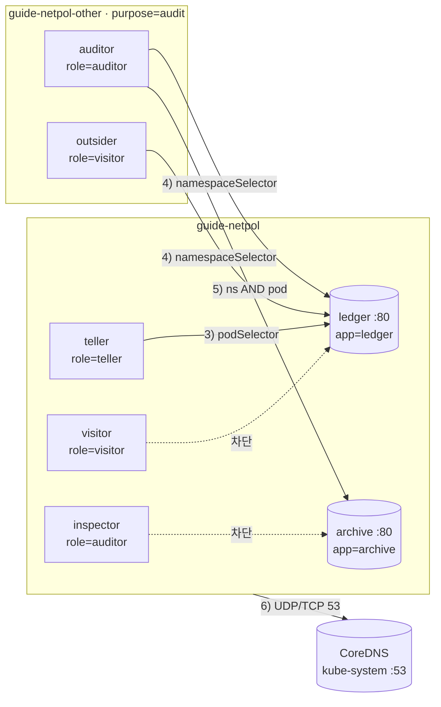

# 10강 · NetworkPolicy

> 영상: **10강-NetworkPolicy** · 이어서 풀 채점 세트: `10-networkpolicy`

## 실습 목표

- 정책이 없을 때는 **전부 열려 있고**, 정책에 선택되는 순간 **그 방향이 기본 거부**가 된다는 것을 확인한다.
- `podSelector` · `namespaceSelector` · `ipBlock` 으로 **누구를 허용할지** 골라 본다.
- 하이픈 하나로 바뀌는 **AND 와 OR** 를 두 정책으로 만들어 결과를 표로 비교한다.
- Egress 를 막으면 **DNS 부터 죽는다**는 것을 보고, 53 번을 여는 정석 규칙을 손에 익힌다.
- 이미 있는 정책 목록을 읽고 **누가 누구에게 닿는지 예측**한 뒤 실제로 검증한다.
- 미리 준비된 정책 파일 여러 개를 비교해 **맞는 것 하나만 골라 적용**한다(2026 실제 출제 유형).

---

## 0) 준비

네임스페이스 두 개를 씁니다. 두 번째 네임스페이스에는 **레이블**을 붙여 둡니다(4) 에서 씀).

```bash
kubectl create namespace guide-netpol
kubectl create namespace guide-netpol-other
kubectl label namespace guide-netpol-other purpose=audit
```

서버 두 개(nginx)와 클라이언트 다섯 개(busybox)를 만듭니다. `kubectl run --expose` 는 같은 이름의 ClusterIP Service 도 함께 만듭니다.

```bash
# 서버 — 파드 + 같은 이름의 Service (80 → 80)
kubectl run ledger  -n guide-netpol --image=nginx:1.27 --labels=app=ledger  --port=80 --expose
kubectl run archive -n guide-netpol --image=nginx:1.27 --labels=app=archive --port=80 --expose

# 같은 네임스페이스의 클라이언트
kubectl run teller    -n guide-netpol --image=busybox:1.36 --labels=role=teller  --command -- sleep 36000
kubectl run visitor   -n guide-netpol --image=busybox:1.36 --labels=role=visitor --command -- sleep 36000
kubectl run inspector -n guide-netpol --image=busybox:1.36 --labels=role=auditor --command -- sleep 36000

# 다른 네임스페이스의 클라이언트
kubectl run auditor  -n guide-netpol-other --image=busybox:1.36 --labels=role=auditor --command -- sleep 36000
kubectl run outsider -n guide-netpol-other --image=busybox:1.36 --labels=role=visitor --command -- sleep 36000

kubectl wait --for=condition=Ready pod --all -n guide-netpol --timeout=120s
kubectl wait --for=condition=Ready pod --all -n guide-netpol-other --timeout=120s
```

| 파드 | 네임스페이스 | 레이블 | 역할 |
|------|-------------|--------|------|
| `ledger` | guide-netpol | `app=ledger` | 서버 (nginx :80) |
| `archive` | guide-netpol | `app=archive` | 서버 (AND/OR 실험용) |
| `teller` | guide-netpol | `role=teller` | 허용할 클라이언트 |
| `visitor` | guide-netpol | `role=visitor` | 막을 클라이언트 |
| `inspector` | guide-netpol | `role=auditor` | **레이블은 auditor 인데 네임스페이스가 다르다** |
| `auditor` | guide-netpol-other | `role=auditor` | 다른 ns 의 auditor |
| `outsider` | guide-netpol-other | `role=visitor` | 다른 ns 의 visitor |

### 한 번에 검사하는 함수

같은 검사를 여러 번 하므로 셸 함수로 만들어 둡니다. 막힌 경우 오래 기다리지 않도록 `--timeout=2` 를 줍니다.

```bash
probe() {   # probe <네임스페이스> <클라이언트파드> <대상>
  if kubectl exec -n "$1" "$2" -- wget -qO- --timeout=2 "http://$3" >/dev/null 2>&1; then r=OK; else r=BLOCKED; fi
  printf '%-30s -> %-22s %s\n' "$1/$2" "$3" "$r"
}
matrix() {
  for c in guide-netpol/teller guide-netpol/visitor guide-netpol/inspector \
           guide-netpol-other/auditor guide-netpol-other/outsider; do
    for t in ledger.guide-netpol archive.guide-netpol; do probe "${c%/*}" "${c#*/}" "$t"; done
  done
}
```

대상 이름을 `ledger.guide-netpol` 처럼 **네임스페이스까지** 적는 이유는 다른 네임스페이스의 클라이언트도 같은 이름으로 부르기 위해서입니다([9강 의 DNS](09-networking.md#6-dns)).

### 다 만들고 나면 이런 그림이 됩니다



---

## 1) 정책이 없으면 전부 열려 있다

먼저 CNI 가 NetworkPolicy 를 **집행할 수 있는지** 확인합니다. 정책 오브젝트는 API 서버에 저장될 뿐이고, 실제로 막는 것은 각 노드의 CNI 에이전트입니다.

```bash
kubectl get pods -n kube-system -l k8s-app=cilium -o wide
kubectl -n kube-system exec ds/cilium -c cilium-agent -- cilium-dbg status --brief
```

```text
NAME           READY   STATUS    NODE
cilium-5hx2d   1/1     Running   control-plane
cilium-9kq7w   1/1     Running   worker-1
cilium-t4m8n   1/1     Running   worker-2
OK
```

!!! warning "Flannel 이면 정책을 만들어도 아무것도 막히지 않습니다"
    Flannel 은 NetworkPolicy 를 집행하지 않습니다. 에러 없이 `created` 가 나오고 트래픽은 그대로 통합니다.
    "정책을 만들었는데 안 막힌다" 면 CNI 부터 봅니다. (Cilium 버전이 낮으면 명령이 `cilium-dbg` 가 아니라 `cilium` 입니다.)

기준선을 봅니다.

```bash
kubectl get networkpolicy -n guide-netpol
matrix
```

```text
No resources found in guide-netpol namespace.
guide-netpol/teller            -> ledger.guide-netpol    OK
guide-netpol/teller            -> archive.guide-netpol   OK
guide-netpol/visitor           -> ledger.guide-netpol    OK
...
guide-netpol-other/outsider    -> archive.guide-netpol   OK
```

관찰 포인트: 10 줄 모두 `OK` 입니다. **네임스페이스가 달라도 파드끼리는 전부 통합니다.** 네임스페이스는 이름 공간일 뿐 방화벽이 아닙니다.

---

## 2) 기본 거부 — Ingress

정책 필드는 `kubectl explain` 으로 확인할 수 있습니다. NetworkPolicy 는 `kubectl create` 명령이 **없어서** YAML 로만 만듭니다.

```bash
kubectl explain networkpolicy.spec
```

```text
FIELDS:
  egress        <[]NetworkPolicyEgressRule>
  ingress       <[]NetworkPolicyIngressRule>
  podSelector   <LabelSelector>
    podSelector selects the pods to which this NetworkPolicy object applies.
    ... An empty selector matches all pods in this namespace.
  policyTypes   <[]string>
    ... Valid options are "Ingress", "Egress", or "Ingress,Egress".
```

`deny-in.yaml`:

```yaml
apiVersion: networking.k8s.io/v1
kind: NetworkPolicy
metadata:
  name: deny-in
  namespace: guide-netpol
spec:
  podSelector: {}           # ← 빈 셀렉터 = 이 네임스페이스의 모든 파드
  policyTypes:
    - Ingress               # ← 들어오는 방향을 제한한다
  # ingress: 필드가 아예 없다 = 허용 목록이 비었다 = 전부 거부
```

```bash
kubectl apply -f deny-in.yaml
matrix
```

```text
guide-netpol/teller            -> ledger.guide-netpol    BLOCKED
guide-netpol/teller            -> archive.guide-netpol   BLOCKED
...
guide-netpol-other/outsider    -> archive.guide-netpol   BLOCKED
```

막힌 모습을 직접 봅니다.

```bash
kubectl exec -n guide-netpol visitor -- wget -qO- --timeout=3 http://ledger
```

```text
wget: download timed out
```

관찰 포인트: `Connection refused` 가 아니라 **timeout** 입니다. NetworkPolicy 는 패킷을 되돌려 보내지 않고 **조용히 버립니다(drop)**. 테스트할 때 `--timeout` 을 꼭 줍니다.

??? note "Cilium 에서 버려지는 패킷을 직접 보기 (선택)"
    ledger 가 떠 있는 노드의 cilium 파드에서 봐야 합니다.
    ```bash
    NODE=$(kubectl get pod ledger -n guide-netpol -o jsonpath='{.spec.nodeName}')
    CPOD=$(kubectl get pods -n kube-system -l k8s-app=cilium --field-selector spec.nodeName=$NODE -o name)
    kubectl -n kube-system exec $CPOD -c cilium-agent -- cilium-dbg monitor --type drop
    # 다른 터미널에서 visitor → ledger 를 다시 시도하면 "Policy denied" 줄이 찍힌다. Ctrl+C 로 종료
    ```

### `ingress` 를 어떻게 적느냐에 따라 정반대가 된다

| 적은 모양 | 뜻 | 결과 |
|-----------|----|------|
| `ingress` 필드 없음 | 허용 목록이 비었다 | **전부 거부** |
| `ingress: []` | 빈 목록 | **전부 거부** |
| `ingress: [ {} ]` (`- {}`) | 조건 없는 규칙 **하나** | **전부 허용** |
| `podSelector: {}` (spec 바로 아래) | 이 네임스페이스의 모든 파드를 **대상으로** | — |
| `from: [ { podSelector: {} } ]` | 같은 네임스페이스의 모든 파드**에서** | 같은 ns 만 허용 |

!!! warning "policyTypes 는 생략하지 않습니다"
    생략하면 `ingress` 가 있으면 Ingress, `egress` 가 있으면 Egress 로 **추론**합니다. 그래서 규칙 없이 `policyTypes` 만 빼면
    Egress 기본 거부를 의도했어도 Ingress 로만 해석됩니다. 항상 명시합니다.

---

## 3) podSelector — 레이블 하나만 허용

`ledger-from-teller.yaml`:

```yaml
apiVersion: networking.k8s.io/v1
kind: NetworkPolicy
metadata:
  name: ledger-from-teller
  namespace: guide-netpol
spec:
  podSelector:
    matchLabels:
      app: ledger            # ← 대상: ledger 파드만
  policyTypes:
    - Ingress
  ingress:
    - from:
        - podSelector:       # ← 같은 네임스페이스의 파드 중에서
            matchLabels:
              role: teller   #    role=teller 만
      ports:
        - protocol: TCP
          port: 80           # ← 파드가 듣는 포트 (Service 포트가 아니다)
```

```bash
kubectl apply -f ledger-from-teller.yaml
matrix
```

```text
guide-netpol/teller            -> ledger.guide-netpol    OK        ← 열렸다
guide-netpol/teller            -> archive.guide-netpol   BLOCKED   ← archive 는 deny-in 에만 선택됨
guide-netpol/visitor           -> ledger.guide-netpol    BLOCKED
guide-netpol/visitor           -> archive.guide-netpol   BLOCKED
guide-netpol/inspector         -> ledger.guide-netpol    BLOCKED
...
guide-netpol-other/auditor     -> ledger.guide-netpol    BLOCKED   ← from 의 podSelector 는 '같은 ns' 만 본다
```

관찰 포인트: ledger 는 `deny-in` 과 `ledger-from-teller` **두 정책에 동시에** 선택됩니다. 정책끼리는 충돌하지 않고 **허용 목록이 합쳐집니다(합집합)**. 그래서 순서도 상관없습니다.

### 실험 — from 레이블 오타

```bash
kubectl patch networkpolicy ledger-from-teller -n guide-netpol --type=json \
  -p '[{"op":"replace","path":"/spec/ingress/0/from/0/podSelector/matchLabels/role","value":"tellers"}]'
kubectl describe networkpolicy ledger-from-teller -n guide-netpol
kubectl get pods -n guide-netpol -l role=tellers
probe guide-netpol teller ledger.guide-netpol
```

```text
Name:         ledger-from-teller
Namespace:    guide-netpol
Spec:
  PodSelector:     app=ledger
  Allowing ingress traffic:
    To Port: 80/TCP
    From:
      PodSelector: role=tellers
  Not affecting egress traffic
  Policy Types: Ingress

No resources found in guide-netpol namespace.     ← 이 레이블을 가진 파드가 없다
guide-netpol/teller            -> ledger.guide-netpol    BLOCKED
```

관찰 포인트: 에러는 없고 **아무도 허용되지 않을 뿐**입니다. `describe` 의 셀렉터를 복사해 `kubectl get pods -l <셀렉터>` 로 실제로 몇 개가 잡히는지 보는 것이 가장 빠른 확인법입니다.

```bash
kubectl apply -f ledger-from-teller.yaml      # 원래대로
```

---

## 4) namespaceSelector — 다른 네임스페이스를 허용

네임스페이스를 고를 때는 **네임스페이스의 레이블**을 봅니다. 모든 네임스페이스에는 이름 레이블이 자동으로 붙어 있습니다.

```bash
kubectl get namespace guide-netpol guide-netpol-other --show-labels
```

```text
NAME                 STATUS   AGE   LABELS
guide-netpol         Active   20m   kubernetes.io/metadata.name=guide-netpol
guide-netpol-other   Active   20m   kubernetes.io/metadata.name=guide-netpol-other,purpose=audit
```

`ledger-from-audit-ns.yaml`:

```yaml
apiVersion: networking.k8s.io/v1
kind: NetworkPolicy
metadata:
  name: ledger-from-audit-ns
  namespace: guide-netpol
spec:
  podSelector:
    matchLabels:
      app: ledger
  policyTypes:
    - Ingress
  ingress:
    - from:
        - namespaceSelector:     # ← purpose=audit 레이블이 붙은 네임스페이스의 '모든' 파드
            matchLabels:
              purpose: audit
            # 이름으로 고르려면: kubernetes.io/metadata.name: guide-netpol-other
      ports:
        - protocol: TCP
          port: 80
```

```bash
kubectl apply -f ledger-from-audit-ns.yaml
probe guide-netpol-other auditor  ledger.guide-netpol
probe guide-netpol-other outsider ledger.guide-netpol
probe guide-netpol       visitor  ledger.guide-netpol
```

```text
guide-netpol-other/auditor     -> ledger.guide-netpol    OK
guide-netpol-other/outsider    -> ledger.guide-netpol    OK        ← 레이블과 무관하게 그 ns 는 전부
guide-netpol/visitor           -> ledger.guide-netpol    BLOCKED
```

### 실험 — 네임스페이스 레이블을 떼면

```bash
kubectl label namespace guide-netpol-other purpose-
probe guide-netpol-other auditor ledger.guide-netpol
kubectl label namespace guide-netpol-other purpose=audit       # 되돌린다
```

```text
guide-netpol-other/auditor     -> ledger.guide-netpol    BLOCKED
```

관찰 포인트: 정책은 그대로인데 **네임스페이스 레이블 하나로** 결과가 바뀝니다. 시험 문제가 "레이블이 붙은 네임스페이스" 를 말하면 `--show-labels` 로 실제 레이블부터 확인합니다.

!!! tip "시험 팁"
    문제에 네임스페이스 **이름**만 나오고 레이블이 없으면, 레이블을 새로 붙이지 말고 `kubernetes.io/metadata.name: <이름>` 을 씁니다.
    채점이 네임스페이스 레이블 변경을 기대하지 않을 수 있습니다.

---

## 5) AND 와 OR — 하이픈 하나의 차이

`archive` 를 대상으로 두 가지 정책을 **하나씩** 걸어 보고 결과를 비교합니다.

=== "AND — archive-and.yaml"
    ```yaml
    apiVersion: networking.k8s.io/v1
    kind: NetworkPolicy
    metadata:
      name: archive-and
      namespace: guide-netpol
    spec:
      podSelector:
        matchLabels:
          app: archive
      policyTypes:
        - Ingress
      ingress:
        - from:
            - namespaceSelector:          # ← '-' 가 있는 항목 하나
                matchLabels:
                  purpose: audit
              podSelector:                # ← '-' 없음: 같은 항목 안 → 두 조건을 모두 만족 (AND)
                matchLabels:
                  role: auditor
    ```
=== "OR — archive-or.yaml"
    ```yaml
    apiVersion: networking.k8s.io/v1
    kind: NetworkPolicy
    metadata:
      name: archive-or
      namespace: guide-netpol
    spec:
      podSelector:
        matchLabels:
          app: archive
      policyTypes:
        - Ingress
      ingress:
        - from:
            - namespaceSelector:          # ← 항목 ①
                matchLabels:
                  purpose: audit
            - podSelector:                # ← '-' 있음: 별도 항목 ② → 둘 중 하나 (OR)
                matchLabels:
                  role: auditor
    ```

### AND 먼저

```bash
kubectl apply -f archive-and.yaml
for c in guide-netpol/teller guide-netpol/visitor guide-netpol/inspector guide-netpol-other/auditor guide-netpol-other/outsider; do
  probe "${c%/*}" "${c#*/}" archive.guide-netpol
done
kubectl describe networkpolicy archive-and -n guide-netpol | sed -n '/Allowing/,/Not affecting/p'
```

```text
guide-netpol/teller            -> archive.guide-netpol   BLOCKED
guide-netpol/visitor           -> archive.guide-netpol   BLOCKED
guide-netpol/inspector         -> archive.guide-netpol   BLOCKED
guide-netpol-other/auditor     -> archive.guide-netpol   OK
guide-netpol-other/outsider    -> archive.guide-netpol   BLOCKED

  Allowing ingress traffic:
    To Port: <any> (traffic allowed to all ports)
    From:
      NamespaceSelector: purpose=audit
      PodSelector: role=auditor           ← From: 하나 아래 두 줄 = AND
  Not affecting egress traffic
```

### 이번엔 OR

```bash
kubectl delete -f archive-and.yaml
kubectl apply -f archive-or.yaml
for c in guide-netpol/teller guide-netpol/visitor guide-netpol/inspector guide-netpol-other/auditor guide-netpol-other/outsider; do
  probe "${c%/*}" "${c#*/}" archive.guide-netpol
done
kubectl describe networkpolicy archive-or -n guide-netpol | sed -n '/Allowing/,/Not affecting/p'
```

```text
guide-netpol/teller            -> archive.guide-netpol   BLOCKED
guide-netpol/visitor           -> archive.guide-netpol   BLOCKED
guide-netpol/inspector         -> archive.guide-netpol   OK        ← 같은 ns 의 role=auditor
guide-netpol-other/auditor     -> archive.guide-netpol   OK
guide-netpol-other/outsider    -> archive.guide-netpol   OK        ← purpose=audit ns 라서 전부

  Allowing ingress traffic:
    To Port: <any> (traffic allowed to all ports)
    From:
      NamespaceSelector: purpose=audit
    From:
      PodSelector: role=auditor           ← From: 이 두 개 = OR
  Not affecting egress traffic
```

| 클라이언트 | ns 레이블 | 파드 레이블 | AND | OR |
|-----------|-----------|-------------|-----|----|
| guide-netpol/teller | — | role=teller | ❌ | ❌ |
| guide-netpol/inspector | — | role=auditor | ❌ | ✅ |
| guide-netpol-other/auditor | purpose=audit | role=auditor | ✅ | ✅ |
| guide-netpol-other/outsider | purpose=audit | role=visitor | ❌ | ✅ |

관찰 포인트: OR 쪽이 **훨씬 넓게** 열립니다. OR 의 `podSelector` 는 **정책이 있는 네임스페이스(guide-netpol)** 의 파드를 고릅니다. 다른 네임스페이스의 특정 파드만 허용하려면 반드시 AND 모양이어야 합니다.

!!! tip "시험 팁 — 문장을 보고 모양을 고른다"
    "pods labeled X **in** namespace Y" → **AND** (한 항목에 두 셀렉터).
    "pods labeled X **or** any pod in namespace Y" → **OR** (항목 두 개). 적용한 뒤 `describe` 에서 `From:` 개수를 셉니다.

AND 쪽을 남겨 둡니다.

```bash
kubectl delete -f archive-or.yaml
kubectl apply -f archive-and.yaml
```

---

## 6) Egress 와 DNS — 나가는 쪽을 막으면

이번에는 **클라이언트 쪽**을 잠급니다. 네임스페이스의 모든 파드에 Egress 기본 거부를 겁니다.

`deny-out.yaml`:

```yaml
apiVersion: networking.k8s.io/v1
kind: NetworkPolicy
metadata:
  name: deny-out
  namespace: guide-netpol
spec:
  podSelector: {}
  policyTypes:
    - Egress                # ← 나가는 방향. ingress 쪽은 이 정책과 무관
```

teller 가 ledger 로 나가는 것만 허용하는 정책도 함께 겁니다.

`teller-to-ledger.yaml`:

```yaml
apiVersion: networking.k8s.io/v1
kind: NetworkPolicy
metadata:
  name: teller-to-ledger
  namespace: guide-netpol
spec:
  podSelector:
    matchLabels:
      role: teller           # ← 대상: 나가는 쪽(클라이언트)
  policyTypes:
    - Egress
  egress:
    - to:
        - podSelector:
            matchLabels:
              app: ledger    # ← 목적지 파드
      ports:
        - protocol: TCP
          port: 80
```

```bash
kubectl apply -f deny-out.yaml -f teller-to-ledger.yaml
kubectl exec -n guide-netpol teller -- nslookup ledger
kubectl exec -n guide-netpol teller -- wget -qO- --timeout=3 http://ledger
```

```text
;; connection timed out; no servers could be reached
wget: bad address 'ledger'
```

허용했는데도 안 됩니다. **IP 로** 직접 불러 봅니다.

```bash
LEDGER_IP=$(kubectl get svc ledger -n guide-netpol -o jsonpath='{.spec.clusterIP}')
kubectl exec -n guide-netpol teller -- wget -qO- --timeout=3 http://$LEDGER_IP | grep title
```

```text
<title>Welcome to nginx!</title>
```

관찰 포인트: 연결 규칙은 맞았고 **이름 해석(DNS, 53번)이 막힌 것**입니다. 파드는 이름을 풀려고 kube-system 의 CoreDNS 로 나가야 하는데, 그 길이 Egress 허용 목록에 없습니다.
ClusterIP 로 불러도 되는 이유는 정책이 **Service 가 아니라 목적지 파드(app=ledger)** 기준으로 판단되기 때문입니다.

### DNS 를 여는 정석 규칙

`allow-dns.yaml`:

```yaml
apiVersion: networking.k8s.io/v1
kind: NetworkPolicy
metadata:
  name: allow-dns
  namespace: guide-netpol
spec:
  podSelector: {}                       # ← 이 네임스페이스 모든 파드가 DNS 는 쓸 수 있게
  policyTypes:
    - Egress
  egress:
    - to:
        - namespaceSelector:
            matchLabels:
              kubernetes.io/metadata.name: kube-system
          podSelector:                  # ← '-' 없음 → AND: kube-system 의 CoreDNS 파드만
            matchLabels:
              k8s-app: kube-dns
      ports:
        - protocol: UDP
          port: 53                      # ← 일반 질의
        - protocol: TCP
          port: 53                      # ← 응답이 큰 경우 TCP 로 재시도한다
```

```bash
kubectl apply -f allow-dns.yaml
kubectl exec -n guide-netpol teller  -- nslookup ledger | grep -A1 Name
kubectl exec -n guide-netpol teller  -- wget -qO- --timeout=3 http://ledger | grep title
kubectl exec -n guide-netpol visitor -- wget -qO- --timeout=3 http://ledger
```

```text
Name:	ledger.guide-netpol.svc.cluster.local
Address: 10.101.88.140
<title>Welcome to nginx!</title>
wget: download timed out                ← visitor 는 이름은 풀리지만 나갈 곳이 없다
```

| Egress 정책 | 이름 해석 | IP 로 접속 | 이름으로 접속 |
|-------------|-----------|-----------|--------------|
| 없음 | ✅ | ✅ | ✅ |
| 목적지만 허용 | ❌ | ✅ | ❌ (`bad address`) |
| 목적지 + DNS 허용 | ✅ | ✅ | ✅ |
| DNS 만 허용 | ✅ | ❌ | ❌ (timeout) |

!!! warning "Egress 정책의 규칙이 하나뿐이면 DNS 를 빼먹었을 가능성이 큽니다"
    CoreDNS 파드 레이블(`k8s-app=kube-dns`)은 `kubectl get pods -n kube-system --show-labels | grep dns` 로 확인합니다.
    문제가 "UDP 53 to anywhere" 처럼 목적지를 안 정하면 `to` 를 생략하고 `ports` 만 둡니다 — 그러면 **모든 목적지의 53 번**이 열립니다.

관찰 포인트: 다른 네임스페이스의 auditor → ledger 는 여전히 됩니다. `deny-out` 은 **guide-netpol 안의 파드가 나가는 것**만 제한합니다.

```bash
probe guide-netpol-other auditor ledger.guide-netpol
```

---

## 7) ipBlock — 클러스터 밖 IP 를 고른다

파드가 아닌 **외부 주소**는 레이블이 없으니 CIDR 로 고릅니다. 테스트에는 curl 이 있는 `nicolaka/netshoot` 을 씁니다(클러스터에서 인터넷이 나가야 합니다).

```bash
kubectl run probe -n guide-netpol --image=nicolaka/netshoot --labels=role=probe --command -- sleep 36000
kubectl wait --for=condition=Ready pod/probe -n guide-netpol --timeout=120s
kubectl exec -n guide-netpol probe -- curl -s -o /dev/null -w '%{http_code}\n' --max-time 3 http://1.1.1.1
```

```text
000          ← deny-out 에 걸려 나갈 수 없다 (DNS 만 허용된 상태)
```

`probe-to-cf.yaml`:

```yaml
apiVersion: networking.k8s.io/v1
kind: NetworkPolicy
metadata:
  name: probe-to-cf
  namespace: guide-netpol
spec:
  podSelector:
    matchLabels:
      role: probe
  policyTypes:
    - Egress
  egress:
    - to:
        - ipBlock:
            cidr: 1.1.1.1/32      # ← 이 주소 하나만
            # 대역을 열고 일부를 빼려면:
            # cidr: 203.0.113.0/24
            # except: [203.0.113.99/32]
      ports:
        - protocol: TCP
          port: 80
```

```bash
kubectl apply -f probe-to-cf.yaml
kubectl exec -n guide-netpol probe -- curl -s -o /dev/null -w '%{http_code}\n' --max-time 3 http://1.1.1.1
kubectl exec -n guide-netpol probe -- curl -s -o /dev/null -w '%{http_code}\n' --max-time 3 http://1.0.0.1
```

```text
301          ← 허용 (Cloudflare 가 https 로 보내라는 응답. 닿았다는 뜻)
000          ← 목록에 없는 주소
```

관찰 포인트: `ipBlock` 은 **클러스터 밖** 주소용입니다. 파드 IP 는 바뀌므로 파드를 고를 때는 레이블(podSelector)을 씁니다.

!!! note "Cilium 에서 노드 IP 를 ipBlock 으로 고르면"
    Cilium 은 노드 주소(192.168.56.x)를 `host`/`remote-node` 로 따로 분류해서, 기본 설정에서는 ipBlock 으로 노드 IP 를 허용해도 기대대로 동작하지 않을 수 있습니다.
    ipBlock 연습은 이 페이지처럼 **클러스터 밖 주소**로 합니다.

---

## 8) 정책을 읽고 예측한다

시험에는 "이미 걸려 있는 정책을 보고 답하라" 는 문제가 나옵니다. 지금 네임스페이스의 정책을 읽어 봅니다.

```bash
kubectl get networkpolicy -n guide-netpol
```

```text
NAME                   POD-SELECTOR   AGE
allow-dns              <none>         8m
archive-and            app=archive    12m
deny-in                <none>         25m
deny-out               <none>         9m
ledger-from-audit-ns   app=ledger     18m
ledger-from-teller     app=ledger     22m
probe-to-cf            role=probe     3m
teller-to-ledger       role=teller    9m
```

`POD-SELECTOR` 가 `<none>` 인 것은 **빈 셀렉터(`{}`) = 모든 파드**입니다. 규칙이 있는지는 `describe` 로 봅니다.

```bash
kubectl describe networkpolicy deny-in deny-out -n guide-netpol | grep -E '^Name:|Allowing|isolated|Not affecting|Policy Types'
```

```text
Name:         deny-in
  Allowing ingress traffic:
    <none> (Selected pods are isolated for ingress connectivity)   ← 규칙 없음 = 기본 거부
  Not affecting egress traffic
  Policy Types: Ingress
Name:         deny-out
  Not affecting ingress traffic
  Allowing egress traffic:
    <none> (Selected pods are isolated for egress connectivity)
  Policy Types: Egress
```

### 먼저 예측하고, 그다음 검증한다

연결이 되려면 **보내는 쪽의 Egress 와 받는 쪽의 Ingress 가 둘 다** 허용해야 합니다. 응답 패킷은 자동으로 허용됩니다.

| 보내는 파드 | 보내는 쪽 Egress | → ledger | → archive |
|-------------|-----------------|----------|-----------|
| teller | `teller-to-ledger` 로 ledger:80 만 | ✅ (`ledger-from-teller`) | ❌ Egress 없음 |
| visitor | DNS 만 | ❌ Egress 없음 | ❌ |
| inspector | DNS 만 | ❌ | ❌ (AND 에도 안 맞음) |
| guide-netpol-other/auditor | 제한 없음 | ✅ (`ledger-from-audit-ns`) | ✅ (`archive-and`) |
| guide-netpol-other/outsider | 제한 없음 | ✅ (`ledger-from-audit-ns`) | ❌ role 이 auditor 가 아님 |

```bash
matrix
```

```text
guide-netpol/teller            -> ledger.guide-netpol    OK
guide-netpol/teller            -> archive.guide-netpol   BLOCKED
guide-netpol/visitor           -> ledger.guide-netpol    BLOCKED
guide-netpol/visitor           -> archive.guide-netpol   BLOCKED
guide-netpol/inspector         -> ledger.guide-netpol    BLOCKED
guide-netpol/inspector         -> archive.guide-netpol   BLOCKED
guide-netpol-other/auditor     -> ledger.guide-netpol    OK
guide-netpol-other/auditor     -> archive.guide-netpol   OK
guide-netpol-other/outsider    -> ledger.guide-netpol    OK
guide-netpol-other/outsider    -> archive.guide-netpol   BLOCKED
```

관찰 포인트: 표와 결과가 한 줄도 다르지 않아야 합니다. 다르면 어느 쪽(Egress / Ingress) 정책을 잘못 읽었는지 되짚어 봅니다.

| 읽을 때 순서 | 확인할 것 |
|-------------|-----------|
| ① 대상 | `spec.podSelector` — 누구를 지키나 (`{}` 면 전부) |
| ② 방향 | `policyTypes` — Ingress / Egress / 둘 다 |
| ③ 상대 | `from` / `to` — `From:` 이 몇 개인가 (AND/OR) |
| ④ 포트 | `ports` — 파드 포트, 프로토콜 |
| ⑤ 반대편 | 상대 파드 쪽에 반대 방향 정책이 있나 |

---

## 9) 여러 정책 중 맞는 것 고르기

2026 시험에는 "디렉터리에 정책 파일이 몇 개 있다. **맞는 것 하나만** 적용하라" 는 문제가 나왔습니다. 파일은 거의 똑같이 생겼고, 한두 줄만 다릅니다.

- 하나는 **너무 넓다** — 허용할 필요 없는 파드까지 연다.
- 하나는 **레이블이 살짝 다르다** — 지켜야 할 파드를 고르지 못하거나, 허용할 파드와 맞지 않는다.
- 하나가 **딱 맞다** — 필요한 것만 연다.

YAML 을 새로 쓰는 문제가 아니라 **읽고 대조하는 문제**입니다. 앞 절과 섞이지 않게 새 네임스페이스에서 연습합니다.

### 준비 — 파드 세 개와 후보 파일 세 개

```bash
kubectl create namespace guide-netpol-pick
kubectl run orders     -n guide-netpol-pick --image=nginx:1.27   --labels=app=orders,tier=backend --port=80 --expose
kubectl run storefront -n guide-netpol-pick --image=busybox:1.36 --labels=app=storefront,team=shop --command -- sleep 36000
kubectl run crawler    -n guide-netpol-pick --image=busybox:1.36 --labels=app=crawler,team=shop    --command -- sleep 36000
kubectl wait --for=condition=Ready pod --all -n guide-netpol-pick --timeout=120s
```

요구사항은 이렇다고 합시다: **storefront 만 orders 의 TCP 80 에 닿게 하고, crawler 는 막는다.**

후보 파일 세 개를 만듭니다(시험에서는 이미 만들어져 있습니다).

```bash
mkdir -p choice
for f in a:orders:'team: shop' b:order:'app: storefront' c:orders:'app: storefront'; do
  id=${f%%:*}; rest=${f#*:}; target=${rest%%:*}; from=${rest#*:}
  cat > choice/candidate-$id.yaml <<EOF
apiVersion: networking.k8s.io/v1
kind: NetworkPolicy
metadata:
  name: orders-ingress-$id
  namespace: guide-netpol-pick
spec:
  podSelector:
    matchLabels:
      app: $target
  policyTypes:
    - Ingress
  ingress:
    - from:
        - podSelector:
            matchLabels:
              $from
      ports:
        - protocol: TCP
          port: 80
EOF
done
ls choice
```

```text
candidate-a.yaml  candidate-b.yaml  candidate-c.yaml
```

### ① 파드 레이블부터 본다

정책은 레이블로 파드를 고릅니다. 파일을 보기 전에 **실제 레이블**을 먼저 확인합니다.

```bash
kubectl get pods -n guide-netpol-pick --show-labels
```

```text
NAME         READY   STATUS    RESTARTS   AGE   LABELS
crawler      1/1     Running   0          40s   app=crawler,team=shop
orders       1/1     Running   0          41s   app=orders,tier=backend
storefront   1/1     Running   0          40s   app=storefront,team=shop
```

관찰 포인트: storefront 와 crawler 는 `team=shop` 을 **같이** 가지고 있습니다. 둘을 가르는 레이블은 `app` 뿐입니다.

### ② 파일끼리 diff 로 다른 줄만 본다

세 파일을 처음부터 끝까지 읽지 말고, **다른 줄만** 뽑아 봅니다.

```bash
diff choice/candidate-a.yaml choice/candidate-c.yaml
diff choice/candidate-b.yaml choice/candidate-c.yaml
```

```text
4c4
<   name: orders-ingress-a
---
>   name: orders-ingress-c
16c16
<               team: shop
---
>               app: storefront
4c4
<   name: orders-ingress-b
---
>   name: orders-ingress-c
9c9
<       app: order
---
>       app: orders
```

관찰 포인트: 이름을 빼면 a 는 16 번째 줄(**from**), b 는 9 번째 줄(**대상 podSelector**)만 다릅니다.

### ③ 다른 줄의 셀렉터를 실제로 돌려 본다

다른 줄에 있는 셀렉터를 그대로 `-l` 에 넣으면, 그 정책이 **몇 개를 고르는지** 바로 나옵니다.

```bash
kubectl get pods -n guide-netpol-pick -l team=shop         # a 의 from
kubectl get pods -n guide-netpol-pick -l app=order         # b 의 대상
kubectl get pods -n guide-netpol-pick -l app=storefront    # c 의 from
kubectl get pods -n guide-netpol-pick -l app=orders        # c 의 대상
```

```text
NAME         READY   STATUS    RESTARTS   AGE
crawler      1/1     Running   0          2m
storefront   1/1     Running   0          2m
No resources found in guide-netpol-pick namespace.
NAME         READY   STATUS    RESTARTS   AGE
storefront   1/1     Running   0          2m
NAME     READY   STATUS    RESTARTS   AGE
orders   1/1     Running   0          2m
```

| 후보 | 대상 (`spec.podSelector`) | 허용 (`from`) | 포트 | 판정 |
|------|--------------------------|---------------|------|------|
| a | `app=orders` → orders ✅ | `team=shop` → storefront **+ crawler** | TCP 80 | ❌ 너무 넓다 |
| b | `app=order` → **0개** | `app=storefront` | TCP 80 | ❌ 아무것도 지키지 않는다 |
| c | `app=orders` → orders ✅ | `app=storefront` → storefront 만 | TCP 80 | ✅ 정답 |

b 가 특히 위험합니다. 대상이 0개라서 orders 는 **어떤 정책에도 선택되지 않고**, 그래서 기본 거부도 걸리지 않습니다. 적용해도 에러 없이 `created` 가 나오고, **crawler 까지 그대로 통합니다.**

### ④ 하나만 적용하고 검증한다

```bash
kubectl apply -f choice/candidate-c.yaml
kubectl get networkpolicy -n guide-netpol-pick
probe guide-netpol-pick storefront orders.guide-netpol-pick
probe guide-netpol-pick crawler    orders.guide-netpol-pick
```

```text
networkpolicy.networking.k8s.io/orders-ingress-c created
NAME               POD-SELECTOR   AGE
orders-ingress-c   app=orders     2s
guide-netpol-pick/storefront   -> orders.guide-netpol-pick OK
guide-netpol-pick/crawler      -> orders.guide-netpol-pick BLOCKED
```

(`probe` 는 [0) 준비](#0) 에서 만든 함수입니다. 새 터미널이면 다시 정의합니다.)

### 실험 — 잘못 적용한 뒤 정답을 덧붙이면

"일단 a 를 넣어 보고, 아니면 c 를 넣지 뭐" 는 통하지 않습니다.

```bash
kubectl apply -f choice/candidate-a.yaml
kubectl get networkpolicy -n guide-netpol-pick
probe guide-netpol-pick crawler orders.guide-netpol-pick
```

```text
networkpolicy.networking.k8s.io/orders-ingress-a created
NAME               POD-SELECTOR   AGE
orders-ingress-a   app=orders     3s
orders-ingress-c   app=orders     1m
guide-netpol-pick/crawler      -> orders.guide-netpol-pick OK
```

관찰 포인트: 이름이 다르니 c 를 덮어쓰지 않고 **정책이 하나 더** 생깁니다. 3) 에서 본 것처럼 허용은 **합집합**이라 a 가 연 crawler 가 다시 통합니다. 잘못 넣었으면 반드시 지웁니다.

```bash
kubectl delete networkpolicy orders-ingress-a -n guide-netpol-pick
probe guide-netpol-pick crawler orders.guide-netpol-pick
```

```text
networkpolicy.networking.k8s.io "orders-ingress-a" deleted
guide-netpol-pick/crawler      -> orders.guide-netpol-pick BLOCKED
```

!!! tip "시험 팁 — 고르는 순서"
    ① `get pods --show-labels` 로 실제 레이블 → ② `diff` 로 다른 줄만 → ③ 그 셀렉터를 `get pods -l` 로 돌려 개수 확인 →
    ④ **하나만** `apply` → ⑤ `get netpol` 로 하나뿐인지 확인 → ⑥ 허용·차단 양쪽 `wget`.
    문제가 "파일을 고치지 말라" 고 하면 정말 고치지 않습니다. 맞는 파일이 이미 그 안에 있습니다.

!!! warning "너무 넓은 정책의 흔한 모양"
    | 모양 | 실제 의미 |
    |------|-----------|
    | `from: [ { podSelector: {} } ]` | 같은 네임스페이스의 **모든 파드** |
    | `from: [ { namespaceSelector: {} } ]` | **모든 네임스페이스의 모든 파드** |
    | `ports` 없음 | **모든 포트** |
    | 여러 파드가 공유하는 레이블(`team=shop`) | 원하지 않은 파드까지 |

---

## 시험에서 빠르게

```yaml
# 문서에서 복사: kubernetes.io/docs/concepts/services-networking/network-policies/
apiVersion: networking.k8s.io/v1
kind: NetworkPolicy
metadata: { name: <이름>, namespace: <ns> }
spec:
  podSelector: { matchLabels: { <k>: <v> } }       # {} = 전부
  policyTypes: [Ingress, Egress]                   # 필요한 것만, 생략하지 않는다
  ingress:
    - from:
        - podSelector: { matchLabels: { <k>: <v> } }                       # 같은 ns 파드
        - namespaceSelector: { matchLabels: { kubernetes.io/metadata.name: <ns> } }   # '-' 따로 = OR
      ports: [ { protocol: TCP, port: <파드포트> } ]
  egress:
    - to: [ { namespaceSelector: { matchLabels: { kubernetes.io/metadata.name: kube-system } },
              podSelector: { matchLabels: { k8s-app: kube-dns } } } ]    # 한 항목 = AND
      ports: [ { protocol: UDP, port: 53 }, { protocol: TCP, port: 53 } ]
```

```bash
kubectl describe networkpolicy <이름> -n <ns>          # From: 개수 = OR 개수
kubectl get pods -n <ns> -l <셀렉터>                    # 셀렉터가 실제로 몇 개를 고르나
kubectl get ns --show-labels                           # namespaceSelector 대조
kubectl exec -n <ns> <client> -- wget -qO- --timeout=2 http://<svc>.<ns>   # timeout = 차단
```

---

## 정리

```bash
kubectl delete namespace guide-netpol guide-netpol-other
rm -f deny-in.yaml ledger-from-teller.yaml ledger-from-audit-ns.yaml archive-and.yaml archive-or.yaml \
      deny-out.yaml teller-to-ledger.yaml allow-dns.yaml probe-to-cf.yaml
kubectl delete namespace guide-netpol-pick
rm -rf choice
unset -f probe matrix
```

---

## 확인 질문

??? question "1. NetworkPolicy 를 만들었는데 아무것도 막히지 않습니다. 가장 먼저 무엇을 보나요?"
    CNI 가 NetworkPolicy 를 집행하는지입니다(Flannel 은 안 함). 그다음 `spec.podSelector` 가 실제 파드를 고르는지
    (`kubectl get pods -l <셀렉터>`), 정책을 올바른 네임스페이스에 만들었는지 봅니다.

??? question "2. `podSelector: {}` 에 `policyTypes: [Ingress]` 만 있고 `ingress` 가 없습니다. 무슨 정책인가요?"
    네임스페이스의 모든 파드에 대한 **Ingress 기본 거부**입니다. 스스로는 아무것도 허용하지 않고, 다른 정책이 허용한 것만 통과시킵니다.

??? question "3. 다음 두 모양의 차이는? `- namespaceSelector: ...` 아래 `podSelector:` / 각각 `-` 로 시작"
    한 항목 안(`-` 하나)에 두 셀렉터가 있으면 **AND**(그 네임스페이스의 그 레이블 파드만),
    각각 `-` 로 시작하면 **OR**(그 네임스페이스 전부 + 정책 네임스페이스의 그 레이블 파드)입니다.

??? question "4. Egress 정책을 건 뒤 `wget http://<svc>` 가 `bad address` 로 실패하는데 ClusterIP 로는 됩니다. 원인은?"
    DNS(53번) Egress 가 막혔습니다. kube-system 의 `k8s-app=kube-dns` 파드로 UDP·TCP 53 을 허용하는 규칙을 추가합니다.

??? question "5. `ingress: []` 와 `ingress: [ {} ]` 는 각각 무엇인가요?"
    `[]` 는 규칙이 없는 것이므로 전부 거부, `[ {} ]` 는 조건 없는 규칙 하나이므로 전부 허용입니다.

??? question "6. Service 가 `port: 8080 → targetPort: 80` 입니다. 정책의 `ports.port` 에는 무엇을 적나요?"
    80 입니다. 정책은 파드에 도착하는 패킷의 포트로 판단합니다.

??? question "7. A → B 통신을 위해 B 에 Ingress 허용을 걸었는데도 안 됩니다. 무엇을 더 보나요?"
    A 쪽에 Egress 정책이 걸려 있는지입니다. 둘 다 허용해야 연결이 됩니다. 응답 방향은 따로 열 필요가 없습니다.

??? question "8. 차단된 연결이 `Connection refused` 가 아니라 timeout 으로 나오는 이유는?"
    NetworkPolicy 는 패킷을 거부 응답 없이 버립니다(drop). 그래서 클라이언트는 응답을 기다리다 시간 초과가 납니다.

??? question "9. 후보 정책 파일 중 하나를 적용했더니 에러 없이 `created` 가 나왔는데, 막아야 할 파드까지 그대로 통합니다. 무엇을 의심하나요?"
    두 가지입니다. `spec.podSelector` 가 실제 파드를 0개 고르고 있어(레이블 오타) 대상이 격리되지 않았거나,
    `from` 이 너무 넓은 경우(`podSelector: {}` · `namespaceSelector: {}` · 여러 파드가 공유하는 레이블)입니다.
    셀렉터를 `kubectl get pods -l <셀렉터>` 로 돌려 보고, `kubectl get netpol` 로 다른 후보가 같이 적용돼 있지 않은지도 봅니다(허용은 합집합).

---

## 다음 단계 — 채점 실습

개념이 잡혔으면 시험 형식으로 풀어 봅니다. 이번에는 **답이 없습니다.** 준비 스크립트가 서버와 클라이언트 파드를 미리 만들어 둡니다.

```bash
cd ~/cka-lab/10-networkpolicy
bash exam.sh start
```

| 문제 | 이 페이지에서 연습한 것 |
|------|------------------------|
| Q1 인그레스 기본 거부 | 2) — `podSelector: {}` + 규칙 없음 |
| Q2 한 레이블만 허용 | 3) — podSelector + ports, 허용/차단 양쪽 검증 |
| Q3 다른 네임스페이스를 허용 | 4) 5) — namespaceSelector, AND/OR 모양 |
| Q4 Egress — DNS 를 열어 둬야 한다 | 6) — Egress 목적지 + 53 번 |
| Q5 정책을 읽어 낸다 | 8) — `get` / `describe` 로 읽고 예측 |
| Q6 정책 파일 중 맞는 것 하나 고르기 | 9) — `--show-labels` · `diff` · `get pods -l` 로 대조, 하나만 적용 |
