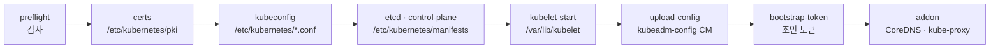
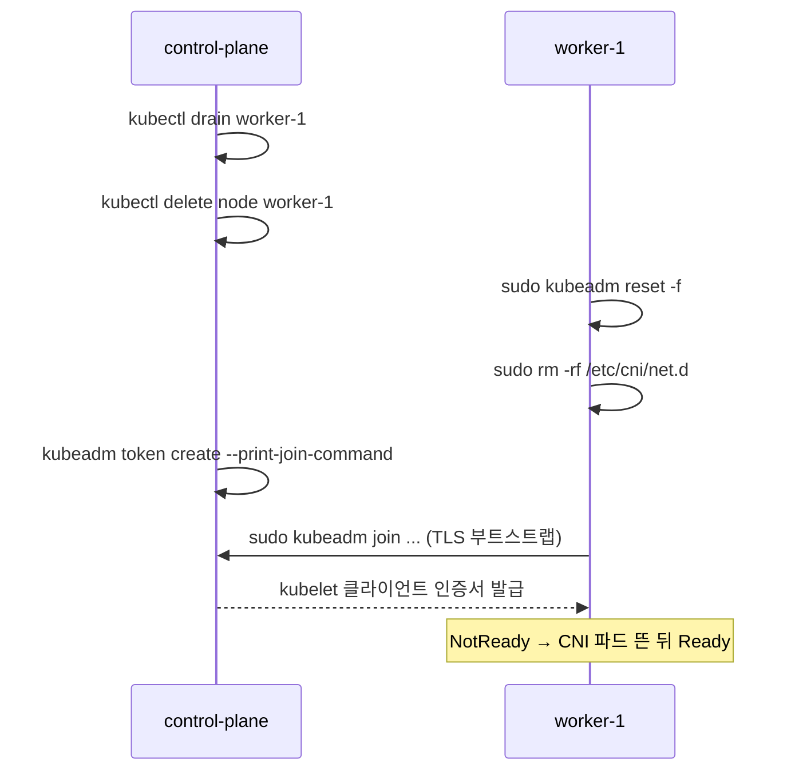

# 3·19강 · 노드 조인 · CNI · CRI

> 영상: **3강 내 클러스터 만들기** (kubeadm init/join · CNI) · **19강 노드 안을 열어 보기** (crictl · kubelet · CRI 설치) · 이어서 풀 채점 세트: `03-cluster-setup`

## 실습 목표

- 노드 준비(swap · 커널 모듈 · sysctl · containerd cgroup · apt hold)가 **실제로 되어 있는지** 명령으로 확인한다.
- `kubeadm init` 이 **어떤 단계(phase)** 를 거쳐 **어떤 파일**을 남겼는지 찾아본다.
- 조인 토큰과 discovery 해시가 **무엇을 증명하는지** 이해하고, 워커를 **빼고 다시 넣어** 본다.
- kubectl 없이 **crictl** 로 컨테이너 · 파드 · 로그 · 이미지를 본다.
- CNI 설정과 바이너리가 **어디에 있는지**, CNI 가 없으면 노드와 파드가 **어떻게 되는지** 확인한다.
- kubelet 이 **어떤 파일들로** 설정되는지(systemd 드롭인 · config.yaml · flags.env)와 **로그 보는 법**을 익힌다.
- 문서의 CNI 매니페스트를 **내려받아 cidr 를 클러스터 값으로** 고친다.
- CRI 패키지(cri-dockerd)를 **dpkg 로 설치 · enable --now · sysctl 영구 설정**까지 해 본다.

---

## 0) 준비

이 페이지는 kubectl 보다 **노드 안에서** 치는 명령이 많습니다. 터미널을 세 개 열어 두면 편합니다.

| 터미널 | 접속 | 주로 하는 일 |
|--------|------|--------------|
| ① | `control-plane` (192.168.56.10) | kubectl · kubeadm · crictl |
| ② | `worker-1` (192.168.56.11) | 5) 빼고 다시 넣기 |
| ③ | `worker-2` (192.168.56.12) | 6) crictl · 7) CNI 실험 · 9) CRI 패키지 |

```bash
# 내 노트북(호스트)에서 — 사용자 이름은 VM 을 만들 때 정한 것으로
ssh <사용자>@192.168.56.10
ssh <사용자>@192.168.56.11
ssh <사용자>@192.168.56.12
```

모든 명령 블록 첫 줄에 **어느 노드에서 치는지** 주석을 달아 두었습니다. 프롬프트를 보고 치세요.

```bash
# control-plane 에서
kubectl create namespace guide-cluster
mkdir -p ~/guide-cluster
kubectl get nodes -o wide
```

```text
NAME            STATUS   ROLES           AGE   VERSION    INTERNAL-IP     CONTAINER-RUNTIME
control-plane   Ready    control-plane   3d    v1.32.x    192.168.56.10   containerd://1.7.x
worker-1        Ready    <none>          3d    v1.32.x    192.168.56.11   containerd://1.7.x
worker-2        Ready    <none>          3d    v1.32.x    192.168.56.12   containerd://1.7.x
```

!!! danger "5) 와 7) 은 노드를 일부러 망가뜨립니다"
    시작 전에 VirtualBox 에서 **세 VM 모두의 스냅샷**을 찍어 두세요(04번 영상의 `clean-cluster`).
    한 대만 되돌리면 클러스터 상태가 어긋나므로, 되돌릴 때도 **세 대를 함께** 되돌립니다.

!!! tip "시험 팁 — 노드에 들어가는 법"
    시험 지문에 `ssh <노드>` 가 주어집니다. 들어가면 프롬프트가 바뀌는지 먼저 보고, root 권한이 필요하면 `sudo -i` 로 전환합니다.
    작업이 끝나면 **반드시 `exit`** 로 나옵니다. 노드 안에서는 kubectl 이 안 되거나 다른 클러스터를 가리킬 수 있습니다.

---

## 1) 노드 준비 — "설치했다" 가 아니라 "되어 있다" 를 확인한다

kubeadm 은 노드 준비를 대신 해 주지 않습니다. swap · 커널 · 런타임 · 패키지 네 가지가 어긋나면 init 이나 join 이 실패하거나, 더 나쁘게는 **성공한 뒤에 이상하게** 동작합니다.
세 노드 모두에서 같은 확인을 합니다.

```bash
# 모든 노드에서 (control-plane · worker-1 · worker-2)
swapon --show                                     # 아무것도 안 나와야 한다
lsmod | grep -E '^(overlay|br_netfilter)'
sysctl net.bridge.bridge-nf-call-iptables net.ipv4.ip_forward
grep -n 'SystemdCgroup' /etc/containerd/config.toml
apt-mark showhold
systemctl is-active containerd kubelet
```

```text
                                                  ← swapon: 빈 출력 = swap 꺼짐
br_netfilter           32768  0
overlay               212992  12
net.bridge.bridge-nf-call-iptables = 1
net.ipv4.ip_forward = 1
139:            SystemdCgroup = true
kubeadm
kubectl
kubelet
active
active
```

| 확인 항목 | 틀리면 생기는 일 |
|-----------|------------------|
| swap 꺼짐 | kubelet 이 뜨지 않는다 (preflight 에서 `[ERROR Swap]`) |
| `br_netfilter` · `ip_forward` | 파드끼리 · 노드 밖으로 통신이 안 된다 |
| `SystemdCgroup = true` | kubelet 과 런타임의 cgroup 드라이버가 달라 파드가 불안정하거나 `ContainerCreating` 에서 멈춘다 |
| `apt-mark hold` | `apt upgrade` 한 번에 kubelet 버전이 멋대로 올라간다 |

**관찰 포인트:** `modprobe` 와 `sysctl -w` 는 **재부팅하면 사라집니다.** 영구 설정은 파일에 있어야 합니다.

```bash
# 모든 노드에서
cat /etc/sysctl.d/k8s.conf
ls /etc/modules-load.d/
```

!!! tip "시험 팁 — \"영구적으로(persistently)\" 가 붙으면 파일이다"
    | 지금만 | 재부팅 뒤에도 |
    |--------|---------------|
    | `sudo modprobe br_netfilter` | `/etc/modules-load.d/<이름>.conf` 에 모듈 이름 한 줄 |
    | `sudo sysctl -w net.ipv4.ip_forward=1` | `/etc/sysctl.d/<이름>.conf` 에 쓰고 `sudo sysctl --system` |
    | `sudo systemctl start <서비스>` | `sudo systemctl enable --now <서비스>` |

    `.deb` 파일을 주고 설치 후 서비스로 띄우라는 문제도 나옵니다: `sudo dpkg -i <파일>.deb` → `sudo systemctl enable --now <서비스>` → `systemctl status <서비스>`. 9) 에서 cri-dockerd 로 직접 해 봅니다.

### 대조 실험 — preflight 는 무엇을 검사하나

이미 클러스터가 있는 control-plane 에서 preflight 단계만 돌려 보면, kubeadm 이 **무엇을 검사하는지** 목록으로 보입니다. 검사만 하고 아무것도 바꾸지 않습니다.

```bash
# control-plane 에서
sudo kubeadm init phase preflight
```

```text
[preflight] Running pre-flight checks
error execution phase preflight: [preflight] Some fatal errors occurred:
	[ERROR Port-6443]: Port 6443 is in use
	[ERROR Port-10259]: Port 10259 is in use
	[ERROR Port-10257]: Port 10257 is in use
	[ERROR FileAvailable--etc-kubernetes-manifests-kube-apiserver.yaml]: /etc/kubernetes/manifests/kube-apiserver.yaml already exists
	...
	[ERROR Port-10250]: Port 10250 is in use
	[ERROR Port-2379]: Port 2379 is in use
	[ERROR DirAvailable--var-lib-etcd]: /var/lib/etcd is not empty
[preflight] If you know what you are doing, you can make a check non-fatal with `--ignore-preflight-errors=...`
```

**관찰 포인트:** 에러 목록이 곧 **init 이 만들 것들의 목록**입니다. 6443(API 서버) · 10259(스케줄러) · 10257(컨트롤러 매니저) · 10250(kubelet) · 2379/2380(etcd) 포트와 매니페스트 파일, etcd 데이터 디렉터리.

---

## 2) kubeadm init 이 남긴 것 — 단계(phase)와 파일

`kubeadm init` 은 한 덩어리 명령처럼 보이지만 실제로는 **정해진 단계를 차례로** 실행합니다. 단계 목록은 도움말에 있습니다.

```bash
# control-plane 에서
kubeadm init --help | sed -n '/following phases/,/^$/p'
```

```text
The "init" command executes the following phases:
preflight                    Run pre-flight checks
certs                        Certificate generation
  /ca                          Generate the self-signed Kubernetes CA ...
  /apiserver                   ...
  ...
kubeconfig                   Generate all kubeconfig files necessary to establish the control plane and the admin kubeconfig file
  ...
etcd                         Generate static Pod manifest file for local etcd
control-plane                Generate all static Pod manifest files necessary to establish the control plane
kubelet-start                Write kubelet settings and (re)start the kubelet
wait-control-plane           Wait for the control plane to start
upload-config                Upload the kubeadm and kubelet configuration to a ConfigMap
upload-certs                 Upload certificates to kubeadm-certs
mark-control-plane           Mark a node as a control-plane
bootstrap-token              Generates bootstrap tokens used to join a node to a cluster
kubelet-finalize             Updates settings relevant to the kubelet after TLS bootstrap
addon                        Install required addons for passing conformance tests
...
```



각 단계의 결과물을 직접 찾아봅니다.

```bash
# control-plane 에서
sudo ls /etc/kubernetes/ /etc/kubernetes/pki/ /etc/kubernetes/pki/etcd/ /etc/kubernetes/manifests/
```

```text
/etc/kubernetes/:
admin.conf  controller-manager.conf  kubelet.conf  manifests  pki  scheduler.conf  super-admin.conf

/etc/kubernetes/pki/:
apiserver.crt  apiserver-etcd-client.crt  apiserver-kubelet-client.crt  ca.crt  ca.key  etcd
front-proxy-ca.crt  front-proxy-client.crt  sa.key  sa.pub  ...

/etc/kubernetes/pki/etcd/:
ca.crt  ca.key  healthcheck-client.crt  healthcheck-client.key  peer.crt  peer.key  server.crt  server.key

/etc/kubernetes/manifests/:
etcd.yaml  kube-apiserver.yaml  kube-controller-manager.yaml  kube-scheduler.yaml
```

| 단계 | 남긴 것 | 이 가이드에서 다시 쓰는 곳 |
|------|---------|---------------------------|
| certs | `/etc/kubernetes/pki/` (CA 10년 · 나머지 1년) | [20강 · 인증서](15-maintenance.md) |
| kubeconfig | `admin.conf` · `super-admin.conf` · `kubelet.conf` … | 3) |
| etcd · control-plane | `/etc/kubernetes/manifests/*.yaml` (스태틱 파드) | [19강 · static pod](16-node-ops.md) |
| kubelet-start | `/var/lib/kubelet/config.yaml` · `kubeadm-flags.env` | 8) |
| upload-config | `kube-system/kubeadm-config` ConfigMap | 아래 |
| bootstrap-token | `kube-system/bootstrap-token-*` Secret | 4) |

### init 때 준 옵션은 어디에 남나

`--pod-network-cidr` 같은 옵션은 **ConfigMap 으로 클러스터 안에** 남습니다. 업그레이드 때 kubeadm 이 이것을 읽습니다.

```bash
# control-plane 에서
kubectl -n kube-system get cm kubeadm-config -o jsonpath='{.data.ClusterConfiguration}' \
  | grep -E 'kubernetesVersion|podSubnet|serviceSubnet|controlPlaneEndpoint|dataDir'
```

```text
kubernetesVersion: v1.32.x
  dataDir: /var/lib/etcd
  podSubnet: 10.244.0.0/16
  serviceSubnet: 10.96.0.0/12
```

!!! note "podSubnet 은 10.244.0.0/16 인데 파드 IP 는 10.0.x.x"
    `cilium install` 기본 모드는 Cilium 자체 IPAM(cluster-pool, 10.0.0.0/8)으로 파드 IP 를 나눠 줍니다. kubeadm 에 준 `--pod-network-cidr` 은 기록만 되고 Cilium 은 쓰지 않습니다. 자세한 배경은 [3강 · 내 클러스터 만들기](04-cluster-build.md)의 8) 을 보세요.

!!! note "기본값과 비교해 보기"
    `kubeadm config print init-defaults` 는 **아무 옵션도 안 줬을 때의 설정**을 YAML 로 보여 줍니다. 클러스터를 바꾸지 않습니다.
    ```bash
    kubeadm config print init-defaults | grep -E 'advertiseAddress|serviceSubnet|podSubnet|criSocket'
    ```
    `advertiseAddress: 1.2.3.4` 처럼 자리표시 값이 보입니다. 그래서 VirtualBox 에서는 `--apiserver-advertise-address` 를 꼭 줘야 했습니다.

!!! tip "단계 하나만 다시 돌릴 수 있다"
    `kubeadm init phase <단계>` 로 단계 하나만 실행할 수 있습니다. 예: 컨트롤플레인을 하나 더 붙이려고 인증서를 다시 올릴 때
    `sudo kubeadm init phase upload-certs --upload-certs`. 시험에서 자주 쓰지는 않지만 "init 은 단계의 묶음" 이라는 감각은 트러블슈팅에 도움이 됩니다.

---

## 3) kubeconfig — admin.conf 와 super-admin.conf

init 이 끝나면 `admin.conf` 를 `~/.kube/config` 로 복사했습니다. 두 파일이 같은지, 그리고 1.29 부터 생긴 `super-admin.conf` 와 무엇이 다른지 봅니다.

```bash
# control-plane 에서
sudo diff -q /etc/kubernetes/admin.conf ~/.kube/config && echo "같은 파일"
kubectl config view --minify -o jsonpath='{.clusters[0].cluster.server}{"\n"}{.users[0].name}{"\n"}'
```

```text
같은 파일
https://192.168.56.10:6443
kubernetes-admin
```

클라이언트 인증서의 **그룹(O)** 이 권한을 정합니다.

```bash
# control-plane 에서
for f in admin super-admin; do
  echo "== $f.conf"
  sudo grep client-certificate-data /etc/kubernetes/$f.conf | awk '{print $2}' | base64 -d \
    | openssl x509 -noout -subject
done
```

```text
== admin.conf
subject=O = kubeadm:cluster-admins, CN = kubernetes-admin
== super-admin.conf
subject=O = system:masters, CN = kubernetes-super-admin
```

| 파일 | 그룹 | 성격 |
|------|------|------|
| `admin.conf` | `kubeadm:cluster-admins` | RBAC 로 cluster-admin 을 받은 그룹 — **RBAC 를 지우면 권한도 사라진다** |
| `super-admin.conf` | `system:masters` | RBAC 를 건너뛰는 비상용 — 평소에는 쓰지 않는다 |

**관찰 포인트:** 일상 작업은 `admin.conf` 로, RBAC 를 망가뜨려 잠겼을 때만 `super-admin.conf` 를 씁니다. 권한 구조는 [15강 · RBAC](14-rbac.md) 에서 이어집니다.

---

## 4) 조인 토큰 — 무엇이 무엇을 증명하나

join 명령에는 두 가지 값이 들어 있습니다.

| 값 | 증명하는 것 | 방향 |
|----|-------------|------|
| `--token abcdef.0123456789abcdef` | "나는 이 클러스터에 들어올 자격이 있는 노드다" | 노드 → 클러스터 |
| `--discovery-token-ca-cert-hash sha256:…` | "내가 접속한 API 서버는 진짜 이 클러스터다" (CA 공개키 고정) | 클러스터 → 노드 |

### 토큰 목록과 만료

```bash
# control-plane 에서
sudo kubeadm token list
```

```text
                                                  ← 클러스터를 만든 지 24시간이 지났으면 비어 있다
```

init 때 만든 토큰은 **24시간 뒤 만료**되어 사라집니다. 새로 만듭니다. 이번에는 짧게, 설명을 붙여서 만들어 봅니다.

```bash
# control-plane 에서
sudo kubeadm token create --ttl 2h --description "guide-cluster 실습" --print-join-command
sudo kubeadm token list
```

```text
kubeadm join 192.168.56.10:6443 --token 7k2m9x.q4w8e1r5t3y6u0i2 --discovery-token-ca-cert-hash sha256:5f1c...e9a2

TOKEN                     TTL   EXPIRES                USAGES                   DESCRIPTION           EXTRA GROUPS
7k2m9x.q4w8e1r5t3y6u0i2   1h    2026-09-29T08:12:41Z   authentication,signing   guide-cluster 실습    system:bootstrappers:kubeadm:default-node-token
```

토큰은 **kube-system 의 Secret** 으로 저장됩니다. 토큰 앞부분(`.` 앞)이 Secret 이름에 들어갑니다.

```bash
# control-plane 에서
kubectl -n kube-system get secrets | grep bootstrap-token
kubectl -n kube-system get secret bootstrap-token-7k2m9x -o jsonpath='{.data.expiration}' | base64 -d; echo
```

```text
bootstrap-token-7k2m9x   bootstrap.kubernetes.io/token   6      1m
2026-09-29T08:12:41Z
```

### discovery 해시를 직접 계산하기

해시는 **CA 인증서의 공개키**를 SHA-256 한 값입니다. 쿠버네티스 문서의 명령 그대로 계산해서, 위 join 명령의 값과 같은지 봅니다.

```bash
# control-plane 에서
openssl x509 -pubkey -in /etc/kubernetes/pki/ca.crt \
  | openssl rsa -pubin -outform der 2>/dev/null \
  | openssl dgst -sha256 -hex | sed 's/^.* //'
```

```text
5f1c...e9a2
```

**관찰 포인트:** 토큰은 몇 번을 새로 만들어도 **해시는 항상 같습니다.** CA 가 바뀌지 않는 한 클러스터의 "지문" 이기 때문입니다.

!!! tip "시험 팁"
    "노드를 조인하라" 가 나오면 init 출력을 찾지 말고 control-plane 에서 `kubeadm token create --print-join-command` 로 **완성된 명령**을 새로 뽑습니다.
    그 줄을 복사해 워커에서 `sudo` 를 붙여 실행하면 끝입니다. 문서 페이지는 *Creating a cluster with kubeadm* 과 *kubeadm join*.

---

## 5) 워커를 빼고 다시 넣기 — drain → delete → reset → join

!!! danger "worker-1 을 클러스터에서 실제로 뺍니다"
    - 0) 의 **VirtualBox 스냅샷**이 있는지 먼저 확인하세요.
    - worker-1 의 파드는 모두 다른 노드로 옮겨집니다. 한 대만 남는 동안 자원이 모자라 Pending 이 생길 수 있습니다.
    - `kubeadm reset` 은 되돌리는 명령이 없습니다. 이 절을 시작했으면 **끝의 join 까지** 진행하세요.



### ① 비우고 지우기

```bash
# control-plane 에서
kubectl drain worker-1 --ignore-daemonsets --delete-emptydir-data
kubectl delete node worker-1
kubectl get nodes
```

```text
node/worker-1 cordoned
Warning: ignoring DaemonSet-managed Pods: kube-system/cilium-8xk2p, kube-system/kube-proxy-m2n8c, ...
evicting pod kube-system/coredns-668d6bf9bc-7xk2p
...
node/worker-1 drained
node "worker-1" deleted

NAME            STATUS   ROLES           AGE   VERSION
control-plane   Ready    control-plane   3d    v1.32.x
worker-2        Ready    <none>          3d    v1.32.x
```

drain 플래그의 의미는 [20강 · drain](15-maintenance.md) 과 [19강 · drain 의 걸림돌](16-node-ops.md) 에서 자세히 봅니다.

### ② 노드 쪽 흔적 지우기

노드 오브젝트를 지워도 **worker-1 의 kubelet 은 아직 옛 인증서로 돌고 있습니다.** 노드 쪽을 초기화합니다.

```bash
# worker-1 에서
sudo kubeadm reset -f
```

```text
[preflight] Running pre-flight checks
...
[reset] Stopping the kubelet service
[reset] Unmounting mounted directories in "/var/lib/kubelet"
[reset] Deleting contents of directories: [/etc/kubernetes/manifests /var/lib/kubelet /etc/kubernetes/pki]
[reset] Deleting files: [/etc/kubernetes/admin.conf /etc/kubernetes/super-admin.conf /etc/kubernetes/kubelet.conf /etc/kubernetes/bootstrap-kubelet.conf ...]

The reset process does not clean CNI configuration. To do so, you must remove /etc/cni/net.d

The reset process does not reset or clean up iptables rules or IPVS tables.
...
```

출력이 알려 주는 대로 CNI 설정을 지웁니다. (CNI **바이너리** `/opt/cni/bin` 은 지우지 않습니다.)

```bash
# worker-1 에서
sudo rm -rf /etc/cni/net.d
systemctl is-active kubelet
```

```text
activating                ← kubelet.conf 가 없어서 뜨려다 죽기를 반복한다 (정상)
```

### ③ 다시 조인

```bash
# control-plane 에서
sudo kubeadm token create --print-join-command
```

```bash
# worker-1 에서 — 위 출력 한 줄을 그대로, 앞에 sudo 를 붙여서
sudo kubeadm join 192.168.56.10:6443 --token <토큰> --discovery-token-ca-cert-hash sha256:<해시>
```

```text
[preflight] Running pre-flight checks
[preflight] Reading configuration from the "kubeadm-config" ConfigMap in namespace "kube-system"...
[kubelet-start] Writing kubelet configuration to file "/var/lib/kubelet/config.yaml"
[kubelet-start] Writing kubelet environment file with flags to file "/var/lib/kubelet/kubeadm-flags.env"
[kubelet-start] Starting the kubelet
[kubelet-start] Waiting for the kubelet to perform the TLS Bootstrap
...
This node has joined the cluster:
* Certificate signing request was sent to apiserver and a response was received.
* The Kubelet was informed of the new secure connection details.
```

```bash
# control-plane 에서
kubectl get nodes -o wide -w
```

```text
NAME       STATUS     ROLES    AGE   VERSION   INTERNAL-IP
worker-1   NotReady   <none>   5s    v1.32.x   192.168.56.11     ← CNI 에이전트가 아직 안 떴다
worker-1   Ready      <none>   40s   v1.32.x   192.168.56.11     ← cilium 파드가 뜨고 CNI 설정을 다시 썼다
```

**관찰 포인트:** 조인 직후 잠깐 NotReady 인 이유는 **CNI 가 그 노드에 아직 없기 때문**입니다. Cilium DaemonSet 이 새 노드에 파드를 띄우면서 `/etc/cni/net.d` 를 다시 채웁니다.

```bash
# worker-1 에서
ls /etc/cni/net.d/
```

!!! warning "INTERNAL-IP 가 10.0.2.15 로 나오면"
    VirtualBox 는 NAT 어댑터(10.0.2.x)가 기본 경로라서, kubelet 이 그 주소를 노드 IP 로 고를 수 있습니다.
    이 과정의 클러스터는 `/etc/hosts` 에 `192.168.56.11 worker-1` 이 있어서 kubelet 이 hostname 을 해석해 192.168.56.x 를 고릅니다([3강](04-cluster-build.md) 1-5). hosts 가 맞는데도 10.0.2.15 가 나오면 `/etc/default/kubelet` 에 `KUBELET_EXTRA_ARGS=--node-ip=...` 를 넣습니다. `kubeadm reset` 은 이 파일을 지우지 않습니다. 8) 에서 이 파일을 확인합니다.

!!! question "노드 오브젝트를 안 지우고 reset → join 하면?"
    같은 이름으로 다시 등록되므로 대부분 동작합니다. 하지만 옛 노드의 레이블 · taint · 상태가 섞여 헷갈리기 쉬워서, 실무에서는 `kubectl delete node` 를 먼저 합니다.

---

## 6) crictl — kubectl 이 안 될 때의 창구

kubectl 은 **API 서버에 묻는** 도구이고, crictl 은 **그 노드의 컨테이너 런타임(containerd)에 직접 묻는** 도구입니다. API 서버가 죽어도 crictl 은 됩니다.

### 런타임 엔드포인트 설정

```bash
# 아무 노드에서
cat /etc/crictl.yaml
```

```text
runtime-endpoint: unix:///run/containerd/containerd.sock
```

이 파일이 없으면 crictl 이 여러 소켓을 차례로 찔러 보며 경고를 냅니다.

```text
WARN[0000] runtime connect using default endpoints: [unix:///run/containerd/containerd.sock unix:///run/crio/crio.sock unix:///var/run/cri-dockerd.sock]. As the default settings are now deprecated, you should set the endpoint instead.
```

없다면 한 번 만들어 둡니다.

```bash
# 파일이 없는 노드에서
sudo crictl config --set runtime-endpoint=unix:///run/containerd/containerd.sock
```

### 파드 · 컨테이너 · 이미지

```bash
# control-plane 에서
sudo crictl pods --namespace kube-system | head -5
sudo crictl ps --name kube-scheduler
sudo crictl images | head -5
```

```text
POD ID          CREATED       STATE   NAME                                    NAMESPACE     ATTEMPT   RUNTIME
9c8d7e6f5a4b1   3 hours ago   Ready   kube-scheduler-control-plane            kube-system   2         (default)
1a2b3c4d5e6f7   3 hours ago   Ready   etcd-control-plane                      kube-system   2         (default)
...

CONTAINER       IMAGE           CREATED       STATE     NAME             ATTEMPT   POD ID          POD
3f1c2a9b7d10e   a389e107f4ff1   3 hours ago   Running   kube-scheduler   3         9c8d7e6f5a4b1   kube-scheduler-control-plane

IMAGE                                     TAG        IMAGE ID        SIZE
quay.io/cilium/cilium                     v1.x.y     9a8b7c6d5e4f3   ...
registry.k8s.io/coredns/coredns           v1.11.x    c69fa2e9cbf5f   18.6MB
registry.k8s.io/etcd                      3.5.x-0    2e96e5913fc06   ...
...
```

| crictl | 비슷한 kubectl | 차이 |
|--------|----------------|------|
| `crictl pods` | `kubectl get pods` | **이 노드**의 파드 샌드박스만 |
| `crictl ps` / `ps -a` | `kubectl get pods` 의 컨테이너 | 컨테이너 단위 · `-a` 는 종료된 것까지 |
| `crictl logs <ID>` | `kubectl logs` | API 서버 없이 읽는다 |
| `crictl inspect <ID>` | `kubectl describe` | 런타임 수준 정보(PID · 마운트 · 이미지 다이제스트) |
| `crictl images` | — | 이 노드에 받아 둔 이미지 |

### 로그 읽기와 파일로 남기기

```bash
# control-plane 에서
ID=$(sudo crictl ps -q --name kube-scheduler | head -1)
sudo crictl logs --tail 5 "$ID"
sudo crictl logs "$ID" > ~/guide-cluster/scheduler.log 2>&1
wc -l ~/guide-cluster/scheduler.log
```

```text
I0929 03:02:11.418263       1 serving.go:386] Generated self-signed cert in-memory
I0929 03:02:12.071934       1 server.go:167] "Starting Kubernetes Scheduler" version="v1.32.x"
I0929 03:02:12.176112       1 leaderelection.go:257] attempting to acquire leader lease kube-system/kube-scheduler...
...
48 /home/<사용자>/guide-cluster/scheduler.log
```

!!! warning "`2>&1` 을 빼면 파일이 비어 있을 수 있습니다"
    컨테이너 로그 중 stderr 로 나온 줄은 crictl 도 **stderr 로** 내보냅니다. 쿠버네티스 구성 요소는 대부분 stderr 에 로그를 씁니다.
    `> 파일` 만 하면 화면에는 보이는데 파일은 비는 일이 생깁니다.

**관찰 포인트:** 로그의 실체는 노드의 파일입니다. crictl 과 kubectl 은 이 파일을 읽어 줄 뿐입니다.

```bash
# control-plane 에서
sudo ls /var/log/pods/ | grep scheduler
sudo ls -l /var/log/containers/ | grep scheduler
```

```text
kube-system_kube-scheduler-control-plane_4b9e2c...
lrwxrwxrwx 1 root root ... kube-scheduler-control-plane_kube-system_kube-scheduler-3f1c2a9b....log -> /var/log/pods/kube-system_kube-scheduler-control-plane_.../kube-scheduler/3.log
```

### inspect 로 런타임 정보 보기

```bash
# control-plane 에서
sudo crictl inspect "$ID" | grep -m1 '"pid"'
sudo crictl inspect "$ID" | grep -m1 '"image"'
```

```text
    "pid": 1843,
      "image": "registry.k8s.io/kube-scheduler:v1.32.x"
```

### 대조 실험 — 컨테이너를 crictl 로 멈추면?

worker-2 에 파드를 하나 고정해서 띄웁니다.

```bash
# control-plane 에서
kubectl run pinned -n guide-cluster --image=nginx:1.27 \
  --overrides='{"spec":{"nodeName":"worker-2"}}'
kubectl get pod pinned -n guide-cluster -o wide
```

```bash
# worker-2 에서
sudo crictl ps --name pinned
sudo crictl stop $(sudo crictl ps -q --name pinned)
sleep 10; sudo crictl ps -a --name pinned
```

```text
CONTAINER       IMAGE           CREATED          STATE     NAME     ATTEMPT   POD ID          POD
b7e1...         9bea9f2796e2    2 minutes ago    Running   pinned   0         4c2d...         pinned

CONTAINER       IMAGE           CREATED          STATE     NAME     ATTEMPT   POD ID          POD
e0a9...         9bea9f2796e2    5 seconds ago    Running   pinned   1         4c2d...         pinned   ← 새 컨테이너
b7e1...         9bea9f2796e2    2 minutes ago    Exited    pinned   0         4c2d...         pinned
```

```bash
# control-plane 에서
kubectl get pod pinned -n guide-cluster
```

```text
NAME     READY   STATUS    RESTARTS      AGE
pinned   1/1     Running   1 (15s ago)   3m
```

**관찰 포인트:** crictl 로 멈춰도 **kubelet 이 원하는 상태(파드 스펙)를 보고 다시 띄웁니다.** POD ID 는 그대로이고 ATTEMPT 와 RESTARTS 만 1 올라갔습니다. 파드를 없애는 것은 여전히 kubelet(또는 API)의 일입니다.

!!! tip "시험 팁"
    - crictl 은 **노드 안에서, sudo 로** 칩니다. `crictl ps -q --name <이름>` 으로 ID 만 뽑으면 한 줄로 이어 쓰기 좋습니다.
    - 문서 페이지: *Debugging Kubernetes nodes with crictl*.

---

## 7) CNI — 설정은 어디에, 없으면 어떻게 되나

CNI 는 두 조각입니다. **설정 파일**(어떤 플러그인을 쓸지)과 **바이너리**(실제로 인터페이스를 만드는 실행 파일). 컨테이너 런타임이 파드를 만들 때 설정을 읽고 바이너리를 실행합니다.

```bash
# 아무 노드에서
ls /etc/cni/net.d/
cat /etc/cni/net.d/05-cilium.conflist
ls /opt/cni/bin/
```

```text
05-cilium.conflist

{
  "cniVersion": "0.3.1",
  "name": "cilium",
  "plugins": [
    {
       "type": "cilium-cni",
       ...
    }
  ]
}

bandwidth  bridge  cilium-cni  dhcp  firewall  host-device  host-local  loopback  macvlan  portmap  ptp  ...
```

| 위치 | 내용 | 누가 채우나 |
|------|------|-------------|
| `/etc/cni/net.d/` | 설정 (사전순으로 **첫 파일**이 쓰인다) | CNI 에이전트(cilium DaemonSet)가 노드마다 씀 |
| `/opt/cni/bin/` | 플러그인 실행 파일 | `kubernetes-cni` 패키지 + CNI 에이전트 |
| containerd 설정 | 위 두 경로를 가리킨다 | `/etc/containerd/config.toml` 의 `[plugins."io.containerd.grpc.v1.cri".cni]` |

### 어떤 CNI 를 쓰는지 알아내는 세 가지 방법

```bash
# control-plane 에서
kubectl get pods -n kube-system -o wide | grep -Ei 'cilium|calico|flannel|weave'
kubectl get ds -n kube-system
ls /etc/cni/net.d/
```

```text
cilium-8xk2p                        1/1   Running   ...   worker-1
cilium-envoy-...                    1/1   Running   ...   worker-1
cilium-operator-6c9d...             1/1   Running   ...   worker-2
...
NAME           DESIRED   CURRENT   READY   ...
cilium         3         3         3
cilium-envoy   3         3         3
kube-proxy     3         3         3
```

설치 방식까지 보려면:

```bash
# control-plane 에서 (helm · cilium CLI 가 설치돼 있다면)
helm list -n kube-system
cilium version
```

!!! note "CNI 설치 명령은 CNI 마다 다르다"
    | 방식 | 예 |
    |------|----|
    | 매니페스트 한 장 | `kubectl apply -f https://github.com/flannel-io/flannel/releases/latest/download/kube-flannel.yml` |
    | Helm 차트 | `helm repo add cilium https://helm.cilium.io/` → `helm install cilium cilium/cilium --version 1.x.y -n kube-system` |
    | 전용 CLI | `cilium install --version 1.x.y` |

    이 클러스터에는 이미 CNI 가 있으니 **실행하지는 마세요.** 시험에서는 문서 링크나 주어진 URL 을 보고 이 중 한 형태로 설치합니다.
    `--pod-network-cidr` 을 요구하는 CNI(Flannel · Calico 기본 설정)는 init 때 준 값과 맞아야 합니다.

### 문서의 매니페스트가 바로 안 될 때 — 내려받아 cidr 맞추기

시험에서는 "문서대로 `kubectl create -f <URL>` 했더니 안 된다" 가 그대로 문제로 나옵니다. Calico 의 operator 방식이 대표적입니다. 문서는 두 줄을 칩니다.

```bash
kubectl create -f https://raw.githubusercontent.com/projectcalico/calico/<버전>/manifests/tigera-operator.yaml
kubectl create -f https://raw.githubusercontent.com/projectcalico/calico/<버전>/manifests/custom-resources.yaml
```

두 번째 파일(`custom-resources.yaml`)을 URL 그대로 쓰면 안 되는 이유가 두 가지입니다.

| 이유 | 증상 |
|------|------|
| IP 풀 `cidr` 가 문서 기본값 **192.168.0.0/16** 이다 | 클러스터의 파드 CIDR 와 달라 파드 IP 가 엉뚱한 대역에서 나오거나 노드 간 라우팅이 어긋난다 |
| `Installation` 은 operator 가 만드는 **CRD 종류**다 | operator 를 먼저 안 깔았으면 `no matches for kind "Installation"` 으로 실패한다 |

그래서 **파일로 내려받아 cidr 를 클러스터 값으로 고친 뒤** 적용합니다. 여기서는 이미 Cilium 이 있으므로 **고치기까지만** 하고 적용은 하지 않습니다.

#### ① 클러스터의 파드 CIDR 찾기

```bash
# control-plane 에서
kubectl -n kube-system get cm kubeadm-config -o jsonpath='{.data.ClusterConfiguration}' | grep podSubnet
kubectl get nodes -o custom-columns=NAME:.metadata.name,PODCIDR:.spec.podCIDR
```

```text
  podSubnet: 10.244.0.0/16
NAME            PODCIDR
control-plane   10.244.0.0/24
worker-1        10.244.1.0/24
worker-2        10.244.2.0/24
```

| 어디서 | 보이는 값 | 쓰임 |
|--------|-----------|------|
| `kubeadm-config` 의 `podSubnet` | **클러스터 전체** 대역 (`--pod-network-cidr`) | CNI 매니페스트의 cidr 에 넣는 값 |
| 노드의 `spec.podCIDR` | 그 노드에 떼어 준 **/24 조각** | 전체 대역을 짐작하는 단서 — 이 값을 그대로 넣으면 안 된다 |

!!! note "이 클러스터의 파드 IP 는 10.0.x.x 인데요?"
    2) 에서 본 것처럼 Cilium 기본 모드는 자체 IPAM 을 써서 `podSubnet` 과 다른 대역을 씁니다. 하지만 "클러스터의 파드 CIDR" 를 묻는 문제의 답은 **kubeadm 에 기록된 값**(`podSubnet`)입니다. `kubectl get pods -o wide` 의 IP 를 보고 고르지 마세요.

#### ② 내려받아서 고치기

버전만 다를 뿐 파일 구조는 같습니다. 이 페이지에서는 v3.30.3 을 받아 봅니다.

```bash
# control-plane 에서
cd ~/guide-cluster
curl -fsSLo calico-cr.yaml https://raw.githubusercontent.com/projectcalico/calico/v3.30.3/manifests/custom-resources.yaml
grep -n -B2 -A3 'cidr' calico-cr.yaml
```

```text
11-    - name: default-ipv4-ippool
12-      blockSize: 26
13:      cidr: 192.168.0.0/16
14-      encapsulation: VXLANCrossSubnet
15-      natOutgoing: Enabled
16-      nodeSelector: all()
```

`vi` 로 고쳐도 되고, 값이 한 군데뿐이면 `sed` 가 빠릅니다. 값은 **손으로 치지 말고** 클러스터에서 읽은 것을 넣습니다.

```bash
# control-plane 에서
POD_CIDR=$(kubectl -n kube-system get cm kubeadm-config -o jsonpath='{.data.ClusterConfiguration}' | awk '/podSubnet:/{print $2}')
echo "$POD_CIDR"
sed -i "s#cidr: 192.168.0.0/16#cidr: ${POD_CIDR}#" calico-cr.yaml
grep -n 'cidr' calico-cr.yaml
```

```text
10.244.0.0/16
13:      cidr: 10.244.0.0/16
```

#### ③ 고친 파일이 YAML 로 멀쩡한지 확인

`kubectl create --dry-run=client` 는 이 파일에 쓸 수 없습니다. `Installation` CRD 가 없어서 dry-run 도 **같은 이유로 실패**합니다. YAML 문법만 보려면 파이썬으로 읽어 봅니다.

```bash
# control-plane 에서
python3 -c 'import yaml,sys; [print(d["kind"], d.get("spec",{}).get("calicoNetwork",{}).get("ipPools",[{}])[0].get("cidr","")) for d in yaml.safe_load_all(open(sys.argv[1])) if d]' calico-cr.yaml
```

```text
Installation 10.244.0.0/16
APIServer
Goldmane
Whisker
```

들여쓰기를 망가뜨렸다면 `yaml.scanner.ScannerError` 가 나옵니다. 특히 `vi` 에서 **탭**이 들어가면 YAML 이 깨집니다.

#### ④ 적용 명령 — URL 이 아니라 고친 파일

```bash
# 실제 클러스터를 새로 만들 때라면 (여기서는 실행하지 않는다)
kubectl create -f https://raw.githubusercontent.com/projectcalico/calico/v3.30.3/manifests/tigera-operator.yaml
kubectl create -f ~/guide-cluster/calico-cr.yaml
```

### 대조 실험 — operator 없이 custom-resources 를 적용하면

이 실험은 **아무것도 만들지 않고 실패**하므로 안전합니다. 문서의 두 번째 줄만 먼저 치면 어떻게 되는지 봅니다.

```bash
# control-plane 에서
kubectl create -f ~/guide-cluster/calico-cr.yaml
```

```text
error: resource mapping not found for name: "default" namespace: "" from "/home/<사용자>/guide-cluster/calico-cr.yaml": no matches for kind "Installation" in version "operator.tigera.io/v1"
ensure CRDs are installed first
...                                              ← APIServer · Goldmane · Whisker 도 같은 오류
```

**관찰 포인트:** "문서 명령이 실패한다" 의 원인은 대개 **순서**(CRD/operator 먼저)이거나 **값**(cidr)입니다. 오류 메시지의 `ensure CRDs are installed first` 가 순서 문제라는 힌트입니다.

!!! tip "시험 팁 — URL 을 바로 create 하지 말고 받아서 본다"
    - `curl -LO <URL>` 또는 `wget <URL>` 로 받아 `grep -n cidr` 부터 봅니다.
    - cidr 는 `kubeadm-config` 의 **podSubnet** 으로 맞춥니다. 노드의 `/24` 조각을 넣지 않습니다.
    - 적용은 `kubectl create -f <고친 파일>`. operator 매니페스트가 따로 있으면 그것을 **먼저** 적용합니다.

### 대조 실험 — worker-2 에서 CNI 설정을 치우면

!!! danger "worker-2 의 네트워크를 잠깐 끊습니다"
    반드시 **같은 절 안에서 파일을 되돌리세요.** 되돌리지 않으면 worker-2 에 새 파드가 뜨지 않습니다.

```bash
# worker-2 에서
sudo mv /etc/cni/net.d/05-cilium.conflist /root/05-cilium.conflist.guide
```

```bash
# control-plane 에서 — 30초쯤 뒤
kubectl get nodes worker-2
kubectl describe node worker-2 | grep -A1 'Ready '
```

```text
NAME       STATUS     ROLES    AGE   VERSION
worker-2   NotReady   <none>   3d    v1.32.x

  Ready            False   ...   KubeletNotReady   container runtime network not ready: NetworkReady=false reason:NetworkPluginNotReady message:Network plugin returns error: cni plugin not initialized
```

이 상태에서 worker-2 에 파드를 고정해 띄워 봅니다.

```bash
# control-plane 에서
kubectl run no-cni -n guide-cluster --image=nginx:1.27 \
  --overrides='{"spec":{"nodeName":"worker-2"}}'
kubectl get pod no-cni -n guide-cluster
kubectl describe pod no-cni -n guide-cluster | tail -3
```

```text
NAME     READY   STATUS              RESTARTS   AGE
no-cni   0/1     ContainerCreating   0          20s

  Warning  NetworkNotReady  ...  network is not ready: container runtime network not ready: NetworkReady=false reason:NetworkPluginNotReady message:Network plugin returns error: cni plugin not initialized
```

!!! note "파일이 저절로 다시 생겼다면"
    CNI 에이전트(Cilium)는 자기 설정 파일을 관리합니다. 버전에 따라 지워진 파일을 **곧바로 다시 써서** 노드가 NotReady 까지 가지 않을 수 있습니다.
    `ls /etc/cni/net.d/` 에 파일이 돌아와 있다면 그것이 관찰 포인트입니다 — **CNI 설정은 사람이 아니라 에이전트가 채운다.**
    이 경우 아래 되돌리기에서 백업 파일(`/root/05-cilium.conflist.guide`)만 지우면 됩니다.

**관찰 포인트:** 이미 돌던 파드(`pinned`)는 그대로 Running 입니다. CNI 는 **파드 샌드박스를 만들 때만** 쓰이기 때문입니다. 새 파드만 `ContainerCreating` 에 걸립니다.
스케줄러를 거치는 파드였다면 NotReady 노드의 taint 때문에 **아예 배치되지 않고** 다른 노드로 갔을 것입니다. `nodeName` 은 스케줄러를 건너뛰어서 이 증상을 볼 수 있었습니다.

되돌립니다.

```bash
# worker-2 에서
sudo mv -n /root/05-cilium.conflist.guide /etc/cni/net.d/05-cilium.conflist   # -n: 이미 있으면 덮지 않는다
sudo rm -f /root/05-cilium.conflist.guide
ls /etc/cni/net.d/
```

```bash
# control-plane 에서
kubectl get nodes worker-2 -w          # Ready 로 돌아올 때까지
kubectl get pod no-cni -n guide-cluster
```

```text
NAME     READY   STATUS    RESTARTS   AGE
no-cni   1/1     Running   0          2m
```

!!! tip "시험 팁 — NotReady 를 보면 describe 의 메시지부터"
    | 메시지 | 방향 |
    |--------|------|
    | `NetworkPluginNotReady` · `cni plugin not initialized` | CNI 가 없거나 설정이 없다 → CNI 설치 또는 `/etc/cni/net.d` 확인 |
    | `Kubelet stopped posting node status` | kubelet 이 멈췄다 → 노드에 들어가 `systemctl status kubelet` ([19강](16-node-ops.md)) |

---

## 8) kubelet — 설정 파일 세 겹과 로그

kubelet 은 파드가 아니라 **systemd 서비스**입니다. 설정이 여러 파일에 나뉘어 있어서, 고칠 곳을 잘못 찾기 쉽습니다.

```bash
# 아무 노드에서
systemctl cat kubelet
```

```text
# /usr/lib/systemd/system/kubelet.service
[Unit]
Description=kubelet: The Kubernetes Node Agent
...
[Service]
ExecStart=/usr/bin/kubelet
Restart=always
...

# /usr/lib/systemd/system/kubelet.service.d/10-kubeadm.conf
[Service]
Environment="KUBELET_KUBECONFIG_ARGS=--bootstrap-kubeconfig=/etc/kubernetes/bootstrap-kubelet.conf --kubeconfig=/etc/kubernetes/kubelet.conf"
Environment="KUBELET_CONFIG_ARGS=--config=/var/lib/kubelet/config.yaml"
EnvironmentFile=-/var/lib/kubelet/kubeadm-flags.env
EnvironmentFile=-/etc/default/kubelet
ExecStart=
ExecStart=/usr/bin/kubelet $KUBELET_KUBECONFIG_ARGS $KUBELET_CONFIG_ARGS $KUBELET_KUBEADM_ARGS $KUBELET_EXTRA_ARGS
```

**드롭인(`.service.d/10-kubeadm.conf`)이 본 유닛의 `ExecStart` 를 비우고 다시 씁니다.** 실제 인자는 네 군데에서 모입니다.

| 파일 | 누가 쓰나 | 담긴 것 |
|------|-----------|---------|
| `10-kubeadm.conf` (드롭인) | kubelet 패키지 | kubeconfig 경로 · `--config` 경로 |
| `/var/lib/kubelet/config.yaml` | kubeadm (init/join/upgrade) | cgroupDriver · clusterDNS · staticPodPath · 인증서 경로 |
| `/var/lib/kubelet/kubeadm-flags.env` | kubeadm | `KUBELET_KUBEADM_ARGS` (런타임 소켓 등) |
| `/etc/default/kubelet` | **사람** | `KUBELET_EXTRA_ARGS` (예: `--node-ip`) — kubeadm 이 건드리지 않는다 |

```bash
# 아무 노드에서
sudo grep -E 'cgroupDriver|clusterDNS|staticPodPath|clientCAFile|rotateCertificates' -A1 /var/lib/kubelet/config.yaml
cat /var/lib/kubelet/kubeadm-flags.env
cat /etc/default/kubelet 2>/dev/null
```

```text
    clientCAFile: /etc/kubernetes/pki/ca.crt
cgroupDriver: systemd
clusterDNS:
- 10.96.0.10
rotateCertificates: true
staticPodPath: /etc/kubernetes/manifests

KUBELET_KUBEADM_ARGS="--container-runtime-endpoint=unix:///var/run/containerd/containerd.sock ..."

KUBELET_EXTRA_ARGS=
```

이 과정의 클러스터는 hosts 파일로 노드 IP 가 정해지므로 `KUBELET_EXTRA_ARGS` 가 비어 있거나 파일이 없는 것이 정상입니다. 10.0.2.15 문제를 고친 노드라면 `--node-ip=192.168.56.x` 가 들어 있습니다.

실행 중인 프로세스 인자로도 같은 것을 확인할 수 있습니다.

```bash
# 아무 노드에서
ps -ef | grep '[/]usr/bin/kubelet' | tr ' ' '\n' | grep -- '^--'
```

```text
--bootstrap-kubeconfig=/etc/kubernetes/bootstrap-kubelet.conf
--kubeconfig=/etc/kubernetes/kubelet.conf
--config=/var/lib/kubelet/config.yaml
--container-runtime-endpoint=unix:///var/run/containerd/containerd.sock
...
```

!!! warning "고친 파일에 따라 다시 읽히는 방법이 다르다"
    - 유닛 · 드롭인 파일(`/usr/lib/systemd/...`, `/etc/systemd/...`)을 고쳤다 → `sudo systemctl daemon-reload` **먼저**, 그다음 `restart kubelet`
    - `config.yaml` · `kubeadm-flags.env` · `/etc/default/kubelet` 을 고쳤다 → `sudo systemctl restart kubelet`

    daemon-reload 를 빠뜨리면 **고쳤는데도 옛 설정으로** 뜹니다.

### 로그는 journalctl

```bash
# 아무 노드에서
sudo journalctl -u kubelet -n 20 --no-pager
sudo journalctl -u kubelet --since "10 min ago" --no-pager | grep -iE 'error|fail' | tail -5
```

```text
Sep 29 06:12:41 worker-2 kubelet[812]: I0929 06:12:41.118263     812 kubelet_node_status.go:...] "Node became not ready" node="worker-2" condition={"type":"Ready","status":"False",...,"message":"container runtime network not ready: ... cni plugin not initialized"}
...
```

**관찰 포인트:** 7) 의 실험 흔적이 kubelet 로그에 그대로 남아 있습니다. 노드가 NotReady 일 때 **원인 문장은 거의 항상 여기** 있습니다.

| 옵션 | 뜻 |
|------|----|
| `-u kubelet` | kubelet 유닛만 |
| `-n 30` | 마지막 30줄 |
| `-f` | 계속 따라가기 (Ctrl+C 로 종료) |
| `--since "10 min ago"` | 시간 범위 |
| `--no-pager` | less 없이 바로 출력 (파이프 · 파일로 보낼 때) |

kubelet 을 멈추고 고치는 실험은 [19강 · NotReady 복구](16-node-ops.md) 에서 합니다.

---

## 9) CRI 패키지 설치 (dpkg · systemctl enable --now · sysctl 영구 설정)

시험에는 "이 노드에 **cri-dockerd** 를 설치하고 서비스로 띄운 뒤, 커널 파라미터를 영구 설정하라" 가 나옵니다. cri-dockerd 는 Docker 엔진을 CRI 로 감싸 주는 어댑터입니다. 손이 가는 곳은 세 군데입니다.

| 단계 | 명령 | 확인 |
|------|------|------|
| 패키지 설치 | `sudo dpkg -i <파일>.deb` | `dpkg -s <패키지>` 의 `Status: install ok installed` |
| 서비스 | `sudo systemctl enable --now <유닛>` | `systemctl is-enabled` · `is-active` |
| 커널 파라미터 | `/etc/sysctl.d/<이름>.conf` 에 쓰고 `sudo sysctl --system` | `sysctl <키>` |

!!! warning "이 실습 노드에는 Docker 엔진이 없습니다"
    이 과정의 클러스터는 containerd 를 쓰고 Docker 엔진은 깔지 않았습니다. 그래서 cri-docker 서비스는 **enable 은 되지만 active 로 유지되지 못합니다**(시작 실패 · 재시작 반복).
    여기서는 그것이 정상입니다. **kubelet 은 계속 containerd 를 쓰므로** 노드는 Ready 로 남습니다. 실제 시험 환경에서는 Docker 가 있어 active 까지 확인됩니다.

### ① 패키지 파일 고르기와 내려받기

GitHub 릴리스에는 배포판 · 아키텍처별 `.deb` 가 따로 있습니다. 노드에 맞는 이름을 먼저 확인합니다.

```bash
# worker-2 에서
dpkg --print-architecture
. /etc/os-release; echo "$VERSION_CODENAME"
```

```text
amd64                     ← Apple Silicon 맥의 VM 이면 arm64
noble                     ← Ubuntu 24.04
```

파일 이름은 `cri-dockerd_<버전>.3-0.ubuntu-<코드네임>_<아키텍처>.deb` 형태입니다.

```bash
# worker-2 에서
mkdir -p ~/guide-cri && cd ~/guide-cri
ARCH=$(dpkg --print-architecture)
curl -fLO "https://github.com/Mirantis/cri-dockerd/releases/download/v0.3.26/cri-dockerd_0.3.26.3-0.ubuntu-noble_${ARCH}.deb"
ls -l
```

```text
-rw-rw-r-- 1 <사용자> <사용자> 11922052 ... cri-dockerd_0.3.26.3-0.ubuntu-noble_amd64.deb
```

### ② dpkg 로 설치

```bash
# worker-2 에서
sudo dpkg -i ~/guide-cri/cri-dockerd_*.deb
dpkg -s cri-dockerd | grep -E '^(Status|Version|Depends)'
```

```text
Selecting previously unselected package cri-dockerd.
(Reading database ... 8xxxx files and directories currently installed.)
Preparing to unpack .../cri-dockerd_0.3.26.3-0.ubuntu-noble_amd64.deb ...
Unpacking cri-dockerd (0.3.26~3-0~ubuntu-noble) ...
Setting up cri-dockerd (0.3.26~3-0~ubuntu-noble) ...

Status: install ok installed
Version: 0:0.3.26~3-0~ubuntu-noble
Depends: containerd (>= 1.2.2-3) | containerd.io (>= 1.2.2-3) | moby-containerd (>= 1.2.2), iptables, libseccomp2 (>= 2.3.0), libc6 (>= 2.34)
```

**관찰 포인트:** `dpkg` 는 의존성을 **검사만 하고 받아 오지 않습니다.** 이 노드에는 apt 로 깐 `containerd` 가 있어서 바로 `install ok installed` 가 됩니다. 의존성이 모자라면 `install ok unpacked` 에 멈추고 `dependency problems` 가 나옵니다. 그때는 `sudo apt-get install -f -y` 로 채웁니다.

!!! note "패키지 이름과 서비스 이름이 다르다"
    패키지는 `cri-dockerd`, 서비스는 `cri-docker.service` 와 `cri-docker.socket` 입니다. 이름이 헷갈리면 목록으로 찾습니다.
    ```bash
    systemctl list-unit-files 'cri-docker*'
    dpkg -L cri-dockerd | grep systemd
    ```

### ③ enable --now — 그리고 Docker 없는 노드에서 보이는 것

데비안 패키지는 설치하면서 유닛을 **스스로 enable** 해 두기도 합니다. 그래도 시험에서는 지문대로 직접 enable 하고 시작합니다.

```bash
# worker-2 에서
sudo systemctl enable --now cri-docker.service
systemctl is-enabled cri-docker.service cri-docker.socket
systemctl is-active cri-docker.service
```

```text
A dependency job for cri-docker.service failed. See 'journalctl -xe' for details.
enabled
enabled
failed                    ← Docker 엔진이 없어서 (이 실습에서는 정상)
```

왜 실패하는지 유닛과 로그로 확인합니다.

```bash
# worker-2 에서
systemctl cat cri-docker.socket | grep -E 'ListenStream|SocketGroup'
sudo journalctl -u cri-docker.socket -n 5 --no-pager
```

```text
ListenStream=%t/cri-dockerd.sock
SocketGroup=docker
... cri-docker.socket: Failed to resolve group docker: No such process
... Failed to listen on cri-docker.socket - CRI Docker Socket for the API.
```

**관찰 포인트:** 소켓 유닛이 `docker` 그룹 소유로 소켓을 만들려는데, Docker 엔진을 깔지 않아 그 그룹이 없습니다. 메시지는 버전마다 조금 다르지만 **원인은 같습니다** — 이 노드에 Docker 가 없다. kubelet 은 여전히 containerd 소켓을 씁니다.

```bash
# worker-2 에서
grep -o 'container-runtime-endpoint=[^ "]*' /var/lib/kubelet/kubeadm-flags.env
```

```text
container-runtime-endpoint=unix:///var/run/containerd/containerd.sock
```

| 명령 | 하는 일 | 재부팅 뒤 |
|------|---------|-----------|
| `systemctl start` | 지금 시작 | 안 뜬다 |
| `systemctl enable` | 부팅 때 시작하도록 링크 생성 | 뜬다 (지금은 안 뜸) |
| `systemctl enable --now` | 둘 다 | 뜬다 |

### ④ sysctl 영구 설정

`sysctl -w` 는 지금만 바꿉니다. 재부팅 뒤에도 남기려면 `/etc/sysctl.d/` 에 파일로 씁니다. 먼저 지금 값을 적어 둡니다(정리할 때 되돌리려고).

```bash
# worker-2 에서
sysctl net.ipv6.conf.all.forwarding net.netfilter.nf_conntrack_max | tee ~/guide-cri/sysctl-before.txt
```

```text
net.ipv6.conf.all.forwarding = 0
net.netfilter.nf_conntrack_max = 131072       ← kube-proxy 가 이미 맞춰 둔 값일 수 있다
```

```bash
# worker-2 에서
cat <<'EOF' | sudo tee /etc/sysctl.d/90-guide-cri.conf
net.bridge.bridge-nf-call-iptables = 1
net.ipv6.conf.all.forwarding = 1
net.ipv4.ip_forward = 1
net.netfilter.nf_conntrack_max = 131072
EOF
sudo sysctl --system | grep -A4 90-guide-cri
```

```text
* Applying /etc/sysctl.d/90-guide-cri.conf ...
net.bridge.bridge-nf-call-iptables = 1
net.ipv6.conf.all.forwarding = 1
net.ipv4.ip_forward = 1
net.netfilter.nf_conntrack_max = 131072
```

| 키 | 뜻 |
|----|----|
| `net.bridge.bridge-nf-call-iptables` | 브리지를 지나는 트래픽도 iptables 를 거친다 (`br_netfilter` 모듈 필요) |
| `net.ipv4.ip_forward` · `net.ipv6.conf.all.forwarding` | 노드가 패킷을 다른 인터페이스로 넘겨 준다 (파드 ↔ 바깥) |
| `net.netfilter.nf_conntrack_max` | 연결 추적 테이블 크기 (`nf_conntrack` 모듈이 올라와 있어야 키가 보인다) |

!!! tip "시험 팁 — 파일 하나만 다시 읽기"
    `sudo sysctl --system` 은 모든 설정 파일을 다시 읽습니다. 방금 쓴 파일만 적용하려면 `sudo sysctl -p /etc/sysctl.d/<이름>.conf`.
    `sysctl: cannot stat /proc/sys/net/bridge/...` 가 나오면 `br_netfilter` 모듈이 안 올라온 것입니다 → `sudo modprobe br_netfilter` (영구는 1) 의 표 참고).

### 대조 실험 — 파일 없이 -w 만 하면

```bash
# worker-2 에서
sudo sysctl -w net.ipv6.conf.all.forwarding=0
sudo sysctl -p /etc/sysctl.d/90-guide-cri.conf | grep ipv6
```

```text
net.ipv6.conf.all.forwarding = 0
net.ipv6.conf.all.forwarding = 1               ← 파일이 있으니 다시 읽으면 돌아온다
```

**관찰 포인트:** 재부팅은 "파일을 다시 읽는 것" 과 같습니다. `-w` 만 한 값은 재부팅에서 사라지고, **파일에 있는 값**만 살아남습니다. 채점도 보통 두 가지를 다 봅니다 — 지금 값(`sysctl`)과 파일.

### ⑤ 되돌리기

```bash
# worker-2 에서
sudo dpkg --purge cri-dockerd
sudo systemctl reset-failed cri-docker.service cri-docker.socket 2>/dev/null
sudo rm -f /etc/sysctl.d/90-guide-cri.conf
cat ~/guide-cri/sysctl-before.txt                  # ④ 에서 적어 둔 값
sudo sysctl -w net.ipv6.conf.all.forwarding=0      # 적어 둔 값으로
sudo sysctl --system > /dev/null                   # k8s.conf 의 ip_forward · bridge = 1 은 그대로 유지된다
sysctl net.ipv4.ip_forward net.bridge.bridge-nf-call-iptables
rm -rf ~/guide-cri
```

```text
net.ipv4.ip_forward = 1
net.bridge.bridge-nf-call-iptables = 1
```

!!! warning "`ip_forward` 와 `bridge-nf-call-iptables` 를 0 으로 되돌리지 마세요"
    이 두 값은 클러스터가 원래 쓰던 값(1)입니다(1) 의 `/etc/sysctl.d/k8s.conf`). 0 으로 바꾸면 파드 통신과 Service 가 망가집니다.
    `dpkg --purge` 는 `cri-dockerd` 만 지우고 의존성인 `containerd` 는 건드리지 않습니다. `apt autoremove` 는 쓰지 않습니다.

---

## 시험에서 빠르게

```bash
# 조인 명령 새로 뽑기 (control-plane)
sudo kubeadm token create --print-join-command
# 워커에서 (다시 조인이면 먼저 reset)
sudo kubeadm reset -f && sudo rm -rf /etc/cni/net.d
sudo kubeadm join <CP>:6443 --token <토큰> --discovery-token-ca-cert-hash sha256:<해시>

# crictl (노드 안, sudo)
sudo crictl ps -a --name <이름>
sudo crictl logs "$(sudo crictl ps -q --name <이름> | head -1)" > <파일> 2>&1
sudo crictl pods --namespace kube-system
sudo crictl inspect <ID>

# CNI 확인
kubectl -n kube-system get pods,ds | grep -Ei 'cilium|calico|flannel'
ls /etc/cni/net.d/ /opt/cni/bin/
kubectl describe node <노드> | grep -i network

# kubelet
systemctl cat kubelet
sudo grep staticPodPath /var/lib/kubelet/config.yaml
sudo journalctl -u kubelet -n 30 --no-pager

# CNI 매니페스트를 받아서 cidr 맞추기
kubectl -n kube-system get cm kubeadm-config -o yaml | grep podSubnet
curl -LO <custom-resources URL> && grep -n cidr custom-resources.yaml
sed -i 's#cidr: 192.168.0.0/16#cidr: <podSubnet>#' custom-resources.yaml
kubectl create -f custom-resources.yaml          # operator 매니페스트가 있으면 그것 먼저

# 노드 준비 (영구)
echo br_netfilter | sudo tee /etc/modules-load.d/<이름>.conf
echo 'net.ipv4.ip_forward = 1' | sudo tee /etc/sysctl.d/<이름>.conf && sudo sysctl --system
sudo dpkg -i <패키지>.deb && sudo systemctl enable --now <서비스>
dpkg -s <패키지> | grep Status                   # install ok installed
systemctl list-unit-files '<이름>*'              # 패키지 이름 ≠ 서비스 이름 (cri-dockerd → cri-docker)
```

---

## 정리

5) 와 7) 에서 바꾼 것이 원래대로 돌아왔는지 먼저 확인합니다. 9) 는 그 절의 ⑤ 되돌리기를 했는지 봅니다.

```bash
# control-plane 에서
kubectl get nodes -o wide                        # 세 노드 모두 Ready · worker-1 INTERNAL-IP 확인
kubectl delete namespace guide-cluster
rm -rf ~/guide-cluster
sudo kubeadm token list                          # 실습용 토큰이 남아 있으면 지운다
sudo kubeadm token delete <토큰ID>               # 예: 7k2m9x
```

```bash
# worker-2 에서
ls /etc/cni/net.d/                               # 05-cilium.conflist 가 있어야 한다
sudo ls /root/05-cilium.conflist.guide 2>/dev/null || echo "백업 파일 없음 (정상)"
dpkg -s cri-dockerd 2>/dev/null | grep Status || echo "cri-dockerd 없음 (정상)"
ls /etc/sysctl.d/90-guide-cri.conf 2>/dev/null || echo "실습 sysctl 파일 없음 (정상)"
```

!!! note "일부가 끝내 돌아오지 않으면"
    0) 에서 찍은 VirtualBox 스냅샷으로 **세 VM 을 함께** 되돌리는 것이 가장 빠릅니다.

---

## 확인 질문

??? question "1. `kubeadm init` 직후 `kubectl get nodes` 가 NotReady 입니다. 무엇이 빠졌나요?"
    CNI 입니다. `describe node` 의 Ready 조건 메시지에 `NetworkPluginNotReady` · `cni plugin not initialized` 가 보입니다.
    CNI 를 설치하면 노드가 Ready 가 되고 Pending 이던 CoreDNS 도 뜹니다.

??? question "2. join 명령의 `--token` 과 `--discovery-token-ca-cert-hash` 는 각각 무엇을 증명하나요?"
    토큰은 **노드가 클러스터에 들어올 자격**을, 해시는 **노드가 접속한 API 서버가 진짜 그 클러스터**라는 것을(CA 공개키 고정) 증명합니다.
    토큰은 24시간이면 만료되지만 해시는 CA 가 바뀌지 않는 한 같습니다.

??? question "3. init 할 때 받은 join 명령을 잃어버렸습니다. 어떻게 하나요?"
    control-plane 에서 `sudo kubeadm token create --print-join-command` 로 완성된 명령을 새로 뽑습니다.

??? question "4. 이미 클러스터에 있던 워커를 다시 조인하려는데 preflight 에서 막힙니다. 무엇을 먼저 하나요?"
    워커에서 `sudo kubeadm reset -f` 로 옛 kubelet 설정 · 인증서 · 매니페스트를 지우고, 출력 안내대로 `/etc/cni/net.d` 도 지웁니다.
    control-plane 쪽에서는 `kubectl delete node <이름>` 으로 옛 노드 오브젝트를 지우는 것이 깔끔합니다.

??? question "5. API 서버가 죽어 kubectl 이 안 됩니다. 스케줄러 컨테이너의 로그는 어떻게 보나요?"
    control-plane 에 들어가 `sudo crictl ps -a --name kube-scheduler` 로 ID 를 찾고 `sudo crictl logs <ID>` 로 봅니다.
    파일로 남길 때는 stderr 까지 담도록 `> 파일 2>&1` 을 붙입니다.

??? question "6. crictl 로 컨테이너를 stop 했더니 곧 다시 떴습니다. 왜 그런가요?"
    kubelet 이 파드 스펙(원하는 상태)을 보고 컨테이너를 다시 만들기 때문입니다. POD ID 는 그대로이고 ATTEMPT · RESTARTS 만 늘어납니다.

??? question "7. 이 클러스터의 CNI 를 어떻게 알아내나요?"
    `kubectl -n kube-system get pods` 에서 `cilium-*` · `calico-node-*` 같은 이름을 보거나, 노드의 `/etc/cni/net.d/` 파일 이름(예: `05-cilium.conflist`)을 봅니다.

??? question "8. `/etc/systemd/system/kubelet.service.d/` 의 드롭인을 고쳤는데 반영이 안 됩니다. 무엇을 빠뜨렸나요?"
    `sudo systemctl daemon-reload` 입니다. 유닛 · 드롭인을 고친 뒤에는 daemon-reload 후 `restart kubelet` 을 해야 새 설정을 읽습니다.

??? question "9. 문서의 `kubectl create -f <custom-resources URL>` 를 그대로 쓰면 안 되는 이유는? cidr 에는 어떤 값을 넣나요?"
    IP 풀 cidr 가 문서 기본값(192.168.0.0/16)이라 클러스터의 파드 CIDR 와 다르고, `Installation` 은 operator 가 만드는 CRD 종류라 operator 없이는 `no matches for kind` 로 실패합니다.
    파일로 받아 cidr 를 `kubeadm-config` 의 **podSubnet** 으로 고친 뒤 `kubectl create -f <고친 파일>` 로 적용합니다. 노드의 `spec.podCIDR`(/24 조각)를 그대로 넣지 않습니다.

??? question "10. `.deb` 로 설치한 서비스가 재부팅 뒤에도 뜨게 하고, 커널 파라미터도 유지하려면?"
    `sudo dpkg -i <파일>.deb` → `sudo systemctl enable --now <서비스>`(enable 이 재부팅 뒤 시작을 맡는다) → `/etc/sysctl.d/<이름>.conf` 에 값을 쓰고 `sudo sysctl --system`.
    확인은 `dpkg -s` 의 `install ok installed`, `systemctl is-enabled`, `sysctl <키>`. 이 실습 노드처럼 Docker 엔진이 없으면 cri-docker 는 enabled 여도 active 가 되지 못합니다.

---

## 다음 단계 — 채점 실습

개념이 잡혔으면 시험 형식으로 풀어 봅니다. 이번에는 **답이 없습니다.**

```bash
cd ~/cka-lab/03-cluster-setup
bash exam.sh start
```

| 문제 | 이 페이지에서 연습한 것 |
|------|------------------------|
| Q1 워커 노드를 클러스터에 조인 | 4) 토큰 · 5) 빼고 다시 넣기 |
| Q2 crictl 로 컨테이너 로그 수집 | 6) crictl logs · `2>&1` |
| Q3 CNI 매니페스트 cidr 를 클러스터 값으로 고치기 | 7) 문서의 매니페스트가 바로 안 될 때 — 내려받아 cidr 맞추기 |
| Q4 CRI 패키지 설치와 커널 파라미터 영구 설정 | 9) CRI 패키지 설치 · 1) 영구 설정 표 |
