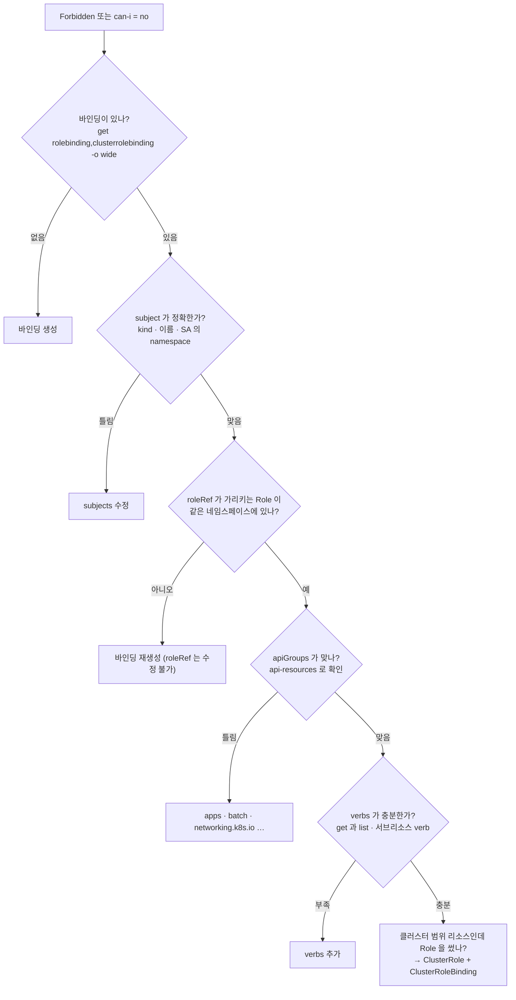

# 15강 · RBAC

> 영상: **15강 인증 · RBAC · ServiceAccount** · 이어서 풀 채점 세트: `15-rbac`

## 실습 목표

- 새로 만든 ServiceAccount 에 **권한이 하나도 없다**는 것(화이트리스트)을 `kubectl auth can-i` 로 직접 확인한다.
- Role · ClusterRole · RoleBinding · ClusterRoleBinding **네 조각의 범위 조합**을 모두 만들어 보고, 되는 조합과 안 되는 조합을 가른다.
- `apiGroups` · `verbs` · `resourceNames` · 서브리소스(`pods/log`, `pods/exec`)를 하나씩 틀려 보며 **"에러 없이 권한만 없는" 상태**를 찾아내는 법을 익힌다.
- ServiceAccount 토큰이 파드에 어떻게 들어가는지 보고, **파드 안에서 curl 로 API 서버를 직접 호출**해 권한을 확인한다.
- 사용자(User)가 오브젝트가 아니라 **인증서의 CN · O** 라는 것을 CSR → 승인 → kubeconfig 흐름으로 확인한다.

---

## 0) 준비

이 페이지는 네임스페이스 두 개를 씁니다. 두 번째 네임스페이스는 **"Role 은 자기 네임스페이스 밖에서는 통하지 않는다"** 를 확인하는 용도입니다.

```bash
kubectl create namespace guide-rbac
kubectl create namespace guide-rbac-other
mkdir -p ~/guide-rbac && cd ~/guide-rbac
```

지금 내가 누구인지부터 봅니다. kubeadm 이 만든 `admin.conf` 의 사용자입니다.

```bash
kubectl auth whoami
```

```text
ATTRIBUTE   VALUE
Username    kubernetes-admin
Groups      [kubeadm:cluster-admins system:authenticated]
```

`kubeadm:cluster-admins` 그룹이 `cluster-admin` ClusterRole 에 묶여 있어서 무엇이든 할 수 있습니다.
이 페이지에서는 **다른 주체인 척(`--as`)** 하면서 권한을 확인합니다.

!!! tip "`--as` 는 관리자만 쓸 수 있습니다"
    `--as` 는 **impersonate(가장)** 권한이 있어야 동작합니다. 시험 환경의 관리자 kubeconfig 에는 이 권한이 있으니 마음껏 쓰면 됩니다.

---

## 1) 기본은 거부 — 새 ServiceAccount 는 아무것도 못 한다

### 왜

쿠버네티스 RBAC 에는 **거부 규칙이 없습니다.** 허용한 것만 되고 나머지는 전부 안 됩니다.
그래서 권한 문제가 생기면 "무엇을 막았나" 가 아니라 **"무엇을 안 줬나"** 를 찾아야 합니다.

### ServiceAccount 만들기

```bash
kubectl create serviceaccount report-bot -n guide-rbac
kubectl get serviceaccount -n guide-rbac
```

```text
NAME         SECRETS   AGE
default      0         40s     ← 네임스페이스를 만들면 자동으로 생긴다
report-bot   0         3s
```

`SECRETS 0` 입니다. 1.24 부터는 SA 를 만들어도 **토큰 Secret 이 자동으로 생기지 않습니다.** 토큰은 필요할 때 발급합니다(6절).

### 무엇을 할 수 있나 물어보기

ServiceAccount 의 정식 사용자 이름은 `system:serviceaccount:<네임스페이스>:<이름>` 입니다.

```bash
kubectl auth can-i list pods -n guide-rbac --as=system:serviceaccount:guide-rbac:report-bot
kubectl auth can-i --list -n guide-rbac --as=system:serviceaccount:guide-rbac:report-bot
```

```text
no

Resources                                       Non-Resource URLs                      Resource Names   Verbs
selfsubjectreviews.authentication.k8s.io        []                                     []               [create]
selfsubjectaccessreviews.authorization.k8s.io   []                                     []               [create]
selfsubjectrulesreviews.authorization.k8s.io    []                                     []               [create]
                                                [/.well-known/openid-configuration/]   []               [get]
                                                [/api/*]                               []               [get]
                                                [/api]                                 []               [get]
...
```

관찰 포인트: 목록에 `pods`, `configmaps` 같은 **실제 리소스가 한 줄도 없습니다.** 남은 줄은 모든 인증된 사용자가 받는
기본 권한(자기 자신에 대해 묻기, API 목록 보기)뿐입니다.

!!! warning "`can-i` 는 no 일 때도 출력을 냅니다"
    답이 `no` 여도 `no` 라는 글자가 **표준 출력**으로 나오고, 종료 코드만 `1` 이 됩니다.
    스크립트에서 `kubectl auth can-i ... || echo no` 처럼 쓰면 `no` 가 두 번 찍힙니다.
    결과를 판단할 때는 출력 글자 하나만 보거나, `echo $?` 로 종료 코드를 보세요.

    ```bash
    kubectl auth can-i delete pods -n guide-rbac --as=system:serviceaccount:guide-rbac:report-bot; echo "exit=$?"
    ```
    ```text
    no
    exit=1
    ```

### 리소스의 그룹과 범위는 `api-resources` 로

Role 을 쓰기 전에 **리소스 이름 · API 그룹 · 네임스페이스 범위**를 확인하는 습관을 들입니다.

```bash
kubectl api-resources | grep -E '^NAME|^pods |^deployments |^configmaps |^jobs |^ingresses '
```

```text
NAME          SHORTNAMES   APIVERSION             NAMESPACED   KIND
configmaps    cm           v1                     true         ConfigMap
pods          po           v1                     true         Pod
deployments   deploy       apps/v1                true         Deployment
jobs                       batch/v1               true         Job
ingresses     ing          networking.k8s.io/v1   true         Ingress
```

`APIVERSION` 에 **슬래시가 없으면 core 그룹**(`""`), 있으면 **슬래시 앞이 그룹 이름**입니다.

```bash
kubectl api-resources --namespaced=false | head -12
```

```text
NAME                  SHORTNAMES   APIVERSION                     NAMESPACED   KIND
componentstatuses     cs           v1                             false        ComponentStatus
namespaces            ns           v1                             false        Namespace
nodes                 no           v1                             false        Node
persistentvolumes     pv           v1                             false        PersistentVolume
...
clusterrolebindings                rbac.authorization.k8s.io/v1   false        ClusterRoleBinding
clusterroles                       rbac.authorization.k8s.io/v1   false        ClusterRole
...
```

`NAMESPACED false` 인 리소스는 **Role 로는 권한을 줄 수 없습니다.** 반드시 ClusterRole 입니다(4절).

---

## 2) Role 과 RoleBinding — 네임스페이스 안의 권한

### 왜

Role 은 **"무엇을"**, RoleBinding 은 **"누구에게"** 입니다. 둘 중 하나만 만들면 아무 일도 일어나지 않습니다. 항상 짝으로 만듭니다.

### YAML 로 보기

먼저 명령으로 YAML 을 뽑아 구조를 확인합니다.

```bash
kubectl create role cm-editor -n guide-rbac \
  --verb=get,list,watch,create,update,patch --resource=configmaps $do > cm-editor.yaml
kubectl create rolebinding cm-editor-rb -n guide-rbac \
  --role=cm-editor --serviceaccount=guide-rbac:report-bot $do > cm-editor-rb.yaml
```

`cm-editor.yaml`:

```yaml
apiVersion: rbac.authorization.k8s.io/v1
kind: Role
metadata:
  name: cm-editor
  namespace: guide-rbac        # ← 권한이 통하는 범위가 여기로 정해진다
rules:
- apiGroups:
  - ""                          # ← core 그룹 (configmaps 는 apiVersion: v1)
  resources:
  - configmaps                  # ← 복수형 소문자
  verbs:                        # ← delete 는 주지 않았다
  - get
  - list
  - watch
  - create
  - update
  - patch
```

`cm-editor-rb.yaml`:

```yaml
apiVersion: rbac.authorization.k8s.io/v1
kind: RoleBinding
metadata:
  name: cm-editor-rb
  namespace: guide-rbac
roleRef:                        # ← 무엇을 (하나만, 만든 뒤에는 바꿀 수 없다)
  apiGroup: rbac.authorization.k8s.io
  kind: Role
  name: cm-editor
subjects:                       # ← 누구에게 (여러 개 가능)
- kind: ServiceAccount
  name: report-bot
  namespace: guide-rbac         # ← SA 는 namespace 가 필수. 빠뜨리는 실수가 잦다
```

```bash
kubectl apply -f cm-editor.yaml -f cm-editor-rb.yaml
kubectl describe role cm-editor -n guide-rbac
```

```text
Name:         cm-editor
Labels:       <none>
Annotations:  <none>
PolicyRule:
  Resources   Non-Resource URLs  Resource Names  Verbs
  ---------   -----------------  --------------  -----
  configmaps  []                 []              [get list watch create update patch]
```

### 검증 — 되는 것과 안 되는 것 둘 다

```bash
SA=system:serviceaccount:guide-rbac:report-bot
kubectl auth can-i create configmaps -n guide-rbac --as=$SA
kubectl auth can-i delete configmaps -n guide-rbac --as=$SA
kubectl auth can-i list secrets     -n guide-rbac --as=$SA
kubectl auth can-i list configmaps  -n guide-rbac-other --as=$SA
```

```text
yes    ← 준 것
no     ← verbs 에 delete 가 없다
no     ← resources 에 secrets 가 없다
no     ← Role 은 guide-rbac 안에서만 통한다
```

관찰 포인트: **네 번째 줄**이 Role 의 범위입니다. 같은 SA 라도 다른 네임스페이스에서는 권한이 없습니다.

바인딩을 한눈에 보려면 `-o wide` 가 편합니다.

```bash
kubectl get rolebinding -n guide-rbac -o wide
```

```text
NAME           ROLE             AGE   USERS   GROUPS   SERVICEACCOUNTS
cm-editor-rb   Role/cm-editor   30s                    guide-rbac/report-bot
```

### 깨 보기 — roleRef 는 바꿀 수 없다

`cm-editor-rb.yaml` 의 `roleRef.name` 을 `view` 로, `kind` 를 `ClusterRole` 로 바꿔 다시 적용해 봅니다.

```bash
sed -i 's/kind: Role$/kind: ClusterRole/; s/name: cm-editor$/name: view/' cm-editor-rb.yaml
kubectl apply -f cm-editor-rb.yaml
```

```text
The RoleBinding "cm-editor-rb" is invalid: roleRef: Invalid value: rbac.RoleRef{APIGroup:"rbac.authorization.k8s.io", Kind:"ClusterRole", Name:"view"}: cannot change roleRef
```

`subjects` 는 고칠 수 있지만 `roleRef` 는 **지우고 다시 만들어야** 합니다. 원래대로 돌려 둡니다.

```bash
kubectl create rolebinding cm-editor-rb -n guide-rbac \
  --role=cm-editor --serviceaccount=guide-rbac:report-bot $do > cm-editor-rb.yaml
```

!!! tip "시험 팁"
    RBAC 은 **명령 세 줄**(`create sa` → `create role` → `create rolebinding`)로 거의 다 끝납니다.
    `--serviceaccount` 는 `네임스페이스:이름` 형식이고, 끝나면 반드시 `auth can-i` 로 **yes 와 no 를 모두** 확인합니다.

---

## 3) apiGroups 와 verbs — 틀려도 에러가 나지 않는다

### 왜

RBAC 은 오브젝트를 잘못 써도 **만들어지기는 합니다.** 그냥 권한이 없을 뿐입니다.
가장 흔한 원인이 **apiGroups** 와 **get/list 혼동**입니다.

### 일부러 틀린 Role

`deploy-viewer-bad.yaml` — Deployment 를 core 그룹으로 적은 Role 입니다.

```yaml
apiVersion: rbac.authorization.k8s.io/v1
kind: Role
metadata:
  name: deploy-viewer
  namespace: guide-rbac
rules:
- apiGroups: [""]               # ← 틀렸다. Deployment 는 apps 그룹
  resources: ["deployments"]
  verbs: ["get"]                # ← list 가 없다
```

```bash
kubectl apply -f deploy-viewer-bad.yaml
kubectl create rolebinding deploy-viewer-rb -n guide-rbac \
  --role=deploy-viewer --serviceaccount=guide-rbac:report-bot
kubectl auth can-i get deployments -n guide-rbac --as=$SA
```

```text
role.rbac.authorization.k8s.io/deploy-viewer created
rolebinding.rbac.authorization.k8s.io/deploy-viewer-rb created
no
```

관찰 포인트: `created` 만 두 번 나오고 **아무 경고도 없습니다.** `can-i` 로 확인하지 않았다면 틀린 줄도 몰랐을 겁니다.

### 고치기 — 그룹부터

```bash
kubectl patch role deploy-viewer -n guide-rbac --type=json \
  -p='[{"op":"replace","path":"/rules/0/apiGroups","value":["apps"]}]'
kubectl auth can-i get  deployments -n guide-rbac --as=$SA
kubectl auth can-i list deployments -n guide-rbac --as=$SA
```

```text
yes
no     ← get 만으로는 kubectl get deployments(목록)가 안 된다
```

```bash
kubectl patch role deploy-viewer -n guide-rbac --type=json \
  -p='[{"op":"replace","path":"/rules/0/verbs","value":["get","list","watch"]}]'
kubectl auth can-i list deployments -n guide-rbac --as=$SA
```

```text
yes
```

!!! tip "명령으로 만들면 그룹을 알아서 채웁니다"
    `kubectl create role ... --resource=deployments` 는 API 서버에 물어서 `apiGroups: ["apps"]` 를 자동으로 넣습니다.
    이름이 겹칠 때는 `--resource=deployments.apps` 처럼 **그룹을 붙여** 적을 수 있습니다.
    손으로 YAML 을 쓸 때만 이 실수가 생깁니다.

    ```bash
    kubectl create role x -n guide-rbac --verb=get --resource=deployments,jobs,ingresses $do | grep -A1 apiGroups
    ```
    ```text
    - apiGroups:
      - apps
    - apiGroups:
      - batch
    - apiGroups:
      - networking.k8s.io
    ```

### verbs 한눈에 보기

| verb | kubectl 에서는 | 메모 |
|------|----------------|------|
| `get` | `kubectl get pod <이름>` | 이름을 지정한 **하나** |
| `list` | `kubectl get pods` | **목록**. get 만 주면 목록이 안 된다 |
| `watch` | `kubectl get pods -w` | 변경 감시. 읽기 권한은 보통 get · list · watch 세트 |
| `create` | `create`, `apply`(새로 만들 때), `run` | `pods/exec` 에도 create 가 필요하다 |
| `update` | `replace`, `apply`(있을 때) | 전체 교체 |
| `patch` | `patch`, `edit`, `label`, `annotate`, `scale` | 부분 수정 |
| `delete` | `delete pod <이름>` | 하나 삭제 |
| `deletecollection` | `delete pods --all` | 여러 개 한꺼번에 |
| `*` | 전부 | 시험에서는 되도록 쓰지 않는다 (최소 권한) |

어떤 리소스가 어떤 verb 를 받는지는 `-o wide` 로 볼 수 있습니다.

```bash
kubectl api-resources -o wide | grep -E '^NAME|^pods '
```

```text
NAME   SHORTNAMES   APIVERSION   NAMESPACED   KIND   VERBS                                                        CATEGORIES
pods   po           v1           true         Pod    create,delete,deletecollection,get,list,patch,update,watch   all
```

---

## 4) ClusterRole — 네 가지 조합표

### 왜

ClusterRole 이 필요한 경우는 셋입니다.

1. **클러스터 범위 리소스** — nodes, persistentvolumes, namespaces, storageclasses …
2. **모든 네임스페이스**에 걸친 권한
3. 같은 권한 묶음을 **여러 네임스페이스에서 재사용**

| 권한 묶음 | 바인딩 | 통하는 범위 | 쓰임 |
|-----------|--------|-------------|------|
| Role | RoleBinding | 그 네임스페이스 | 가장 흔하다 |
| ClusterRole | RoleBinding | **RoleBinding 이 있는 네임스페이스만** | 공통 권한 재사용 (예: 기본 제공 `view`) |
| ClusterRole | ClusterRoleBinding | 클러스터 전체 + 클러스터 범위 리소스 | 노드 · PV 읽기, 모니터링 |
| Role | ClusterRoleBinding | **만들 수 없다** | API 서버가 거부 |

### ① ClusterRole + ClusterRoleBinding — 클러스터 범위 리소스

PV 와 StorageClass 를 읽는 권한을 만듭니다.

```bash
kubectl create clusterrole pv-watcher --verb=get,list,watch --resource=persistentvolumes,storageclasses
kubectl create clusterrolebinding pv-watcher-crb \
  --clusterrole=pv-watcher --serviceaccount=guide-rbac:report-bot
kubectl get clusterrole pv-watcher -o yaml
```

```yaml
apiVersion: rbac.authorization.k8s.io/v1
kind: ClusterRole
metadata:
  name: pv-watcher              # ← namespace 칸이 없다
rules:
- apiGroups:
  - ""
  resources:
  - persistentvolumes           # ← core 그룹
  verbs: [get, list, watch]
- apiGroups:
  - storage.k8s.io              # ← storageclasses 는 storage.k8s.io 그룹 (자동으로 채워졌다)
  resources:
  - storageclasses
  verbs: [get, list, watch]
```

```bash
kubectl auth can-i list persistentvolumes --as=$SA
kubectl auth can-i list storageclasses --as=$SA
kubectl auth can-i delete persistentvolumes --as=$SA
```

```text
yes
yes
no
```

클러스터 범위 리소스를 물을 때는 `-n` 이 필요 없습니다(붙여도 무시됩니다).

### 깨 보기 — PV 를 Role 로 주면?

```bash
kubectl create role pv-in-role -n guide-rbac --verb=list --resource=persistentvolumes
kubectl create rolebinding pv-in-role-rb -n guide-rbac --role=pv-in-role --serviceaccount=guide-rbac:ghost
kubectl auth can-i list persistentvolumes --as=system:serviceaccount:guide-rbac:ghost
```

```text
role.rbac.authorization.k8s.io/pv-in-role created
rolebinding.rbac.authorization.k8s.io/pv-in-role-rb created
no
```

Role 은 **네임스페이스 안의 리소스**에만 적용됩니다. PV 는 어느 네임스페이스에도 속하지 않으므로 이 Role 은 영원히 아무 일도 하지 않습니다.
(만든 적도 없는 SA `ghost` 를 subject 로 적었는데도 **에러가 나지 않은 것**도 눈여겨보세요. 바인딩은 이름만 적어 둡니다.)

```bash
kubectl delete role pv-in-role -n guide-rbac
kubectl delete rolebinding pv-in-role-rb -n guide-rbac
```

### ② ClusterRole + RoleBinding — 기본 제공 `view` 를 한 네임스페이스에만

쿠버네티스에는 `view` · `edit` · `admin` · `cluster-admin` 이 기본으로 들어 있습니다.

```bash
kubectl get clusterrole view edit admin cluster-admin
kubectl describe clusterrole view | head -20
```

`guide-rbac-other` 에 SA 를 하나 만들고, `view` 를 RoleBinding 으로 **`guide-rbac-other` 에만** 붙입니다.

```bash
kubectl create serviceaccount auditor -n guide-rbac-other
kubectl create rolebinding auditor-view -n guide-rbac-other \
  --clusterrole=view --serviceaccount=guide-rbac-other:auditor
AU=system:serviceaccount:guide-rbac-other:auditor
kubectl auth can-i list pods        -n guide-rbac-other --as=$AU
kubectl auth can-i list deployments -n guide-rbac-other --as=$AU
kubectl auth can-i list pods        -n guide-rbac       --as=$AU
kubectl auth can-i list secrets     -n guide-rbac-other --as=$AU
```

```text
yes
yes
no     ← ClusterRole 이지만 바인딩이 RoleBinding 이라 guide-rbac-other 에서만 통한다
no     ← view 는 일부러 secrets 를 빼 두었다
```

관찰 포인트: **범위를 정하는 것은 바인딩**입니다. 권한 묶음이 ClusterRole 이어도 RoleBinding 으로 묶으면 그 네임스페이스로 좁혀집니다.

### ③ Role + ClusterRoleBinding — 만들 수 없다

`role-in-crb.yaml`:

```yaml
apiVersion: rbac.authorization.k8s.io/v1
kind: ClusterRoleBinding
metadata:
  name: role-in-crb
roleRef:
  apiGroup: rbac.authorization.k8s.io
  kind: Role                    # ← ClusterRoleBinding 은 ClusterRole 만 가리킬 수 있다
  name: cm-editor
subjects:
- kind: ServiceAccount
  name: report-bot
  namespace: guide-rbac
```

```bash
kubectl apply -f role-in-crb.yaml
```

```text
The ClusterRoleBinding "role-in-crb" is invalid: roleRef.kind: Unsupported value: "Role": supported values: "ClusterRole"
```

네 조합 가운데 **에러가 나는 것은 이것 하나뿐**입니다. 나머지 실수는 모두 조용히 "권한 없음" 이 됩니다.

!!! note "`view` 는 어떻게 CRD 권한까지 알까요? — 집계(aggregation)"
    `view` · `edit` · `admin` 은 `aggregationRule` 을 가진 ClusterRole 입니다.
    `rbac.authorization.k8s.io/aggregate-to-view: "true"` 레이블이 붙은 다른 ClusterRole 의 규칙을 컨트롤러가 자동으로 합쳐 넣습니다.
    ```bash
    kubectl get clusterrole view -o jsonpath='{.aggregationRule}{"\n"}'
    ```

---

## 5) resourceNames 와 서브리소스 — 더 좁게 주기

### 왜

"이 ConfigMap **하나만**", "파드 **로그만**", "exec **만**" 처럼 좁게 줘야 할 때가 있습니다.
`resourceNames` 는 **이름 단위**로, 서브리소스는 **리소스의 일부 기능** 단위로 좁힙니다.

### resourceNames — 이름 하나만

```bash
kubectl create configmap feature-flags -n guide-rbac --from-literal=beta=on
kubectl create configmap db-settings   -n guide-rbac --from-literal=host=db
kubectl create serviceaccount flag-reader -n guide-rbac
```

`flag-reader.yaml`:

```yaml
apiVersion: rbac.authorization.k8s.io/v1
kind: Role
metadata:
  name: flag-reader
  namespace: guide-rbac
rules:
- apiGroups: [""]
  resources: ["configmaps"]
  resourceNames: ["feature-flags"]   # ← 이 이름만. 비워 두면 모든 이름
  verbs: ["get", "update"]
---
apiVersion: rbac.authorization.k8s.io/v1
kind: RoleBinding
metadata:
  name: flag-reader-rb
  namespace: guide-rbac
roleRef:
  apiGroup: rbac.authorization.k8s.io
  kind: Role
  name: flag-reader
subjects:
- kind: ServiceAccount
  name: flag-reader
  namespace: guide-rbac
```

명령으로는 `--resource-name` 입니다.

```bash
kubectl create role flag-reader -n guide-rbac --verb=get,update \
  --resource=configmaps --resource-name=feature-flags $do | grep -A1 resourceNames
```

```bash
kubectl apply -f flag-reader.yaml
FR=system:serviceaccount:guide-rbac:flag-reader
kubectl auth can-i get configmap/feature-flags -n guide-rbac --as=$FR
kubectl auth can-i get configmap/db-settings   -n guide-rbac --as=$FR
kubectl auth can-i list configmaps             -n guide-rbac --as=$FR
```

```text
yes
no     ← 다른 이름
no     ← list 는 이름을 지정하지 않는 요청이라 resourceNames 로 허용할 수 없다
```

!!! warning "resourceNames 로 제한할 수 없는 verb"
    `list` · `watch` · `create` · `deletecollection` 은 요청에 **특정 이름이 없거나(목록) 아직 이름이 정해지지 않은(생성)** 요청입니다.
    `resourceNames` 를 붙이면 이 verb 들은 사실상 막힙니다. 이름 제한은 `get` · `update` · `patch` · `delete` 에 씁니다.

### 서브리소스 — `pods/log`, `pods/exec`

파드 목록과 로그는 볼 수 있지만 exec 는 못 하는 SA 를 만듭니다.

```bash
kubectl create serviceaccount log-bot -n guide-rbac
kubectl create role log-only -n guide-rbac --verb=get,list --resource=pods,pods/log
kubectl create rolebinding log-only-rb -n guide-rbac --role=log-only --serviceaccount=guide-rbac:log-bot
kubectl get role log-only -n guide-rbac -o jsonpath='{.rules}{"\n"}'
```

```text
[{"apiGroups":[""],"resources":["pods","pods/log"],"verbs":["get","list"]}]
```

서브리소스는 `can-i` 에서 `--subresource` 로 묻습니다.

```bash
LB=system:serviceaccount:guide-rbac:log-bot
kubectl auth can-i get pods    --subresource=log  -n guide-rbac --as=$LB
kubectl auth can-i create pods --subresource=exec -n guide-rbac --as=$LB
```

```text
yes
no
```

exec 를 열어 주려면 **`pods/exec` 에 `create`** 를 줍니다(로그는 `get`, exec 는 `create` 로 verb 가 다릅니다).

```bash
kubectl create role shell-access -n guide-rbac --verb=create --resource=pods/exec
kubectl create rolebinding shell-access-rb -n guide-rbac --role=shell-access --serviceaccount=guide-rbac:log-bot
kubectl auth can-i create pods --subresource=exec -n guide-rbac --as=$LB
```

```text
yes
```

| 서브리소스 | verb | kubectl 명령 |
|------------|------|--------------|
| `pods/log` | `get` | `kubectl logs` |
| `pods/exec` | `create` | `kubectl exec` |
| `pods/portforward` | `create` | `kubectl port-forward` |
| `deployments/scale` | `get`, `update`, `patch` | `kubectl scale` |
| `pods/eviction` | `create` | `kubectl drain` 이 내부적으로 사용 |

---

## 6) ServiceAccount 토큰 — 파드에 무엇이 들어가나

### 왜

SA 는 **파드가 API 서버에 접속할 때 쓰는 신원**입니다. 파드가 뜨면 SA 토큰이 파일로 마운트되고, 앱은 그 토큰을 `Authorization: Bearer` 헤더로 보냅니다.

### SA 를 쓰는 파드 만들기

`api-client.yaml`:

```yaml
apiVersion: v1
kind: Pod
metadata:
  name: api-client
  namespace: guide-rbac
spec:
  serviceAccountName: report-bot      # ← 없으면 그 네임스페이스의 default SA
  containers:
  - name: curl
    image: curlimages/curl:8.10.1     # ← curl 과 sh 가 들어 있는 작은 이미지
    command: ["sleep", "infinity"]
```

```bash
kubectl apply -f api-client.yaml
kubectl wait pod/api-client -n guide-rbac --for=condition=Ready --timeout=60s
kubectl exec -n guide-rbac api-client -- ls /var/run/secrets/kubernetes.io/serviceaccount
```

```text
ca.crt  namespace  token
```

세 파일이 어디서 왔는지 파드 스펙을 봅니다.

```bash
kubectl get pod api-client -n guide-rbac -o yaml | grep -A18 '  volumes:'
```

```yaml
  volumes:
  - name: kube-api-access-7x2qp
    projected:                          # ← 여러 출처를 한 디렉터리로 합친 볼륨
      defaultMode: 420
      sources:
      - serviceAccountToken:
          expirationSeconds: 3607       # ← 약 1시간짜리 토큰. kubelet 이 자동으로 갱신한다
          path: token
      - configMap:
          items:
          - key: ca.crt
            path: ca.crt                # ← API 서버 인증서를 검증할 CA
          name: kube-root-ca.crt
      - downwardAPI:
          items:
          - fieldRef:
              apiVersion: v1
              fieldPath: metadata.namespace
            path: namespace             # ← 파드가 속한 네임스페이스
```

관찰 포인트: 우리가 적지 않은 볼륨이 **자동으로 추가**되었습니다. 이 동작을 끄는 것이 `automountServiceAccountToken` 입니다.

### 토큰을 직접 발급하기 — `kubectl create token`

파드 밖에서 SA 로 API 를 호출해 보고 싶을 때 씁니다. **짧은 수명의 토큰을 발급만** 하고, Secret 은 만들지 않습니다.

```bash
TOKEN=$(kubectl create token report-bot -n guide-rbac --duration=10m)
echo ${TOKEN:0:40}...
curl -s --cacert /etc/kubernetes/pki/ca.crt \
  -H "Authorization: Bearer $TOKEN" \
  https://192.168.56.10:6443/api/v1/namespaces/guide-rbac/configmaps | grep '"name"'
```

```text
eyJhbGciOiJSUzI1NiIsImtpZCI6IjRtV0...
        "name": "db-settings",
        "name": "feature-flags",
        "name": "kube-root-ca.crt",
```

report-bot 에는 2절의 `cm-editor` 가 있으니 ConfigMap 목록이 나옵니다.

!!! note "오래 가는 토큰이 꼭 필요하면"
    1.24 이전처럼 만료 없는 토큰을 Secret 으로 만들 수도 있습니다. 보안상 권장하지 않습니다.
    ```yaml
    apiVersion: v1
    kind: Secret
    type: kubernetes.io/service-account-token
    metadata:
      name: report-bot-token
      namespace: guide-rbac
      annotations:
        kubernetes.io/service-account.name: report-bot   # ← 컨트롤러가 여기에 토큰을 채운다
    ```

### 깨 보기 — 자동 마운트 끄기

`quiet-pod.yaml`:

```yaml
apiVersion: v1
kind: Pod
metadata:
  name: quiet-pod
  namespace: guide-rbac
spec:
  serviceAccountName: report-bot
  automountServiceAccountToken: false   # ← 파드 단위로 끈다 (SA 에 적으면 그 SA 를 쓰는 모든 파드)
  containers:
  - name: curl
    image: curlimages/curl:8.10.1
    command: ["sleep", "infinity"]
```

```bash
kubectl apply -f quiet-pod.yaml
kubectl wait pod/quiet-pod -n guide-rbac --for=condition=Ready --timeout=60s
kubectl exec -n guide-rbac quiet-pod -- ls /var/run/secrets/kubernetes.io/serviceaccount
```

```text
ls: /var/run/secrets/kubernetes.io/serviceaccount: No such file or directory
command terminated with exit code 1
```

API 서버를 부를 일이 없는 앱(대부분의 웹 서버)은 이렇게 꺼 두는 것이 안전합니다.

| 설정 위치 | 효과 | 둘 다 있으면 |
|-----------|------|--------------|
| `ServiceAccount.automountServiceAccountToken` | 그 SA 를 쓰는 모든 파드의 기본값 | **파드 쪽이 이긴다** |
| `Pod.spec.automountServiceAccountToken` | 그 파드만 | |

!!! tip "시험 팁 — 실행 중인 파드의 SA 는 바꿀 수 없습니다"
    `spec.serviceAccountName` 은 파드를 만든 뒤 수정할 수 없습니다. Deployment 라면
    `kubectl set serviceaccount deployment/<이름> <SA>` 로 템플릿을 바꿔 파드를 새로 만듭니다.

---

## 7) 파드 안에서 API 서버 호출 — 권한을 몸으로 확인

`api-client` 파드 안에서 마운트된 토큰으로 API 서버를 호출합니다. 클러스터 안에서는 API 서버를 `kubernetes.default.svc` 라는 이름으로 부릅니다.

```bash
kubectl exec -it -n guide-rbac api-client -- sh
```

파드 안에서:

```sh
SAD=/var/run/secrets/kubernetes.io/serviceaccount
TOKEN=$(cat $SAD/token)
NS=$(cat $SAD/namespace)
API=https://kubernetes.default.svc

# ① 허용된 것 — ConfigMap 목록
curl -s --cacert $SAD/ca.crt -H "Authorization: Bearer $TOKEN" \
  $API/api/v1/namespaces/$NS/configmaps | head -5
```

```text
{
  "kind": "ConfigMapList",
  "apiVersion": "v1",
  "metadata": {
    "resourceVersion": "48213"
```

```sh
# ② 허용되지 않은 것 — Secret 목록
curl -s --cacert $SAD/ca.crt -H "Authorization: Bearer $TOKEN" \
  $API/api/v1/namespaces/$NS/secrets
```

```text
{
  "kind": "Status",
  "apiVersion": "v1",
  "metadata": {},
  "status": "Failure",
  "message": "secrets is forbidden: User \"system:serviceaccount:guide-rbac:report-bot\" cannot list resource \"secrets\" in API group \"\" in the namespace \"guide-rbac\"",
  "reason": "Forbidden",
  "details": {
    "kind": "secrets"
  },
  "code": 403
}
```

```sh
# ③ ClusterRoleBinding 으로 준 것 — PV 목록 (클러스터 범위 URL)
curl -s --cacert $SAD/ca.crt -H "Authorization: Bearer $TOKEN" \
  $API/api/v1/persistentvolumes | head -3
exit
```

```text
{
  "kind": "PersistentVolumeList",
  "apiVersion": "v1",
```

관찰 포인트: 403 메시지에 **누가(User) · 무엇을(verb, resource) · 어느 그룹(API group) · 어디서(namespace)** 가 전부 들어 있습니다.
이 한 줄이 곧 Role 에 추가해야 할 규칙입니다.

| 403 메시지 조각 | Role 의 필드 |
|-----------------|--------------|
| `cannot list` | `verbs: [list]` |
| `resource "secrets"` | `resources: [secrets]` |
| `in API group ""` | `apiGroups: [""]` |
| `in the namespace "guide-rbac"` | Role 의 `metadata.namespace` |

!!! note "kubectl 도 같은 일을 합니다"
    kubectl 이 들어 있는 이미지를 이 SA 로 띄우면, kubeconfig 없이도 kubectl 이 마운트된 토큰(in-cluster 설정)을 자동으로 씁니다.
    결과는 curl 과 같습니다 — `kubectl get secrets` 가 `Forbidden` 으로 실패합니다.

---

## 8) 사용자 인증서 — User 는 오브젝트가 아니다 (심화)

### 왜

`kubectl get users` 라는 명령은 없습니다. 사람 사용자는 **클러스터 밖에서** 인증됩니다.
kubeadm 클러스터에서는 클러스터 CA 가 서명한 **클라이언트 인증서**가 신원이고, 인증서의 **CN 이 사용자 이름, O 가 그룹**이 됩니다.

### ① 키와 CSR 만들기

```bash
openssl genrsa -out dana.key 2048
openssl req -new -key dana.key -out dana.csr -subj "/CN=dana/O=qa"   # ← 사용자 dana, 그룹 qa
```

### ② CertificateSigningRequest 제출

`dana-csr.yaml` 을 만듭니다. `request` 에는 CSR 파일을 한 줄 base64 로 넣습니다.

```bash
cat > dana-csr.yaml <<EOF
apiVersion: certificates.k8s.io/v1
kind: CertificateSigningRequest
metadata:
  name: dana
spec:
  request: $(base64 -w0 < dana.csr)
  signerName: kubernetes.io/kube-apiserver-client   # ← API 서버 클라이언트 인증서용 서명자
  expirationSeconds: 86400                           # ← 하루
  usages:
  - client auth
EOF
kubectl apply -f dana-csr.yaml
kubectl get csr dana
```

```text
NAME   AGE   SIGNERNAME                            REQUESTOR          REQUESTEDDURATION   CONDITION
dana   3s    kubernetes.io/kube-apiserver-client   kubernetes-admin   24h                 Pending
```

### ③ 승인하고 인증서 꺼내기

```bash
kubectl certificate approve dana
kubectl get csr dana
kubectl get csr dana -o jsonpath='{.status.certificate}' | base64 -d > dana.crt
openssl x509 -in dana.crt -noout -subject -enddate
```

```text
certificatesigningrequest.certificates.k8s.io/dana approved
NAME   AGE   SIGNERNAME                            REQUESTOR          REQUESTEDDURATION   CONDITION
dana   40s   kubernetes.io/kube-apiserver-client   kubernetes-admin   24h                 Approved,Issued
subject=CN = dana, O = qa
notAfter=Sep 30 06:40:12 2026 GMT
```

### ④ kubeconfig 에 사용자와 컨텍스트 추가

```bash
kubectl config set-credentials dana --client-key=dana.key --client-certificate=dana.crt --embed-certs=true
kubectl config set-context dana@kubernetes --cluster=kubernetes --user=dana --namespace=guide-rbac
kubectl config get-contexts
```

```text
CURRENT   NAME                          CLUSTER      AUTHINFO           NAMESPACE
          dana@kubernetes               kubernetes   dana               guide-rbac
*         kubernetes-admin@kubernetes   kubernetes   kubernetes-admin
```

!!! warning "현재 컨텍스트를 바꾸지 마세요"
    `use-context` 로 dana 로 바꾸면 관리자 권한이 사라져 되돌리기 번거롭습니다. 이 실습에서는 **`--context=` 로 한 번씩만** 씁니다.

### ⑤ 인증은 되지만 권한은 없다

```bash
kubectl --context=dana@kubernetes auth whoami
kubectl --context=dana@kubernetes get pods
```

```text
ATTRIBUTE   VALUE
Username    dana
Groups      [qa system:authenticated]

Error from server (Forbidden): pods is forbidden: User "dana" cannot list resource "pods" in API group "" in the namespace "guide-rbac"
```

**인증(누구인가)** 은 통과했고 **인가(무엇을 할 수 있나)** 에서 막혔습니다. 권한을 **그룹**에 줍니다.

```bash
kubectl create rolebinding qa-view -n guide-rbac --clusterrole=view --group=qa
kubectl --context=dana@kubernetes get pods
```

```text
NAME         READY   STATUS    RESTARTS   AGE
api-client   1/1     Running   0          12m
quiet-pod    1/1     Running   0          8m
```

### 깨 보기 — `--as` 는 그룹을 모른다

```bash
kubectl auth can-i list pods -n guide-rbac --as=dana
kubectl auth can-i list pods -n guide-rbac --as=dana --as-group=qa
```

```text
no     ← --as 로 가장하면 인증서의 O(그룹)가 따라오지 않는다
yes
```

그룹에 준 권한을 확인할 때는 `--as-group` 을 함께 줘야 합니다.

| 주체 | 어디서 오나 | 바인딩 subject | can-i |
|------|-------------|----------------|-------|
| ServiceAccount | 쿠버네티스 오브젝트 | `kind: ServiceAccount` + `namespace` | `--as=system:serviceaccount:ns:name` |
| User | 인증서 CN (또는 OIDC 등) | `kind: User` | `--as=<이름>` |
| Group | 인증서 O (또는 OIDC 등) | `kind: Group` | `--as=<이름> --as-group=<그룹>` |

---

## 9) 권한이 안 먹을 때 — 점검 순서



특정 SA 에 걸린 바인딩을 전부 찾는 한 줄:

```bash
kubectl get rolebinding,clusterrolebinding -A -o wide | grep -E 'NAME|report-bot'
```

```text
NAMESPACE    NAME                                                    ROLE                     ...   SERVICEACCOUNTS
guide-rbac   rolebinding.rbac.authorization.k8s.io/cm-editor-rb      Role/cm-editor           ...   guide-rbac/report-bot
guide-rbac   rolebinding.rbac.authorization.k8s.io/deploy-viewer-rb  Role/deploy-viewer       ...   guide-rbac/report-bot
             clusterrolebinding.rbac.authorization.k8s.io/pv-watcher-crb   ClusterRole/pv-watcher   ...   guide-rbac/report-bot
```

!!! tip "시험 팁 — 과하게 주면 감점입니다"
    귀찮다고 `cluster-admin` 이나 `verbs: ["*"]` 를 붙이면 "안 돼야 하는 것" 까지 yes 가 됩니다.
    요구한 verb 와 리소스만 주고, **`can-i --list` 로 남는 것이 없는지** 마지막에 훑어봅니다.

---

## 시험에서 빠르게

```bash
# SA · Role · RoleBinding
kubectl create sa <sa> -n <ns>
kubectl create role <r> -n <ns> --verb=get,list,watch --resource=pods,deployments.apps
kubectl create rolebinding <rb> -n <ns> --role=<r> --serviceaccount=<ns>:<sa>

# 클러스터 범위 (nodes · pv · namespaces …)
kubectl create clusterrole <cr> --verb=get,list,watch --resource=persistentvolumes
kubectl create clusterrolebinding <crb> --clusterrole=<cr> --serviceaccount=<ns>:<sa>

# ClusterRole 을 한 네임스페이스에만
kubectl create rolebinding <rb> -n <ns> --clusterrole=view --serviceaccount=<ns>:<sa>

# 이름 · 서브리소스
kubectl create role <r> -n <ns> --verb=get --resource=configmaps --resource-name=<name>
kubectl create role <r> -n <ns> --verb=get --resource=pods/log
kubectl create role <r> -n <ns> --verb=create --resource=pods/exec

# 검증 (yes 와 no 모두)
kubectl auth can-i <verb> <resource> -n <ns> --as=system:serviceaccount:<ns>:<sa>
kubectl auth can-i get pods --subresource=log -n <ns> --as=...
kubectl auth can-i --list -n <ns> --as=...

# 파드에 SA · 토큰
kubectl run <p> --image=busybox $do -- sleep 3600   # → spec.serviceAccountName 추가
kubectl set serviceaccount deployment/<d> <sa> -n <ns>
kubectl create token <sa> -n <ns> --duration=1h

# 그룹 이름을 모를 때
kubectl api-resources | grep -i <kind>
```

---

## 정리

네임스페이스를 지우면 그 안의 Role · RoleBinding · SA 는 함께 지워집니다.
**클러스터 범위 오브젝트(ClusterRole · ClusterRoleBinding · CSR)와 kubeconfig 항목은 따로** 지워야 합니다.

```bash
kubectl delete namespace guide-rbac guide-rbac-other
kubectl delete clusterrolebinding pv-watcher-crb
kubectl delete clusterrole pv-watcher
kubectl delete clusterrolebinding role-in-crb --ignore-not-found   # 3) 에서 거부됐으면 없다
kubectl delete csr dana
kubectl config delete-context dana@kubernetes
kubectl config delete-user dana
kubectl config current-context        # kubernetes-admin@kubernetes 인지 확인
cd ~ && rm -rf ~/guide-rbac
```

---

## 확인 질문

??? question "1. Role 을 만들었는데 SA 가 여전히 아무것도 못 합니다. 가장 먼저 의심할 것은?"
    RoleBinding 이 없는 경우입니다. Role 은 권한 묶음일 뿐이고, 바인딩으로 주체에 연결해야 권한이 생깁니다.
    `kubectl get rolebinding -n <ns> -o wide` 로 SERVICEACCOUNTS 칸을 확인합니다.

??? question "2. Deployment 를 읽는 Role 인데 `can-i list deployments` 가 no 입니다. 흔한 원인 두 가지는?"
    `apiGroups` 를 `""` 로 적은 경우(Deployment 는 `apps`)와, verbs 에 `get` 만 있고 `list` 가 없는 경우입니다.
    둘 다 **에러 없이** 만들어지므로 `can-i` 로만 발견할 수 있습니다.

??? question "3. ClusterRole 을 RoleBinding 으로 묶으면 어디까지 통하나요?"
    RoleBinding 이 있는 **그 네임스페이스에서만** 통합니다. 범위는 바인딩이 정합니다.
    기본 제공 `view` · `edit` 을 특정 네임스페이스에만 줄 때 쓰는 패턴입니다.

??? question "4. 노드(nodes)를 읽는 권한을 Role 로 주면 어떻게 되나요?"
    Role 은 만들어지지만 아무 효과가 없습니다. nodes 는 `NAMESPACED false` 인 클러스터 범위 리소스라
    ClusterRole + ClusterRoleBinding 으로만 줄 수 있습니다.

??? question "5. `kubectl logs` 와 `kubectl exec` 를 허용하려면 각각 무엇이 필요한가요?"
    로그는 `pods/log` 에 `get`, exec 는 `pods/exec` 에 `create` 입니다.
    파드 이름을 찾으려면 보통 `pods` 에 `get`/`list` 도 함께 줍니다.

??? question "6. `resourceNames: [feature-flags]` 를 준 Role 로 `kubectl get configmaps` 가 안 되는 이유는?"
    `kubectl get configmaps` 는 `list` 요청이고, list 요청에는 특정 이름이 없어서 resourceNames 제한을 통과할 수 없습니다.
    `kubectl get configmap feature-flags`(get)만 됩니다.

??? question "7. 인증서로 만든 사용자 dana(O=qa)에게 그룹으로 권한을 줬는데 `can-i --as=dana` 가 no 입니다. 왜 그런가요?"
    `--as` 는 사용자 이름만 가장하고 그룹은 붙이지 않습니다. `--as=dana --as-group=qa` 로 물어야 합니다.
    실제로 dana 의 인증서로 접속하면(`--context`) 그룹이 함께 들어가므로 권한이 있습니다.

??? question "8. 파드 안의 앱이 API 서버를 호출할 때 쓰는 토큰은 어디에 있고, 이것을 끄려면?"
    `/var/run/secrets/kubernetes.io/serviceaccount/token` 에 projected 볼륨으로 마운트되며 kubelet 이 주기적으로 갱신합니다.
    `automountServiceAccountToken: false` 를 파드나 SA 에 적으면 마운트되지 않습니다(둘 다 있으면 파드 쪽 우선).

---

## 다음 단계 — 채점 실습

개념이 잡혔으면 시험 형식으로 풀어 봅니다. 이번에는 **답이 없습니다.**

```bash
cd ~/cka-lab/15-rbac
bash exam.sh start
```

| 문제 | 이 페이지에서 연습한 것 |
|------|------------------------|
| Q1 ServiceAccount 를 쓰는 파드 | 1) SA 만들기 · 6) `serviceAccountName` 과 토큰 마운트 |
| Q2 Role 과 RoleBinding | 2) · 3) apiGroups 와 verbs |
| Q3 ClusterRole 과 ClusterRoleBinding | 4) ① 클러스터 범위 리소스 |
| Q4 부여된 권한 검증 | 1) `can-i` · 2) yes/no 모두 확인 · 9) 과하게 주지 않기 |
