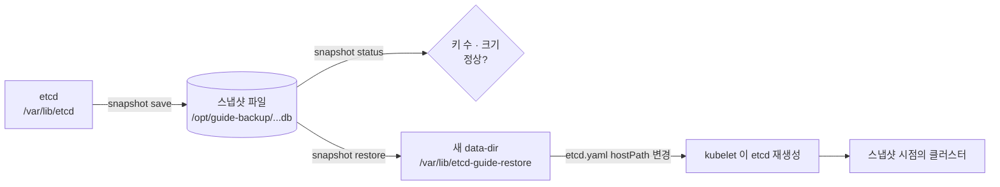
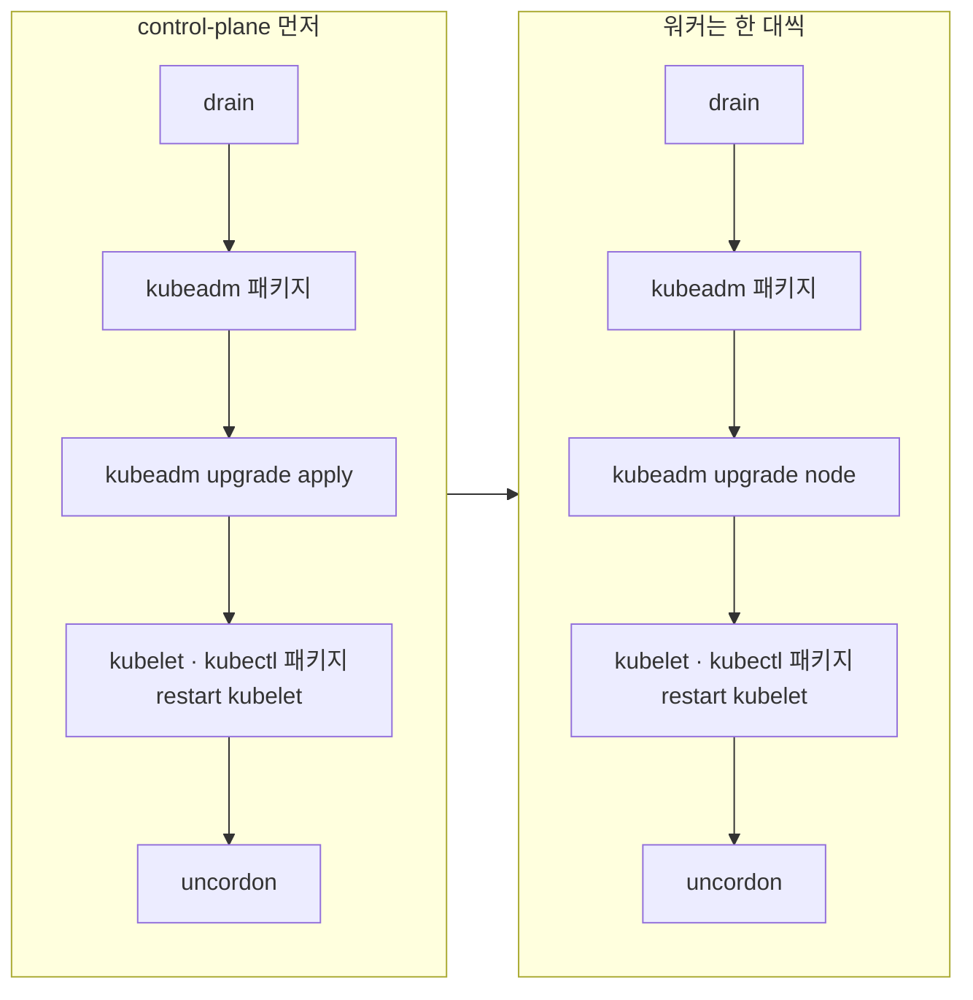

# 20·21강 · 유지보수 (drain · 업그레이드 · 인증서 · etcd)

> 영상: **20강 노드 비우기 · 업그레이드 · 인증서** (1~2 · 5~7) · **21강 etcd 백업 · 복원** (3~4) · 이어서 풀 채점 세트: `20-maintenance`

## 실습 목표

- cordon · drain · uncordon 이 **각각 무엇을 바꾸는지**(taint · 파드 · 스케줄) 눈으로 확인한다.
- PodDisruptionBudget 이 **drain 을 멈춰 세우는** 장면을 보고, 푸는 방법을 익힌다.
- etcd 스냅샷을 **저장 · 검증**하고, 카나리 오브젝트로 **복원이 실제로 시점을 되돌리는지** 확인한 뒤 원래대로 되돌린다.
- 업그레이드 **순서와 버전 규칙**을 이해하고, 실제로 올리지 않고 **계획만 확인**하는 방법(`kubeadm upgrade plan` · apt 레포 전환 · `apt-cache madison`)을 익힌다.
- 인증서 만료일을 `kubeadm certs` 와 `openssl` 두 가지로 확인하고, 갱신 뒤 **재시작해야 반영된다**는 것을 확인한다.

---

## 0) 준비

| 절 | 어디서 | 위험도 |
|----|--------|--------|
| 1) 2) drain · PDB | control-plane (kubectl) | 낮음 — uncordon 으로 되돌린다 |
| 3) etcd 백업 | control-plane 안 (sudo) | 낮음 — 파일만 만든다 |
| 4) etcd 복원 | control-plane 안 (sudo) | **높음** — VM 스냅샷 필수 |
| 5) 업그레이드 계획 | control-plane 안 (sudo) | 낮음 — 읽기만, 레포 파일은 되돌린다 |
| 6) 실제 업그레이드 | 모든 노드 | **높음** — 참고용 절차만 |
| 7) 인증서 | control-plane 안 (sudo) | 중간 — API 서버가 잠깐 재시작 |

```bash
# control-plane 에서
kubectl create namespace guide-maint
sudo mkdir -p /opt/guide-backup
kubectl get nodes
```

!!! danger "VirtualBox 스냅샷을 먼저 찍으세요"
    4) 와 6) 은 되돌리는 명령이 없습니다. 세 VM 을 모두 끈 상태에서 스냅샷(`before-etcd-restore`, `before-upgrade`)을 찍고 시작합니다.
    되돌릴 때도 **세 대를 함께** 되돌립니다.

### etcdctl 준비

kubeadm 클러스터는 etcd 가 **컨테이너 안에만** 있어서 호스트에 `etcdctl` 이 없습니다.

=== "호스트에 설치 (인터넷 필요)"
    ```bash
    # control-plane 에서
    sudo apt-get install -y etcd-client
    etcdctl version
    ```
    ```text
    etcdctl version: 3.4.x
    API version: 3.4
    ```
=== "etcd 파드 안의 것 쓰기"
    ```bash
    # control-plane 에서
    kubectl -n kube-system exec etcd-control-plane -- etcdctl version
    ```
    ```text
    etcdctl version: 3.5.x
    API version: 3.5
    ```
    파드 안에서는 **컨테이너의 경로**만 보입니다. 호스트와 공유되는 곳은 `/var/lib/etcd` 와 `/etc/kubernetes/pki/etcd` 두 곳뿐입니다. 자세한 비교는 [19강 · etcdctl 호스트 vs 파드](16-node-ops.md) 에 있습니다.

이 페이지는 **호스트에 설치한 etcdctl** 을 기준으로 씁니다.

!!! note "`ETCDCTL_API=3` 은 붙여도 되고 안 붙여도 됩니다"
    etcdctl 3.4 부터 v3 API 가 **기본값**입니다. 시험 지문이나 옛 문서에 붙어 있는 것은 예전 버전과의 호환 때문이고, 붙여도 해가 없습니다.

---

## 1) cordon · drain · uncordon — 무엇이 바뀌나

### 실습용 워크로드

```bash
# control-plane 에서
kubectl create deployment maint-web -n guide-maint --image=nginx:1.27 --replicas=4
kubectl rollout status deployment/maint-web -n guide-maint
kubectl get pods -n guide-maint -o wide
```

```text
NAME                         READY   STATUS    NODE
maint-web-6b8f9c7d4-2kq8w    1/1     Running   worker-1
maint-web-6b8f9c7d4-7xm4t    1/1     Running   worker-2
maint-web-6b8f9c7d4-h9p2c    1/1     Running   worker-1
maint-web-6b8f9c7d4-r5n6v    1/1     Running   worker-2
```

### cordon — 새 파드만 막는다

```bash
# control-plane 에서
kubectl cordon worker-1
kubectl get nodes worker-1
kubectl describe node worker-1 | grep -A1 Taints
kubectl get node worker-1 -o jsonpath='{.spec.unschedulable}{"\n"}'
```

```text
NAME       STATUS                     ROLES    AGE   VERSION
worker-1   Ready,SchedulingDisabled   <none>   3d    v1.32.x

Taints:             node.kubernetes.io/unschedulable:NoSchedule
Unschedulable:      true
true
```

파드를 늘려 봅니다.

```bash
# control-plane 에서
kubectl scale deployment maint-web -n guide-maint --replicas=6
kubectl get pods -n guide-maint -o wide
```

**관찰 포인트:** 원래 worker-1 에 있던 두 개는 **그대로 Running** 이고, 새로 생긴 두 개는 **모두 worker-2** 로 갑니다. cordon 은 `spec.unschedulable: true` 와 `NoSchedule` taint 하나를 거는 것이 전부입니다.

### drain — 미리 보기부터

drain 은 `--dry-run` 을 지원합니다. 무엇이 쫓겨날지 먼저 봅니다.

```bash
# control-plane 에서
kubectl drain worker-1 --ignore-daemonsets --delete-emptydir-data --dry-run=client
```

```text
node/worker-1 cordoned (dry run)
Warning: ignoring DaemonSet-managed Pods: kube-system/cilium-8xk2p, kube-system/cilium-envoy-..., kube-system/kube-proxy-m2n8c
evicting pod guide-maint/maint-web-6b8f9c7d4-2kq8w (dry run)
evicting pod guide-maint/maint-web-6b8f9c7d4-h9p2c (dry run)
...
node/worker-1 drained (dry run)
```

```bash
# control-plane 에서
kubectl drain worker-1 --ignore-daemonsets --delete-emptydir-data
kubectl get pods -n guide-maint -o wide
kubectl get pods -n kube-system -o wide --field-selector spec.nodeName=worker-1
```

```text
NAME                         READY   STATUS    NODE
maint-web-6b8f9c7d4-7xm4t    1/1     Running   worker-2
...                                             ← 전부 worker-2

NAME                 READY   STATUS    NODE
cilium-8xk2p         1/1     Running   worker-1     ← DaemonSet 파드는 남는다
kube-proxy-m2n8c     1/1     Running   worker-1
...
```

**관찰 포인트:** DaemonSet 파드는 `unschedulable` taint 를 견디도록 만들어져 있어서 **drain 뒤에도 그 노드에 남습니다.** `--ignore-daemonsets` 는 "이것들은 못 옮기는 걸 안다" 는 확인 도장입니다.

### uncordon — 돌아오지는 않는다

```bash
# control-plane 에서
kubectl uncordon worker-1
kubectl get pods -n guide-maint -o wide
```

**관찰 포인트:** worker-1 이 스케줄 가능해졌지만 파드는 **여전히 전부 worker-2** 에 있습니다. uncordon 은 앞으로 만들어질 파드의 배치만 허용합니다. 다시 나누려면 파드를 새로 만들어야 합니다.

```bash
# control-plane 에서
kubectl rollout restart deployment/maint-web -n guide-maint
kubectl rollout status deployment/maint-web -n guide-maint
kubectl get pods -n guide-maint -o wide          # 두 워커에 다시 퍼진다
```

| 명령 | `unschedulable` | 이미 있는 파드 | DaemonSet 파드 |
|------|-----------------|----------------|----------------|
| `cordon` | true | 그대로 | 그대로 |
| `drain` | true | **축출(evict)** → 컨트롤러가 다른 노드에 재생성 | 그대로 (`--ignore-daemonsets` 필요) |
| `uncordon` | false | 돌아오지 않음 | 그대로 |

---

## 2) PodDisruptionBudget — drain 이 멈추는 이유

drain 은 파드를 그냥 지우지 않고 **Eviction API** 로 "내보내도 되겠습니까?" 를 묻습니다. 그 질문에 "안 된다" 고 답하는 것이 PDB 입니다.

```bash
# control-plane 에서
kubectl scale deployment maint-web -n guide-maint --replicas=4
kubectl rollout status deployment/maint-web -n guide-maint
kubectl create pdb maint-web-pdb -n guide-maint --selector=app=maint-web --min-available=4
kubectl get pdb -n guide-maint
```

```text
NAME            MIN AVAILABLE   MAX UNAVAILABLE   ALLOWED DISRUPTIONS   AGE
maint-web-pdb   4               N/A               0                     3s
```

`ALLOWED DISRUPTIONS 0` — 파드를 한 개도 내보낼 수 없다는 뜻입니다. 이 상태에서 drain 합니다. 끝없이 재시도하므로 `--timeout` 을 줍니다.

```bash
# control-plane 에서
kubectl drain worker-1 --ignore-daemonsets --delete-emptydir-data --timeout=30s
```

```text
node/worker-1 cordoned
Warning: ignoring DaemonSet-managed Pods: ...
evicting pod guide-maint/maint-web-7c5d8b9f6-kx2p4
evicting pod guide-maint/maint-web-7c5d8b9f6-q8m3n
error when evicting pods/"maint-web-7c5d8b9f6-kx2p4" -n "guide-maint" (will retry after 5s): Cannot evict pod as it would violate the pod's disruption budget.
error when evicting pods/"maint-web-7c5d8b9f6-q8m3n" -n "guide-maint" (will retry after 5s): Cannot evict pod as it would violate the pod's disruption budget.
...
error: unable to drain node "worker-1" due to error: [error when evicting pods/"maint-web-7c5d8b9f6-kx2p4" -n "guide-maint": global timeout reached: 30s, ...], continuing command...
There are pending nodes to be drained:
 worker-1
```

```bash
# control-plane 에서
kubectl get nodes worker-1
```

```text
NAME       STATUS                     ROLES    AGE   VERSION
worker-1   Ready,SchedulingDisabled   <none>   3d    v1.32.x
```

**관찰 포인트:** drain 이 실패해도 **cordon 은 이미 걸려 있습니다.** "SchedulingDisabled 인데 파드는 그대로" 인 상태가 바로 이것입니다.

### 풀기 — 예산을 현실적으로

```bash
# control-plane 에서
kubectl patch pdb maint-web-pdb -n guide-maint --type=merge -p '{"spec":{"minAvailable":3}}'
kubectl get pdb -n guide-maint
kubectl drain worker-1 --ignore-daemonsets --delete-emptydir-data
```

```text
NAME            MIN AVAILABLE   MAX UNAVAILABLE   ALLOWED DISRUPTIONS   AGE
maint-web-pdb   3               N/A               1                     2m

evicting pod guide-maint/maint-web-7c5d8b9f6-kx2p4
evicting pod guide-maint/maint-web-7c5d8b9f6-q8m3n
error when evicting pods/"maint-web-7c5d8b9f6-q8m3n" ... (will retry after 5s): Cannot evict pod as it would violate the pod's disruption budget.
evicting pod guide-maint/maint-web-7c5d8b9f6-q8m3n
pod/maint-web-7c5d8b9f6-kx2p4 evicted
pod/maint-web-7c5d8b9f6-q8m3n evicted
node/worker-1 drained
```

**관찰 포인트:** 이번에는 **한 번에 하나씩** 나갑니다. 첫 파드가 나가고 대체 파드가 Ready 가 되어야 두 번째가 나갈 수 있습니다. PDB 는 drain 을 막는 장치가 아니라 **속도를 조절하는 장치**입니다.

```bash
# control-plane 에서
kubectl uncordon worker-1
kubectl explain pdb.spec --recursive | head -20
```

| PDB 설정 | 뜻 | 4개 중 동시에 나갈 수 있는 수 |
|----------|----|-----------------------------|
| `minAvailable: 4` | 최소 4개는 살아 있어야 한다 | 0 — drain 영원히 대기 |
| `minAvailable: 3` | 최소 3개 | 1 |
| `maxUnavailable: 1` | 최대 1개까지 빠져도 된다 | 1 (레플리카 수가 바뀌어도 유지) |

!!! warning "`--disable-eviction` 은 PDB 를 무시합니다"
    `kubectl drain --disable-eviction` 은 Eviction API 대신 **그냥 삭제**해서 PDB 를 건너뜁니다. 서비스가 끊겨도 괜찮다고 확신할 때만 씁니다.
    시험에서 drain 이 PDB 때문에 멈추면, 먼저 **PDB 를 확인**하고(`kubectl get pdb -A`) 지문이 허락하는 범위에서 조정합니다.

---

## 3) etcd 백업 — 값은 매니페스트에서 읽는다

etcd 에는 쿠버네티스 **오브젝트 전부**가 들어 있습니다. PV 안의 실제 데이터, 컨테이너 이미지, 파드 안의 파일은 **없습니다.**



### 접속 정보 찾기

```bash
# control-plane 에서
sudo grep -E 'listen-client-urls|cert-file|key-file|trusted-ca-file|data-dir' /etc/kubernetes/manifests/etcd.yaml
```

```text
    - --cert-file=/etc/kubernetes/pki/etcd/server.crt
    - --data-dir=/var/lib/etcd
    - --key-file=/etc/kubernetes/pki/etcd/server.key
    - --listen-client-urls=https://127.0.0.1:2379,https://192.168.56.10:2379
    - --peer-cert-file=/etc/kubernetes/pki/etcd/peer.crt
    - --peer-key-file=/etc/kubernetes/pki/etcd/peer.key
    - --peer-trusted-ca-file=/etc/kubernetes/pki/etcd/ca.crt
    - --trusted-ca-file=/etc/kubernetes/pki/etcd/ca.crt
```

| etcd.yaml | etcdctl 플래그 |
|-----------|----------------|
| `--listen-client-urls` 중 `127.0.0.1:2379` | `--endpoints` |
| `--trusted-ca-file` | `--cacert` |
| `--cert-file` (peer 아닌 것) | `--cert` |
| `--key-file` (peer 아닌 것) | `--key` |

반복해서 쓰기 편하도록 셸 변수로 묶어 둡니다.

```bash
# control-plane 에서
export ETCD_FLAGS="--endpoints=https://127.0.0.1:2379 \
  --cacert=/etc/kubernetes/pki/etcd/ca.crt \
  --cert=/etc/kubernetes/pki/etcd/server.crt \
  --key=/etc/kubernetes/pki/etcd/server.key"
sudo etcdctl $ETCD_FLAGS endpoint health
sudo etcdctl $ETCD_FLAGS member list -w table
```

```text
https://127.0.0.1:2379 is healthy: successfully committed proposal: took = 8.912ms

+------------------+---------+---------------+----------------------------+----------------------------+------------+
|        ID        | STATUS  |     NAME      |         PEER ADDRS         |        CLIENT ADDRS        | IS LEARNER |
+------------------+---------+---------------+----------------------------+----------------------------+------------+
| 8e9e05c52164694d | started | control-plane | https://192.168.56.10:2380 | https://192.168.56.10:2379 |      false |
+------------------+---------+---------------+----------------------------+----------------------------+------------+
```

### 카나리 ① — 스냅샷 **전에** 만든 것

```bash
# control-plane 에서
kubectl create configmap before-snap -n guide-maint --from-literal=when=before
```

### 저장과 검증

```bash
# control-plane 에서
sudo etcdctl $ETCD_FLAGS snapshot save /opt/guide-backup/etcd-guide.db
sudo ls -lh /opt/guide-backup/etcd-guide.db
sudo etcdctl snapshot status /opt/guide-backup/etcd-guide.db -w table
```

```text
{"level":"info",...,"msg":"created temporary db file","path":"/opt/guide-backup/etcd-guide.db.part"}
...
{"level":"info",...,"msg":"fetched snapshot","endpoint":"https://127.0.0.1:2379","size":"6.1 MB",...}
Snapshot saved at /opt/guide-backup/etcd-guide.db

-rw------- 1 root root 6.1M Sep 29 06:20 /opt/guide-backup/etcd-guide.db

+----------+----------+------------+------------+
|   HASH   | REVISION | TOTAL KEYS | TOTAL SIZE |
+----------+----------+------------+------------+
| 3c9a71e2 |   412733 |       1243 |     6.1 MB |
+----------+----------+------------+------------+
```

**관찰 포인트:** `snapshot status` 에는 인증서가 필요 없습니다. **파일만** 읽기 때문입니다. TOTAL KEYS 가 수백~수천이고 크기가 MB 단위면 정상입니다.

!!! note "`etcdutl` 과 deprecated 경고"
    etcd 3.5 부터 **파일을 다루는** 명령(`snapshot status` · `snapshot restore`)은 `etcdutl` 로 옮겨 갔습니다.
    3.5 의 `etcdctl snapshot status/restore` 는 `Deprecated: Use etcdutl snapshot ...` 경고를 내지만 동작하고, 3.6 에서는 빠집니다.
    **서버에 접속하는** `snapshot save` 는 계속 `etcdctl` 입니다.

    | 명령 | 3.4 (`apt etcd-client`) | 3.5 (etcd 파드) | 3.6 |
    |------|------------------------|-----------------|-----|
    | `etcdctl snapshot save` | O | O | O |
    | `etcdctl snapshot status/restore` | O | O (경고) | X |
    | `etcdutl snapshot status/restore` | 없음 | O | O |

### 대조 실험 — 백업 이후의 변화

```bash
# control-plane 에서
kubectl create configmap after-snap -n guide-maint --from-literal=when=after
kubectl get cm -n guide-maint
```

```text
NAME               DATA   AGE
after-snap         1      2s
before-snap        1      1m
kube-root-ca.crt   1      30m
```

`after-snap` 은 스냅샷 파일에 **없습니다.** 다음 절에서 복원하면 이것이 사라져야 합니다.

!!! tip "시험 팁"
    - etcd 문제는 **control-plane 안에서, sudo 로** 풉니다. 지문의 저장 경로는 **한 글자도 바꾸지 말고** 그대로 씁니다.
    - 저장 뒤 `snapshot status` 로 5초 확인. 빈 파일을 두고 넘어가는 것이 최악입니다.
    - 문서 페이지: *Operating etcd clusters for Kubernetes* → "Backing up an etcd cluster".

---

## 4) etcd 복원 — 새 디렉터리 → hostPath 전환 → 되돌리기

!!! danger "클러스터 전체를 과거로 돌립니다"
    - `before-etcd-restore` **VM 스냅샷**이 있는지 확인하세요.
    - 복원하는 1~2분 동안 **API 서버가 응답하지 않습니다.** 정상입니다.
    - 원래 데이터(`/var/lib/etcd`)는 **건드리지 않습니다.** 그래서 이 절 끝에서 안전하게 되돌릴 수 있습니다.

### ① 새 디렉터리에 풀기

`snapshot restore` 는 **실행 중인 etcd 를 건드리지 않습니다.** 파일을 etcd 가 읽을 수 있는 디렉터리 구조로 풀어 놓을 뿐이라 인증서도 필요 없습니다.

```bash
# control-plane 에서
sudo etcdctl snapshot restore /opt/guide-backup/etcd-guide.db --data-dir=/var/lib/etcd-guide-restore
sudo ls /var/lib/etcd-guide-restore/member
```

```text
{"level":"info",...,"msg":"restoring snapshot","path":"/opt/guide-backup/etcd-guide.db","wal-dir":"/var/lib/etcd-guide-restore/member/wal","data-dir":"/var/lib/etcd-guide-restore",...}
...
{"level":"info",...,"msg":"restored snapshot",...}
snap  wal
```

!!! warning "data-dir 은 없는 경로여야 합니다"
    이미 있는 디렉터리를 주면 restore 가 거부합니다. 특히 **`/var/lib/etcd` 를 주면 안 됩니다.** 실습을 다시 하려면 먼저 `sudo rm -rf /var/lib/etcd-guide-restore`.

!!! tip "멤버 정보까지 맞추려면"
    위 명령은 멤버 이름을 `default`, peer 주소를 `http://localhost:2380` 으로 기록합니다. 단일 노드에서는 그대로 동작하지만, 원래 멤버 정보를 유지하고 싶으면 etcd.yaml 의 값으로 함께 줍니다.
    ```bash
    sudo etcdctl snapshot restore /opt/guide-backup/etcd-guide.db --data-dir=/var/lib/etcd-guide-restore \
      --name=control-plane \
      --initial-cluster=control-plane=https://192.168.56.10:2380 \
      --initial-advertise-peer-urls=https://192.168.56.10:2380
    ```
    etcd 3.5 이상이라면 같은 옵션으로 `etcdutl snapshot restore ...` 를 씁니다.

### ② etcd.yaml 백업 후 hostPath 한 줄 바꾸기

!!! danger "매니페스트 백업은 manifests 디렉터리 **밖에**"
    `/etc/kubernetes/manifests/etcd.yaml.bak` 처럼 같은 디렉터리에 두면 kubelet 이 **그것도 파드로 띄우려고** 합니다(이름이 같은 etcd 가 둘). 반드시 다른 곳에 복사합니다.

```bash
# control-plane 에서
sudo cp /etc/kubernetes/manifests/etcd.yaml /opt/guide-backup/etcd.yaml.orig
sudo grep -n -B1 -A2 'path: /var/lib/etcd' /etc/kubernetes/manifests/etcd.yaml
```

```text
    volumeMounts:
    - mountPath: /var/lib/etcd          ← 컨테이너 안 경로: 그대로 둔다
      name: etcd-data
--
  - hostPath:
      path: /var/lib/etcd               ← 호스트 쪽 경로: 이것만 바꾼다
      type: DirectoryOrCreate
    name: etcd-data
```

```bash
# control-plane 에서
sudo sed -i 's|^\(\s*\)path: /var/lib/etcd$|\1path: /var/lib/etcd-guide-restore|' /etc/kubernetes/manifests/etcd.yaml
sudo grep -n -E 'data-dir|mountPath: /var/lib|path: /var/lib' /etc/kubernetes/manifests/etcd.yaml
```

```text
    - --data-dir=/var/lib/etcd
    - mountPath: /var/lib/etcd
      path: /var/lib/etcd-guide-restore
```

**관찰 포인트:** 컨테이너 안에서 etcd 는 여전히 `/var/lib/etcd` 를 읽습니다. 바뀐 것은 **그 자리에 호스트의 어느 디렉터리를 붙이느냐**뿐입니다.

### ③ 기다리기 — kubectl 대신 crictl

```bash
# control-plane 에서
kubectl get nodes                                  # 잠깐 동안 에러가 정상
watch -n2 "sudo crictl ps --name 'etcd|kube-apiserver'"
```

```text
The connection to the server 192.168.56.10:6443 was refused - did you specify the right host or port?

CONTAINER      IMAGE          CREATED          STATE     NAME             ATTEMPT   POD ID
9e2f...        a9e7e6b294ba   25 seconds ago   Running   etcd             0         c1d4...
4b7a...        6417e1437b6d   3 hours ago      Running   kube-apiserver   2         7e8f...
```

etcd 의 CREATED 가 방금으로 바뀌고 API 서버가 다시 응답하면 확인합니다. (Ctrl+C 로 watch 종료)

```bash
# control-plane 에서
kubectl get cm -n guide-maint
```

```text
NAME               DATA   AGE
before-snap        1      4m
kube-root-ca.crt   1      33m
                                                   ← after-snap 이 없다
```

**관찰 포인트:** 스냅샷 **이후에 만든 `after-snap` 이 사라졌습니다.** 클러스터가 스냅샷 시점으로 돌아간 것입니다.

!!! note "복원 직후 이상하면 컨트롤플레인 구성 요소를 재시작"
    데이터가 과거로 돌아가면 API 서버 · 컨트롤러 매니저 · 스케줄러가 들고 있던 캐시와 어긋날 수 있습니다. 쿠버네티스 문서도 복원 뒤 이 구성 요소들의 재시작을 권합니다.
    ```bash
    sudo crictl ps -q --name 'kube-apiserver|kube-controller-manager|kube-scheduler' | xargs -r sudo crictl stop
    ```
    kubelet 이 곧바로 다시 띄웁니다.

### ④ 되돌리기 — 원래 데이터로

실제 장애 복구라면 여기서 끝입니다. 실습이므로 원래 상태로 돌아갑니다. 원래 데이터는 `/var/lib/etcd` 에 그대로 있습니다.

```bash
# control-plane 에서
sudo cp /opt/guide-backup/etcd.yaml.orig /etc/kubernetes/manifests/etcd.yaml
watch -n2 "sudo crictl ps --name etcd"             # CREATED 가 다시 바뀔 때까지
```

```bash
# control-plane 에서
kubectl get cm -n guide-maint
sudo rm -rf /var/lib/etcd-guide-restore
```

```text
NAME               DATA   AGE
after-snap         1      6m                         ← 돌아왔다
before-snap        1      7m
kube-root-ca.crt   1      36m
```

| 증상 | 원인 | 확인 |
|------|------|------|
| 복원했는데 `after-snap` 이 그대로 | etcd.yaml 을 안 고쳤거나 다른 파일을 고침 | `grep 'path: /var/lib' etcd.yaml` |
| etcd 가 계속 안 뜸 | hostPath 오타 · restore 경로와 불일치 | `sudo ls <hostPath>/member` · `sudo crictl ps -a --name etcd` · `sudo crictl logs <ID>` |
| etcd 가 둘 뜨려 함 | manifests 디렉터리 안에 백업 파일 | `ls /etc/kubernetes/manifests/` |

---

## 5) 업그레이드 계획 — 올리지 않고 확인만

### 순서와 버전 규칙



| 규칙 (v1.32 기준) | 이유 |
|-------------------|------|
| 마이너는 **한 단계씩** (1.32 → 1.33 → 1.34) | kubeadm 이 한 단계 차이만 지원한다 |
| **control-plane 먼저** | kubelet 은 API 서버보다 **새로우면 안 된다** (최대 3 마이너까지 낮은 것은 허용) |
| kubectl 은 API 서버와 ±1 마이너 | 그 밖은 지원하지 않는다 |
| 워커는 **한 대씩** | 나머지 워커가 파드를 받는 동안 올린다 |

### 지금 버전 보기

```bash
# control-plane 에서
kubectl get nodes
kubeadm version -o short
kubectl version
```

```text
NAME            STATUS   ROLES           AGE   VERSION
control-plane   Ready    control-plane   3d    v1.32.x
...
v1.32.x
Client Version: v1.32.x
Kustomize Version: v5.5.0
Server Version: v1.32.x
```

### kubeadm upgrade plan

`plan` 은 **읽기만** 합니다. 무엇을 할 수 있는지, 무엇을 손으로 올려야 하는지 알려 줍니다.

```bash
# control-plane 에서
sudo kubeadm upgrade plan
```

```text
[preflight] Running pre-flight checks.
[upgrade/config] Reading configuration from the "kubeadm-config" ConfigMap in namespace "kube-system"...
[upgrade] Running cluster health checks
[upgrade] Fetching available versions to upgrade to
[upgrade/versions] Cluster version: 1.32.x
[upgrade/versions] kubeadm version: v1.32.x
[upgrade/versions] Target version: v1.32.y
[upgrade/versions] Latest version in the v1.32 series: v1.32.y

Components that must be upgraded manually after you have upgraded the control plane with 'kubeadm upgrade apply':
COMPONENT   NODE            CURRENT    TARGET
kubelet     control-plane   v1.32.x    v1.32.y
kubelet     worker-1        v1.32.x    v1.32.y
kubelet     worker-2        v1.32.x    v1.32.y

Upgrade to the latest version in the v1.32 series:

COMPONENT                 NODE            CURRENT    TARGET
kube-apiserver            control-plane   v1.32.x    v1.32.y
kube-controller-manager   control-plane   v1.32.x    v1.32.y
kube-scheduler            control-plane   v1.32.x    v1.32.y
kube-proxy                                1.32.x     v1.32.y
CoreDNS                                   v1.11.x    v1.11.x
etcd                      control-plane   3.5.x-0    3.5.x-0

You can now apply the upgrade by executing the following command:

	kubeadm upgrade apply v1.32.y

Note: Before you can perform this upgrade, you have to update kubeadm to v1.32.y.
...
```

**관찰 포인트:** 표가 두 개입니다. 위 표(**kubelet**)는 `apply` 가 **올려 주지 않는** 것, 아래 표는 `apply` 가 올려 주는 것입니다. 그래서 apply 뒤에도 `kubectl get nodes` 의 VERSION(=kubelet)은 그대로입니다.
다음 마이너(1.33)는 **kubeadm 자체를 1.33 으로** 올려야 plan 에 나옵니다.

!!! note "인터넷이 없으면"
    plan 은 dl.k8s.io 에서 최신 버전을 조회합니다. 실패하면 경고를 내고 현재 kubeadm 버전 기준으로만 보여 줍니다. 출력을 파일로 남길 때는 `2>&1` 로 경고까지 담습니다.

### apt 레포 — 마이너별로 나뉘어 있다

pkgs.k8s.io 는 **마이너 버전마다 주소가 다릅니다.** 지금 레포로는 1.32 패키지만 보입니다.

```bash
# control-plane 에서
grep -rl pkgs.k8s.io /etc/apt/sources.list.d/
apt-cache madison kubeadm | head -3
apt-mark showhold
```

```text
/etc/apt/sources.list.d/kubernetes.list          ← 또는 kubernetes.sources

   kubeadm | 1.32.y-1.1 | https://pkgs.k8s.io/core:/stable:/v1.32/deb  Packages
   kubeadm | 1.32.x-1.1 | https://pkgs.k8s.io/core:/stable:/v1.32/deb  Packages
   ...
kubeadm
kubectl
kubelet
```

레포 파일 형식은 배포판 · 설치 방법에 따라 둘 중 하나입니다.

=== "kubernetes.list (한 줄 형식)"
    ```text
    deb [signed-by=/etc/apt/keyrings/kubernetes-apt-keyring.gpg] https://pkgs.k8s.io/core:/stable:/v1.32/deb/ /
    ```
=== "kubernetes.sources (deb822 형식)"
    ```text
    Types: deb
    URIs: https://pkgs.k8s.io/core:/stable:/v1.32/deb/
    Suites: /
    Signed-By: /etc/apt/keyrings/kubernetes-apt-keyring.gpg
    ```

두 형식 모두 `v1.32` 라는 글자만 바꾸면 되므로, **파일 이름을 외우지 않고 grep 으로 찾아서** 바꿉니다.

### 대조 실험 — 레포만 바꿔서 다음 마이너 들여다보기

패키지에 hold 가 걸려 있으므로 `apt-get update` 만으로는 아무것도 설치되지 않습니다. 레포 파일은 **백업하고 바꾼 뒤 되돌립니다.**

```bash
# control-plane 에서
REPO=$(grep -rl pkgs.k8s.io /etc/apt/sources.list.d/)
sudo cp "$REPO" /opt/guide-backup/
sudo sed -i 's|v1.32|v1.33|' "$REPO"
sudo apt-get update -qq
apt-cache madison kubeadm | head -3
```

```text
   kubeadm | 1.33.z-1.1 | https://pkgs.k8s.io/core:/stable:/v1.33/deb  Packages
   ...
```

**관찰 포인트:** 레포를 바꾸자 1.33 패키지가 보입니다. 설치할 때는 이 **버전 문자열(`1.33.z-1.1`)을 그대로 복사**해서 `kubeadm='1.33.z-1.1'` 처럼 씁니다.

되돌립니다.

```bash
# control-plane 에서
sudo cp /opt/guide-backup/$(basename "$REPO") "$REPO"
sudo apt-get update -qq
apt-cache madison kubeadm | head -1              # 다시 1.32 만 보여야 한다
apt-mark showhold                                 # kubeadm kubectl kubelet 그대로
```

!!! tip "시험 팁"
    - 문서 페이지: *Upgrading kubeadm clusters* — 명령 블록을 그대로 복사해 버전만 바꿉니다.
    - 시험은 대개 **노드 한 대**만 올리라고 합니다. 어느 노드를 **몇 버전**으로 올리는지 먼저 적어 두고, 다섯 단계를 하나씩 지우면서 갑니다.
    - `apply` 는 control-plane, `node` 는 워커. 워커에서 `apply` 를 치면 에러입니다.

---

## 6) 실제 업그레이드 — 전체 절차 (참고)

!!! danger "되돌릴 수 없는 작업입니다"
    실제로 해 보려면 `before-upgrade` **VM 스냅샷**을 먼저 찍으세요. 한 번 올린 버전은 kubeadm 으로 내릴 수 없습니다.
    아래 절차는 **1.32.x → 1.33.z** 기준이며, `z` 는 5) 의 `apt-cache madison` 에서 본 실제 값으로 바꿉니다.

??? note "전체 절차 (참고) — control-plane"
    ```bash
    # control-plane 에서 (kubectl)
    kubectl drain control-plane --ignore-daemonsets

    # control-plane 안에서 — ① 레포 전환 + kubeadm
    sudo sed -i 's|v1.32|v1.33|' $(grep -rl pkgs.k8s.io /etc/apt/sources.list.d/)
    sudo apt-get update
    apt-cache madison kubeadm | head -3
    sudo apt-mark unhold kubeadm
    sudo apt-get install -y kubeadm='1.33.z-1.1'
    sudo apt-mark hold kubeadm
    kubeadm version -o short                         # v1.33.z

    # ② 컴포넌트 교체
    sudo kubeadm upgrade plan
    sudo kubeadm upgrade apply v1.33.z               # 확인 프롬프트: y  (또는 -y)
    #   [upgrade/successful] SUCCESS! Your cluster was upgraded to "v1.33.z". Enjoy!

    # ③ kubelet · kubectl
    sudo apt-mark unhold kubelet kubectl
    sudo apt-get install -y kubelet='1.33.z-1.1' kubectl='1.33.z-1.1'
    sudo apt-mark hold kubelet kubectl
    sudo systemctl daemon-reload
    sudo systemctl restart kubelet

    # control-plane 에서 (kubectl)
    kubectl uncordon control-plane
    kubectl get nodes                                 # control-plane 만 v1.33.z
    ```

??? note "전체 절차 (참고) — 워커 한 대 (worker-1)"
    ```bash
    # control-plane 에서
    kubectl drain worker-1 --ignore-daemonsets --delete-emptydir-data

    # worker-1 에서
    sudo sed -i 's|v1.32|v1.33|' $(grep -rl pkgs.k8s.io /etc/apt/sources.list.d/)
    sudo apt-get update
    sudo apt-mark unhold kubeadm
    sudo apt-get install -y kubeadm='1.33.z-1.1'
    sudo apt-mark hold kubeadm
    sudo kubeadm upgrade node                        # plan 없음 · 버전 인자 없음
    sudo apt-mark unhold kubelet kubectl
    sudo apt-get install -y kubelet='1.33.z-1.1' kubectl='1.33.z-1.1'
    sudo apt-mark hold kubelet kubectl
    sudo systemctl daemon-reload
    sudo systemctl restart kubelet

    # control-plane 에서
    kubectl uncordon worker-1
    kubectl get nodes
    ```
    worker-2 도 같은 순서로 **한 대씩** 올립니다.

`upgrade apply` 가 정확히 무엇을 바꾸는지(매니페스트 이미지 · kubeadm-config · 백업 디렉터리)는 [19강 · 업그레이드하면 무엇이 바뀌나](16-node-ops.md) 에서 봅니다.

---

## 7) 인증서 — 만료일 확인과 갱신

kubeadm 이 만든 인증서는 **1년**, CA 는 **10년**입니다. 만료되면 kubectl 이 갑자기 안 되고, 구성 요소끼리도 통신하지 못합니다.

### kubeadm 으로 한눈에

```bash
# control-plane 에서
sudo kubeadm certs check-expiration
```

```text
[check-expiration] Reading configuration from the cluster...
[check-expiration] FYI: You can look at this config file with 'kubectl -n kube-system get cm kubeadm-config -o yaml'

CERTIFICATE                EXPIRES                  RESIDUAL TIME   CERTIFICATE AUTHORITY   EXTERNALLY MANAGED
admin.conf                 Sep 26, 2027 03:02 UTC   361d            ca                      no
apiserver                  Sep 26, 2027 03:02 UTC   361d            ca                      no
apiserver-etcd-client      Sep 26, 2027 03:02 UTC   361d            etcd-ca                 no
apiserver-kubelet-client   Sep 26, 2027 03:02 UTC   361d            ca                      no
controller-manager.conf    Sep 26, 2027 03:02 UTC   361d            ca                      no
etcd-healthcheck-client    Sep 26, 2027 03:02 UTC   361d            etcd-ca                 no
etcd-peer                  Sep 26, 2027 03:02 UTC   361d            etcd-ca                 no
etcd-server                Sep 26, 2027 03:02 UTC   361d            etcd-ca                 no
front-proxy-client         Sep 26, 2027 03:02 UTC   361d            front-proxy-ca          no
scheduler.conf             Sep 26, 2027 03:02 UTC   361d            ca                      no
super-admin.conf           Sep 26, 2027 03:02 UTC   361d            ca                      no

CERTIFICATE AUTHORITY   EXPIRES                  RESIDUAL TIME   EXTERNALLY MANAGED
ca                      Sep 24, 2036 03:02 UTC   9y              no
etcd-ca                 Sep 24, 2036 03:02 UTC   9y              no
front-proxy-ca          Sep 24, 2036 03:02 UTC   9y              no
```

### openssl 로 한 장씩

kubeadm 이 없는 환경이나, **실제로 서비스 중인** 인증서를 볼 때는 openssl 을 씁니다.

```bash
# control-plane 에서
sudo openssl x509 -in /etc/kubernetes/pki/apiserver.crt -noout -subject -issuer -dates
sudo openssl x509 -in /etc/kubernetes/pki/apiserver.crt -noout -ext subjectAltName
```

```text
subject=CN = kube-apiserver
issuer=CN = kubernetes
notBefore=Sep 26 02:57:41 2026 GMT
notAfter=Sep 26 03:02:41 2027 GMT

X509v3 Subject Alternative Name:
    DNS:control-plane, DNS:kubernetes, DNS:kubernetes.default, DNS:kubernetes.default.svc, DNS:kubernetes.default.svc.cluster.local, IP Address:10.96.0.1, IP Address:192.168.56.10
```

| 옵션 | 보여 주는 것 |
|------|--------------|
| `-dates` / `-enddate` | 유효 기간 / 만료일만 |
| `-subject` · `-issuer` | 누구의 인증서인가 · 누가 서명했나 |
| `-ext subjectAltName` | 이 인증서로 접속할 수 있는 이름 · IP |
| `-checkend 86400` | 24시간 안에 만료되면 종료 코드 1 |

### 대조 실험 — 갱신했는데 왜 그대로지?

API 서버 인증서 하나만 갱신해 봅니다. 먼저 **지금 API 서버가 실제로 내보내는** 인증서의 만료일을 봅니다.

```bash
# control-plane 에서
echo | openssl s_client -connect 192.168.56.10:6443 2>/dev/null | openssl x509 -noout -enddate
sudo kubeadm certs renew apiserver
sudo openssl x509 -in /etc/kubernetes/pki/apiserver.crt -noout -enddate
echo | openssl s_client -connect 192.168.56.10:6443 2>/dev/null | openssl x509 -noout -enddate
```

```text
notAfter=Sep 26 03:02:41 2027 GMT            ← 서비스 중인 인증서
[renew] Reading configuration from the cluster...
...
certificate for serving the Kubernetes API renewed
notAfter=Sep 29 06:41:12 2027 GMT            ← 파일은 새것
notAfter=Sep 26 03:02:41 2027 GMT            ← 서비스 중인 것은 아직 옛것
```

**관찰 포인트:** 파일은 바뀌었지만 **API 서버는 시작할 때 읽은 인증서를 계속 씁니다.** 매니페스트가 바뀌지 않았으니 kubelet 도 재시작하지 않습니다. 직접 재시작합니다.

!!! warning "API 서버가 20~40초 동안 내려갑니다"

```bash
# control-plane 에서
sudo mv /etc/kubernetes/manifests/kube-apiserver.yaml /opt/guide-backup/
sleep 20; sudo crictl ps --name kube-apiserver          # 비어 있을 때까지
sudo mv /opt/guide-backup/kube-apiserver.yaml /etc/kubernetes/manifests/
sleep 30; echo | openssl s_client -connect 192.168.56.10:6443 2>/dev/null | openssl x509 -noout -enddate
```

```text
notAfter=Sep 29 06:41:12 2027 GMT            ← 이제 새 인증서
```

`renew all` 을 하면 kubeadm 도 같은 안내를 합니다.

```text
Done renewing certificates. You must restart the kube-apiserver, kube-controller-manager, kube-scheduler and etcd, so that they can use the new certificates.
```

!!! note "갱신 뒤 챙길 것 두 가지"
    - `admin.conf` 도 갱신되므로 `sudo cp /etc/kubernetes/admin.conf ~/.kube/config` 로 **다시 복사**합니다.
    - kubelet 의 클라이언트 인증서(`/var/lib/kubelet/pki/kubelet-client-current.pem`)는 목록에 없습니다. `rotateCertificates: true` 로 **kubelet 이 스스로 갱신**합니다.
      ```bash
      sudo openssl x509 -in /var/lib/kubelet/pki/kubelet-client-current.pem -noout -enddate
      ```
    - `kubeadm upgrade apply` 는 기본으로 인증서도 함께 갱신합니다. 1년 안에 한 번씩 업그레이드하면 만료를 겪지 않습니다.

!!! tip "시험 팁"
    문서 페이지: *Certificate Management with kubeadm*. 만료일 확인 문제는 `sudo kubeadm certs check-expiration` 출력을 **stderr 까지** 파일로 남기면 됩니다.

---

## 시험에서 빠르게

```bash
# drain / uncordon (kubectl 이 되는 곳)
kubectl drain <노드> --ignore-daemonsets --delete-emptydir-data
kubectl get pdb -A                                  # drain 이 멈추면
kubectl uncordon <노드>

# etcd (control-plane 안, sudo)
sudo grep -E 'listen-client|cert-file|key-file|trusted-ca' /etc/kubernetes/manifests/etcd.yaml
sudo ETCDCTL_API=3 etcdctl snapshot save <경로> --endpoints=https://127.0.0.1:2379 \
  --cacert=/etc/kubernetes/pki/etcd/ca.crt --cert=/etc/kubernetes/pki/etcd/server.crt \
  --key=/etc/kubernetes/pki/etcd/server.key
sudo etcdctl snapshot status <경로> -w table
sudo etcdctl snapshot restore <경로> --data-dir=<새 경로>     # 또는 etcdutl
sudo vi /etc/kubernetes/manifests/etcd.yaml                    # volumes: etcd-data hostPath.path

# 업그레이드 (노드 안, sudo)
sudo kubeadm upgrade plan
sudo sed -i 's|v1.OLD|v1.NEW|' $(grep -rl pkgs.k8s.io /etc/apt/sources.list.d/) && sudo apt-get update
apt-cache madison kubeadm
# unhold → install '버전' → hold → upgrade apply(CP)/node(워커) → kubelet·kubectl → daemon-reload → restart

# 인증서 (control-plane 안, sudo)
sudo kubeadm certs check-expiration
sudo kubeadm certs renew <이름|all>
sudo openssl x509 -in <crt> -noout -dates -ext subjectAltName
```

---

## 정리

```bash
# control-plane 에서
kubectl get nodes                                          # SchedulingDisabled 가 없어야 한다
kubectl uncordon worker-1 2>/dev/null
kubectl delete namespace guide-maint

# 되돌려 놓았는지 확인
sudo grep 'path: /var/lib/etcd' /etc/kubernetes/manifests/etcd.yaml   # /var/lib/etcd 여야 한다
ls /etc/kubernetes/manifests/                                          # 파일 4개 그대로
grep -r 'stable:/v1' /etc/apt/sources.list.d/                          # v1.32 여야 한다
apt-mark showhold                                                      # kubeadm kubectl kubelet

# 만든 파일 삭제
sudo rm -rf /var/lib/etcd-guide-restore /opt/guide-backup
unset ETCD_FLAGS
```

!!! note "etcd-client 패키지"
    0) 에서 설치한 `etcd-client` 는 다른 실습(채점 세트)에서도 쓰므로 남겨 둡니다. 지우려면 `sudo apt-get remove -y etcd-client`.

---

## 확인 질문

??? question "1. cordon 과 drain 의 차이는?"
    cordon 은 `unschedulable` 표시와 `NoSchedule` taint 만 걸어 **새 파드를 막습니다.** 이미 있는 파드는 그대로입니다.
    drain 은 cordon 에 더해 이미 있는 파드를 **축출(evict)** 해서 컨트롤러가 다른 노드에 다시 만들게 합니다.

??? question "2. uncordon 을 하면 drain 때 나간 파드가 돌아오나요?"
    돌아오지 않습니다. 앞으로 만들어지는 파드가 그 노드에도 배치될 수 있게 될 뿐입니다. 다시 나누려면 `rollout restart` 등으로 파드를 새로 만들어야 합니다.

??? question "3. drain 이 `Cannot evict pod as it would violate the pod's disruption budget` 에서 계속 재시도합니다. 무엇을 봐야 하나요?"
    `kubectl get pdb -A` 로 `ALLOWED DISRUPTIONS` 가 0 인 PDB 를 찾습니다. 레플리카를 늘리거나 PDB 를 완화하면 하나씩 축출됩니다.
    그동안 노드는 이미 cordon 되어 SchedulingDisabled 상태라는 점도 기억합니다.

??? question "4. etcdctl 의 `--cacert` · `--cert` · `--key` 값은 어디서 찾나요?"
    `/etc/kubernetes/manifests/etcd.yaml` 의 `--trusted-ca-file` · `--cert-file` · `--key-file` 입니다(peer 가 붙지 않은 것).

??? question "5. `snapshot restore` 를 실행하면 클러스터가 바로 과거로 돌아가나요?"
    아닙니다. restore 는 새 data-dir 에 파일을 풀어 놓을 뿐입니다. etcd.yaml 의 `etcd-data` 볼륨 `hostPath.path` 를 그 경로로 바꿔야 kubelet 이 etcd 를 새 데이터로 다시 띄웁니다.

??? question "6. etcd 스냅샷으로 복원하면 PV 에 저장한 데이터도 돌아오나요?"
    돌아오지 않습니다. etcd 에는 PV · PVC **오브젝트**만 있고 실제 데이터는 스토리지에 있습니다. 데이터는 따로 백업해야 합니다.

??? question "7. `kubeadm upgrade apply` 를 끝냈는데 `kubectl get nodes` 의 VERSION 이 그대로입니다. 왜 그런가요?"
    VERSION 은 **kubelet** 버전입니다. apply 는 컨트롤플레인 구성 요소만 올립니다. kubelet 패키지를 올리고 `daemon-reload` · `restart kubelet` 을 해야 바뀝니다.

??? question "8. 새 버전의 kubeadm 이 apt 에 보이지 않습니다. 무엇을 빠뜨렸나요?"
    pkgs.k8s.io 레포는 마이너 버전별로 나뉘어 있습니다. `grep -rl pkgs.k8s.io /etc/apt/sources.list.d/` 로 찾은 레포 파일의 `v1.32` 를 다음 마이너로 바꾸고 `apt-get update` 해야 합니다.

??? question "9. `kubeadm certs renew` 후에도 API 서버가 옛 인증서를 내보냅니다. 왜 그런가요?"
    API 서버는 시작할 때 인증서를 읽습니다. 매니페스트가 바뀌지 않아 kubelet 이 재시작하지 않으므로, 구성 요소를 직접 재시작해야 반영됩니다.

---

## 다음 단계 — 채점 실습

개념이 잡혔으면 시험 형식으로 풀어 봅니다. 이번에는 **답이 없습니다.**

```bash
cd ~/cka-lab/20-maintenance
bash exam.sh start
```

| 문제 | 이 페이지에서 연습한 것 |
|------|------------------------|
| Q1 노드 drain 후 uncordon | 1) cordon · drain · uncordon · 2) PDB |
| Q2 etcd 스냅샷 백업 | 3) 접속 정보 찾기 · save · status |
| Q3 클러스터 업그레이드 계획 확인 | 5) `kubeadm upgrade plan` · `2>&1` |
| Q4 인증서 만료일 확인 | 7) `kubeadm certs check-expiration` |

복원과 실제 업그레이드는 채점 세트가 없습니다. 4) 와 6) 을 VM 스냅샷을 찍어 두고 **두 번씩** 손으로 돌려 보세요.
