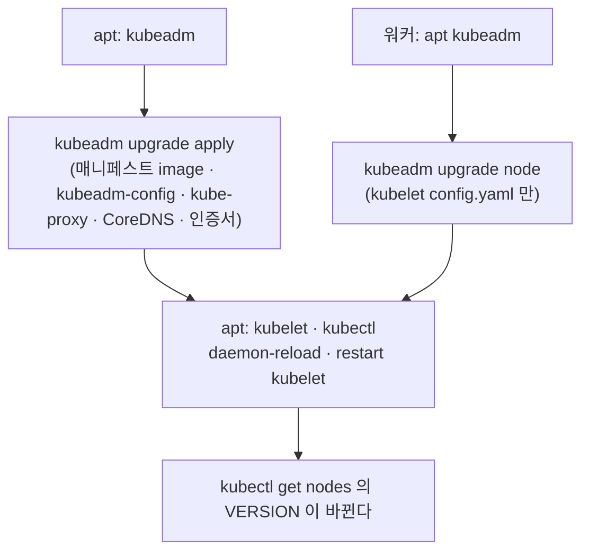

# 19강 · 노드 운영 (static pod · kubelet · drain · etcdctl)

> 영상: **19강 노드 안을 열어 보기** (drain · etcd · 업그레이드 부분은 20·21강과 이어짐) · 이어서 풀 채점 세트: `19-node-ops`

## 실습 목표

- **어느 노드에서 무엇을 치는지** 몸에 익힌다 — kubectl 은 밖에서, systemctl · etcdctl · kubeadm 은 노드 안에서.
- 워커 노드에서 **staticPodPath 를 찾아** static pod 를 만들고 · 고치고 · 지워 본다.
- kubelet 을 멈추고 · 끄고 · 설정을 깨뜨려서 **NotReady 의 세 가지 얼굴**을 보고 복구한다.
- drain 을 막는 세 가지 — **DaemonSet 파드 · emptyDir · 컨트롤러 없는 파드** — 를 하나씩 만나고 플래그로 넘는다.
- etcdctl 을 **호스트에서 쓸 때와 etcd 파드 안에서 쓸 때**의 차이, 그리고 흔한 에러 메시지를 직접 재현한다.
- 업그레이드하면 **무엇이 바뀌고 무엇이 그대로인지** 버전이 적힌 곳을 전부 찾아 확인한다.

이 페이지는 [20·21강 · 유지보수](15-maintenance.md) 의 짝입니다. 유지보수 페이지가 "정석 흐름"(drain · PDB · etcd 복원 · 업그레이드 절차 · 인증서)이라면, 이 페이지는 **노드 안에서 손으로 부딪히는 경우들**을 다룹니다.

---

## 0) 준비

| 절 | 들어가는 노드 | 되돌리기 |
|----|--------------|----------|
| 2) 3) static pod | **worker-1** | 매니페스트 파일 치우기 |
| 4) NotReady | **worker-2** | kubelet start · enable · 설정 복구 |
| 5) drain 걸림돌 | control-plane (kubectl) | uncordon |
| 6) etcdctl | control-plane | 만든 파일 삭제 |
| 7) 버전 확인 | control-plane · worker-1 | 읽기만 |

```bash
# control-plane 에서
kubectl create namespace guide-node
sudo mkdir -p /opt/guide-node
kubectl get nodes
```

!!! danger "4) 는 워커의 kubelet 을 일부러 망가뜨립니다"
    VirtualBox 스냅샷(`clean-cluster`)이 있는지 확인하세요. 4) 의 설정 파일 실험은 **백업을 먼저** 뜨고 시작합니다.

---

## 1) 안과 밖 — 프롬프트를 보고 친다

시험 터미널에서는 kubectl 이 되지만, 노드 안의 파일 · 서비스는 **ssh 로 들어가야** 만질 수 있습니다. 먼저 노드마다 **어떤 도구가 있는지** 확인합니다.

=== "control-plane"
    ```bash
    # control-plane 에서
    hostname; for c in kubectl kubeadm kubelet crictl etcdctl; do printf '%-8s ' $c; command -v $c || echo '(없음)'; done
    ls ~/.kube/config
    ```
    ```text
    control-plane
    kubectl  /usr/bin/kubectl
    kubeadm  /usr/bin/kubeadm
    kubelet  /usr/bin/kubelet
    crictl   /usr/bin/crictl
    etcdctl  (없음)                ← apt 로 설치하기 전
    /home/<사용자>/.kube/config
    ```
=== "worker-1"
    ```bash
    # worker-1 에서
    hostname; for c in kubectl kubeadm kubelet crictl etcdctl; do printf '%-8s ' $c; command -v $c || echo '(없음)'; done
    kubectl get nodes
    ```
    ```text
    worker-1
    kubectl  /usr/bin/kubectl
    kubeadm  /usr/bin/kubeadm
    kubelet  /usr/bin/kubelet
    crictl   /usr/bin/crictl
    etcdctl  (없음)
    E0929 ... "Unhandled Error" err="couldn't get current server API group list: Get \"http://localhost:8080/api?timeout=32s\": dial tcp 127.0.0.1:8080: connect: connection refused"
    The connection to the server localhost:8080 was refused - did you specify the right host or port?
    ```

**관찰 포인트:** 워커에도 kubectl **바이너리는 있지만 kubeconfig 가 없어서** `localhost:8080` 으로 접속하려다 실패합니다. "kubectl 이 안 된다 = 지금 노드 안에 있다" 는 신호입니다.

| 작업 | 치는 곳 | 도구 |
|------|---------|------|
| drain · uncordon · get · describe | kubectl 이 되는 곳 | kubectl |
| kubelet 살리기 | **고장 난 그 노드** 안 | systemctl · journalctl |
| static pod 만들기 | **그 파드를 띄울 노드** 안 | 파일 편집 (sudo) |
| etcd 백업 · 복원 | control-plane 안 | etcdctl / etcdutl (sudo) |
| 업그레이드 | 올릴 노드 안 | apt · kubeadm · systemctl |

!!! tip "시험 팁 — ssh · sudo -i · exit"
    - 지문의 `ssh <노드>` 를 그대로 칩니다. 프롬프트가 `<사용자>@<노드>` 로 바뀐 것을 **눈으로 확인**하고 작업합니다.
    - sudo 를 매번 붙이기 번거로우면 `sudo -i` 로 root 셸에 들어갑니다. 이때는 `exit` 를 **두 번**(root → 사용자 → 시험 터미널) 쳐야 나옵니다.
    - 다음 문제로 넘어가기 전에 `hostname` 한 번. 노드 안에서 다음 문제를 풀면 전부 틀립니다.

---

## 2) static pod 만들기 — 워커에서 staticPodPath 찾기

kubelet 은 **정해진 디렉터리의 YAML** 을 보고 API 서버 · 스케줄러 없이 파드를 띄웁니다. 컨트롤플레인 구성 요소가 이렇게 뜹니다([18강 · 아키텍처](03-architecture.md)).
그 디렉터리가 어디인지는 노드마다 kubelet 설정에 있으므로, **추측하지 말고 찾습니다.**

```bash
# worker-1 에서
ps -ef | grep '[/]usr/bin/kubelet' | grep -o -- '--config=[^ ]*'
sudo grep staticPodPath /var/lib/kubelet/config.yaml
sudo ls -la /etc/kubernetes/manifests/
```

```text
--config=/var/lib/kubelet/config.yaml
staticPodPath: /etc/kubernetes/manifests
total 8
drwxr-xr-x 2 root root 4096 Sep 26 03:10 .
drwxr-xr-x 4 root root 4096 Sep 26 03:10 ..
                                                   ← 워커에는 비어 있다 (디렉터리가 없으면 sudo mkdir -p 로 만든다)
```

**관찰 포인트:** 찾는 순서는 **프로세스 인자(`--config`) → 그 파일의 `staticPodPath`** 입니다. 시험 환경에서 경로가 표준과 다르게 바뀌어 있을 수 있기 때문에 이 순서를 익혀 둡니다.

### 매니페스트 두기

워커에는 kubectl 이 안 되므로 YAML 을 직접 씁니다. (control-plane 에서 `kubectl run ... $do` 로 뽑아 복사해 와도 됩니다.)

```bash
# worker-1 에서
sudo tee /etc/kubernetes/manifests/guide-static.yaml >/dev/null <<'EOF'
apiVersion: v1
kind: Pod
metadata:
  name: guide-static
  namespace: guide-node
  labels:
    app: guide-static
spec:
  containers:
    - name: web
      image: nginx:1.27
      ports:
        - containerPort: 80
EOF
sleep 10; sudo crictl ps --name web
```

```text
CONTAINER      IMAGE          CREATED         STATE     NAME   ATTEMPT   POD ID         POD
5c1e9a...      9bea9f2796e2   6 seconds ago   Running   web    0         a7b3...        guide-static-worker-1
```

```bash
# control-plane 에서
kubectl get pods -n guide-node -o wide
kubectl get pod guide-static-worker-1 -n guide-node \
  -o jsonpath='{.metadata.ownerReferences[0].kind}/{.metadata.ownerReferences[0].name}{"\n"}{.metadata.annotations.kubernetes\.io/config\.source}{"\n"}'
```

```text
NAME                    READY   STATUS    RESTARTS   AGE   IP           NODE
guide-static-worker-1   1/1     Running   0          20s   10.0.1.87    worker-1

Node/worker-1
file
```

| | 일반 파드 | static pod |
|---|---|---|
| 만드는 곳 | API 서버 (`kubectl apply`) | 노드의 `staticPodPath` 에 파일 |
| 이름 | 지정한 그대로 | `<이름>-<노드이름>` |
| 소유자 | ReplicaSet · DaemonSet … 또는 없음 | **Node** |
| API 에 보이는 것 | 진짜 오브젝트 | kubelet 이 올린 **거울(mirror) 파드** |
| 스케줄러 | 거친다 | 거치지 않는다 (파일이 있는 노드에 뜬다) |

!!! note "static pod 에서 못 쓰는 것"
    static pod 는 API 서버 없이도 떠야 하므로 **ConfigMap · Secret · ServiceAccount 토큰 같은 다른 API 오브젝트를 참조할 수 없습니다.** 필요하면 hostPath 로 파일을 넣습니다.
    namespace 는 지정할 수 있지만, 그 namespace 가 없으면 **거울 파드가 API 에 올라가지 못해** kubectl 로 보이지 않습니다.

---

## 3) static pod 고치기 · 지우기

### kubectl delete 는 거울만 지운다

```bash
# control-plane 에서
kubectl delete pod guide-static-worker-1 -n guide-node
kubectl get pods -n guide-node
```

```text
pod "guide-static-worker-1" deleted
NAME                    READY   STATUS    RESTARTS   AGE
guide-static-worker-1   1/1     Running   0          2s          ← 곧바로 다시 보인다
```

```bash
# worker-1 에서
sudo crictl ps --name web
```

```text
CONTAINER      IMAGE          CREATED         STATE     NAME   ATTEMPT   POD ID    POD
5c1e9a...      9bea9f2796e2   2 minutes ago   Running   web    0         a7b3...   guide-static-worker-1
```

**관찰 포인트:** API 의 AGE 는 2초로 바뀌었지만 **노드의 컨테이너는 CREATED 가 그대로**입니다. kubectl 이 지운 것은 거울일 뿐이고, kubelet 은 파일이 있는 한 거울을 다시 올립니다.

### 파일을 고치면 다시 만든다

```bash
# worker-1 에서
sudo sed -i 's|image: nginx:1.27$|image: nginx:1.27-alpine|' /etc/kubernetes/manifests/guide-static.yaml
sleep 15; sudo crictl ps -a --name web
```

```text
CONTAINER      IMAGE          CREATED          STATE     NAME   ATTEMPT   POD ID    POD
e8d2f4...      4a5b...        5 seconds ago    Running   web    0         c9d1...   guide-static-worker-1   ← 새 POD ID
```

```bash
# control-plane 에서
kubectl get pod guide-static-worker-1 -n guide-node -o jsonpath='{.spec.containers[0].image}{"\n"}'
```

```text
nginx:1.27-alpine
```

**관찰 포인트:** POD ID 까지 바뀌었습니다. 매니페스트 해시가 달라지면 kubelet 은 파드를 **통째로 새로** 만듭니다. etcd 복원 때 `etcd.yaml` 을 고치면 etcd 가 재시작되는 것도 같은 원리입니다([21강 · 4)](15-maintenance.md)).

### 지우려면 파일을 치운다

```bash
# worker-1 에서
sudo mv /etc/kubernetes/manifests/guide-static.yaml /root/guide-static.yaml
sleep 15; sudo crictl ps -a --name web
```

```bash
# control-plane 에서
kubectl get pods -n guide-node
```

```text
No resources found in guide-node namespace.
```

!!! warning "manifests 디렉터리에 백업 파일을 두지 마세요"
    kubelet 은 디렉터리 안의 파일을 **확장자와 상관없이** 읽으려 합니다(점으로 시작하는 숨김 파일만 무시). `guide-static.yaml.bak` 을 거기 두면 같은 이름의 파드를 두 번 띄우려다 충돌합니다.
    옮길 때는 **디렉터리 밖**(`/root`, `/tmp` 등)으로 옮깁니다.

!!! tip "시험 팁"
    - "노드 X 에 static pod 를 만들어라" → **X 에 ssh** → `staticPodPath` 확인 → 그 디렉터리에 YAML. `kubectl apply` 가 아닙니다.
    - YAML 은 kubectl 이 되는 곳에서 `kubectl run <이름> --image=<이미지> $do` 로 뽑아 복사하면 빠릅니다.
    - 문서 페이지: *Create static Pods*.

---

## 4) NotReady — kubelet 의 세 가지 고장

NotReady 는 "노드가 꺼졌다" 가 아니라 **"kubelet 의 소식이 끊겼다"** 는 뜻입니다. kubelet 은 주기적으로 상태를 보고하고, 일정 시간(기본 40~50초, 버전에 따라 다름) 소식이 없으면 노드 컨트롤러가 NotReady 로 바꿉니다.

### 고장 ① — 멈춰 있다 (inactive)

```bash
# worker-2 에서
sudo systemctl stop kubelet
```

```bash
# control-plane 에서
kubectl get nodes -w                                # 40~50초 뒤 NotReady (Ctrl+C)
kubectl describe node worker-2 | grep -E -A6 '^Conditions'
kubectl describe node worker-2 | grep -A2 Taints
```

```text
worker-2   NotReady   <none>   3d   v1.32.x

Conditions:
  Type             Status    ...  Reason              Message
  MemoryPressure   Unknown   ...  NodeStatusUnknown   Kubelet stopped posting node status.
  DiskPressure     Unknown   ...  NodeStatusUnknown   Kubelet stopped posting node status.
  PIDPressure      Unknown   ...  NodeStatusUnknown   Kubelet stopped posting node status.
  Ready            Unknown   ...  NodeStatusUnknown   Kubelet stopped posting node status.

Taints:             node.kubernetes.io/unreachable:NoExecute
                    node.kubernetes.io/unreachable:NoSchedule
```

```bash
# worker-2 에서
sudo crictl ps | head -5
systemctl status kubelet --no-pager | head -4
```

```text
CONTAINER      IMAGE          CREATED       STATE     NAME        ...
b7e1...        9bea9f2796e2   2 hours ago   Running   nginx       ...
...
○ kubelet.service - kubelet: The Kubernetes Node Agent
     Loaded: loaded (/usr/lib/systemd/system/kubelet.service; enabled; preset: enabled)
    Drop-In: /usr/lib/systemd/system/kubelet.service.d
             └─10-kubeadm.conf
     Active: inactive (dead) since ...
```

**관찰 포인트:** API 에서는 NotReady 지만 **컨테이너는 노드에서 여전히 돌고 있습니다.** kubelet 이 없으니 보고만 끊긴 것입니다.

!!! warning "5분 안에 되돌리세요"
    `unreachable:NoExecute` taint 가 붙으면, 기본 toleration(300초)이 지난 파드는 **다른 노드로 축출**됩니다. 실험이 길어지면 워크로드가 옮겨 갑니다.

```bash
# worker-2 에서
sudo systemctl start kubelet
```

### 고장 ② — 부팅 때 안 켜진다 (disabled)

```bash
# worker-2 에서
sudo systemctl disable --now kubelet
systemctl status kubelet --no-pager | sed -n '2,5p'
```

```text
     Loaded: loaded (/usr/lib/systemd/system/kubelet.service; disabled; preset: enabled)   ← disabled
     ...
     Active: inactive (dead) since ...
```

`start` 만 하면 지금은 살아나지만 **재부팅하면 다시 NotReady** 입니다. 둘 다 합니다.

```bash
# worker-2 에서
sudo systemctl enable --now kubelet
systemctl is-enabled kubelet; systemctl is-active kubelet
```

```text
enabled
active
```

### 고장 ③ — 켜지자마자 죽는다 (activating, auto-restart)

설정 파일 경로에 오타가 난 상황을 만듭니다. **백업부터** 합니다.

```bash
# worker-2 에서
sudo cp /var/lib/kubelet/config.yaml /root/kubelet-config.yaml.guide
sudo sed -i 's|clientCAFile: /etc/kubernetes/pki/ca.crt|clientCAFile: /etc/kubernetes/pki/ca-typo.crt|' /var/lib/kubelet/config.yaml
sudo systemctl restart kubelet
sleep 5; systemctl status kubelet --no-pager | grep Active
sudo journalctl -u kubelet -n 30 --no-pager | grep -iE 'error|fail' | tail -3
```

```text
     Active: activating (auto-restart) (Result: exit-code) since ...

... "command failed" err="failed to construct kubelet dependencies: unable to load client CA file /etc/kubernetes/pki/ca-typo.crt: open /etc/kubernetes/pki/ca-typo.crt: no such file or directory"
```

**관찰 포인트:** 로그의 **마지막 에러 줄이 곧 답**입니다. 어느 파일을 못 찾는지 알려 주므로 그 경로를 실제 파일과 대조합니다.

```bash
# worker-2 에서
sudo cp /root/kubelet-config.yaml.guide /var/lib/kubelet/config.yaml
sudo systemctl restart kubelet
systemctl is-active kubelet
sudo rm /root/kubelet-config.yaml.guide
```

```bash
# control-plane 에서
kubectl get nodes -w                                # worker-2 Ready (Ctrl+C)
```

| `Active:` | 뜻 | 풀이 |
|-----------|----|------|
| `inactive (dead)` + `enabled` | 누가 멈췄다 | `systemctl start kubelet` |
| `inactive (dead)` + `disabled` | 부팅 때 안 켜진다 | `systemctl enable --now kubelet` |
| `activating (auto-restart)` | 켜지려다 계속 죽는다 | `journalctl -u kubelet` 의 마지막 에러 → 파일 수정 → restart |

| 로그에 보이는 것 | 고칠 곳 | 다시 읽히게 하려면 |
|------------------|---------|-------------------|
| `failed to load kubelet config file` | 드롭인의 `--config=` 경로 또는 `config.yaml` 자체 | 드롭인이면 `daemon-reload` → restart |
| `unable to load client CA file` | `config.yaml` 의 `clientCAFile` | restart |
| `...containerd.sock: connect: no such file` | containerd 가 죽음 → `systemctl start containerd` | restart kubelet |

kubelet 설정 파일들의 전체 구조는 [19강 · kubelet](13-cluster-setup.md) 에 있습니다.

!!! tip "시험 팁"
    지문에 **"permanently" · "재부팅 후에도"** 가 있으면 `enable` 이 채점 항목입니다. 습관적으로 `sudo systemctl enable --now kubelet` 으로 칩니다.
    고친 뒤 Ready 가 바로 안 보여도 **다시 들어가지 말고** 밖에서 `kubectl get nodes -w` 로 수십 초 기다립니다.

---

## 5) drain 의 걸림돌 세 가지

drain 은 "안전하게 비울 수 없는" 파드가 있으면 **아무것도 하지 않고 거부**합니다. 무엇이 안전하지 않은지 세 종류를 모두 worker-2 에 만들어 봅니다.

```bash
# control-plane 에서 — ① emptyDir 을 쓰는 Deployment
cat <<'EOF' | kubectl apply -f -
apiVersion: apps/v1
kind: Deployment
metadata:
  name: scratch
  namespace: guide-node
spec:
  replicas: 4
  selector:
    matchLabels: { app: scratch }
  template:
    metadata:
      labels: { app: scratch }
    spec:
      containers:
        - name: app
          image: busybox:1.36
          command: ["sh", "-c", "sleep infinity"]
          volumeMounts:
            - name: tmp
              mountPath: /scratch
      volumes:
        - name: tmp
          emptyDir: {}
EOF
```

```bash
# control-plane 에서 — ② 컨트롤러 없는 단독 파드, worker-2 에 고정
kubectl run lonely -n guide-node --image=nginx:1.27 --overrides='{"spec":{"nodeName":"worker-2"}}'
kubectl get pods -n guide-node -o wide
```

```text
NAME                       READY   STATUS    NODE
lonely                     1/1     Running   worker-2
scratch-5f7d9c8b6-2kxq8    1/1     Running   worker-1
scratch-5f7d9c8b6-8vn4p    1/1     Running   worker-2
scratch-5f7d9c8b6-m3t7z    1/1     Running   worker-2
scratch-5f7d9c8b6-z9w2c    1/1     Running   worker-1
```

`scratch` 가 worker-2 에 하나도 없으면 `kubectl rollout restart deployment/scratch -n guide-node` 로 다시 섞습니다. ③ DaemonSet 파드(cilium · kube-proxy)는 이미 worker-2 에 있습니다.

### 플래그 없이 drain

```bash
# control-plane 에서
kubectl drain worker-2
```

```text
node/worker-2 cordoned
error: unable to drain node "worker-2" due to error: [cannot delete DaemonSet-managed Pods (use --ignore-daemonsets to ignore): kube-system/cilium-..., kube-system/cilium-envoy-..., kube-system/kube-proxy-..., cannot delete Pods with local storage (use --delete-emptydir-data to override): guide-node/scratch-5f7d9c8b6-8vn4p, guide-node/scratch-5f7d9c8b6-m3t7z, cannot delete Pods that declare no controller (use --force to override): guide-node/lonely], continuing command...
There are pending nodes to be drained:
 worker-2
cannot delete DaemonSet-managed Pods (use --ignore-daemonsets to ignore): ...
cannot delete Pods with local storage (use --delete-emptydir-data to override): ...
cannot delete Pods that declare no controller (use --force to override): guide-node/lonely
```

**관찰 포인트:** 에러 문장마다 **필요한 플래그가 괄호 안에 적혀 있습니다.** 그리고 첫 줄 — `cordoned` — 는 이미 실행됐습니다. 아무 파드도 나가지 않았지만 노드는 SchedulingDisabled 입니다.

### 플래그를 하나씩

```bash
# control-plane 에서
kubectl drain worker-2 --ignore-daemonsets --delete-emptydir-data
```

```text
node/worker-2 already cordoned
error: unable to drain node "worker-2" due to error: cannot delete Pods that declare no controller (use --force to override): guide-node/lonely, continuing command...
```

두 가지가 풀리고 `lonely` 만 남았습니다. `--force` 의 결과를 이해하고 붙입니다.

```bash
# control-plane 에서
kubectl drain worker-2 --ignore-daemonsets --delete-emptydir-data --force
kubectl get pods -n guide-node -o wide
```

```text
node/worker-2 already cordoned
Warning: deleting Pods that declare no controller: guide-node/lonely; ignoring DaemonSet-managed Pods: ...
evicting pod guide-node/scratch-5f7d9c8b6-8vn4p
evicting pod guide-node/scratch-5f7d9c8b6-m3t7z
evicting pod guide-node/lonely
pod/lonely evicted
...
node/worker-2 drained

NAME                       READY   STATUS    NODE
scratch-5f7d9c8b6-2kxq8    1/1     Running   worker-1
scratch-5f7d9c8b6-q7r2d    1/1     Running   worker-1     ← 새로 만들어졌다
...                                                        ← lonely 는 영영 없다
```

| 걸림돌 | 플래그 | 붙이면 일어나는 일 |
|--------|--------|--------------------|
| DaemonSet 파드 | `--ignore-daemonsets` | 그 파드는 **남겨 두고** 나머지만 비운다 |
| emptyDir 을 쓰는 파드 | `--delete-emptydir-data` | 파드는 다른 노드에 새로 뜨지만 **emptyDir 내용은 사라진다** |
| 컨트롤러 없는 파드 | `--force` | 그 파드는 **삭제되고 되살아나지 않는다** |
| PodDisruptionBudget | (플래그로 넘지 않는다) | 재시도하며 기다린다 → [20강 · 2)](15-maintenance.md) |

```bash
# control-plane 에서
kubectl uncordon worker-2
kubectl get nodes worker-2
```

!!! tip "시험 팁"
    - drain 은 **kubectl 명령**이라 노드 안이 아니라 밖에서 칩니다. control-plane 을 drain 할 때도 마찬가지입니다.
    - 거부 메시지를 읽고 필요한 플래그만 붙입니다. `--force` 는 지문이 단독 파드 처리를 요구할 때만.
    - 문서 페이지: *Safely Drain a Node*.

---

## 6) etcdctl — 호스트에서 vs etcd 파드 안에서

control-plane 의 etcd 는 static pod 입니다. etcdctl 을 쓰는 길이 두 가지입니다.

```bash
# control-plane 에서
sudo apt-get install -y etcd-client          # 이미 있으면 건너뛴다
etcdctl version
kubectl -n kube-system exec etcd-control-plane -- etcdctl version
kubectl -n kube-system exec etcd-control-plane -- sh -c 'echo hi' 2>&1 | tail -1
```

```text
etcdctl version: 3.4.x
API version: 3.4
etcdctl version: 3.5.x
API version: 3.5
error: ... exec: "sh": executable file not found in $PATH       ← 셸이 없는 이미지
```

| | 호스트 etcdctl (`apt etcd-client`) | etcd 파드 안 etcdctl |
|---|---|---|
| 버전 | 우분투 패키지 버전 (3.4 계열) | 서버와 같은 버전 (3.5 계열) |
| 인증서 경로 | 호스트의 `/etc/kubernetes/pki/etcd/` | 같은 경로가 마운트되어 있다 |
| 파일 저장 | 아무 경로나 | **`/var/lib/etcd` 아래만** 호스트에 남는다 (hostPath) |
| API 서버가 죽으면 | 그대로 된다 | `kubectl exec` 불가 → `sudo crictl exec <etcd 컨테이너ID> etcdctl ...` |
| `etcdutl` | 없음 | 있음 |
| 셸 | 있음 | **없음** — 명령을 바로 실행해야 한다 |

### 파드 안에서 스냅샷을 뜨고 꺼내기

```bash
# control-plane 에서
kubectl -n kube-system exec etcd-control-plane -- etcdctl \
  --endpoints=https://127.0.0.1:2379 \
  --cacert=/etc/kubernetes/pki/etcd/ca.crt \
  --cert=/etc/kubernetes/pki/etcd/server.crt \
  --key=/etc/kubernetes/pki/etcd/server.key \
  snapshot save /var/lib/etcd/guide-node-snap.db
sudo mv /var/lib/etcd/guide-node-snap.db /opt/guide-node/
kubectl -n kube-system exec etcd-control-plane -- etcdutl version
sudo etcdctl snapshot status /opt/guide-node/guide-node-snap.db -w table | tee /opt/guide-node/snap-check.txt
```

```text
{"level":"info",...,"msg":"fetched snapshot","endpoint":"https://127.0.0.1:2379","size":"6.1 MB",...}
Snapshot saved at /var/lib/etcd/guide-node-snap.db
etcdutl version: 3.5.x
API version: 3.5
+----------+----------+------------+------------+
|   HASH   | REVISION | TOTAL KEYS | TOTAL SIZE |
+----------+----------+------------+------------+
| 7d21c4a9 |   415902 |       1251 |     6.1 MB |
+----------+----------+------------+------------+
```

**관찰 포인트:** 파드 안에서 `/var/lib/etcd/...` 에 저장한 파일이 호스트의 **같은 경로에** 나타났습니다. 두 경로가 hostPath 로 연결돼 있기 때문입니다. etcd 데이터 디렉터리에 잡동사니를 남기지 않도록 **바로 옮깁니다.**

### etcd 안에는 정말 오브젝트가 있다

```bash
# control-plane 에서
kubectl create configmap etcd-peek -n guide-node --from-literal=msg=hello-etcd
export ETCD_FLAGS="--endpoints=https://127.0.0.1:2379 --cacert=/etc/kubernetes/pki/etcd/ca.crt --cert=/etc/kubernetes/pki/etcd/server.crt --key=/etc/kubernetes/pki/etcd/server.key"
sudo etcdctl $ETCD_FLAGS get /registry/configmaps/guide-node --prefix --keys-only
sudo etcdctl $ETCD_FLAGS get /registry/configmaps/guide-node/etcd-peek --print-value-only | strings | grep hello
sudo etcdctl $ETCD_FLAGS endpoint status -w table
```

```text
/registry/configmaps/guide-node/etcd-peek
/registry/configmaps/guide-node/kube-root-ca.crt

hello-etcd

+------------------------+------------------+---------+---------+-----------+------------+-----------+------------+--------------------+--------+
|        ENDPOINT        |        ID        | VERSION | DB SIZE | IS LEADER | IS LEARNER | RAFT TERM | RAFT INDEX | RAFT APPLIED INDEX | ERRORS |
+------------------------+------------------+---------+---------+-----------+------------+-----------+------------+--------------------+--------+
| https://127.0.0.1:2379 | 8e9e05c52164694d |  3.5.x  |  6.1 MB |      true |      false |         4 |     416020 |             416020 |        |
+------------------------+------------------+---------+---------+-----------+------------+-----------+------------+--------------------+--------+
```

**관찰 포인트:** 키 모양은 `/registry/<리소스>/<네임스페이스>/<이름>` 입니다. 값은 protobuf 라 `strings` 로 글자만 보면 우리가 넣은 값이 보입니다. 스냅샷 = 이 키 전부의 사본입니다.

### 에러 재현 — 메시지가 곧 진단

하나씩 틀리게 쳐 봅니다. 아무것도 바꾸지 않는 읽기 명령(`endpoint health`)이라 안전합니다.

```bash
# control-plane 에서
etcdctl $ETCD_FLAGS endpoint health                                   # ① sudo 없이
sudo etcdctl --endpoints=https://127.0.0.1:2379 --cert=/etc/kubernetes/pki/etcd/server.crt \
  --key=/etc/kubernetes/pki/etcd/server.key --dial-timeout=3s endpoint health    # ② --cacert 없이
sudo etcdctl $ETCD_FLAGS --endpoints=https://127.0.0.1:2380 --dial-timeout=3s endpoint health   # ③ peer 포트
```

```text
① Error: open /etc/kubernetes/pki/etcd/server.key: permission denied
② ... "error":"... x509: certificate signed by unknown authority ..."
   https://127.0.0.1:2379 is unhealthy: failed to commit proposal: context deadline exceeded
③ ... "error":"... tls: ... bad certificate ..." (또는 context deadline exceeded)
   https://127.0.0.1:2380 is unhealthy: failed to commit proposal: context deadline exceeded
```

| 메시지 | 원인 | 고치기 |
|--------|------|--------|
| `etcdctl: command not found` | 노드가 틀렸거나 설치 안 됨 | control-plane 에 ssh · `apt install etcd-client` 또는 파드 안의 것 |
| `permission denied` | sudo 누락 (`server.key` 는 root 전용) | `sudo` |
| `certificate signed by unknown authority` | `--cacert` 누락 · 다른 CA | etcd.yaml 의 `--trusted-ca-file` |
| `context deadline exceeded` | endpoints 틀림 · 2380(peer) 포트 | `https://127.0.0.1:2379` |

!!! note "뒤에 나오는 플래그가 이긴다"
    ③ 에서 `$ETCD_FLAGS` 안의 `--endpoints` 뒤에 다시 `--endpoints` 를 주면 **마지막 값**이 쓰입니다. 셸 변수로 묶어 쓸 때 한 가지만 바꿔 실험하기 좋습니다.

복원(restore → etcd.yaml hostPath → 대기 → 되돌리기)은 [21강 · 4) etcd 복원](15-maintenance.md) 에서 카나리 오브젝트로 확인합니다.

---

## 7) 업그레이드하면 무엇이 바뀌나 — 버전이 적힌 곳 전부

"클러스터 버전" 이라는 숫자는 한 곳에 있지 않습니다. 업그레이드는 이것들을 **정해진 순서로 하나씩** 바꾸는 일입니다. 실제로 올리지 않고, 지금 어디에 무엇이 적혀 있는지 봅니다.

### 노드 쪽 — 바이너리 세 개

```bash
# control-plane 에서 (worker-1 에서도 같은 명령)
kubeadm version -o short
kubelet --version
kubectl version --client
```

```text
v1.32.x
Kubernetes v1.32.x
Client Version: v1.32.x
Kustomize Version: v5.5.0
```

### 클러스터 쪽 — 매니페스트 · ConfigMap · 애드온

```bash
# control-plane 에서
sudo grep -h 'image:' /etc/kubernetes/manifests/*.yaml
kubectl -n kube-system get cm kubeadm-config -o jsonpath='{.data.ClusterConfiguration}' | grep kubernetesVersion
kubectl -n kube-system get ds kube-proxy -o jsonpath='{.spec.template.spec.containers[0].image}{"\n"}'
kubectl -n kube-system get deploy coredns -o jsonpath='{.spec.template.spec.containers[0].image}{"\n"}'
kubectl get nodes -o custom-columns='NODE:.metadata.name,KUBELET:.status.nodeInfo.kubeletVersion,RUNTIME:.status.nodeInfo.containerRuntimeVersion,KERNEL:.status.nodeInfo.kernelVersion'
```

```text
    image: registry.k8s.io/etcd:3.5.x-0
    image: registry.k8s.io/kube-apiserver:v1.32.x
    image: registry.k8s.io/kube-controller-manager:v1.32.x
    image: registry.k8s.io/kube-scheduler:v1.32.x
kubernetesVersion: v1.32.x
registry.k8s.io/kube-proxy:v1.32.x
registry.k8s.io/coredns/coredns:v1.11.x
NODE            KUBELET    RUNTIME              KERNEL
control-plane   v1.32.x    containerd://1.7.x   6.8.0-...-generic
worker-1        v1.32.x    containerd://1.7.x   6.8.0-...-generic
worker-2        v1.32.x    containerd://1.7.x   6.8.0-...-generic
```

### 누가 무엇을 바꾸나

| 버전이 적힌 곳 | 바꾸는 단계 | 확인 명령 |
|----------------|-------------|-----------|
| kubeadm 바이너리 | `apt-get install kubeadm='…'` | `kubeadm version` |
| 컨트롤플레인 매니페스트의 `image:` | `kubeadm upgrade apply` (control-plane) | `grep image: /etc/kubernetes/manifests/*.yaml` |
| `kubeadm-config` 의 `kubernetesVersion` | `kubeadm upgrade apply` | 위 jsonpath |
| kube-proxy DaemonSet · CoreDNS | `kubeadm upgrade apply` (애드온 단계) | 위 jsonpath |
| 각 노드의 `/var/lib/kubelet/config.yaml` | `upgrade apply`(CP) · `upgrade node`(워커) | `sudo cat /var/lib/kubelet/config.yaml` |
| kubelet 바이너리 = **`get nodes` 의 VERSION** | `apt-get install kubelet='…'` + `restart kubelet` | `kubectl get nodes` |
| kubectl 바이너리 | `apt-get install kubectl='…'` | `kubectl version --client` |
| 인증서 만료일 | `upgrade apply` 가 기본으로 함께 갱신 | `kubeadm certs check-expiration` |

**관찰 포인트:** `kubeadm upgrade apply` 가 끝나도 **VERSION 열은 그대로**입니다. 그 열은 kubelet 바이너리의 버전이고, kubelet 은 apt 로 따로 올립니다. "올렸는데 VERSION 이 안 바뀐다" 의 답은 거의 항상 이것입니다.

### apply 가 바꿀 매니페스트를 미리 보기

`kubeadm upgrade diff` 는 **읽기 전용**으로, 지정한 버전으로 올리면 매니페스트가 어떻게 바뀌는지 보여 줍니다. 지금 kubeadm 이 지원하는 범위(같은 마이너의 다른 패치)로 봅니다.

```bash
# control-plane 에서 — v1.32.y 는 upgrade plan 에 나온 대상 버전 (15 · 5) 참고)
sudo kubeadm upgrade diff v1.32.y 2>&1 | grep -E '^[-+] .*image:'
```

```text
-    image: registry.k8s.io/kube-apiserver:v1.32.x
+    image: registry.k8s.io/kube-apiserver:v1.32.y
-    image: registry.k8s.io/kube-controller-manager:v1.32.x
+    image: registry.k8s.io/kube-controller-manager:v1.32.y
...
```

실제로 apply 를 한 적이 있다면 kubeadm 이 **바꾸기 전 매니페스트와 etcd 데이터를 백업**해 둔 흔적이 남아 있습니다.

```bash
# control-plane 에서
sudo ls /etc/kubernetes/tmp/ 2>/dev/null || echo "(업그레이드한 적 없음)"
```

```text
kubeadm-backup-etcd-2026-...   kubeadm-backup-manifests-2026-...
```

### 계획 확인을 파일로 남기기

시험에서는 "무엇이 바뀌는지 확인해서 남겨라" 형태로 나옵니다. 경고까지 담도록 stderr 도 함께 받습니다.

```bash
# control-plane 에서
sudo kubeadm upgrade plan 2>&1 | sudo tee /opt/guide-node/plan-check.txt | tail -5
kubectl get nodes -o custom-columns='NODE:.metadata.name,KUBELET:.status.nodeInfo.kubeletVersion' --no-headers \
  | sudo tee /opt/guide-node/node-versions.txt
```

```text
You can now apply the upgrade by executing the following command:

	kubeadm upgrade apply v1.32.y
...
control-plane   v1.32.x
worker-1        v1.32.x
worker-2        v1.32.x
```

실제 업그레이드 절차(레포 전환 → kubeadm → apply/node → kubelet · kubectl → uncordon)는 [20강 · 6) 전체 절차](15-maintenance.md) 에 참고용으로 있습니다.



---

## 시험에서 빠르게

```bash
# 어디에 있나
hostname                                               # 다음 문제 전에 한 번

# static pod (그 노드 안)
ps -ef | grep '[/]usr/bin/kubelet' | grep -o -- '--config=[^ ]*'
sudo grep staticPodPath /var/lib/kubelet/config.yaml
sudo vi <staticPodPath>/<이름>.yaml                   # 지우기 = 파일을 디렉터리 밖으로

# NotReady (고장 난 노드 안)
systemctl status kubelet --no-pager
sudo systemctl enable --now kubelet
sudo journalctl -u kubelet -n 30 --no-pager
sudo systemctl daemon-reload && sudo systemctl restart kubelet   # 유닛·드롭인 고쳤을 때

# drain (밖)
kubectl drain <노드> --ignore-daemonsets --delete-emptydir-data [--force]
kubectl uncordon <노드>

# etcdctl — 파드 안의 것을 쓸 때 (/var/lib/etcd 아래로 저장 → 꺼내기)
kubectl -n kube-system exec etcd-<CP노드> -- etcdctl --endpoints=https://127.0.0.1:2379 \
  --cacert=/etc/kubernetes/pki/etcd/ca.crt --cert=/etc/kubernetes/pki/etcd/server.crt \
  --key=/etc/kubernetes/pki/etcd/server.key snapshot save /var/lib/etcd/<파일>
sudo mv /var/lib/etcd/<파일> <지문의 경로>

# 버전 확인
sudo kubeadm upgrade plan > <파일> 2>&1
kubectl get nodes -o custom-columns='NAME:.metadata.name,VER:.status.nodeInfo.kubeletVersion'
```

---

## 정리

```bash
# worker-1 에서 — static pod
sudo rm -f /etc/kubernetes/manifests/guide-static.yaml /root/guide-static.yaml
ls /etc/kubernetes/manifests/                           # 비어 있어야 한다
```

```bash
# worker-2 에서 — kubelet
systemctl is-enabled kubelet; systemctl is-active kubelet   # enabled / active
sudo grep clientCAFile /var/lib/kubelet/config.yaml          # /etc/kubernetes/pki/ca.crt
sudo rm -f /root/kubelet-config.yaml.guide
```

```bash
# control-plane 에서
kubectl get nodes                                       # 모두 Ready, SchedulingDisabled 없음
kubectl uncordon worker-2 2>/dev/null
kubectl delete namespace guide-node
sudo rm -rf /opt/guide-node
sudo ls /var/lib/etcd/                                  # member 만 있어야 한다 (스냅샷 파일 남기지 않기)
unset ETCD_FLAGS
```

---

## 확인 질문

??? question "1. 워커에서 kubectl 을 쳤더니 `localhost:8080 was refused` 가 나옵니다. 무슨 뜻인가요?"
    그 노드에 kubeconfig 가 없다는 뜻입니다. 지금 **노드 안에** 있다는 신호이므로, kubectl 작업은 `exit` 로 나와서 합니다.

??? question "2. 워커의 static pod 디렉터리는 어떻게 찾나요?"
    `ps -ef | grep kubelet` 에서 `--config=` 경로를 찾고, 그 파일(보통 `/var/lib/kubelet/config.yaml`)의 `staticPodPath` 를 봅니다.

??? question "3. static pod 를 `kubectl delete` 했더니 AGE 만 바뀌고 곧 다시 보입니다. 컨테이너는 재시작됐나요?"
    아닙니다. 지워진 것은 API 에 보이는 거울 파드뿐이고, kubelet 이 거울을 다시 올렸습니다. 노드의 컨테이너(`crictl ps`)는 CREATED 가 그대로입니다.
    없애려면 매니페스트 파일을 디렉터리 밖으로 옮깁니다.

??? question "4. `systemctl status kubelet` 이 `inactive (dead)` 이고 Loaded 줄에 `disabled` 가 보입니다. 무엇을 치나요?"
    `sudo systemctl enable --now kubelet` — 지금 켜고, 재부팅 뒤에도 켜지게 합니다.

??? question "5. kubelet 이 `activating (auto-restart)` 를 반복합니다. 어디를 보나요?"
    `sudo journalctl -u kubelet -n 30 --no-pager` 의 마지막 에러 줄입니다. 어느 파일을 못 읽는지 나오므로 그 경로를 고치고 restart 합니다(유닛 · 드롭인을 고쳤으면 daemon-reload 먼저).

??? question "6. drain 이 `cannot delete Pods that declare no controller` 로 거부됩니다. `--force` 를 붙이면 그 파드는 어떻게 되나요?"
    삭제되고 **되살아나지 않습니다.** 옮겨 줄 컨트롤러가 없기 때문입니다. 지문이 허락할 때만 붙입니다.

??? question "7. etcd 파드 안의 etcdctl 로 스냅샷을 떠서 호스트에 남기려면 어디에 저장해야 하나요?"
    `/var/lib/etcd` 아래입니다. 그 경로만 hostPath 로 호스트와 연결돼 있습니다(인증서 디렉터리 제외). 저장 뒤 호스트에서 원하는 경로로 옮깁니다.

??? question "8. `kubeadm upgrade apply` 가 SUCCESS 인데 `kubectl get nodes` 의 VERSION 이 그대로입니다. 무엇을 빠뜨렸나요?"
    kubelet 패키지 업그레이드와 `daemon-reload` · `restart kubelet` 입니다. VERSION 열은 kubelet 버전이고, apply 는 매니페스트 · 애드온 · kubeadm-config 만 바꿉니다.

---

## 다음 단계 — 채점 실습

개념이 잡혔으면 시험 형식으로 풀어 봅니다. 이번에는 **답이 없습니다.**

```bash
cd ~/cka-lab/19-node-ops
bash exam.sh start
```

| 문제 | 이 페이지에서 연습한 것 |
|------|------------------------|
| Q1 노드를 비우고 되돌리기 | 5) drain 걸림돌 세 가지 · uncordon |
| Q2 etcd 백업 | 6) etcdctl 호스트 vs 파드 · 에러 재현 (+ [21강 · 3)](15-maintenance.md)) |
| Q3 업그레이드하면 무엇이 바뀌는지 확인 | 7) 버전이 적힌 곳 · plan 을 파일로 |
| Q4 static pod 만들어 보기 | 2) 3) staticPodPath · 거울 파드 · 파일로 다루기 |

NotReady 복구는 `~/cka-lab/mock-4` 의 Q7 에서 실제로 kubelet 이 멈춘 노드로 채점됩니다. 4) 의 순서 그대로 풀어 보세요.
