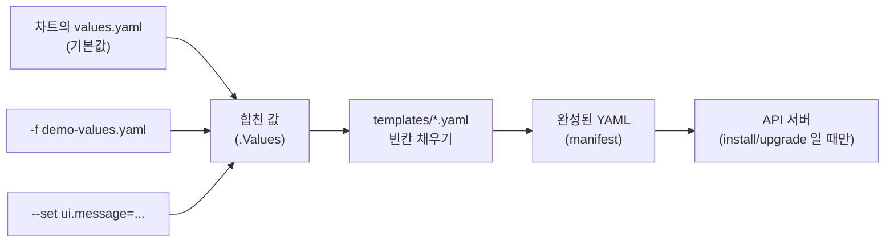
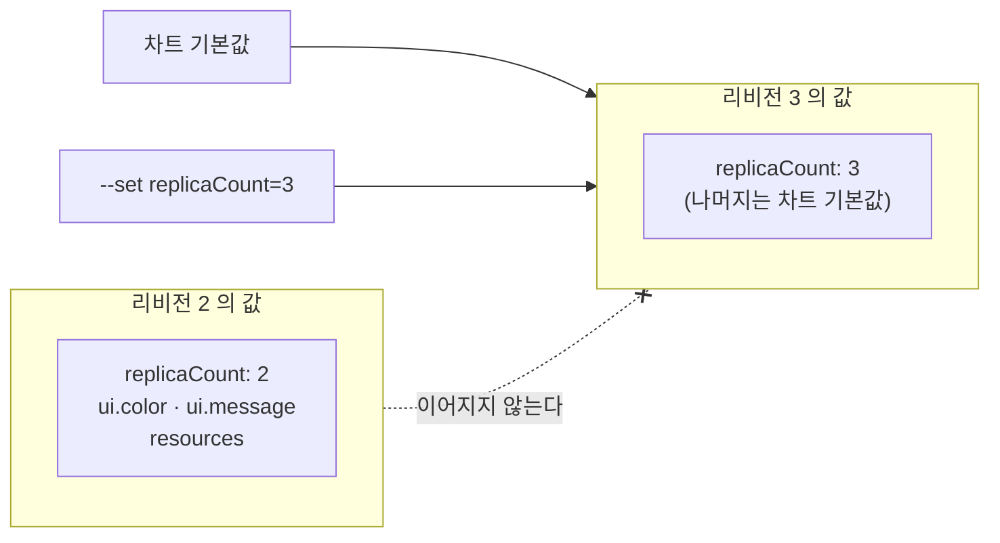

# 17강 · Helm과 Kustomize

> 영상: **17강-Helm과Kustomize** · 이어서 풀 채점 세트: `17-helm`

## 실습 목표

- Helm 의 세 단어 **차트 · 릴리스 · 값**을 구분하고, 저장소 추가 → 검색 → 값 확인 → 설치 흐름을 끝까지 따라 한다.
- `--set` 과 `-f values.yaml` 의 **우선순위**, 그리고 upgrade 때 **앞서 준 값이 사라지는 함정**(`--reuse-values`)을 직접 겪어 본다.
- `history` · `rollback` 으로 **롤백도 새 리비전**이라는 것을 확인한다.
- `helm template` 으로 **설치하지 않고 매니페스트만** 뽑고, `--version` · `--skip-crds` · `--include-crds` 가 CRD 를 어떻게 다루는지 차트 구조와 함께 확인한다.
- 릴리스 이름을 **생략**하면 `template` 은 `release-name` 을 쓴다는 것, 그리고 `kubectl get crd` · `kubectl explain` 결과를 **파일로 저장**하는 조회형 문제를 연습한다.
- `helm pull --untar` 로 차트 속을 열어 보고, `Chart.yaml` 의 **의존성 버전**을 바꿔 `helm dependency update` 한다.
- Kustomize base/overlay 로 **namePrefix · labels · images · patches · configMapGenerator** 를 써 보고, `kubectl kustomize`(미리 보기)와 `kubectl apply -k`(적용)를 구분한다.

---

## 0) 준비

이 페이지의 리소스는 `guide-helm` 네임스페이스에 만듭니다. 네임스페이스는 **2) 에서 Helm 이 만들게** 합니다.
작업 파일은 홈 아래 한 곳에 모읍니다.

```bash
mkdir -p ~/guide-helm && cd ~/guide-helm
helm version --short
```

```text
v3.17.3+ge4da497
```

!!! note "helm 이 없다면"
    Helm 은 kubectl 처럼 **내 kubeconfig 로 API 서버에 접속하는 클라이언트 프로그램**일 뿐입니다. 클러스터 쪽에 설치할 것은 없습니다.
    공식 설치 스크립트로 컨트롤플레인 노드에 설치합니다.
    ```bash
    curl -fsSL -o get_helm.sh https://raw.githubusercontent.com/helm/helm/main/scripts/get-helm-3
    bash get_helm.sh
    helm version --short
    ```

!!! warning "인터넷이 필요합니다"
    1)~8) 은 차트를 내려받습니다. VM 의 NAT 어댑터가 살아 있어야 합니다. 9) Kustomize 는 인터넷 없이 됩니다.

이 페이지에서는 채점 세트와 겹치지 않도록 **podinfo** 라는 작은 데모 차트를 씁니다.
저장소 주소는 `https://stefanprodan.github.io/podinfo` 이고, 이미지는 `ghcr.io/stefanprodan/podinfo` 입니다.

---

## 1) 차트 · 릴리스 · 값 — 저장소에서 찾기까지

### 왜

| 용어 | 뜻 | 비유 |
|------|----|------|
| **차트(chart)** | 템플릿 YAML 묶음 + 기본값 | 설치 프로그램 |
| **릴리스(release)** | 차트를 클러스터에 설치한 **한 번의 설치본**. 이름이 있다 | 설치된 앱 |
| **값(values)** | 템플릿의 빈칸을 채우는 설정 | 설치 옵션 |

같은 차트로 릴리스를 여러 개(이름만 다르게) 설치할 수 있습니다.

### 저장소 추가와 검색

```bash
helm repo add podinfo https://stefanprodan.github.io/podinfo
helm repo update
helm repo list
helm search repo podinfo
```

```text
"podinfo" has been added to your repositories
Hang tight while we grab the latest from your chart repositories...
...Successfully got an update from the "podinfo" chart repository
Update Complete. ⎈Happy Helming!⎈

NAME     URL
podinfo  https://stefanprodan.github.io/podinfo

NAME             CHART VERSION   APP VERSION   DESCRIPTION
podinfo/podinfo  6.15.0          6.15.0        Podinfo Helm chart for Kubernetes
```

`search repo` 는 기본으로 **최신 버전 하나만** 보여 줍니다. 버전 목록은 `--versions` 입니다.

```bash
helm search repo podinfo/podinfo --versions | head -5
```

```text
NAME             CHART VERSION   APP VERSION   DESCRIPTION
podinfo/podinfo  6.15.0          6.15.0        Podinfo Helm chart for Kubernetes
podinfo/podinfo  6.14.1          6.14.1        Podinfo Helm chart for Kubernetes
podinfo/podinfo  6.14.0          6.14.0        Podinfo Helm chart for Kubernetes
podinfo/podinfo  6.13.0          6.13.0        Podinfo Helm chart for Kubernetes
```

관찰 포인트: **CHART VERSION**(차트 자체의 버전)과 **APP VERSION**(안에 든 앱의 버전)은 다른 값입니다.
`--version` 옵션이 가리키는 것은 **CHART VERSION** 입니다. (podinfo 는 둘이 같아서 헷갈리지 않지만, 대부분의 차트는 다릅니다.)

### 설치 전에 값 확인 — `helm show`

```bash
helm show chart  podinfo/podinfo --version 6.13.0      # Chart.yaml
helm show values podinfo/podinfo --version 6.13.0 | head -30
```

```yaml
# Default values for podinfo.

replicaCount: 1               # ← --set replicaCount=2 로 바꿀 수 있는 키
logLevel: info
...
image:
  repository: ghcr.io/stefanprodan/podinfo
  tag: 6.13.0
  pullPolicy: IfNotPresent
...
ui:
  color: "#34577c"            # ← 중첩 키는 --set ui.color=... 처럼 점으로 잇는다
  message: ""
...
service:
  enabled: true
  type: ClusterIP
  httpPort: 9898
  externalPort: 9898
...
```

!!! tip "시험 팁"
    `--set` 에 넣을 **키 이름은 외우는 것이 아니라 `helm show values` 로 찾는 것**입니다.
    `helm show values <차트> | grep -n -i <단어>` 로 위치를 찾고, 들여쓰기를 따라 점(`.`)으로 이어 적습니다.

---

## 2) 설치 — `helm install <릴리스> <차트>`

### 설치

```bash
helm install demo podinfo/podinfo \
  --version 6.13.0 \
  --namespace guide-helm --create-namespace \
  --set ui.message="hello from install"
```

```text
NAME: demo
LAST DEPLOYED: Tue Sep 29 07:10:11 2026
NAMESPACE: guide-helm
STATUS: deployed
REVISION: 1
NOTES:
1. Get the application URL by running these commands:
  echo "Visit http://127.0.0.1:8080 to use your application"
  kubectl -n guide-helm port-forward deploy/demo-podinfo 8080:9898
```

| 부분 | 뜻 |
|------|----|
| `demo` | 릴리스 이름 (**첫 번째** 인자) |
| `podinfo/podinfo` | `<저장소>/<차트>` (**두 번째** 인자) |
| `--version 6.13.0` | 차트 버전. 없으면 최신 |
| `-n guide-helm --create-namespace` | 설치할 네임스페이스. 없으면 만든다 |
| `--set k=v` | 값 덮어쓰기 |

### 무엇이 생겼나

```bash
helm list -n guide-helm
kubectl get deploy,svc,pods -n guide-helm
```

```text
NAME   NAMESPACE    REVISION   UPDATED                                   STATUS     CHART            APP VERSION
demo   guide-helm   1          2026-09-29 07:10:11.52 +0000 UTC          deployed   podinfo-6.13.0   6.13.0

NAME                           READY   UP-TO-DATE   AVAILABLE
deployment.apps/demo-podinfo   1/1     1            1

NAME                   TYPE        CLUSTER-IP      PORT(S)
service/demo-podinfo   ClusterIP   10.96.187.40    9898/TCP,9999/TCP

NAME                                READY   STATUS
pod/demo-podinfo-7c9d6b5f4-q8x2m    1/1     Running
```

리소스 이름이 `<릴리스>-<차트>` 로 지어졌습니다(차트마다 규칙은 다릅니다). 값이 실제로 들어갔는지 앱에 물어봅니다.

```bash
kubectl run curl -n guide-helm --rm -i --restart=Never --image=curlimages/curl:8.10.1 -- \
  curl -s demo-podinfo:9898 | grep -E '"(version|message)"'
```

```text
  "version": "6.13.0",
  "message": "hello from install",
```

### 릴리스는 어디에 저장되나

```bash
kubectl get secret -n guide-helm -l owner=helm
```

```text
NAME                         TYPE                 DATA   AGE
sh.helm.release.v1.demo.v1   helm.sh/release.v1   1      1m
```

관찰 포인트: Helm 3 는 클러스터에 별도 서버가 없습니다. 릴리스 정보(차트 · 값 · 만든 매니페스트)를 **그 네임스페이스의 Secret** 에 리비전마다 하나씩 저장합니다.
그래서 `helm list` 도 네임스페이스를 탑니다 — `-n` 을 빼면 `default` 만 봅니다.

```bash
helm list            # default 네임스페이스 → 비어 있다
helm list -A         # 모든 네임스페이스
```

### 깨 보기 — 같은 이름으로 또 설치

```bash
helm install demo podinfo/podinfo -n guide-helm
```

```text
Error: INSTALLATION FAILED: cannot re-use a name that is still in use
```

같은 네임스페이스에 같은 릴리스 이름은 하나뿐입니다. 이미 있는 릴리스를 바꾸는 것은 `upgrade` 입니다.
"없으면 설치, 있으면 업그레이드" 는 `helm upgrade --install` 한 줄로 됩니다.

---

## 3) 값 넣기 — `--set` 과 `-f`, 그리고 확인

### 먼저 그림 — 값은 템플릿의 빈칸을 채운다

`--set` 이 무엇을 바꾸는지 알려면 **차트 안의 템플릿**을 한 번 봐야 합니다. podinfo 차트의 `templates/deployment.yaml` 일부입니다.

```yaml
spec:
  replicas: {{ .Values.replicaCount }}          # ← values 의 replicaCount 가 여기 들어간다
  ...
          env:
          {{- if .Values.ui.message }}               # ← ui.message 가 비어 있지 않으면
          - name: PODINFO_UI_MESSAGE                 #    환경변수 하나를 만든다
            value: {{ quote .Values.ui.message }}
          {{- end }}
          {{- if .Values.ui.color }}
          - name: PODINFO_UI_COLOR
            value: {{ quote .Values.ui.color }}
          {{- end }}
```

- `{{ .Values.replicaCount }}` 는 "값 목록에서 `replicaCount` 를 꺼내 이 자리에 넣어라" 라는 뜻입니다.
- `.Values.ui.message` 는 값 목록의 `ui:` 아래 `message:` 입니다. 그래서 `--set ui.message=...` 처럼 **점으로 이어** 적습니다.
- 2) 에서 준 `--set ui.message="hello from install"` 은 결국 **파드의 환경변수 `PODINFO_UI_MESSAGE`** 가 되었고, podinfo 앱이 그 환경변수를 읽어 응답에 넣은 것입니다.

값이 매니페스트가 되기까지의 흐름입니다.



아래로 갈수록(`-f` → `--set`) 앞의 값을 덮어씁니다. 이 순서는 뒤의 "우선순위 확인" 에서 직접 봅니다.

### 값을 확인하는 명령 — 하나씩

설치된 릴리스에 **어떤 값이 들어갔는지** 확인하는 방법은 세 가지입니다. 하나씩 실행해 봅니다.

**① 내가 준 값만 — `helm get values`**

```bash
helm get values demo -n guide-helm
```

```text
USER-SUPPLIED VALUES:
ui:
  message: hello from install
```

| 부분 | 뜻 |
|------|----|
| `helm get` | 설치된 **릴리스**에서 정보를 꺼낸다 (`helm show` 는 설치 전 **차트**에서 꺼낸다) |
| `values` | 꺼낼 정보의 종류 — 값 |
| `demo` | 릴리스 이름 |
| `-n guide-helm` | 릴리스가 있는 네임스페이스. 빼면 `default` 에서 찾다가 `release: not found` |

`USER-SUPPLIED VALUES` 는 "사용자가 직접 준 값" 이라는 뜻입니다. 2) 에서 `--set ui.message=...` 하나만 줬으니 그것만 나옵니다. 기본값 `replicaCount: 1` 같은 것은 여기에 **안 나옵니다.**

**② 기본값까지 합친 최종 값 — `--all`**

```bash
helm get values demo -n guide-helm --all | grep -A3 '^ui:'
```

```text
ui:
  color: '#34577c'
  logo: ""
  message: hello from install
```

| 부분 | 뜻 |
|------|----|
| `--all` | 기본값 + 내가 준 값을 합친 **최종 값 전체**. 템플릿이 실제로 본 값이다 (맨 위 제목이 `COMPUTED VALUES:` 로 바뀐다) |
| `\| grep -A3 '^ui:'` | 전체가 길어서 `ui:` 부분만 잘라 본다 |
| `'^ui:'` | `^` 는 **줄의 맨 앞**. 들여쓰기 안 된 `ui:` 줄만 찾는다 |
| `-A3` | 찾은 줄 **뒤(After)로 3줄**을 함께 보여 준다 |

관찰 포인트: `color` 는 내가 준 적이 없는데 `#34577c` 가 들어 있습니다. 차트 기본값입니다. `message` 만 내가 준 값으로 바뀌었습니다.

**③ 실제로 클러스터에 보낸 YAML — `helm get manifest`**

```bash
helm get manifest demo -n guide-helm | grep -E '^kind:|^  name:'
```

```text
kind: Service
  name: demo-podinfo
kind: Deployment
  name: demo-podinfo
```

| 부분 | 뜻 |
|------|----|
| `helm get manifest` | 템플릿에 값을 채워 **완성된 YAML 전체**. 이 릴리스가 클러스터에 만든 리소스 목록이다 |
| `grep -E '...'` | `-E` 는 `\|`(또는)을 쓸 수 있는 확장 정규식 |
| `'^kind:\|^  name:'` | 맨 앞의 `kind:` 줄, 또는 두 칸 들여쓴 `name:` 줄(= `metadata.name`)만 |

이 릴리스가 **Service 하나와 Deployment 하나**를 만들었다는 것을 한눈에 볼 수 있습니다. `grep` 을 빼고 전체를 보면 환경변수에 `PODINFO_UI_MESSAGE` 가 들어간 것도 찾을 수 있습니다.

```bash
helm get manifest demo -n guide-helm | grep -A1 PODINFO_UI
```

**④ 상태 요약 — `helm status`**

```bash
helm status demo -n guide-helm
```

설치 때 봤던 화면(`STATUS: deployed`, `REVISION`, `NOTES`)을 다시 보여 줍니다.

| 명령 | 보여 주는 것 | 언제 쓰나 |
|------|--------------|-----------|
| `helm get values <릴리스>` | **내가 준 값만** | "내가 뭘 바꿨더라?" |
| `helm get values <릴리스> --all` | 기본값과 합쳐진 최종 값 | "실제로 어떤 값으로 돌고 있나?" |
| `helm get manifest <릴리스>` | 클러스터에 보낸 완성 YAML | "무슨 리소스가 만들어졌나?" |
| `helm status <릴리스>` | 상태 · 리비전 · NOTES | "설치가 잘 됐나? 접속 방법은?" |

### values 파일 만들기

`--set` 은 값 한두 개에 편하지만, 값이 많아지면 명령이 길어지고 오타가 납니다. 그때는 **values 파일**에 적어 `-f` 로 넘깁니다.
파일 형식은 `helm show values` 로 본 기본값과 **같은 모양**이고, 바꾸고 싶은 키만 적으면 됩니다.

```bash
cd ~/guide-helm
cat > demo-values.yaml <<'EOF'
replicaCount: 2               # ← 파드 2개 (기본 1)
ui:
  color: "#2e7d32"            # ← 초록색 (기본 #34577c)
  message: "hello from file"
resources:
  requests:
    cpu: 10m
    memory: 32Mi
EOF
cat demo-values.yaml
```

`cat > 파일 <<'EOF' ... EOF` 는 두 `EOF` 사이의 내용을 그대로 파일로 저장하는 셸 문법입니다. vi 로 만들어도 됩니다.

이 파일의 각 줄은 `--set` 과 1:1 로 대응합니다.

| 파일에서 | 같은 뜻의 `--set` |
|----------|-------------------|
| `replicaCount: 2` | `--set replicaCount=2` |
| `ui:` 아래 `color: "#2e7d32"` | `--set ui.color="#2e7d32"` |
| `resources:` → `requests:` → `cpu: 10m` | `--set resources.requests.cpu=10m` |

### 우선순위 확인 — 파일보다 `--set` 이 이긴다

같은 키(`ui.message`)를 **파일에도 주고 `--set` 에도 주면** 어느 쪽이 이길까요? 설치하지 않고 결과 YAML 만 보는 `helm template` 으로 확인합니다(6절에서 자세히).

```bash
helm template demo podinfo/podinfo --version 6.13.0 -n guide-helm \
  -f demo-values.yaml --set ui.message="set wins" \
  --show-only templates/deployment.yaml | grep -E 'replicas:|PODINFO_UI' -A1
```

한 줄씩 풀면:

| 부분 | 뜻 |
|------|----|
| `helm template demo podinfo/podinfo` | 릴리스 이름 `demo` 로 차트를 **렌더링만** 한다. 클러스터는 건드리지 않는다 |
| `--version 6.13.0 -n guide-helm` | 설치 때와 같은 버전·네임스페이스로 맞춘다 |
| `-f demo-values.yaml` | 파일의 값 (`ui.message: hello from file`) |
| `--set ui.message="set wins"` | 같은 키를 다른 값으로 한 번 더 |
| `--show-only templates/deployment.yaml` | 출력이 길어서 **Deployment 템플릿의 결과만** 보여 달라는 옵션. 경로는 차트 안의 파일 경로다 (8절 `helm pull` 에서 직접 본다) |
| `grep -E 'replicas:\|PODINFO_UI' -A1` | `replicas:` 줄과 `PODINFO_UI` 가 든 줄, 그리고 각각 **다음 1줄**(값이 적힌 줄) |

```text
  replicas: 2                        ← 파일 값 (기본 1 을 덮었다)
  strategy:
--
          - name: PODINFO_UI_MESSAGE
            value: "set wins"          ← 파일의 hello from file 이 아니라 --set 값
          - name: PODINFO_UI_COLOR
            value: "#2e7d32"           ← 파일 값
```

관찰 포인트: 파일과 `--set` 이 **같은 키**를 주면 `--set` 이 이깁니다. **다른 키**(`replicaCount`, `ui.color`)는 파일 값이 그대로 살아 있습니다. 덮어쓰기는 키 단위로 일어납니다.

| 순서 (아래로 갈수록 강하다) | 예 |
|------------------------------|----|
| 차트의 `values.yaml` 기본값 | `replicaCount: 1` |
| `-f a.yaml -f b.yaml` | 뒤에 준 파일이 앞 파일을 덮는다 |
| `--set` · `--set-string` · `--set-file` | 가장 강하다 |

!!! question "왜 install 이 아니라 template 으로 확인하나요?"
    install/upgrade 로 확인하면 리비전이 쌓이고 파드가 다시 뜹니다. template 은 **결과 YAML 만 계산**하므로, "이 값을 주면 어떻게 되지?" 를 공짜로 실험할 수 있습니다.
    같은 명령을 `helm install` → `helm upgrade --install ... --dry-run` 으로 바꿔도 비슷한 결과를 볼 수 있습니다.

### 깨 보기 — 키 이름에 오타를 내면

`ui.message` 를 `ui.mesage` 로 잘못 써 봅니다.

```bash
helm template demo podinfo/podinfo --version 6.13.0 \
  --set ui.mesage="typo" | grep -c PODINFO_UI_MESSAGE
```

```text
0
```

**에러가 나지 않습니다.** Helm 은 모르는 키를 그냥 값 목록에 추가할 뿐이고, 템플릿이 그 키를 읽지 않으니 아무 효과가 없습니다. 환경변수가 0 개입니다.

!!! warning "`--set` 은 틀려도 조용합니다"
    그래서 값을 넣은 뒤에는 **반드시 결과를 확인**합니다.

    - 설치 전: `helm template ... | grep <찾을 것>`
    - 설치 후: `helm get values <릴리스> --all`, 또는 실제 리소스를 `kubectl get ... -o yaml`

    키 이름은 추측하지 말고 `helm show values <차트> | grep -n <단어>` 로 찾아서 복사합니다.

### `--set` 문법 모음

```bash
--set a.b=c                    # 중첩 키:  a:  →  b: c
--set a=1,b=2                  # 여러 개를 쉼표로 (값에 쉼표가 있으면 \, 로)
--set 'list={x,y,z}'           # 리스트:  list: [x, y, z]
--set 'list[0].name=x'         # 리스트의 첫 원소의 name
--set-string tag=1.10          # 숫자처럼 보여도 문자열로 (1.10 이 1.1 로 바뀌는 것 방지)
```

| 헷갈리는 점 | 설명 |
|-------------|------|
| 왜 따옴표로 감싸나 | `{}` · `[]` 는 셸이 먼저 해석하려고 해서 `'...'` 로 감싸 셸이 건드리지 못하게 한다 |
| `--set image.tag=1.10` 이 이상하다 | `--set` 은 숫자처럼 보이면 숫자로 바꾼다. `1.10` → `1.1`. 버전 문자열은 `--set-string` 을 쓴다 |
| `--set` 을 여러 번 | `--set a=1 --set b=2` 처럼 여러 번 써도 된다. 같은 키면 **뒤의 것**이 이긴다 |

---

## 4) 업그레이드 — 그리고 값이 사라지는 함정

`helm upgrade` 는 **이미 설치된 릴리스**를 새 값이나 새 차트 버전으로 바꿉니다. 형식은 install 과 같습니다.

```text
helm upgrade <릴리스> <차트> [--version X] [-n 네임스페이스] [-f 파일] [--set k=v]
```

upgrade 할 때마다 **리비전 번호가 1씩** 올라가고(1 → 2 → 3 …), 바뀐 매니페스트를 클러스터에 적용합니다. Deployment 템플릿이 바뀌었다면 파드가 롤링 업데이트됩니다.

### 파일로 업그레이드

```bash
helm upgrade demo podinfo/podinfo --version 6.13.0 -n guide-helm -f demo-values.yaml
helm get values demo -n guide-helm
```

| 부분 | 뜻 |
|------|----|
| `upgrade demo` | `demo` 릴리스를 고친다 (없으면 에러 — 없을 때 설치까지 하려면 `upgrade --install`) |
| `podinfo/podinfo --version 6.13.0` | 어떤 차트·버전으로. 같은 버전이면 **값만** 바뀐다 |
| `-f demo-values.yaml` | 이번에 적용할 값 |

```text
Release "demo" has been upgraded. Happy Helming!
NAME: demo
...
REVISION: 2

USER-SUPPLIED VALUES:
replicaCount: 2
resources:
  requests:
    cpu: 10m
    memory: 32Mi
ui:
  color: '#2e7d32'
  message: hello from file
```

관찰 포인트: `REVISION: 2` — 두 번째 버전이 되었습니다. 내가 준 값(USER-SUPPLIED)이 **파일 내용으로 통째로 바뀌었습니다.** 2) 의 `hello from install` 은 없어지고 `hello from file` 이 되었습니다.

```bash
kubectl get pods -n guide-helm        # replicaCount: 2 → 파드가 2개로 늘었다
```

이번엔 파일에 `ui.message` 가 있어서 티가 나지 않았습니다. **파일에 없는 값**으로 다시 해 봅니다.

### 깨 보기 — `--set` 하나만 주고 업그레이드

"파드만 3개로 늘리고 싶다" 는 생각으로 `--set replicaCount=3` 만 줍니다.

```bash
helm upgrade demo podinfo/podinfo --version 6.13.0 -n guide-helm --set replicaCount=3
helm get values demo -n guide-helm
kubectl get deploy demo-podinfo -n guide-helm -o jsonpath='{.spec.replicas}{"\n"}'
```

마지막 줄은 Deployment 의 `spec.replicas` 값만 뽑아 봅니다. `-o jsonpath='{...}'` 는 YAML 에서 원하는 경로의 값만 꺼내는 출력 형식이고, `{"\n"}` 은 끝에 줄바꿈을 붙여 프롬프트가 붙지 않게 합니다.

```text
USER-SUPPLIED VALUES:
replicaCount: 3
3
```

관찰 포인트: 파드는 3개가 되었지만 `ui.color` · `ui.message` · `resources` 가 **전부 사라졌습니다.** 앱 색깔도 기본 파란색으로 돌아갔습니다.

왜 그럴까요? upgrade 는 **"직전 값 + 이번 값"** 이 아니라 **"차트 기본값 + 이번에 준 값"** 으로 처음부터 다시 계산합니다.



!!! warning "값을 아무것도 안 주면?"
    `--set` 도 `-f` 도 **하나도 없이** upgrade 하면 Helm 3 는 직전 릴리스의 값을 그대로 씁니다.
    **하나라도 주는 순간** 나머지는 기본값으로 돌아갑니다. 헷갈리지 않으려면 항상 아래 둘 중 하나로 합니다.

### 고치기 — `--reuse-values` 또는 값을 전부 다시

두 가지 방법이 있습니다. 차례로 실행합니다.

**① 매번 값을 전부 준다** — 파일 + 이번에 바꿀 것

```bash
helm upgrade demo podinfo/podinfo --version 6.13.0 -n guide-helm \
  -f demo-values.yaml --set replicaCount=3
```

파일로 기존 값을 다시 주고, 바꿀 것만 `--set` 으로 덮습니다(3절의 우선순위 — `--set` 이 이긴다). → 리비전 4

**② `--reuse-values`** — 직전 리비전의 값을 가져와 그 위에 이번 값만 얹는다

```bash
helm upgrade demo podinfo/podinfo --version 6.13.0 -n guide-helm \
  --reuse-values --set ui.message="reused"
helm get values demo -n guide-helm
```

→ 리비전 5

```text
USER-SUPPLIED VALUES:
replicaCount: 3
resources:
  requests:
    cpu: 10m
    memory: 32Mi
ui:
  color: '#2e7d32'
  message: reused
```

관찰 포인트: 리비전 4 의 값(파일 내용 + `replicaCount: 3`)이 모두 살아 있고, `ui.message` 만 `reused` 로 바뀌었습니다.

| 방법 | 장점 | 단점 |
|------|------|------|
| ① `-f 파일` + `--set` | 무엇이 적용되는지 파일에 다 있다. 가장 확실 | 파일을 챙겨야 한다 |
| ② `--reuse-values` + `--set` | 짧다. 바꿀 것만 적는다 | 직전 값이 무엇이었는지 눈에 안 보인다 |

!!! tip "시험 팁"
    "기존 설정은 유지하고 X 만 바꿔라" 라는 지문이면 `--reuse-values --set X=...` 가 가장 빠릅니다.
    끝나면 `helm get values <릴리스> -n <ns>` 로 **다른 값이 살아 있는지** 꼭 확인합니다.

### 차트 버전 올리기

값은 그대로 두고 **차트 버전만** 6.13.0 → 6.14.0 으로 올립니다.

```bash
helm upgrade demo podinfo/podinfo --version 6.14.0 -n guide-helm --reuse-values
helm list -n guide-helm
```

```text
NAME   NAMESPACE    REVISION   ...   STATUS     CHART            APP VERSION
demo   guide-helm   6          ...   deployed   podinfo-6.14.0   6.14.0
```

관찰 포인트: `CHART` 칸이 `podinfo-6.14.0` 으로 바뀌었습니다. 그런데 실제 이미지는 어떨까요?

```bash
kubectl get deploy demo-podinfo -n guide-helm -o jsonpath='{.spec.template.spec.containers[0].image}{"\n"}'
```

```text
ghcr.io/stefanprodan/podinfo:6.13.0
```

**차트는 6.14.0 인데 이미지는 6.13.0 그대로입니다.** `--reuse-values` 는 내가 준 값뿐 아니라 **옛 차트의 기본값**(`image.tag: 6.13.0` 포함)까지 통째로 가져오기 때문입니다. 새 차트의 기본값 `image.tag: 6.14.0` 은 쓰이지 않았습니다.

| 차트 버전을 올릴 때 | 이미지 태그 | 내가 준 값 |
|---------------------|-------------|------------|
| `--reuse-values` | 옛 기본값 6.13.0 이 남는다 | 유지 |
| `-f demo-values.yaml` (값을 전부 다시) | 새 기본값 6.14.0 | 파일에 있는 것만 |
| `--reset-then-reuse-values` (Helm 3.14+) | 새 기본값 6.14.0 | 유지 |

??? example "직접 고쳐 보기 (하면 아래 리비전 번호가 하나씩 밀립니다)"
    ```bash
    helm upgrade demo podinfo/podinfo --version 6.14.0 -n guide-helm --reset-then-reuse-values
    kubectl get deploy demo-podinfo -n guide-helm -o jsonpath='{.spec.template.spec.containers[0].image}{"\n"}'
    ```
    ```text
    ghcr.io/stefanprodan/podinfo:6.14.0
    ```
    `helm version --short` 이 3.14 보다 낮으면 이 옵션이 없습니다. 그때는 `-f demo-values.yaml` 로 값을 다시 줍니다.

!!! warning "차트 버전을 올릴 때는 `--reuse-values` 를 피합니다"
    값은 이어지지만 새 차트의 기본값(이미지 태그 등)이 반영되지 않아 **"올렸는데 안 올라간"** 상태가 됩니다.
    차트 버전을 올릴 때는 values 파일을 다시 주거나 `--reset-then-reuse-values` 를 씁니다.

---

## 5) history 와 rollback — 롤백도 새 리비전이다

### 이력 보기 — `helm history`

지금까지 install 1번 + upgrade 5번을 했습니다. 그 기록을 봅니다.

```bash
helm history demo -n guide-helm
```

```text
REVISION   UPDATED                    STATUS       CHART            APP VERSION   DESCRIPTION
1          Tue Sep 29 07:10:11 2026   superseded   podinfo-6.13.0   6.13.0        Install complete
2          Tue Sep 29 07:14:02 2026   superseded   podinfo-6.13.0   6.13.0        Upgrade complete
3          Tue Sep 29 07:15:40 2026   superseded   podinfo-6.13.0   6.13.0        Upgrade complete
4          Tue Sep 29 07:16:58 2026   superseded   podinfo-6.13.0   6.13.0        Upgrade complete
5          Tue Sep 29 07:17:25 2026   superseded   podinfo-6.13.0   6.13.0        Upgrade complete
6          Tue Sep 29 07:18:51 2026   deployed     podinfo-6.14.0   6.14.0        Upgrade complete
```

| 칸 | 뜻 |
|----|----|
| `REVISION` | 몇 번째 버전인가. install 이 1, 이후 upgrade·rollback 마다 +1 |
| `STATUS` | `deployed` = **지금 적용된 것** (항상 하나). `superseded` = 다음 리비전에 밀려난 옛것. 실패하면 `failed` |
| `CHART` · `APP VERSION` | 그 리비전에서 쓴 차트 버전 |
| `DESCRIPTION` | 무슨 일이었나 (`Install complete`, `Upgrade complete`, `Rollback to N`) |

| 리비전 | 이 페이지에서 한 일 |
|--------|---------------------|
| 1 | 2) install — `--set ui.message="hello from install"` |
| 2 | 4) 파일로 upgrade |
| 3 | 4) `--set replicaCount=3` 만 → 값이 사라진 것 |
| 4 | 4) ① 파일 + `--set` |
| 5 | 4) ② `--reuse-values` |
| 6 | 4) 차트 버전 6.14.0 |

### 옛 리비전의 값 보기 — `--revision`

되돌리기 전에 **그 리비전이 어떤 값이었는지** 먼저 확인합니다.

```bash
helm get values demo -n guide-helm --revision 2
```

```text
USER-SUPPLIED VALUES:
replicaCount: 2
resources:
  requests:
    cpu: 10m
    memory: 32Mi
ui:
  color: '#2e7d32'
  message: hello from file
```

`--revision N` 은 `get values` · `get manifest` 에 모두 쓸 수 있습니다. 빼면 현재(`deployed`) 리비전입니다.

### 되돌리기 — `helm rollback`

```text
helm rollback <릴리스> [리비전] [-n 네임스페이스]
```

리비전 2 로 되돌립니다.

```bash
helm rollback demo 2 -n guide-helm
helm history demo -n guide-helm | tail -3
kubectl get deploy demo-podinfo -n guide-helm -o jsonpath='{.spec.replicas} {.spec.template.spec.containers[0].image}{"\n"}'
```

| 명령 | 하는 일 |
|------|---------|
| `helm rollback demo 2` | 리비전 2 의 차트·값으로 되돌린다 |
| `helm history ... \| tail -3` | 이력의 **마지막 3줄**만 본다 (`tail -N` = 끝에서 N 줄) |
| `kubectl get deploy ... jsonpath=...` | 파드 수와 이미지를 한 줄로 뽑아 실제로 되돌아갔는지 확인 |

```text
Rollback was a success! Happy Helming!

6          Tue Sep 29 07:18:51 2026   superseded   podinfo-6.14.0   6.14.0        Upgrade complete
7          Tue Sep 29 07:20:33 2026   deployed     podinfo-6.13.0   6.13.0        Rollback to 2

2 ghcr.io/stefanprodan/podinfo:6.13.0
```

관찰 포인트: 리비전 2 가 되살아난 것이 아니라 **리비전 7 이 새로 생겼고**, 설명에 `Rollback to 2` 가 남았습니다. 파드는 2개, 이미지는 6.13.0 으로 돌아왔습니다.
Deployment 의 `rollout undo` 와 같은 원리입니다. 리비전 번호를 빼면(`helm rollback demo`) **직전 리비전**으로 돌아갑니다.

!!! tip "시험 팁"
    "이전 버전으로 되돌려라" 는 `helm history` 로 **몇 번으로 갈지 먼저 확인**하고 `helm rollback <릴리스> <번호> -n <ns>`.
    번호 없이 `helm rollback <릴리스>` 는 "바로 전" 이라서, 지문이 말하는 버전과 다를 수 있습니다.

### 이력은 어디에 남나

```bash
kubectl get secret -n guide-helm -l owner=helm,name=demo
```

`-l owner=helm,name=demo` 는 레이블이 `owner=helm` **이고** `name=demo` 인 Secret 만 고르는 셀렉터입니다(쉼표 = AND).

```text
NAME                         TYPE                 DATA   AGE
sh.helm.release.v1.demo.v1   helm.sh/release.v1   1      10m
...
sh.helm.release.v1.demo.v7   helm.sh/release.v1   1      20s
```

리비전마다 Secret 이 하나씩 있습니다(기본 최대 10개, `--history-max` 로 조정). `helm history` 는 이 Secret 들을 읽어 표로 보여 준 것입니다.
그래서 이 Secret 을 지우면 Helm 은 릴리스를 잊어버립니다 — 직접 지우지 마세요.

---

## 6) helm template — 설치하지 않고 매니페스트만

### 왜

GitOps 저장소에 넣을 YAML 이 필요하거나, 설치 전에 무엇이 만들어질지 검토하거나, CRD 를 따로 관리하고 싶을 때 씁니다.
`template` 은 **클러스터를 전혀 건드리지 않고** 렌더링 결과를 화면에 뱉기만 합니다.

### 파일로 뽑기

```bash
helm template preview podinfo/podinfo \
  --version 6.14.0 \
  --namespace guide-helm \
  -f demo-values.yaml \
  --skip-tests > ~/guide-helm/podinfo-6.14.0.yaml

grep -E '^kind:' ~/guide-helm/podinfo-6.14.0.yaml
grep -E '^  namespace:' ~/guide-helm/podinfo-6.14.0.yaml | sort -u
helm list -n guide-helm -q
```

```text
kind: Service
kind: Deployment
  namespace: guide-helm
demo                       ← preview 라는 릴리스는 없다
```

| 옵션 | 뜻 |
|------|----|
| `preview` (첫 인자) | 릴리스 이름. 리소스 이름에 들어간다 (`preview-podinfo`). **생략할 수 있다** — 바로 아래에서 확인 |
| `--version` | 차트 버전. **시험에서 버전이 주어지면 반드시** |
| `--namespace` / `-n` | 렌더링에 쓸 네임스페이스 (`metadata.namespace` 에 반영되는지는 차트마다 다르다) |
| `-f` / `--set` | install 과 똑같이 값을 준다 |
| `--skip-tests` | `helm test` 용 테스트 파드를 결과에서 뺀다 |
| `--show-only templates/x.yaml` (`-s`) | 템플릿 하나만 렌더링 |
| `> 파일` | 표준 출력을 파일로 |

!!! note "`--skip-tests` 를 빼면"
    podinfo 는 `helm test` 용 파드 템플릿을 갖고 있어서, 빼지 않으면 `kind: Pod` 가 세 개 더 나옵니다.
    `install` 은 이런 훅(hook) 리소스를 따로 다루지만 `template` 은 그냥 YAML 로 다 뱉습니다.

### 릴리스 이름 없이 template 하면?

시험에서 "릴리스 이름을 지정하지 말고 렌더링하라" 는 요구가 나올 수 있습니다. `template` 은 인자를 **차트 하나만** 줘도 됩니다.
이름을 비워 두면 Helm 이 `release-name` 이라는 **기본 이름**을 채워 넣습니다.

```bash
helm template podinfo/podinfo \
  --version 6.14.0 \
  --namespace guide-helm \
  --skip-tests > ~/guide-helm/podinfo-noname.yaml

grep -E '^kind:|^  name:' ~/guide-helm/podinfo-noname.yaml
```

```text
kind: Service
  name: release-name-podinfo
kind: Deployment
  name: release-name-podinfo
```

관찰 포인트: 위의 `preview-podinfo` 와 비교하면 **릴리스 이름 자리에 `release-name` 이 들어간 것** 말고는 같습니다.
차트의 레이블 `app.kubernetes.io/instance` 같은 곳에도 `{{ .Release.Name }}` 이 쓰이므로 똑같이 `release-name` 이 들어갑니다.

같은 방식으로 `install` 을 하면 어떻게 될까요?

```bash
helm install podinfo/podinfo -n guide-helm
```

```text
Error: INSTALLATION FAILED: must either provide a name or specify --generate-name
```

| 명령 | 인자를 차트 하나만 주면 |
|------|------------------------|
| `helm template <차트>` | 릴리스 이름 `release-name` 으로 렌더링한다 |
| `helm install <차트>` | **에러.** 이름을 주거나 `--generate-name` 으로 무작위 이름(`podinfo-1759...`)을 받아야 한다 |

!!! tip "시험 팁 — 지문에 릴리스 이름이 없으면 넣지 않습니다"
    "릴리스 이름 없이" 라는 지문에 습관처럼 이름을 붙이면 결과 YAML 의 이름·레이블이 전부 달라집니다.
    뽑은 뒤 `grep -m1 'release-name' <파일>` 로 기본 이름이 들어갔는지 한 번 확인합니다.
    버전이 주어졌다면 `--version` 도 빠뜨리지 않았는지 `grep -m1 'helm.sh/chart:' <파일>` 로 봅니다.

### install 과 template 비교

| | `helm install` | `helm template` |
|---|---|---|
| 클러스터를 바꾸나 | 바꾼다 | **안 바꾼다** |
| 릴리스(Secret)가 남나 | 남는다 (`helm list`) | 안 남는다 |
| 결과 | 설치됨 | YAML 이 화면/파일로 |
| `crds/` 폴더의 CRD | 기본으로 먼저 설치 (`--skip-crds` 로 끔) | 기본으로 **출력하지 않음** (`--include-crds` 로 켬) |
| 되돌리기 | `helm rollback` / `uninstall` | 파일을 지우면 끝 |

뽑은 파일을 나중에 적용하면 그때 클러스터가 바뀝니다. 이렇게 적용한 리소스는 **Helm 릴리스가 아니므로** `helm list` 에 나오지 않습니다.

!!! warning "\"설치하라\" 인지 \"뽑아내라\" 인지 문제를 다시 읽습니다"
    뽑으라는 문제에 `install` 을 하면 클러스터에 릴리스가 남아 감점입니다. 반대로 설치하라는 문제에 `template` 만 하면 아무것도 없습니다.

---

## 7) CRD 는 차트의 어디에 있나 — `--skip-crds` 가 먹는 경우와 안 먹는 경우

### 왜

차트가 CRD 를 담는 방법은 **두 가지**이고, Helm 옵션이 먹는 것은 그중 하나뿐입니다.
옵션을 외우기보다 **결과 파일에 CRD 가 몇 개 들었는지 세어 보는 습관**이 중요합니다.

| CRD 위치 | Helm 이 보는 방식 | CRD 를 빼려면 |
|----------|-------------------|---------------|
| 차트의 `crds/` 폴더 | 특별 취급. 템플릿이 아니다 | `install --skip-crds` · `template` 은 기본으로 빠짐 |
| `templates/` 안 (값으로 on/off) | 보통 템플릿과 똑같이 렌더링 | **차트의 값**으로 끈다 (`crds.enabled=false` 같은 키 — 차트마다 이름이 다르다) |

### ① `crds/` 폴더형 — Traefik 차트

Traefik(인그레스 컨트롤러) 차트는 CRD 를 `crds/` 폴더에 둡니다. 저장소는 `https://traefik.github.io/charts` 입니다.

```bash
helm repo add traefik https://traefik.github.io/charts
helm repo update traefik
helm search repo traefik/traefik --versions | head -3
helm pull traefik/traefik --version 41.5.0 --untar -d ~/guide-helm/charts
ls ~/guide-helm/charts/traefik
ls ~/guide-helm/charts/traefik/crds | head -3
```

```text
NAME              CHART VERSION   APP VERSION   DESCRIPTION
traefik/traefik   41.6.0          v3.7.13       A Traefik based Kubernetes ingress controller
traefik/traefik   41.5.0          v3.7.13       A Traefik based Kubernetes ingress controller

Chart.yaml  Changelog.md  crds  EXAMPLES.md  ...  templates  values.schema.json  values.yaml
hub.traefik.io_accesscontrolpolicies.yaml
hub.traefik.io_aiservices.yaml
hub.traefik.io_apiauths.yaml
```

세 가지 방법으로 뽑아 CRD 수를 셉니다.

```bash
T="helm template edge traefik/traefik --version 41.5.0 -n guide-helm"
$T                | grep -c '^kind: CustomResourceDefinition'
$T --include-crds | grep -c '^kind: CustomResourceDefinition'
$T --skip-crds    | grep -c '^kind: CustomResourceDefinition'
```

```text
0      ← template 은 crds/ 폴더를 기본으로 출력하지 않는다
25     ← --include-crds 를 줘야 나온다
0      ← --skip-crds: crds/ 폴더를 건너뛴다
```

!!! tip "시험 팁 — `--skip-crds` 를 붙여 두면 안전합니다"
    "CRD 없이 뽑아라" 라는 요구가 있으면 `--skip-crds` 를 명시하는 것이 의도가 가장 분명합니다.
    그리고 **반드시 결과 파일을 `grep -c` 로 세어** 0 인지 확인합니다. 아래 ② 같은 차트가 있기 때문입니다.

### ② `templates/` 형 — cert-manager 차트

cert-manager 는 CRD 를 **템플릿 안**에 두고 `crds.enabled` 값으로 켜고 끕니다. 저장소는 `https://charts.jetstack.io` 입니다.

```bash
helm repo add jetstack https://charts.jetstack.io
helm repo update jetstack
helm show values jetstack/cert-manager --version v1.21.2 | grep -n -A3 '^crds:'
```

```text
106:crds:
107-  # This option decides if the CRDs should be installed
108-  # as part of the Helm installation.
109-  enabled: false
```

```bash
C="helm template cm jetstack/cert-manager --version v1.21.2 -n guide-helm"
$C --set crds.enabled=true              | grep -c '^kind: CustomResourceDefinition'
$C --set crds.enabled=true --skip-crds  | grep -c '^kind: CustomResourceDefinition'
$C --set crds.enabled=false --skip-crds | grep -c '^kind: CustomResourceDefinition'
```

```text
6
6      ← --skip-crds 를 줘도 그대로다. crds/ 폴더가 아니라 templates/ 에 있기 때문
0      ← 차트의 값으로 꺼야 빠진다
```

관찰 포인트: `--skip-crds` 는 **`crds/` 폴더만** 다룹니다. 템플릿 안의 CRD 는 Helm 입장에서 그냥 리소스입니다.
CRD 가 어디 있는지는 `helm pull --untar` 후 `ls crds/ templates/ | grep -i crd` 로 바로 알 수 있고,
끄는 값의 이름은 `helm show values <차트> | grep -i -A3 crd` 로 찾습니다.

!!! note "CRD 자체가 궁금하다면"
    CRD 와 오퍼레이터가 무엇인지는 **18강 (CRD 와 오퍼레이터)** 에서 다룹니다. 여기서는 "차트가 CRD 를 함께 가져올 수 있다" 까지만 알면 충분합니다.

### ③ CRD 목록과 필드 설명을 파일로 — `kubectl get crd` · `kubectl explain`

차트로 설치한 프로젝트는 CRD 를 여러 개 남깁니다. 시험에는 **"이 프로젝트의 CRD 목록을 기본 출력 형식으로 파일에 저장하라"**,
**"이 CRD 의 특정 필드 설명을 파일에 저장하라"** 같은 조회형 문제가 나옵니다. 설치는 필요 없고 **CRD 만 있으면** 됩니다.

여기서는 Prometheus Operator 의 CRD 두 개(ServiceMonitor · PodMonitor)만 설치해서 연습합니다. 오퍼레이터 본체는 설치하지 않으므로 파드는 생기지 않습니다.

```bash
P=https://raw.githubusercontent.com/prometheus-operator/prometheus-operator/v0.77.1/example/prometheus-operator-crd
kubectl apply --server-side \
  -f $P/monitoring.coreos.com_servicemonitors.yaml \
  -f $P/monitoring.coreos.com_podmonitors.yaml
```

```text
customresourcedefinition.apiextensions.k8s.io/servicemonitors.monitoring.coreos.com serverside-applied
customresourcedefinition.apiextensions.k8s.io/podmonitors.monitoring.coreos.com serverside-applied
```

!!! note "왜 `--server-side` 인가요?"
    일반 `kubectl apply` 는 적용한 YAML 전체를 `last-applied-configuration` 주석에 넣는데, 주석 크기 한도가 256KiB 입니다.
    CRD 는 스키마가 길어서 이 한도를 넘는 경우가 많습니다. 서버 쪽 적용은 그 주석을 쓰지 않습니다.

**1) 목록을 기본 출력 형식으로** — `-o` 를 붙이지 않은 그대로가 "기본 출력" 입니다. 프로젝트의 API 그룹 이름으로 거릅니다.

```bash
kubectl get crd | grep monitoring.coreos.com > ~/guide-helm/monitoring-crds.txt
cat ~/guide-helm/monitoring-crds.txt
```

```text
podmonitors.monitoring.coreos.com       2026-10-04T05:20:11Z
servicemonitors.monitoring.coreos.com   2026-10-04T05:20:11Z
```

같은 목록을 다른 형식으로 뽑으면 무엇이 다른지 봅니다.

```bash
kubectl get crd -o name | grep monitoring.coreos.com
```

```text
customresourcedefinition.apiextensions.k8s.io/podmonitors.monitoring.coreos.com
customresourcedefinition.apiextensions.k8s.io/servicemonitors.monitoring.coreos.com
```

| 명령 | 한 줄의 모양 | "기본 출력 형식" 인가 |
|------|-------------|----------------------|
| `kubectl get crd` | `이름   생성 시각` (머리줄 `NAME  CREATED AT`) | **예** |
| `kubectl get crd -o name` | `customresourcedefinition.apiextensions.k8s.io/이름` | 아니오 |
| `kubectl get crd -o yaml` | 스키마 전체 | 아니오 |

!!! tip "시험 팁 — 거른 결과를 그대로 저장하고, 다른 CRD 가 섞이지 않았는지 봅니다"
    `grep` 의 단어는 **API 그룹**(예: `monitoring.coreos.com`)으로 고르면 다른 프로젝트의 CRD 가 섞이지 않습니다.
    `grep` 을 쓰면 머리줄(`NAME ...`)은 빠집니다. 머리줄까지 요구하면 `kubectl get crd | head -1` 을 먼저 붙입니다.
    저장한 뒤 `wc -l` 로 줄 수가 `kubectl get crd -o name | grep -c <그룹>` 과 같은지 맞춰 봅니다.

**2) 필드 설명을 파일로** — `kubectl explain <리소스>.<필드>.<필드>` 입니다. 리소스 이름은 단수·복수·짧은 이름 모두 됩니다.
먼저 그 그룹에 어떤 리소스가 있는지 확인합니다.

```bash
kubectl api-resources --api-group=monitoring.coreos.com
```

```text
NAME              SHORTNAMES   APIVERSION                 NAMESPACED   KIND
podmonitors       pmon         monitoring.coreos.com/v1   true         PodMonitor
servicemonitors   smon         monitoring.coreos.com/v1   true         ServiceMonitor
```

```bash
kubectl explain servicemonitor.spec.endpoints > ~/guide-helm/servicemonitor-endpoints.txt
head -5 ~/guide-helm/servicemonitor-endpoints.txt
grep -E '^  (interval|path|port)\b' ~/guide-helm/servicemonitor-endpoints.txt
```

```text
GROUP:      monitoring.coreos.com
KIND:       ServiceMonitor
VERSION:    v1

FIELD: endpoints <[]Object>
  interval      <string>
  path          <string>
  port          <string>
```

관찰 포인트: 맨 위 `KIND` · `FIELD` 두 줄이 "무엇의 어느 필드인지" 를 말해 줍니다. 그 아래 `DESCRIPTION` 과 `FIELDS`(하위 필드 목록)가 이어집니다.
CRD 의 설명은 **CRD 안의 스키마(openAPIV3Schema)** 에서 나옵니다. 그래서 컨트롤러가 없어도 CRD 만 있으면 `explain` 이 됩니다.

!!! warning "깨 보기 — 필드 이름 오타"
    ```bash
    kubectl explain servicemonitor.spec.endpoint
    ```
    ```text
    error: field "endpoint" does not exist
    ```
    필드 이름은 스키마 그대로(대소문자·복수형 포함) 써야 합니다. 모르면 한 단계 위(`servicemonitor.spec`)를 먼저 explain 해서 이름을 확인합니다.
    하위 필드까지 한 번에 보고 싶으면 `--recursive` 를 붙입니다.

---

## 8) 차트 속 들여다보기 — `helm pull` 과 의존성

### 차트 구조

```bash
helm pull podinfo/podinfo --version 6.14.0 --untar -d ~/guide-helm/charts
cd ~/guide-helm/charts/podinfo && ls
cat Chart.yaml
ls templates
```

```text
Chart.yaml  LICENSE  README.md  templates  values-prod.yaml  values.yaml

apiVersion: v1
appVersion: 6.14.0          ← 앱 버전
description: Podinfo Helm chart for Kubernetes
kubeVersion: '>=1.23.0-0'
name: podinfo
version: 6.14.0             ← 차트 버전 (--version 이 가리키는 값)
...

NOTES.txt  _helpers.tpl  certificate.yaml  deployment.yaml  hpa.yaml  ingress.yaml  service.yaml  ...
```

템플릿 한 조각을 보면 값이 어디로 들어가는지 보입니다.

```bash
grep -n -E 'replicas|UI_MESSAGE' -A1 templates/deployment.yaml | head -8
```

```text
10:  replicas: {{ .Values.replicaCount }}          ← values.yaml 의 replicaCount
...
          - name: PODINFO_UI_MESSAGE
            value: {{ quote .Values.ui.message }}  ← ui.message
```

| 파일 | 역할 |
|------|------|
| `Chart.yaml` | 이름 · 차트 버전 · 앱 버전 · **의존성** |
| `values.yaml` | 기본값. `helm show values` 가 보여 주는 것 |
| `templates/` | Go 템플릿으로 쓴 YAML. `{{ .Values.x }}` 자리에 값이 들어간다 |
| `crds/` | (있다면) CRD. 템플릿이 아니다 |
| `charts/` | (있다면) 의존 차트가 내려받아지는 곳 |

내려받은 차트 디렉터리는 그대로 설치 · 렌더링할 수 있습니다.

```bash
helm template local-copy ~/guide-helm/charts/podinfo --skip-tests | grep '^kind:'
```

### 의존성 — 다른 차트를 부품으로 쓰기

podinfo 를 부품으로 쓰는 작은 상위 차트 `shop-stack` 을 직접 만듭니다.

```bash
mkdir -p ~/guide-helm/shop-stack && cd ~/guide-helm/shop-stack
```

`Chart.yaml`:

```yaml
apiVersion: v2                 # ← dependencies 는 apiVersion v2 차트에서 Chart.yaml 에 적는다
name: shop-stack
version: 0.1.0
dependencies:
  - name: podinfo              # ← 의존 차트 이름
    version: "6.13.0"          # ← 의존 차트 버전 (범위도 가능: "~6.13.0", ">=6.13.0 <7")
    repository: https://stefanprodan.github.io/podinfo
```

`values.yaml` — 하위 차트의 값은 **차트 이름 아래에** 적습니다.

```yaml
podinfo:                       # ← 의존 차트 이름이 최상위 키
  replicaCount: 2
  ui:
    message: "from shop-stack"
```

```bash
helm dependency list .
helm dependency update .
ls charts/ && cat Chart.lock
```

```text
NAME      VERSION   REPOSITORY                               STATUS
podinfo   6.13.0    https://stefanprodan.github.io/podinfo   missing

Saving 1 charts
Downloading podinfo from repo https://stefanprodan.github.io/podinfo
Deleting outdated charts

podinfo-6.13.0.tgz
dependencies:
- name: podinfo
  repository: https://stefanprodan.github.io/podinfo
  version: 6.13.0
digest: sha256:14b49cf1...
generated: "2026-09-29T07:30:12Z"
```

```bash
helm template shop . --skip-tests | grep -E '^kind:|replicas:|image:|from shop'
```

```text
kind: Service
kind: Deployment
  replicas: 2
          image: "ghcr.io/stefanprodan/podinfo:6.13.0"
            value: "from shop-stack"
```

### 깨 보기 — 의존성 버전만 바꾸고 update 를 안 하면

`Chart.yaml` 의 `version: "6.13.0"` 을 `"6.14.0"` 으로 바꿉니다.

```bash
sed -i 's/version: "6.13.0"/version: "6.14.0"/' Chart.yaml
helm dependency list .
```

```text
NAME      VERSION   REPOSITORY                               STATUS
podinfo   6.14.0    https://stefanprodan.github.io/podinfo   wrong version
```

`charts/` 에는 아직 6.13.0 이 들어 있습니다. **`helm dependency update` 를 해야** 새 버전을 받아 옵니다.

```bash
helm dependency update . && ls charts/
helm template shop . --skip-tests | grep 'image: "ghcr'
```

```text
podinfo-6.14.0.tgz
          image: "ghcr.io/stefanprodan/podinfo:6.14.0"
```

!!! tip "시험 팁"
    "차트의 의존성 버전을 X 로 바꿔라" 는 **`Chart.yaml` 수정 → `helm dependency update` → `helm dependency list` 로 `ok` 확인** 세 단계입니다.
    `Chart.lock` 과 `charts/*.tgz` 는 update 가 다시 만듭니다.

---

## 9) Kustomize — base 는 그대로, overlay 에 차이만

### 왜

Helm 은 **템플릿에 값을 채우는** 방식이고, Kustomize 는 **완성된 YAML 위에 덮어쓰는** 방식입니다.
kubectl 에 들어 있어서 따로 설치할 것이 없습니다(`kubectl kustomize`, `kubectl apply -k`).

```text
~/guide-helm/kustomize/
├── base/
│   ├── kustomization.yaml
│   ├── deployment.yaml
│   └── service.yaml
└── overlays/
    ├── staging/
    │   └── kustomization.yaml
    └── prod/
        ├── kustomization.yaml
        └── replicas-and-resources.yaml
```

```bash
mkdir -p ~/guide-helm/kustomize/{base,overlays/staging,overlays/prod}
cd ~/guide-helm/kustomize
```

### base

`base/deployment.yaml`:

```yaml
apiVersion: apps/v1
kind: Deployment
metadata:
  name: catalog
spec:
  replicas: 1
  selector:
    matchLabels:
      app: catalog
  template:
    metadata:
      labels:
        app: catalog
    spec:
      containers:
      - name: httpd                 # ← patch 가 이 이름으로 컨테이너를 찾는다
        image: httpd:2.4.62
        ports:
        - containerPort: 80
```

`base/service.yaml`:

```yaml
apiVersion: v1
kind: Service
metadata:
  name: catalog
spec:
  selector:
    app: catalog
  ports:
  - port: 80
    targetPort: 80
```

`base/kustomization.yaml`:

```yaml
apiVersion: kustomize.config.k8s.io/v1beta1
kind: Kustomization
resources:                        # ← 이 디렉터리에서 묶을 파일
  - deployment.yaml
  - service.yaml
labels:
  - pairs:
      team: storefront
    includeSelectors: false       # ← metadata.labels 에만 붙이고 selector 는 건드리지 않는다
```

### staging overlay — namePrefix 하나

`overlays/staging/kustomization.yaml`:

```yaml
apiVersion: kustomize.config.k8s.io/v1beta1
kind: Kustomization
namespace: guide-helm             # ← 모든 리소스의 네임스페이스
namePrefix: stg-                  # ← 모든 리소스 이름 앞에
resources:
  - ../../base                    # ← 파일이 아니라 base 디렉터리를 가리킨다
```

적용하기 전에 **결과부터** 봅니다.

```bash
kubectl kustomize overlays/staging
```

```yaml
apiVersion: v1
kind: Service
metadata:
  labels:
    team: storefront
  name: stg-catalog               # ← 접두사
  namespace: guide-helm
spec:
  ports:
  - port: 80
    targetPort: 80
  selector:
    app: catalog
---
apiVersion: apps/v1
kind: Deployment
metadata:
  labels:
    team: storefront
  name: stg-catalog
  namespace: guide-helm
spec:
  replicas: 1
  ...
      containers:
      - image: httpd:2.4.62
        name: httpd
```

```bash
kubectl apply -k overlays/staging
kubectl get deploy,svc -n guide-helm -l team=storefront
```

```text
service/stg-catalog created
deployment.apps/stg-catalog created

NAME                          READY   UP-TO-DATE   AVAILABLE
deployment.apps/stg-catalog   1/1     1            1

NAME                  TYPE        CLUSTER-IP     PORT(S)
service/stg-catalog   ClusterIP   10.105.33.7    80/TCP
```

### 깨 보기 — `-k` 대신 `-f`

```bash
kubectl apply -f overlays/staging
```

```text
error: resource mapping not found for name: "" namespace: "" from "overlays/staging/kustomization.yaml": no matches for kind "Kustomization" in version "kustomize.config.k8s.io/v1beta1"
ensure CRDs are installed first
```

`-f` 는 디렉터리 안의 YAML 을 **쿠버네티스 리소스로** 읽으려고 합니다. `kustomization.yaml` 은 리소스가 아니라 Kustomize 설정이므로 `-k` 로 넘겨야 합니다.
(`apiVersion`/`kind` 줄을 생략한 kustomization 이면 "apiVersion not set, kind not set" 류의 에러가 납니다. 어느 쪽이든 원인은 `-f` 입니다.)

staging 은 여기까지 보고 지웁니다. `delete -k` 도 됩니다.

```bash
kubectl delete -k overlays/staging
```

### prod overlay — labels · images · patches · configMapGenerator

`overlays/prod/kustomization.yaml`:

```yaml
apiVersion: kustomize.config.k8s.io/v1beta1
kind: Kustomization
namespace: guide-helm
namePrefix: prod-
resources:
  - ../../base
labels:
  - pairs:
      env: prod
    includeSelectors: true        # ← selector 와 파드 템플릿에도 붙인다 (Service 셀렉터까지 맞춰 준다)
images:
  - name: httpd                   # ← 이미지 이름이 httpd 인 컨테이너를 찾아
    newTag: "2.4.63"              # ← 태그만 바꾼다 (newName 으로 이름도 바꿀 수 있다)
patches:
  - path: replicas-and-resources.yaml   # ← 전략적 병합 패치 파일
configMapGenerator:
  - name: catalog-config
    literals:
      - LOG_LEVEL=warn
```

`overlays/prod/replicas-and-resources.yaml` — **바꿀 부분만** 적은 반쪽짜리 Deployment 입니다.

```yaml
apiVersion: apps/v1
kind: Deployment
metadata:
  name: catalog                   # ← base 의 이름으로 대상을 찾는다 (prod- 를 붙이지 않는다)
spec:
  replicas: 3
  template:
    spec:
      containers:
      - name: httpd               # ← 컨테이너는 name 으로 병합된다
        envFrom:
        - configMapRef:
            name: catalog-config  # ← 생성기 이름. 결과에서는 해시가 붙은 이름으로 바뀐다
        resources:
          requests:
            cpu: 50m
            memory: 64Mi
```

```bash
kubectl kustomize overlays/prod
```

```yaml
apiVersion: v1
data:
  LOG_LEVEL: warn
kind: ConfigMap
metadata:
  labels:
    env: prod
  name: prod-catalog-config-dfk4bdbtkk     # ← 내용 해시가 붙는다
  namespace: guide-helm
---
apiVersion: v1
kind: Service
metadata:
  labels:
    env: prod
    team: storefront
  name: prod-catalog
  namespace: guide-helm
spec:
  ...
  selector:
    app: catalog
    env: prod                              # ← includeSelectors: true
---
apiVersion: apps/v1
kind: Deployment
metadata:
  labels:
    env: prod
    team: storefront
  name: prod-catalog
  namespace: guide-helm
spec:
  replicas: 3                              # ← patch
  selector:
    matchLabels:
      app: catalog
      env: prod
  template:
    metadata:
      labels:
        app: catalog
        env: prod
    spec:
      containers:
      - envFrom:
        - configMapRef:
            name: prod-catalog-config-dfk4bdbtkk   # ← 참조도 자동으로 바뀌었다
        image: httpd:2.4.63                        # ← images
        name: httpd
        ...
        resources:
          requests:
            cpu: 50m
            memory: 64Mi
```

```bash
kubectl apply -k overlays/prod
kubectl get deploy,svc,cm -n guide-helm -l env=prod
kubectl get endpoints prod-catalog -n guide-helm
```

```text
NAME                           READY   UP-TO-DATE   AVAILABLE
deployment.apps/prod-catalog   3/3     3            3

NAME                   TYPE        CLUSTER-IP      PORT(S)
service/prod-catalog   ClusterIP   10.109.40.21    80/TCP

NAME                                     DATA
configmap/prod-catalog-config-dfk4bdbtkk 1

NAME           ENDPOINTS
prod-catalog   10.0.1.23:80,10.0.2.41:80,10.0.2.57:80
```

관찰 포인트: ConfigMap 내용을 바꾸면(예: `LOG_LEVEL=error`) **해시가 바뀌어 새 이름**이 되고, Deployment 의 참조도 바뀌므로 파드가 **자동으로 롤링 업데이트**됩니다.
6강에서 "ConfigMap 을 바꿔도 환경변수는 그대로" 였던 문제를 Kustomize 는 이름을 바꾸는 방식으로 풉니다.

| kustomization 필드 | 하는 일 |
|--------------------|---------|
| `resources` | 묶을 파일 · 디렉터리 (overlay 는 base 를 가리킨다) |
| `namespace` · `namePrefix` · `nameSuffix` | 모든 리소스에 일괄 적용 |
| `labels` (`includeSelectors`) | 레이블 추가. 예전 `commonLabels` 는 selector 까지 무조건 바꿨고 지금은 폐기 예정 |
| `images` | 이미지 이름 · 태그 교체 |
| `replicas` | 레플리카 수만 바꿀 때 (patch 없이) |
| `patches` | 전략적 병합 패치(`path`), 또는 `target` + JSON6902 패치 |
| `configMapGenerator` · `secretGenerator` | 해시가 붙은 ConfigMap · Secret 생성 |

!!! note "`commonLabels` 를 쓰면"
    ```text
    # Warning: 'commonLabels' is deprecated. Please use 'labels' instead. ...
    ```
    경고와 함께 여전히 동작합니다. 시험 지문이 `commonLabels` 를 요구하면 그대로 써도 됩니다.

### Helm 과 Kustomize — 언제 무엇을

| | Helm | Kustomize |
|---|---|---|
| 방식 | 템플릿 + 값 | 순수 YAML + 덮어쓰기 |
| 잘하는 것 | 남이 만든 앱 설치 · 버전 관리 · 롤백 | 내 YAML 을 환경별로 조금씩 |
| 설치 기록 | 릴리스(Secret)로 남는다 | 남지 않는다 (그냥 apply) |
| 도구 | `helm` 별도 설치 | `kubectl` 에 내장 |
| 미리 보기 | `helm template` | `kubectl kustomize` |

---

## 시험에서 빠르게

```bash
# 저장소 · 검색 · 값
helm repo add <name> <url> && helm repo update
helm search repo <chart> --versions
helm show values <repo>/<chart> --version <v> | grep -n -i <key>

# 설치 · 확인
helm install <rel> <repo>/<chart> -n <ns> --create-namespace --version <v> --set a.b=c -f values.yaml
helm list -A
helm status <rel> -n <ns>
helm get values <rel> -n <ns> [--all] [--revision N]
helm get manifest <rel> -n <ns>

# 업그레이드 · 롤백 · 삭제
helm upgrade <rel> <repo>/<chart> -n <ns> --reuse-values --set x=y
helm upgrade --install <rel> <repo>/<chart> -n <ns> -f values.yaml
helm history <rel> -n <ns>
helm rollback <rel> <rev> -n <ns>
helm uninstall <rel> -n <ns>

# 설치하지 않고 뽑기 (CRD 는 결과를 세어서 확인)
helm template <rel> <repo>/<chart> --version <v> -n <ns> --skip-crds > /path/out.yaml
helm template <repo>/<chart> --version <v> -n <ns> > /path/out.yaml   # 이름 생략 → release-name
grep -c '^kind: CustomResourceDefinition' /path/out.yaml

# CRD 조회를 파일로
kubectl get crd | grep <api-group> > /path/crds.txt          # 기본 출력 형식 (-o 없음)
kubectl explain <resource>.spec.<field> > /path/explain.txt

# 차트 열어 보기 · 의존성
helm pull <repo>/<chart> --version <v> --untar -d <dir>
helm dependency update <chart-dir> && helm dependency list <chart-dir>

# Kustomize
kubectl kustomize <dir>          # 미리 보기
kubectl apply -k <dir>           # 적용 (-f 아님)
kubectl delete -k <dir>
```

---

## 정리

Helm 릴리스를 먼저 지우고(릴리스 Secret 과 리소스가 함께 정리됩니다), 네임스페이스와 작업 파일을 지웁니다.
클러스터 범위 오브젝트는 7)-③ 에서 설치한 **CRD 두 개뿐**입니다(`helm template` 결과는 적용하지 않았습니다).

!!! warning "Prometheus Operator 를 원래 쓰고 있던 클러스터라면"
    CRD 를 지우면 그 종류의 오브젝트(ServiceMonitor · PodMonitor)도 **전부** 지워집니다. 7)-③ 의 apply 전에 이미 있던 CRD 라면 지우지 않습니다.

```bash
kubectl delete crd servicemonitors.monitoring.coreos.com podmonitors.monitoring.coreos.com
helm uninstall demo -n guide-helm
kubectl delete -k ~/guide-helm/kustomize/overlays/prod
kubectl delete namespace guide-helm
helm list -A                       # guide-helm 릴리스가 남지 않았는지

helm repo remove traefik jetstack  # 7) 에서만 쓴 저장소 (podinfo 는 남겨 둬도 된다)
cd ~ && rm -rf ~/guide-helm
```

```text
customresourcedefinition.apiextensions.k8s.io "servicemonitors.monitoring.coreos.com" deleted
customresourcedefinition.apiextensions.k8s.io "podmonitors.monitoring.coreos.com" deleted
release "demo" uninstalled
```

---

## 확인 질문

??? question "1. `helm install` 의 두 인자 중 무엇이 릴리스 이름인가요? `--version` 은 무엇의 버전인가요?"
    첫 번째가 릴리스 이름, 두 번째가 차트(`<저장소>/<차트>`)입니다.
    `--version` 은 **차트 버전**(CHART VERSION)이며, 앱 버전(APP VERSION)과 다를 수 있습니다.

??? question "2. `-f values.yaml` 과 `--set` 에 같은 키가 있으면 어느 값이 쓰이나요?"
    `--set` 이 이깁니다. 순서는 차트 기본값 < `-f`(뒤 파일일수록 강함) < `--set` 입니다.

??? question "3. 설치 때 `--set ui.message=x` 를 줬고, 업그레이드 때 `--set replicaCount=2` 만 줬습니다. message 는?"
    기본값(빈 문자열)으로 돌아갑니다. upgrade 는 이번에 준 값만으로 계산합니다.
    `--reuse-values` 를 주거나, 매번 모든 값을 다시 줘야 합니다.

??? question "4. 리비전 6 에서 `helm rollback <rel> 2` 를 하면 history 에 무엇이 생기나요?"
    리비전 7 이 새로 생기고 DESCRIPTION 이 `Rollback to 2` 가 됩니다. 롤백도 새 리비전입니다.

??? question "5. `helm template` 과 `helm install --dry-run` 을 쓰지 않고 `helm install` 을 해 버리면 무엇이 남나요?"
    클러스터에 리소스가 만들어지고, 그 네임스페이스에 `sh.helm.release.v1.<rel>.v1` Secret(릴리스 기록)이 남아 `helm list` 에 보입니다.
    `template` 은 아무것도 남기지 않습니다.

??? question "6. `helm template ... --skip-crds` 결과에 CRD 가 여전히 들어 있습니다. 왜 그렇고 어떻게 빼나요?"
    그 차트가 CRD 를 `crds/` 폴더가 아니라 `templates/` 안에 두었기 때문입니다. `--skip-crds` 는 `crds/` 폴더만 다룹니다.
    `helm show values <차트> | grep -i -A3 crd` 로 CRD 를 끄는 값(예: `crds.enabled`, `crds.install`)을 찾아 `--set ...=false` 로 끕니다.
    결과는 `grep -c '^kind: CustomResourceDefinition'` 으로 확인합니다.

??? question "7. `helm template <차트>` 처럼 릴리스 이름을 빼면 어떻게 되나요? `helm install <차트>` 는요?"
    `template` 은 기본 이름 `release-name` 으로 렌더링합니다. 리소스 이름과 `app.kubernetes.io/instance` 레이블에 `release-name` 이 들어갑니다.
    `install` 은 `must either provide a name or specify --generate-name` 에러가 납니다.

??? question "8. CRD 목록을 '기본 출력 형식' 으로 저장하라는 문제에 `kubectl get crd -o name | grep ...` 을 쓰면 왜 틀리나요?"
    `-o name` 은 `customresourcedefinition.apiextensions.k8s.io/<이름>` 만 찍는 **다른 출력 형식**입니다. 기본 출력은 `-o` 없이 `NAME  CREATED AT` 두 열입니다.
    `kubectl get crd | grep <api-group> > 파일` 로 저장하고, 필드 설명은 `kubectl explain <리소스>.spec.<필드> > 파일` 로 저장합니다.

??? question "9. `Chart.yaml` 의 의존성 버전을 바꿨는데 렌더링 결과가 옛 버전입니다. 무엇을 빠뜨렸나요?"
    `helm dependency update` 입니다. `helm dependency list` 의 STATUS 가 `wrong version` 이면 `charts/` 에 옛 tgz 가 남아 있다는 뜻입니다.

??? question "10. Kustomize overlay 의 patch 파일에 적는 `metadata.name` 은 `prod-catalog` 인가요, `catalog` 인가요?"
    base 의 원래 이름인 `catalog` 입니다. namePrefix 는 패치가 끝난 뒤 결과에 붙습니다.

---

## 다음 단계 — 채점 실습

개념이 잡혔으면 시험 형식으로 풀어 봅니다. 이번에는 **답이 없습니다.** 차트를 내려받으므로 인터넷이 필요합니다.

```bash
cd ~/cka-lab/17-helm
bash exam.sh start
```

| 문제 | 이 페이지에서 연습한 것 |
|------|------------------------|
| Q1 repo 추가 후 차트 설치 | 1) 저장소 · `show values` · 2) install · 3) `--set` |
| Q2 릴리스 업그레이드 | 4) upgrade 와 값이 사라지는 함정 |
| Q3 릴리스 롤백 | 5) history · rollback |
| Q4 Kustomize base 와 overlay | 9) base · overlay · namePrefix · `apply -k` |
| Q5 릴리스 이름 없이 매니페스트만 뽑기 | 6) `helm template` · 릴리스 이름 없이 template 하면? · 7) CRD 확인 |
| Q6 CRD 를 빼고 차트 설치 | 2) install · 7)-② 차트 값으로 CRD 끄기 |
| Q7 CRD 목록과 필드 설명을 파일로 | 7)-③ `kubectl get crd` · `kubectl explain` 을 파일로 |
