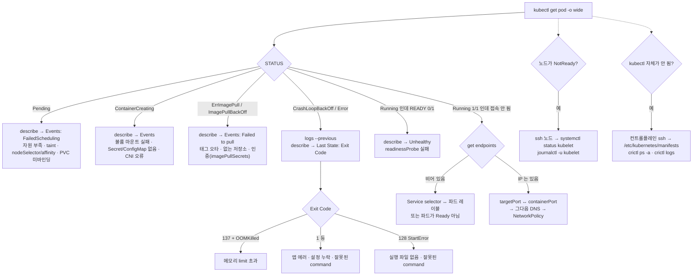

# 22·23강 · 트러블슈팅

> 영상: **22강 앱이 안 뜰 때** (1~8) · **23강 클러스터가 아플 때** (9~12) · 이어서 풀 채점 세트: `22-troubleshooting`

## 실습 목표

- 증상(STATUS)을 보고 **어느 층(스케줄링 · 이미지 · 컨테이너 · 프로브 · 서비스 · DNS · 노드)** 을 볼지 고르는 순서를 몸에 익힌다.
- Pending · ImagePullBackOff · CrashLoopBackOff · OOMKilled · `0/1 Running` 을 **직접 만들고**, 각각 어느 명령의 어느 줄에 원인이 찍히는지 확인한다.
- Service 의 Endpoints 가 비는 두 원인(**셀렉터 불일치 · 준비 안 된 파드**)과, 차 있는데도 안 되는 원인(**targetPort**)을 가른다.
- 워커의 kubelet 을 멈춰 **NotReady 노드**를 만들고 `systemctl` · `journalctl` 로 복구한다.
- kubectl 로 볼 수 없을 때를 대비해 **컨트롤플레인 로그를 `crictl` · `/var/log/pods`** 에서 읽는다.
- **API 서버가 내려간 클러스터**를 `crictl` → 매니페스트 플래그 순서로 되살리고, kubelet 로그의 `6443 refused` 를 증상으로 읽는다.
- 스태틱 파드의 **CPU 요청을 노드 CPU 의 몇 %** 로 맞추는 계산(코어 → 밀리코어)과, kubelet 의 `OutOfcpu` 거부를 확인한다.

---

## 0) 준비

```bash
kubectl create namespace guide-trouble
mkdir -p ~/guide-trouble && cd ~/guide-trouble
```

이 페이지는 일부러 고장을 냅니다. 9) 은 **워커 노드의 kubelet 을**, 10) 은 **컨트롤플레인의 스케줄러를**, 11) 은 **API 서버를** 잠시 멈추고, 12) 는 컨트롤플레인 노드에 **실습용 스태틱 파드**를 둡니다.
11) 을 하기 전에는 **컨트롤플레인 VM 스냅샷**을 찍어 두세요.
두 절에는 되돌리는 명령이 바로 붙어 있고, **정리** 절에서 한 번 더 확인합니다.

!!! warning "노드 이름을 확인하세요"
    이 페이지는 워커를 `worker-1` · `worker-2`, 컨트롤플레인을 `control-plane` 으로 적습니다. `kubectl get nodes` 로 내 이름을 확인해 바꿔 입력하세요.

---

## 1) 진단 순서 — 네 개의 명령과 판단 흐름

### 왜

트러블슈팅은 명령을 많이 아는 것보다 **순서를 건너뛰지 않는 것**이 중요합니다.
거의 모든 문제는 아래 네 명령 안에서 원인이 드러납니다.

| 순서 | 명령 | 보는 것 |
|------|------|---------|
| ① | `kubectl get pod -o wide` | STATUS · READY · RESTARTS · 어느 노드 |
| ② | `kubectl describe pod` | 맨 아래 **Events**, 컨테이너의 **State / Last State** |
| ③ | `kubectl logs [--previous]` | 앱이 남긴 말. 죽은 컨테이너는 `--previous` |
| ④ | `kubectl events` / `get events` | 네임스페이스 전체에서 시간순으로 무슨 일이 있었나 |

### 판단 흐름



### 이벤트 보는 두 가지 방법

```bash
kubectl get events -n guide-trouble --sort-by=.lastTimestamp          # 오래된 것 → 최근 것
kubectl get events -n guide-trouble --field-selector type=Warning     # 경고만
kubectl events -n guide-trouble --for pod/<이름>                       # 특정 오브젝트만 (시간순 정렬이 기본)
kubectl events -n guide-trouble --types=Warning --watch                # 경고를 실시간으로
```

!!! tip "시험 팁 — 이벤트는 1시간이면 사라집니다"
    이벤트는 기본 1시간만 보관됩니다. 오래전에 난 문제는 이벤트가 없을 수 있으니, 그때는 `describe` 의 **Last State** 와 `logs --previous` 가 증거입니다.

### 자원 사용량 — `kubectl top`

`kubectl top` 은 **metrics-server** 가 있어야 동작합니다. kubeadm 클러스터에는 기본으로 없습니다.

```bash
kubectl top nodes
```

```text
error: Metrics API not available
```

??? note "metrics-server 설치 (선택)"
    kubeadm 의 kubelet 서빙 인증서는 클러스터 CA 가 아니라 kubelet 이 스스로 서명한 것이라, metrics-server 가 검증하지 못합니다. 실습용으로 `--kubelet-insecure-tls` 를 추가합니다.
    ```bash
    kubectl apply -f https://github.com/kubernetes-sigs/metrics-server/releases/latest/download/components.yaml
    kubectl patch deployment metrics-server -n kube-system --type=json \
      -p='[{"op":"add","path":"/spec/template/spec/containers/0/args/-","value":"--kubelet-insecure-tls"}]'
    kubectl rollout status deployment/metrics-server -n kube-system
    ```
    1분쯤 뒤:
    ```bash
    kubectl top nodes
    kubectl top pods -A --sort-by=memory | head -5
    ```
    ```text
    NAME            CPU(cores)   CPU(%)   MEMORY(bytes)   MEMORY(%)
    control-plane   182m         9%       1289Mi          68%
    worker-1        48m          2%       702Mi           37%
    worker-2        41m          2%       655Mi           34%
    ```

---

## 2) Pending — 스케줄러가 놓을 곳을 못 찾는다

### 왜

Pending 은 **아직 노드가 정해지지 않은** 상태입니다. 컨테이너는 시작도 안 했으니 `logs` 는 비어 있고, 원인은 전부 **스케줄러의 이벤트**에 있습니다.

### ① 자원 부족

`too-big.yaml`:

```yaml
apiVersion: v1
kind: Pod
metadata:
  name: too-big
  namespace: guide-trouble
spec:
  containers:
  - name: app
    image: nginx:1.27
    resources:
      requests:
        cpu: "64"            # ← 64 코어. 어느 노드에도 없다
        memory: 64Mi
```

```bash
kubectl apply -f too-big.yaml
kubectl get pod too-big -n guide-trouble -o wide
kubectl events -n guide-trouble --for pod/too-big
```

```text
NAME      READY   STATUS    RESTARTS   AGE   IP       NODE
too-big   0/1     Pending   0          8s    <none>   <none>      ← NODE 가 비어 있다

LAST SEEN   TYPE      REASON             OBJECT        MESSAGE
8s          Warning   FailedScheduling   Pod/too-big   0/3 nodes are available: 1 node(s) had untolerated taint {node-role.kubernetes.io/control-plane: }, 2 Insufficient cpu. preemption: 0/3 nodes are available: 1 Preemption is not helpful for scheduling, 2 No preemption victims found for incoming pod.
```

관찰 포인트: 메시지가 **노드 3대를 어떻게 탈락시켰는지** 나눠서 말해 줍니다. 컨트롤플레인 1대는 taint 로, 워커 2대는 CPU 부족으로 탈락했습니다.

노드에 실제로 얼마가 남았는지는 `describe node` 의 **Allocated resources** 로 봅니다.

```bash
kubectl describe node worker-1 | grep -A6 'Allocated resources'
```

```text
Allocated resources:
  (Total limits may be over 100 percent, i.e., overcommitted.)
  Resource           Requests     Limits
  --------           --------     ------
  cpu                350m (17%)   0 (0%)
  memory             140Mi (7%)   340Mi (18%)
```

스케줄러는 **실제 사용량이 아니라 requests 의 합**으로 판단합니다. `kubectl top` 이 한가해 보여도 requests 가 차 있으면 Pending 입니다.

### ② nodeSelector 가 맞는 노드가 없다

```bash
kubectl run picky -n guide-trouble --image=nginx:1.27 \
  --overrides='{"spec":{"nodeSelector":{"disktype":"nvme"}}}'
kubectl events -n guide-trouble --for pod/picky | tail -1
```

```text
... FailedScheduling   Pod/picky   0/3 nodes are available: 1 node(s) had untolerated taint {node-role.kubernetes.io/control-plane: }, 2 node(s) didn't match Pod's node affinity/selector. preemption: ...
```

```bash
kubectl get pod picky -n guide-trouble -o jsonpath='{.spec.nodeSelector}{"\n"}'
kubectl get nodes -L disktype
kubectl label node worker-1 disktype=nvme
kubectl get pod picky -n guide-trouble -o wide
```

```text
{"disktype":"nvme"}

NAME            STATUS   ROLES           AGE   VERSION   DISKTYPE
control-plane   Ready    control-plane   5d    v1.32.x
worker-1        Ready    <none>          5d    v1.32.x
worker-2        Ready    <none>          5d    v1.32.x

node/worker-1 labeled

NAME    READY   STATUS    NODE
picky   1/1     Running   worker-1
```

Pending 파드는 조건이 맞는 순간 **스케줄러가 알아서 다시 시도**합니다. 파드를 지우고 다시 만들 필요가 없습니다.

| FailedScheduling 메시지 조각 | 원인 | 대응 |
|------------------------------|------|------|
| `Insufficient cpu` / `memory` | requests 가 남은 자원보다 크다 | requests 줄이기 · 다른 파드 정리 |
| `had untolerated taint {…}` | 노드의 taint | toleration 추가 또는 taint 제거 |
| `didn't match Pod's node affinity/selector` | nodeSelector · affinity | 노드 레이블 추가 또는 조건 수정 |
| `pod has unbound immediate PersistentVolumeClaims` | PVC 가 Pending | 13강 스토리지 — PV · StorageClass 확인 |
| `node(s) were unschedulable` | `kubectl cordon` 된 노드 | `kubectl uncordon` |
| 이벤트가 아예 없음 | 스케줄러가 죽었다 | 10) 컨트롤플레인 확인 |

```bash
kubectl delete pod too-big picky -n guide-trouble
```

---

## 3) ImagePullBackOff — 이미지를 못 받는다

### 왜

노드는 정해졌는데 kubelet 이 **컨테이너 런타임(containerd)에게 이미지를 받아 오라고 했다가 실패**한 상태입니다.
`ErrImagePull`(방금 실패) → `ImagePullBackOff`(잠시 기다렸다 재시도) 를 번갈아 보입니다.

```bash
kubectl create deployment cart -n guide-trouble --image=redis:7.9.99
kubectl get pods -n guide-trouble -l app=cart -w
```

```text
NAME                    READY   STATUS              RESTARTS   AGE
cart-6f8b7d9c5-k2x7p    0/1     ContainerCreating   0          1s
cart-6f8b7d9c5-k2x7p    0/1     ErrImagePull        0          4s
cart-6f8b7d9c5-k2x7p    0/1     ImagePullBackOff    0          17s
```

`Ctrl+C` 로 빠져나와 이벤트를 봅니다.

```bash
kubectl describe pod -n guide-trouble -l app=cart | sed -n '/Events:/,$p'
```

```text
Events:
  Type     Reason     Age   From               Message
  ----     ------     ----  ----               -------
  Normal   Scheduled  30s   default-scheduler  Successfully assigned guide-trouble/cart-6f8b7d9c5-k2x7p to worker-2
  Normal   Pulling    29s   kubelet            Pulling image "redis:7.9.99"
  Warning  Failed     27s   kubelet            Failed to pull image "redis:7.9.99": rpc error: code = NotFound desc = failed to pull and unpack image "docker.io/library/redis:7.9.99": failed to resolve reference "docker.io/library/redis:7.9.99": docker.io/library/redis:7.9.99: not found
  Warning  Failed     27s   kubelet            Error: ErrImagePull
  Normal   BackOff    14s   kubelet            Back-off pulling image "redis:7.9.99"
  Warning  Failed     14s   kubelet            Error: ImagePullBackOff
```

관찰 포인트: `Scheduled` 는 성공했습니다. 스케줄링 문제가 아니라 **노드(kubelet) 단계**의 문제라는 뜻입니다.
`redis:7.9.99` 가 `docker.io/library/redis:7.9.99` 로 풀려서 해석된 것도 보입니다.

| 메시지 조각 | 원인 |
|-------------|------|
| `not found` / `manifest unknown` | 태그 · 이미지 이름 오타 |
| `pull access denied` / `unauthorized` / `401` | 비공개 저장소 — `imagePullSecrets` 필요 |
| `i/o timeout` / `dial tcp … no such host` | 노드에서 저장소로 나가는 네트워크 · DNS |
| `toomanyrequests` | Docker Hub 요청 한도 |

### 고치기 — Deployment 템플릿을 바꾼다

```bash
kubectl get deploy cart -n guide-trouble -o jsonpath='{.spec.template.spec.containers[*].name}{"\n"}'
kubectl set image deployment/cart -n guide-trouble redis=redis:7.4
kubectl rollout status deployment/cart -n guide-trouble
```

```text
redis
deployment "cart" successfully rolled out
```

!!! tip "파드의 이미지는 고칠 수 있습니다"
    파드 필드는 대부분 수정할 수 없지만 **`image` 는 예외**입니다. Deployment 없는 단독 파드라면
    `kubectl set image pod/<이름> <컨테이너>=<이미지>` 로 바로 고칠 수 있습니다. 다른 필드를 바꿔야 하면 `kubectl replace --force -f` 로 지우고 다시 만듭니다.

노드에서 직접 받아 보면 kubelet 을 거치지 않고 확인할 수 있습니다.

```bash
ssh worker-2 'sudo crictl pull redis:7.9.99'
```

```text
... pulling image: failed to pull and unpack image "docker.io/library/redis:7.9.99": failed to resolve reference ... not found
```

---

## 4) CrashLoopBackOff — 떴다가 죽고, 다시 뜨고

### 왜

컨테이너가 **시작은 됐는데 곧 종료**되고, kubelet 이 재시작하는 것을 반복합니다. 재시작 간격은 10초 → 20초 → 40초 … 최대 5분까지 늘어납니다.
원인은 **죽은 컨테이너가 남긴 로그**와 **종료 코드**에 있습니다.

### 설정 파일이 없어 죽는 앱

`crashy.yaml`:

```yaml
apiVersion: v1
kind: Pod
metadata:
  name: crashy
  namespace: guide-trouble
spec:
  containers:
  - name: app
    image: busybox:1.36
    command: ["sh", "-c"]
    args:
    - |
      echo "starting app, reading /etc/app/app.conf"
      cat /etc/app/app.conf || { echo "FATAL: config not found"; exit 1; }   # ← 파일이 없으면 exit 1
      sleep 3600
```

```bash
kubectl apply -f crashy.yaml
sleep 30; kubectl get pod crashy -n guide-trouble
```

```text
NAME     READY   STATUS             RESTARTS      AGE
crashy   0/1     CrashLoopBackOff   2 (15s ago)   32s
```

```bash
kubectl logs crashy -n guide-trouble --previous
kubectl describe pod crashy -n guide-trouble | grep -A8 '    State:'
```

```text
starting app, reading /etc/app/app.conf
cat: can't open '/etc/app/app.conf': No such file or directory
FATAL: config not found

    State:          Waiting
      Reason:       CrashLoopBackOff
    Last State:     Terminated
      Reason:       Error
      Exit Code:    1                    ← 앱이 스스로 에러로 끝냈다
      Started:      Tue, 29 Sep 2026 07:41:03 +0000
      Finished:     Tue, 29 Sep 2026 07:41:03 +0000
    Ready:          False
    Restart Count:  2
```

!!! warning "`--previous` 를 빼면"
    `kubectl logs crashy` 는 **지금 막 재시작한 컨테이너**의 로그를 봅니다. 그 컨테이너가 아직 아무것도 못 찍었거나 Waiting 상태면 비어 있거나 에러가 납니다.
    죽기 직전의 말은 **`--previous`(`-p`)** 에 있습니다.

### 고치기 — 없는 설정을 넣어 준다

```bash
kubectl create configmap crashy-conf -n guide-trouble --from-literal=app.conf='mode=prod'
kubectl get pod crashy -n guide-trouble -o yaml > crashy-fixed.yaml
```

`crashy-fixed.yaml` 에 볼륨을 추가합니다. SA 토큰용 `volumes` · `volumeMounts` 목록이 이미 있으니 **그 목록에 항목을 하나씩 더합니다**.
(파드의 볼륨은 실행 중에 바꿀 수 없으므로 `replace --force` 로 지우고 다시 만듭니다.)

```yaml
spec:
  containers:
  - name: app
    ...
    volumeMounts:
    - name: conf
      mountPath: /etc/app          # ← 앱이 찾는 경로
  volumes:
  - name: conf
    configMap:
      name: crashy-conf            # ← 키 app.conf 가 파일 /etc/app/app.conf 가 된다
```

```bash
kubectl replace --force -f crashy-fixed.yaml
kubectl get pod crashy -n guide-trouble
kubectl logs crashy -n guide-trouble
```

```text
pod "crashy" deleted
pod/crashy replaced

NAME     READY   STATUS    RESTARTS   AGE
crashy   1/1     Running   0          5s

starting app, reading /etc/app/app.conf
mode=prod
```

### 비교 — 실행 파일 자체가 없으면

```bash
kubectl run no-binary -n guide-trouble --image=busybox:1.36 --command -- start-server --port 80
sleep 20; kubectl get pod no-binary -n guide-trouble
kubectl logs no-binary -n guide-trouble --previous
kubectl describe pod no-binary -n guide-trouble | grep -A6 'Last State'
```

```text
NAME        READY   STATUS             RESTARTS      AGE
no-binary   0/1     CrashLoopBackOff   2 (12s ago)   20s

(비어 있다 — 프로세스가 시작조차 못 했다)

    Last State:     Terminated
      Reason:       StartError
      Message:      failed to create containerd task: failed to create shim task: OCI runtime create failed: runc create failed: unable to start container process: exec: "start-server": executable file not found in $PATH: unknown
      Exit Code:    128
```

관찰 포인트: 앱 에러는 **logs 에**, 실행 자체의 실패는 **describe 의 Message 에** 남습니다. 로그가 비어 있으면 describe 로 갑니다.

| Exit Code | 뜻 | 먼저 볼 곳 |
|-----------|----|------------|
| 0 | 정상 종료 — 그런데 `restartPolicy: Always` 라 다시 뜬다 (할 일 없이 끝나는 command) | command/args |
| 1, 2 … | 앱이 에러로 종료 | `logs --previous` |
| 126 / 127 | 셸에서 실행 권한 없음 / 명령 없음 | `logs --previous`, command |
| 128 (`StartError`) | 컨테이너 프로세스를 시작하지 못함 | describe 의 Message |
| 137 | SIGKILL — **OOMKilled** 이거나 강제 종료 | describe 의 Reason |
| 143 | SIGTERM — 정상적인 종료 요청 | 보통 문제 아님 (liveness 실패 재시작 등) |

---

## 5) OOMKilled — 메모리 limit 을 넘었다

### 왜

컨테이너가 `resources.limits.memory` 를 넘으면 커널이 프로세스를 **즉시 죽입니다(SIGKILL, 137)**. 앱은 로그를 남길 틈도 없습니다.

`memhog.yaml`:

```yaml
apiVersion: v1
kind: Pod
metadata:
  name: memhog
  namespace: guide-trouble
spec:
  containers:
  - name: stress
    image: polinux/stress
    command: ["stress"]
    args: ["--vm", "1", "--vm-bytes", "150M", "--vm-hang", "1"]   # ← 150MB 를 잡으려 한다
    resources:
      requests:
        memory: 32Mi
      limits:
        memory: 64Mi                                              # ← 한도는 64Mi
```

```bash
kubectl apply -f memhog.yaml
sleep 15; kubectl get pod memhog -n guide-trouble
kubectl describe pod memhog -n guide-trouble | grep -A5 'Last State'
```

```text
NAME     READY   STATUS      RESTARTS     AGE
memhog   0/1     OOMKilled   1 (8s ago)   15s

    Last State:     Terminated
      Reason:       OOMKilled            ← 결정적 증거
      Exit Code:    137
      Started:      ...
      Finished:     ...
```

잠시 뒤에는 STATUS 가 `CrashLoopBackOff` 로 바뀝니다. **STATUS 만 보면 CrashLoop 과 구분이 안 되므로** Last State 의 Reason 을 꼭 봅니다.

```bash
kubectl get pod memhog -n guide-trouble \
  -o jsonpath='{.status.containerStatuses[0].lastState.terminated.reason}{"\n"}'
```

```text
OOMKilled
```

고치는 방법은 둘입니다 — limit 을 올리거나, 앱이 덜 쓰게 합니다. 여기서는 사용량을 줄여 봅니다.

```bash
sed -i 's/"150M"/"40M"/' memhog.yaml
kubectl replace --force -f memhog.yaml
sleep 10; kubectl get pod memhog -n guide-trouble
```

```text
NAME     READY   STATUS    RESTARTS   AGE
memhog   1/1     Running   0          10s
```

!!! note "노드 전체 메모리가 모자라면"
    컨테이너 limit 이 아니라 **노드 메모리**가 부족하면 kubelet 이 파드를 **축출(Evicted)** 합니다. STATUS 가 `Evicted` 이고
    `describe node` 의 Conditions 에 `MemoryPressure True` 가 보입니다. OOMKilled 와는 다른 경로입니다.

---

## 6) Running 인데 READY 0/1 — readinessProbe 실패

### 왜

컨테이너는 살아 있지만 **"요청 받을 준비가 됐다"** 는 검사를 통과하지 못한 상태입니다.
준비 안 된 파드는 **Service 의 Endpoints 에서 빠집니다.** 파드는 멀쩡해 보이는데 서비스가 안 되는 흔한 원인입니다.

`menu.yaml`:

```yaml
apiVersion: apps/v1
kind: Deployment
metadata:
  name: menu
  namespace: guide-trouble
spec:
  replicas: 2
  selector:
    matchLabels: { app: menu }
  template:
    metadata:
      labels: { app: menu }
    spec:
      containers:
      - name: web
        image: nginx:1.27
        ports:
        - containerPort: 80
        readinessProbe:
          httpGet:
            path: /healthz          # ← nginx 기본 설정에는 이 경로가 없다 → 404
            port: 80
          periodSeconds: 5
---
apiVersion: v1
kind: Service
metadata:
  name: menu
  namespace: guide-trouble
spec:
  selector: { app: menu }
  ports:
  - port: 80
    targetPort: 80
```

```bash
kubectl apply -f menu.yaml
sleep 20; kubectl get pods -n guide-trouble -l app=menu
kubectl get endpoints menu -n guide-trouble
```

```text
NAME                    READY   STATUS    RESTARTS   AGE
menu-7d5c9b6f8-4hq9z    0/1     Running   0          20s      ← Running 이지만 0/1
menu-7d5c9b6f8-m2n8c    0/1     Running   0          20s

NAME   ENDPOINTS   AGE
menu   <none>      20s
```

```bash
kubectl describe pod -n guide-trouble -l app=menu | grep -E 'Readiness|Unhealthy' | head -3
```

```text
    Readiness:      http-get http://:80/healthz delay=0s timeout=1s period=5s #success=1 #failure=3
  Warning  Unhealthy  3s (x6 over 28s)  kubelet  Readiness probe failed: HTTP probe failed with statuscode: 404
```

EndpointSlice 를 보면 파드 IP 는 **알고 있지만 ready 가 false** 라서 빠진 것이 보입니다.

```bash
kubectl get endpointslice -n guide-trouble -l kubernetes.io/service-name=menu -o yaml | grep -E 'addresses|- 10\.|ready:'
```

```text
- addresses:
  - 10.0.1.87
    ready: false
- addresses:
  - 10.0.2.19
    ready: false
```

### 고치기

```bash
kubectl patch deployment menu -n guide-trouble --type=json \
  -p='[{"op":"replace","path":"/spec/template/spec/containers/0/readinessProbe/httpGet/path","value":"/"}]'
kubectl rollout status deployment/menu -n guide-trouble
kubectl get endpoints menu -n guide-trouble
```

```text
deployment "menu" successfully rolled out
NAME   ENDPOINTS                     AGE
menu   10.0.1.92:80,10.0.2.24:80     2m
```

| | readinessProbe 실패 | livenessProbe 실패 |
|---|---|---|
| 결과 | Endpoints 에서 빠진다 (READY 0/1) | 컨테이너를 **재시작**한다 (RESTARTS 증가) |
| STATUS | Running | Running ↔ CrashLoopBackOff |
| 이벤트 | `Readiness probe failed` | `Liveness probe failed` · `Container … failed liveness probe, will be restarted` |

---

## 7) Service 가 파드를 못 찾는다 — 셀렉터와 targetPort

### 왜

Service 문제는 순서대로 좁힙니다. **① Endpoints 가 비었나 → ② 차 있는데 안 되나(포트) → ③ 이름만 안 되나(DNS, 8절) → ④ 다 맞는데 안 되나(NetworkPolicy)**.

`billing.yaml` — 두 군데를 일부러 틀렸습니다.

```yaml
apiVersion: apps/v1
kind: Deployment
metadata:
  name: billing
  namespace: guide-trouble
spec:
  replicas: 2
  selector:
    matchLabels: { app: billing }
  template:
    metadata:
      labels: { app: billing, tier: backend }
    spec:
      containers:
      - name: web
        image: nginx:1.27
        ports:
        - containerPort: 80
---
apiVersion: v1
kind: Service
metadata:
  name: billing-svc
  namespace: guide-trouble
spec:
  selector:
    app: billing-api            # ← 틀림 ①: 파드 레이블은 app=billing
  ports:
  - port: 80
    targetPort: 8080            # ← 틀림 ②: nginx 는 80 에서 듣는다
```

```bash
kubectl apply -f billing.yaml
kubectl get endpoints billing-svc -n guide-trouble
```

```text
NAME          ENDPOINTS   AGE
billing-svc   <none>      5s
```

### ① Endpoints 가 비었다 → 셀렉터

```bash
kubectl get svc billing-svc -n guide-trouble -o jsonpath='{.spec.selector}{"\n"}'
kubectl get pods -n guide-trouble -l app=billing --show-labels
kubectl get pods -n guide-trouble -l app=billing-api         # 서비스 셀렉터로 직접 조회
```

```text
{"app":"billing-api"}

NAME                       READY   STATUS    LABELS
billing-5b8c7d6f9-7wq4k    1/1     Running   app=billing,pod-template-hash=5b8c7d6f9,tier=backend
billing-5b8c7d6f9-x2k8p    1/1     Running   app=billing,pod-template-hash=5b8c7d6f9,tier=backend

No resources found in guide-trouble namespace.
```

관찰 포인트: **서비스 셀렉터를 그대로 `-l` 에 넣어 조회**하면 한 번에 판정됩니다. 결과가 없으면 셀렉터 문제입니다.
6절처럼 파드가 Ready 가 아닐 때도 Endpoints 가 비므로, READY 칸도 함께 봅니다.

```bash
kubectl patch svc billing-svc -n guide-trouble -p '{"spec":{"selector":{"app":"billing"}}}'
kubectl get endpoints billing-svc -n guide-trouble
```

```text
NAME          ENDPOINTS                       AGE
billing-svc   10.0.1.45:8080,10.0.2.61:8080   1m     ← 포트가 8080
```

!!! warning "`patch` 로 셀렉터를 바꿀 때"
    `-p '{"spec":{"selector":{...}}}'` 는 기존 키에 **병합**됩니다. 틀린 키 이름이 따로 있었다면(예: `application: billing`) 그 키는 남습니다.
    `kubectl edit svc` 로 셀렉터 전체를 눈으로 확인하는 편이 안전합니다.

### ② Endpoints 는 있는데 접속이 안 된다 → targetPort

```bash
kubectl run probe -n guide-trouble --rm -i --restart=Never --image=busybox:1.36 -- \
  wget -qO- -T 3 http://billing-svc
```

```text
wget: can't connect to remote host (10.103.72.15): Connection refused
pod "probe" deleted
pod guide-trouble/probe terminated (Error)
```

```bash
kubectl get pods -n guide-trouble -l app=billing -o jsonpath='{.items[0].spec.containers[0].ports[*].containerPort}{"\n"}'
kubectl patch svc billing-svc -n guide-trouble --type=json \
  -p='[{"op":"replace","path":"/spec/ports/0/targetPort","value":80}]'
kubectl run probe -n guide-trouble --rm -i --restart=Never --image=busybox:1.36 -- \
  wget -qO- -T 3 http://billing-svc | head -4
```

```text
80

<!DOCTYPE html>
<html>
<head>
<title>Welcome to nginx!</title>
```

| 증상 | 원인 | 확인 명령 |
|------|------|-----------|
| ENDPOINTS `<none>`, 파드 Ready | selector ↔ 파드 레이블 | `get pods -l <서비스 셀렉터>` |
| ENDPOINTS `<none>`, 파드 0/1 | readinessProbe | `describe pod` → Unhealthy |
| ENDPOINTS 에 IP 있음, `Connection refused` | targetPort ↔ containerPort | `get svc -o yaml`, 파드 ports |
| ENDPOINTS 에 IP 있음, 타임아웃 | NetworkPolicy · CNI | `get networkpolicy -n <ns>` |
| IP 로는 되는데 이름으로 안 됨 | DNS | 8) |

---

## 8) DNS — 이름으로만 안 될 때

### 왜

파드는 `/etc/resolv.conf` 에 적힌 **CoreDNS(kube-dns Service)** 에게 이름을 묻습니다. 이름으로만 안 되면 CoreDNS 와 resolv.conf 를 봅니다.

```bash
kubectl run dns -n guide-trouble --rm -i --restart=Never --image=busybox:1.28 -- \
  nslookup billing-svc.guide-trouble.svc.cluster.local
```

```text
Server:    10.96.0.10
Address 1: 10.96.0.10 kube-dns.kube-system.svc.cluster.local

Name:      billing-svc.guide-trouble.svc.cluster.local
Address 1: 10.103.72.15 billing-svc.guide-trouble.svc.cluster.local
```

!!! note "busybox 1.28 을 쓰는 이유"
    최신 busybox 의 `nslookup` 은 search 도메인 처리가 달라 헷갈리는 결과를 낼 때가 있습니다. DNS 확인용으로는 1.28 이 흔히 쓰입니다.

파드 안의 resolv.conf 는 이렇게 생겼습니다.

```bash
kubectl run dns -n guide-trouble --rm -i --restart=Never --image=busybox:1.28 -- cat /etc/resolv.conf
```

```text
search guide-trouble.svc.cluster.local svc.cluster.local cluster.local
nameserver 10.96.0.10          ← kube-dns Service 의 ClusterIP
options ndots:5
```

`search` 줄 덕분에 같은 네임스페이스에서는 `billing-svc` 만, 다른 네임스페이스에서는 `billing-svc.guide-trouble` 로 부를 수 있습니다.

### 깨 보기 — CoreDNS 를 잠시 0 개로

!!! warning "클러스터 전체의 이름 해석이 멈춥니다"
    몇십 초 동안 모든 파드의 DNS 가 안 됩니다. 실습 클러스터에서만 하고, 바로 되돌립니다.

```bash
kubectl get deploy coredns -n kube-system -o jsonpath='{.spec.replicas}{"\n"}'   # 원래 개수 기억 (보통 2)
kubectl scale deploy coredns -n kube-system --replicas=0
kubectl run dns -n guide-trouble --rm -i --restart=Never --image=busybox:1.28 -- \
  nslookup billing-svc
```

```text
2
deployment.apps/coredns scaled
Server:    10.96.0.10
Address 1: 10.96.0.10

nslookup: can't resolve 'billing-svc'
pod guide-trouble/dns terminated (Error)
```

```bash
kubectl get endpoints kube-dns -n kube-system
kubectl scale deploy coredns -n kube-system --replicas=2
kubectl rollout status deploy coredns -n kube-system
kubectl logs -n kube-system -l k8s-app=kube-dns --tail=5
```

```text
NAME       ENDPOINTS   AGE
kube-dns   <none>      5d          ← 7절과 같은 모양: 서비스는 있는데 뒤에 파드가 없다

deployment.apps/coredns scaled
deployment "coredns" successfully rolled out
.:53
[INFO] plugin/reload: Running configuration SHA512 = ...
CoreDNS-1.11.3
linux/amd64, go1.21.11, a6338e9
```

관찰 포인트: DNS 장애도 결국 **"kube-dns Service 의 Endpoints 가 비었다"** 로 보입니다. 7절의 점검 순서가 그대로 통합니다.

---

## 9) 노드 NotReady — kubelet 을 멈춰 보기

### 왜

노드의 상태는 그 노드의 **kubelet 이 API 서버에 주기적으로 보고**해서 정해집니다. 보고가 끊기면 컨트롤플레인은 약 40초 뒤 노드를 `NotReady`(정확히는 `Unknown`)로 표시합니다.
kubelet 은 파드가 아니라 **systemd 서비스**라서, 고치려면 그 노드에 들어가야 합니다.

!!! warning "워커 하나에서만, 끝나면 반드시 되돌립니다"
    `worker-2` 의 kubelet 을 멈춥니다. 5분 넘게 두면 그 노드의 파드가 다른 노드로 축출되기 시작합니다. 관찰이 끝나면 곧바로 `systemctl start kubelet` 합니다.

### 멈추기

=== "터미널 1 — 컨트롤플레인에서 지켜보기"
    ```bash
    kubectl get nodes -w
    ```
=== "터미널 2 — worker-2 에서 멈추기"
    ```bash
    ssh worker-2
    sudo systemctl stop kubelet
    sudo systemctl status kubelet --no-pager | head -5
    ```

```text
● kubelet.service - kubelet: The Kubernetes Node Agent
     Loaded: loaded (/usr/lib/systemd/system/kubelet.service; enabled; preset: enabled)
    Drop-In: /usr/lib/systemd/system/kubelet.service.d
             └─10-kubeadm.conf
     Active: inactive (dead) since Tue 2026-09-29 08:02:11 UTC; 5s ago
```

40초쯤 지나면 터미널 1 에:

```text
NAME            STATUS     ROLES           AGE   VERSION
worker-2        NotReady   <none>          5d    v1.32.x
```

### 관찰

```bash
kubectl describe node worker-2 | sed -n '/Taints:/,/Unschedulable/p;/Conditions:/,/Addresses:/p'
```

```text
Taints:             node.kubernetes.io/unreachable:NoExecute
                    node.kubernetes.io/unreachable:NoSchedule
Unschedulable:      false
Conditions:
  Type             Status    LastHeartbeatTime   Reason              Message
  ----             ------    -----------------   ------              -------
  MemoryPressure   Unknown   ...                 NodeStatusUnknown   Kubelet stopped posting node status.
  DiskPressure     Unknown   ...                 NodeStatusUnknown   Kubelet stopped posting node status.
  PIDPressure      Unknown   ...                 NodeStatusUnknown   Kubelet stopped posting node status.
  Ready            Unknown   ...                 NodeStatusUnknown   Kubelet stopped posting node status.
Addresses:
```

관찰 포인트:

- Status 가 `False` 가 아니라 **`Unknown`** 입니다. "나빠졌다" 가 아니라 "소식이 끊겼다" 입니다.
- 노드 컨트롤러가 **`unreachable` taint** 를 자동으로 붙였습니다. `NoSchedule` 때문에 새 파드는 오지 않고,
  `NoExecute` 때문에 기존 파드는 기본 toleration(300초)이 지나면 축출됩니다.
- 그 노드의 파드는 API 에 여전히 `Running` 으로 보일 수 있습니다. **보고할 kubelet 이 없어서** 갱신이 안 된 것입니다.

### 원인 찾고 복구하기

worker-2 에서:

```bash
sudo journalctl -u kubelet -n 20 --no-pager
```

```text
Sep 29 08:02:11 worker-2 systemd[1]: Stopping kubelet.service - kubelet: The Kubernetes Node Agent...
Sep 29 08:02:11 worker-2 systemd[1]: kubelet.service: Deactivated successfully.
Sep 29 08:02:11 worker-2 systemd[1]: Stopped kubelet.service - kubelet: The Kubernetes Node Agent.
```

누가 멈췄다는 기록만 있습니다. 이번 원인은 "멈춰 있다" 이므로 시작하고, 부팅 때도 뜨도록 enable 을 확인합니다.

```bash
sudo systemctl start kubelet
sudo systemctl enable kubelet
systemctl is-active kubelet; systemctl is-enabled kubelet
exit
```

```text
active
enabled
```

```bash
kubectl get nodes
kubectl describe node worker-2 | grep Taints
```

```text
worker-2        Ready      <none>          5d    v1.32.x
Taints:             <none>
```

taint 도 자동으로 사라졌습니다.

| journalctl 에 보이는 것 | 흔한 원인 | 대응 |
|-------------------------|-----------|------|
| `Stopped kubelet.service` 뿐 | 누가 멈췄다 · disable 됐다 | `systemctl enable --now kubelet` |
| `failed to load kubelet config file` | `/var/lib/kubelet/config.yaml` 경로 · 문법 | 파일 확인 후 restart |
| `unable to load client CA file` / 인증서 에러 | 인증서 경로 · 만료 | `/etc/kubernetes/kubelet.conf`, `/var/lib/kubelet/pki` |
| `container runtime is down` / containerd 소켓 에러 | containerd 가 죽었다 | `systemctl status containerd` |
| `running with swap on is not supported` | swap 이 켜졌다 | `swapoff -a` + fstab |

!!! tip "시험 팁 — 설정을 고쳤으면 `daemon-reload`"
    `/usr/lib/systemd/system/kubelet.service.d/10-kubeadm.conf` 같은 **systemd 유닛 파일**을 고쳤다면 `sudo systemctl daemon-reload` 후 restart 해야 반영됩니다.
    `/var/lib/kubelet/config.yaml` 만 고쳤다면 restart 로 충분합니다.

---

## 10) 컨트롤플레인 로그 — kubectl 이 안 믿길 때

### 왜

컨트롤플레인 구성 요소는 **스태틱 파드**입니다(18강). API 서버가 살아 있으면 `kubectl logs` 로 보면 되지만,
API 서버가 죽으면 kubectl 이 아예 동작하지 않습니다. 그때는 **노드의 컨테이너 런타임에게 직접** 묻습니다.

### API 서버가 살아 있을 때

```bash
kubectl get pods -n kube-system -l tier=control-plane
kubectl logs -n kube-system kube-scheduler-control-plane --tail=3
```

### API 서버 없이 보는 법 — crictl 과 /var/log/pods

컨트롤플레인 노드에서:

```bash
sudo crictl ps --name kube-scheduler
sudo crictl logs --tail 3 $(sudo crictl ps -q --name kube-scheduler)
ls /var/log/pods/ | grep kube-system_kube-scheduler
```

```text
CONTAINER       IMAGE           CREATED       STATE     NAME             ATTEMPT   POD ID          POD
3f9e2c1d8a7b4   a389e107f4ff1   5 days ago    Running   kube-scheduler   0         9b2d4c6e1f3a5   kube-scheduler-control-plane

I0929 08:10:02.112345       1 leaderelection.go:...] successfully acquired lease kube-system/kube-scheduler
...
kube-system_kube-scheduler-control-plane_6c1f0d2e8b...
```

!!! note "crictl 이 경고를 낸다면"
    `WARN ... runtime connect using default endpoints` 경고가 나오면 소켓을 알려 줍니다.
    ```bash
    sudo crictl config --set runtime-endpoint=unix:///run/containerd/containerd.sock \
                       --set image-endpoint=unix:///run/containerd/containerd.sock
    ```

### 깨 보기 — 스케줄러에 없는 옵션을 넣는다

API 서버는 그대로 두고 **스케줄러만** 고장 냅니다. 먼저 매니페스트를 **manifests 디렉터리 밖에** 백업합니다.

!!! warning "백업을 `/etc/kubernetes/manifests/` 안에 두지 마세요"
    kubelet 은 그 디렉터리의 **모든 파일**을 스태틱 파드로 띄우려 합니다. 백업 파일이 거기 있으면 같은 이름의 파드가 충돌합니다.

```bash
sudo cp /etc/kubernetes/manifests/kube-scheduler.yaml ~/guide-trouble/kube-scheduler.yaml.bak
sudo sed -i 's/    - --bind-address=127.0.0.1/    - --bind-address=127.0.0.1\n    - --no-such-flag=true/' \
  /etc/kubernetes/manifests/kube-scheduler.yaml
sudo grep -n 'no-such-flag' /etc/kubernetes/manifests/kube-scheduler.yaml
```

kubelet 이 파일 변경을 감지해 스케줄러를 다시 띄웁니다. 30초쯤 뒤:

```bash
kubectl get pods -n kube-system -l component=kube-scheduler
kubectl run after-break -n guide-trouble --image=nginx:1.27
kubectl get pod after-break -n guide-trouble
```

```text
NAME                           READY   STATUS             RESTARTS      AGE
kube-scheduler-control-plane   0/1     CrashLoopBackOff   2 (20s ago)   5d

NAME          READY   STATUS    RESTARTS   AGE
after-break   0/1     Pending   0          5s        ← 이벤트조차 없다 (2절 표의 마지막 줄)
```

이제 kubectl 없이 원인을 찾습니다.

```bash
sudo crictl ps -a --name kube-scheduler | head -3
sudo crictl logs $(sudo crictl ps -a -q --name kube-scheduler | head -1) 2>&1 | head -3
sudo tail -3 /var/log/pods/kube-system_kube-scheduler-control-plane_*/kube-scheduler/*.log
```

```text
CONTAINER       IMAGE           CREATED          STATE    NAME             ATTEMPT   ...
8c1e4f2a9d6b3   a389e107f4ff1   12 seconds ago   Exited   kube-scheduler   3         ...

Error: unknown flag: --no-such-flag
...
2026-09-29T08:15:40.123Z stderr F Error: unknown flag: --no-such-flag
```

관찰 포인트: `crictl ps` 에는 **`-a`** 를 붙여야 죽은(Exited) 컨테이너까지 보입니다. 로그 파일은 `/var/log/pods/<ns>_<파드>_<uid>/<컨테이너>/<재시작번호>.log` 입니다.

### 되돌리기

```bash
sudo cp ~/guide-trouble/kube-scheduler.yaml.bak /etc/kubernetes/manifests/kube-scheduler.yaml
sleep 30
kubectl get pods -n kube-system -l component=kube-scheduler
kubectl get pod after-break -n guide-trouble
```

```text
NAME                           READY   STATUS    RESTARTS   AGE
kube-scheduler-control-plane   1/1     Running   0          20s

NAME          READY   STATUS    RESTARTS   AGE
after-break   1/1     Running   0          1m        ← 스케줄러가 돌아오자 바로 배치됐다
```

| 구성 요소가 죽으면 | 눈에 보이는 증상 |
|--------------------|------------------|
| kube-apiserver | `kubectl` 전부 `The connection to the server … was refused` |
| etcd | API 서버도 곧 실패 (etcd 에 못 붙어서) |
| kube-scheduler | 새 파드가 **이벤트 없이** Pending |
| kube-controller-manager | Deployment 를 만들어도 ReplicaSet · 파드가 안 생긴다, 스케일이 안 먹는다 |
| kubelet (노드) | 그 노드 NotReady (9절) |

!!! tip "시험 팁 — API 서버가 죽었을 때의 순서"
    ① 컨트롤플레인에 ssh → ② `/etc/kubernetes/manifests/kube-apiserver.yaml` 을 직접 읽어 오타 확인 →
    ③ `crictl ps -a | grep apiserver` · `crictl logs <ID>` → ④ 컨테이너조차 없으면 `journalctl -u kubelet` (YAML 문법 오류는 kubelet 로그에 남습니다).

---

## 11) 컨트롤플레인 복구 — API 서버가 내려갔을 때

### 왜

10) 에서는 API 서버가 살아 있어서 `kubectl` 로 증상을 볼 수 있었습니다. 시험에서는 **"kubectl 이 안 된다"** 에서 출발하는 문제가 나옵니다.
원인은 대개 `kube-apiserver.yaml` 의 **플래그 한 줄**입니다. kubectl 도 `kubectl logs` 도 못 쓰니, 컨트롤플레인 노드에서 **런타임(crictl)과 kubelet** 에게 직접 묻습니다.

| 순서 | 명령 | 알 수 있는 것 |
|------|------|---------------|
| ① | `kubectl get nodes` | `refused` → API 서버 프로세스 자체가 없다 |
| ② | `sudo crictl ps -a --name kube-apiserver` | 컨테이너가 `Exited` 를 반복하나, 아예 없나 |
| ③ | `sudo crictl logs <ID>` | **왜** 죽는지 — 마지막 몇 줄에 파일·주소가 찍힌다 |
| ④ | `sudo grep ... kube-apiserver.yaml` | 로그가 가리킨 플래그를 매니페스트에서 찾는다 |
| ⑤ (②에서 컨테이너가 없을 때) | `sudo journalctl -u kubelet` | YAML 문법 오류처럼 kubelet 이 파드를 못 만드는 이유 |

!!! warning "VM 스냅샷을 먼저 찍으세요"
    이 절은 **API 서버를 멈춥니다.** 되돌리는 명령이 바로 붙어 있지만, 매니페스트를 잘못 고치면 클러스터 전체가 멈춘 채로 남습니다.
    시작 전에 컨트롤플레인 VM 의 스냅샷을 찍어 두세요. 백업은 10) 과 같이 **manifests 디렉터리 밖**에 둡니다.

### 깨 보기 — etcd CA 파일 경로를 틀리게

컨트롤플레인 노드에서:

```bash
sudo cp /etc/kubernetes/manifests/kube-apiserver.yaml ~/guide-trouble/kube-apiserver.yaml.bak
sudo sed -i 's#--etcd-cafile=/etc/kubernetes/pki/etcd/ca.crt#--etcd-cafile=/etc/kubernetes/pki/etcd/ca-typo.crt#' \
  /etc/kubernetes/manifests/kube-apiserver.yaml
sudo grep -n 'etcd-cafile' /etc/kubernetes/manifests/kube-apiserver.yaml
```

```text
22:    - --etcd-cafile=/etc/kubernetes/pki/etcd/ca-typo.crt
```

kubelet 이 파일 변경을 알아채고 API 서버를 다시 띄우려 합니다. 30초~1분 뒤:

```bash
kubectl get nodes
```

```text
The connection to the server 192.168.56.10:6443 was refused - did you specify the right host or port?
```

처음 20초쯤은 옛 컨테이너가 아직 응답할 수 있습니다. `refused` 가 나올 때까지 기다리세요.

### 증상 — kubelet 로그의 6443 refused 는 범인이 아니다

```bash
sudo journalctl -u kubelet --since "2 min ago" --no-pager | grep 6443 | tail -2
```

```text
Sep 29 08:31:02 control-plane kubelet[812]: E0929 08:31:02.118 ... failed to list *v1.Node: Get "https://192.168.56.10:6443/api/v1/nodes?...": dial tcp 192.168.56.10:6443: connect: connection refused
Sep 29 08:31:04 control-plane kubelet[812]: E0929 08:31:04.522 ... "Failed to update lease" err="Put \"https://192.168.56.10:6443/apis/coordination.k8s.io/v1/namespaces/kube-node-lease/leases/control-plane?timeout=10s\": dial tcp 192.168.56.10:6443: connect: connection refused"
```

관찰 포인트:

- kubelet 도 API 서버의 **클라이언트**입니다. `6443 ... connection refused` 는 "API 서버가 없다" 는 사실을 kubelet 이 한 번 더 말해 주는 **증상**입니다.
- 이 줄을 보고 kubelet 설정을 뒤지거나 `systemctl restart kubelet` 을 반복하면 시간만 갑니다. 원인은 **API 서버 컨테이너의 로그**에 있습니다.

### 원인 — crictl 로 API 서버 컨테이너를 본다

```bash
sudo crictl ps -a --name kube-apiserver | head -3
sudo crictl logs $(sudo crictl ps -a -q --name kube-apiserver | head -1) 2>&1 | tail -2
```

```text
CONTAINER       IMAGE           CREATED          STATE    NAME             ATTEMPT   POD ID          POD
5d1c7e9a2b4f8   6e6d5fe7d4ac9   15 seconds ago   Exited   kube-apiserver   3         7a3c1e0b9d2f4   kube-apiserver-control-plane

I0929 08:31:19.981204       1 options.go:...] ...
E0929 08:31:20.004512       1 run.go:72] "command failed" err="open /etc/kubernetes/pki/etcd/ca-typo.crt: no such file or directory"
```

마지막 줄의 형식은 버전마다 조금 다르지만, **어느 파일 · 어느 주소에서 실패했는지**가 찍힙니다. 그 값을 매니페스트에서 찾고, 짝이 되는 etcd 쪽 설정과 맞춰 봅니다.

```bash
sudo grep -nE 'etcd-(servers|cafile|certfile|keyfile)' /etc/kubernetes/manifests/kube-apiserver.yaml
sudo grep -nE 'listen-client-urls|listen-peer-urls|trusted-ca-file' /etc/kubernetes/manifests/etcd.yaml
ls /etc/kubernetes/pki/etcd/
```

```text
22:    - --etcd-cafile=/etc/kubernetes/pki/etcd/ca-typo.crt      ← 이 파일이 없다
23:    - --etcd-certfile=/etc/kubernetes/pki/apiserver-etcd-client.crt
24:    - --etcd-keyfile=/etc/kubernetes/pki/apiserver-etcd-client.key
25:    - --etcd-servers=https://127.0.0.1:2379

20:    - --listen-client-urls=https://127.0.0.1:2379,https://192.168.56.10:2379
22:    - --listen-peer-urls=https://192.168.56.10:2380
29:    - --trusted-ca-file=/etc/kubernetes/pki/etcd/ca.crt

ca.crt  ca.key  healthcheck-client.crt  healthcheck-client.key  peer.crt  peer.key  server.crt  server.key
```

### 2379 와 2380 — 포트 하나 차이

같은 패턴의 고장으로 **`--etcd-servers` 의 포트**가 틀리는 경우가 자주 나옵니다. etcd 는 포트를 두 개 엽니다.

| 포트 | etcd 의 플래그 | 누가 붙나 |
|------|----------------|-----------|
| **2379** | `--listen-client-urls` | **클라이언트** — kube-apiserver, etcdctl |
| 2380 | `--listen-peer-urls` | etcd **멤버끼리** (복제 · 리더 선출) |

API 서버는 etcd 의 클라이언트이므로 `--etcd-servers` 는 **반드시 2379** 입니다. 2380 으로 바뀌어 있으면 API 서버 로그에
`127.0.0.1:2380` 에 붙지 못한다는 줄(연결 거부나 `context deadline exceeded`)이 반복되다가 컨테이너가 죽습니다.
위 출력처럼 kubeadm 의 peer 포트는 **노드 IP 에만** 열려 있어서 `127.0.0.1:2380` 에는 듣는 쪽조차 없습니다.

| 로그 · 상태에 보이는 것 | 의심할 플래그 |
|-------------------------|---------------|
| `127.0.0.1:2380` · `:2381` 등 다른 포트로 etcd 연결 실패 | `--etcd-servers` 포트 → `etcd.yaml` 의 `--listen-client-urls` 와 맞춘다 |
| `open ... .crt/.key: no such file or directory` | `--etcd-cafile` · `--etcd-certfile` · `--tls-*-file` · `--client-ca-file` 경로 → `ls /etc/kubernetes/pki` |
| `tls: ... certificate signed by unknown authority` | `--etcd-cafile` 이 엉뚱한 CA(`/etc/kubernetes/pki/ca.crt`)를 가리킨다 |
| `unknown flag` | 플래그 이름 오타 (10절) |
| `crictl ps -a` 에 컨테이너가 아예 없다 | 매니페스트 YAML 문법 → `journalctl -u kubelet` |
| etcd 컨테이너가 `Exited` | API 서버가 아니라 etcd 가 먼저 → `crictl logs` 를 etcd 쪽에서 |

### 고치기

```bash
sudo cp ~/guide-trouble/kube-apiserver.yaml.bak /etc/kubernetes/manifests/kube-apiserver.yaml
# 시험에서는 백업이 없으니 vi 로 그 줄만 고칩니다 (ca-typo.crt → ca.crt)
watch -n2 'sudo crictl ps --name kube-apiserver'     # STATE 가 Running 으로 바뀌면 Ctrl+C
kubectl get nodes
kubectl get pods -n kube-system -l component=kube-apiserver
```

```text
NAME            STATUS   ROLES           AGE   VERSION
control-plane   Ready    control-plane   5d    v1.32.x
worker-1        Ready    <none>          5d    v1.32.x
worker-2        Ready    <none>          5d    v1.32.x

NAME                           READY   STATUS    RESTARTS   AGE
kube-apiserver-control-plane   1/1     Running   0          40s
```

관찰 포인트: API 서버가 돌아오면 kubelet 로그의 `6443 refused` 도 **저절로** 멈춥니다. kubelet 은 처음부터 고장이 아니었습니다.

!!! tip "시험 팁 — 고쳤는데 1~2분이 지나도 그대로라면"
    kubelet 은 manifests 디렉터리를 주기적으로(약 20초) 다시 읽습니다. 그래도 컨테이너가 안 바뀌면 `sudo systemctl restart kubelet` 을 한 번 해 봅니다.
    그래도 컨테이너가 없으면 `sudo journalctl -u kubelet -n 50 --no-pager | grep -i apiserver` 로 YAML 오류를 찾습니다. 탭 문자 · 들여쓰기가 흔한 원인입니다.

---

## 12) static pod 의 자원 요청 고치기 — 노드 CPU 의 10%

### 왜

2) 에서 64 코어를 요청한 **일반 파드**는 `Pending` 이었고, 스케줄러가 `FailedScheduling` 이벤트를 남겼습니다.
**스태틱 파드**는 스케줄러를 거치지 않고 그 노드의 kubelet 이 바로 띄웁니다. 그래서 자원이 모자라면 Pending 이 아니라
**kubelet 이 입장(admission)을 거부**하고, 이유는 `OutOfcpu` 입니다. 컨트롤플레인 구성 요소가 이렇게 되면 그 구성 요소가 통째로 사라집니다.

kubeadm 이 만든 컨트롤플레인 스태틱 파드에도 requests 가 있습니다.

```bash
sudo grep -A1 'requests:' /etc/kubernetes/manifests/*.yaml
```

```text
/etc/kubernetes/manifests/etcd.yaml:      requests:
/etc/kubernetes/manifests/etcd.yaml-        cpu: 100m
--
/etc/kubernetes/manifests/kube-apiserver.yaml:      requests:
/etc/kubernetes/manifests/kube-apiserver.yaml-        cpu: 250m
--
/etc/kubernetes/manifests/kube-controller-manager.yaml:      requests:
/etc/kubernetes/manifests/kube-controller-manager.yaml-        cpu: 200m
--
/etc/kubernetes/manifests/kube-scheduler.yaml:      requests:
/etc/kubernetes/manifests/kube-scheduler.yaml-        cpu: 100m
```

### 노드 CPU 읽기 → 밀리코어 → 10%

```bash
kubectl get node control-plane -o jsonpath='{.status.capacity.cpu}{" / "}{.status.allocatable.cpu}{"\n"}'
nproc
```

```text
2 / 2
2
```

`capacity` 는 노드가 가진 전체, `allocatable` 은 시스템 예약을 뺀 나머지입니다. kubeadm 기본은 예약이 없어 둘이 같습니다.
문제가 "노드의 CPU" 라고 하면 **capacity** 를 씁니다. **1 CPU = 1000m(밀리코어)** 입니다.

| capacity.cpu | 밀리코어 | 10% | 매니페스트에 쓸 값 |
|--------------|----------|-----|--------------------|
| 2 | 2000m | 200m | `cpu: 200m` |
| 3 | 3000m | 300m | `cpu: 300m` |
| 4 | 4000m | 400m | `cpu: 400m` |
| 8 | 8000m | 800m | `cpu: 800m` |

```bash
CAP=$(kubectl get node control-plane -o jsonpath='{.status.capacity.cpu}')
echo "$(( CAP * 1000 / 10 ))m"
```

```text
200m
```

`0.2` 와 `200m` 은 같은 값이지만, 시험에서는 단위가 눈에 보이는 **`m` 표기**가 실수가 적습니다.

### 깨 보기 — 요청이 너무 큰 스태틱 파드

컨트롤플레인 구성 요소 대신 **실습용 스태틱 파드**로 같은 현상을 만듭니다. 컨트롤플레인 노드에서:

```bash
cat <<'EOF' | sudo tee /etc/kubernetes/manifests/guide-cpu-hog.yaml >/dev/null
apiVersion: v1
kind: Pod
metadata:
  name: guide-cpu-hog
  namespace: guide-trouble
spec:
  containers:
  - name: web
    image: nginx:1.27
    resources:
      requests:
        cpu: "64"            # ← 64 코어
EOF
```

30초쯤 뒤:

```bash
kubectl get pods -n guide-trouble | grep cpu-hog
kubectl get events -n guide-trouble --field-selector reason=OutOfcpu
sudo crictl pods --name guide-cpu-hog
```

```text
guide-cpu-hog-control-plane   0/1     OutOfcpu   0          25s

LAST SEEN   TYPE      REASON     OBJECT                            MESSAGE
25s         Warning   OutOfcpu   Pod/guide-cpu-hog-control-plane   Node didn't have enough resource: cpu, requested: 64000, used: 950, capacity: 2000

POD ID   CREATED   STATE   NAME   NAMESPACE   ATTEMPT   RUNTIME          ← 샌드박스조차 만들지 않았다
```

관찰 포인트:

- **Pending 이 아닙니다.** 스케줄러가 아니라 **kubelet** 이 거부했습니다. 메시지의 숫자는 모두 밀리코어입니다(`requested: 64000`, `capacity: 2000`).
- `used` 는 그 노드에 이미 있는 파드들의 **requests 합**입니다. 새 요청이 `allocatable − used` 안에 들어와야 입장합니다.
- 첫 줄(미러 파드)은 타이밍에 따라 보이지 않을 수 있습니다. 그래서 **이벤트 · `crictl pods` · kubelet 로그**를 같이 봅니다.
  `sudo journalctl -u kubelet --since "5 min ago" --no-pager | grep -iE 'outofcpu|enough resource'`
- 이 파드가 **kube-scheduler** 였다면? 스케줄러가 사라지고, 그 뒤 만든 파드는 **이벤트 없이 Pending** 입니다(10절 표).

### 고치기 — 노드 CPU 의 10% 로

미러 파드는 kubelet 이 만든 **읽기 전용 사본**이라 `kubectl edit` 으로는 고칠 수 없습니다. **매니페스트 파일**을 고칩니다.

```bash
CAP=$(kubectl get node control-plane -o jsonpath='{.status.capacity.cpu}')
sudo vi /etc/kubernetes/manifests/guide-cpu-hog.yaml          # cpu: "64" → cpu: 200m
# vi 대신 한 줄로:
# sudo sed -i "s/cpu: \"64\"/cpu: $(( CAP * 100 ))m/" /etc/kubernetes/manifests/guide-cpu-hog.yaml
```

kubelet 이 바뀐 파일을 읽고 파드를 **새로** 만듭니다. 30초쯤 뒤:

```bash
kubectl get pods -n guide-trouble -o wide | grep cpu-hog
kubectl get pod guide-cpu-hog-control-plane -n guide-trouble \
  -o jsonpath='{.spec.containers[0].resources.requests.cpu}{"\n"}'
```

```text
guide-cpu-hog-control-plane   1/1     Running   0          20s   10.0.0.123   control-plane   <none>   <none>
200m
```

관찰 포인트: RESTARTS 가 `0` 이고 AGE 가 새로 시작합니다. 컨테이너를 재시작한 게 아니라 **파드를 새로 만든** 것입니다(스태틱 파드는 매니페스트 내용이 바뀌면 다른 파드로 취급됩니다).

!!! warning "미러 파드를 kubectl 로 지우거나 고치지 마세요"
    `kubectl delete pod guide-cpu-hog-control-plane` 을 해도 kubelet 이 곧 다시 만듭니다(매니페스트가 그대로이므로). 원인은 언제나 **파일**에 있습니다.

!!! tip "시험 팁 — 컨트롤플레인 구성 요소도 순서는 같습니다"
    ① capacity 확인 → 밀리코어로 바꿔 % 계산 ② 매니페스트를 **manifests 밖**에 백업 ③ `resources.requests.cpu` **한 줄만** 바꾼다(다른 플래그는 손대지 않는다)
    ④ `sudo crictl ps --name <구성요소>` 로 Running 확인 ⑤ 그 구성 요소가 하는 일까지 확인 — 스케줄러라면 `kubectl run` 으로 새 파드가 **노드에 배치되는지**까지 봅니다.

실습용 스태틱 파드를 치웁니다. 파일을 지우면 kubelet 이 파드를 거둬 갑니다.

```bash
sudo rm /etc/kubernetes/manifests/guide-cpu-hog.yaml
```

---

## 시험에서 빠르게

```bash
# 네 개의 명령
kubectl get pod <p> -n <ns> -o wide
kubectl describe pod <p> -n <ns> | sed -n '/Events:/,$p'
kubectl logs <p> -n <ns> --previous            # -c <컨테이너>
kubectl events -n <ns> --for pod/<p>           # 또는 get events --sort-by=.lastTimestamp

# 종료 이유 한 줄로
kubectl get pod <p> -n <ns> -o jsonpath='{.status.containerStatuses[0].lastState.terminated.reason}{"\n"}'

# Pending
kubectl describe node <n> | grep -A6 'Allocated resources'
kubectl get nodes -L <label> ; kubectl describe node <n> | grep Taints

# 이미지
kubectl set image deployment/<d> <container>=<image> -n <ns>

# Service
kubectl get endpoints <svc> -n <ns>
kubectl get svc <svc> -n <ns> -o jsonpath='{.spec.selector}'
kubectl get pods -n <ns> -l <서비스 셀렉터 그대로> --show-labels
kubectl run t --rm -i --restart=Never --image=busybox:1.28 -n <ns> -- nslookup <svc>

# 노드
ssh <node>; sudo systemctl status kubelet; sudo journalctl -u kubelet -n 50 --no-pager
sudo systemctl enable --now kubelet

# 컨트롤플레인
sudo crictl ps -a --name <component>; sudo crictl logs <ID>
ls /var/log/pods/ ; ls /etc/kubernetes/manifests/
sudo grep -nE 'etcd-servers|listen-client-urls' /etc/kubernetes/manifests/{kube-apiserver,etcd}.yaml   # 2379 끼리 맞나

# 스태틱 파드 CPU 를 노드의 N%
kubectl get node <n> -o jsonpath='{.status.capacity.cpu}'        # 2 → 2000m → 10% = 200m
kubectl get events -n <ns> --field-selector reason=OutOfcpu
```

---

## 정리

**먼저 노드와 컨트롤플레인이 정상인지** 확인하고, 그다음 실습 리소스를 지웁니다.

```bash
# 9) · 10) · 11) · 12) 를 되돌렸는지
kubectl get nodes                                             # 모두 Ready
kubectl get pods -n kube-system -l tier=control-plane         # 모두 1/1 Running
sudo grep -c no-such-flag /etc/kubernetes/manifests/kube-scheduler.yaml   # 0
sudo grep -c ca-typo /etc/kubernetes/manifests/kube-apiserver.yaml        # 0
sudo rm -f /etc/kubernetes/manifests/guide-cpu-hog.yaml                   # 12) 의 실습용 스태틱 파드
kubectl get deploy coredns -n kube-system                     # 8) 에서 되돌린 개수 (예: 2/2)

# 2) 에서 붙인 노드 레이블
kubectl label node worker-1 disktype-

# 실습 리소스
kubectl delete namespace guide-trouble
cd ~ && rm -rf ~/guide-trouble
```

!!! note "metrics-server 를 설치했다면"
    남겨 두면 이후 강의에서도 `kubectl top` 을 쓸 수 있습니다. 지우려면
    `kubectl delete -f https://github.com/kubernetes-sigs/metrics-server/releases/latest/download/components.yaml`.

---

## 확인 질문

??? question "1. 파드가 Pending 입니다. `kubectl logs` 를 보면 무엇이 나오나요? 어디를 봐야 하나요?"
    Pending 은 컨테이너가 시작도 안 했으므로 로그가 없습니다. `describe pod` 의 Events 에서 `FailedScheduling` 메시지를 봅니다.
    메시지가 노드마다 탈락 이유(자원 · taint · selector)를 나눠 알려 줍니다. 이벤트조차 없으면 스케줄러를 의심합니다.

??? question "2. CrashLoopBackOff 파드에서 `kubectl logs` 가 비어 있습니다. 다음 명령은?"
    `kubectl logs <파드> --previous` 로 죽은 컨테이너의 마지막 로그를 봅니다. 그래도 비어 있으면
    `describe` 의 Last State 에서 Reason(`StartError`, `OOMKilled`)과 Message 를 봅니다.

??? question "3. STATUS 가 CrashLoopBackOff 인데 원인이 메모리인지 어떻게 확인하나요?"
    `describe pod` 의 Last State 에 `Reason: OOMKilled`, `Exit Code: 137` 이 있으면 메모리 limit 초과입니다.
    jsonpath 로 `.status.containerStatuses[0].lastState.terminated.reason` 을 봐도 됩니다.

??? question "4. 파드는 `Running` 인데 READY 가 `0/1` 이고 Service 로 접속이 안 됩니다. 원인은?"
    readinessProbe 실패입니다. 준비되지 않은 파드는 Endpoints 에서 빠집니다.
    `describe pod` 의 `Readiness probe failed` 이벤트에서 이유(404, 연결 거부 등)를 확인하고 프로브나 앱을 고칩니다.

??? question "5. Service 의 Endpoints 에 IP 는 있는데 `Connection refused` 가 납니다. 무엇을 비교하나요?"
    Service 의 `targetPort` 와 파드의 `containerPort`(실제로 앱이 듣는 포트)를 비교합니다.
    Endpoints 가 `<none>` 이면 selector 쪽, IP 가 있으면 포트 쪽입니다.

??? question "6. kubelet 을 멈춘 노드의 Ready 조건은 `False` 인가요 `Unknown` 인가요? 어떤 taint 가 붙나요?"
    `Unknown` 입니다(Message: `Kubelet stopped posting node status.`). 노드 컨트롤러가
    `node.kubernetes.io/unreachable` 을 `NoSchedule` 과 `NoExecute` 두 가지로 붙이고, 기존 파드는 기본 300초 뒤 축출됩니다.

??? question "7. kubectl 이 `connection refused` 로 전부 실패합니다. 어디서 무엇을 보나요?"
    컨트롤플레인 노드에 ssh 해서 `/etc/kubernetes/manifests/kube-apiserver.yaml` 을 확인하고,
    `crictl ps -a` 로 apiserver 컨테이너 상태를, `crictl logs <ID>` 나 `/var/log/pods/` 로 로그를 봅니다. 컨테이너가 아예 없으면 `journalctl -u kubelet` 입니다.

??? question "8. 스태틱 파드 매니페스트 백업을 `/etc/kubernetes/manifests/kube-scheduler.yaml.bak` 으로 두면 무엇이 문제인가요?"
    kubelet 은 그 디렉터리의 파일을 모두 스태틱 파드로 읽으려 하므로 같은 이름의 파드가 중복 정의되어 문제가 생깁니다.
    백업은 반드시 manifests 디렉터리 **밖**에 둡니다.

??? question "9. kubectl 이 refused 이고 `journalctl -u kubelet` 에 `dial tcp ...:6443: connect: connection refused` 가 가득합니다. kubelet 을 고쳐야 하나요?"
    아닙니다. kubelet 도 API 서버의 클라이언트라서, API 서버가 없다는 **증상**을 보여 줄 뿐입니다.
    `sudo crictl ps -a --name kube-apiserver` → `crictl logs` 로 API 서버가 왜 죽는지 보고, 가리키는 플래그를 매니페스트에서 고칩니다.
    `--etcd-servers` 라면 etcd 의 **클라이언트 포트 2379** 여야 합니다(2380 은 etcd 멤버끼리 쓰는 peer 포트).

??? question "10. CPU 가 4개인 노드에서 스태틱 파드의 CPU 요청을 노드 CPU 의 10% 로 하라고 합니다. 무엇을 어디에 씁니까? 요청이 너무 크면 어떤 상태가 됩니까?"
    4 CPU = 4000m 이므로 10% 는 **`400m`** 입니다. `/etc/kubernetes/manifests/<파드>.yaml` 의 `resources.requests.cpu` 를 바꾸면 kubelet 이 파드를 새로 만듭니다.
    요청이 노드에 들어가지 않으면 스태틱 파드는 Pending 이 아니라 kubelet 이 **`OutOfcpu`** 로 거부합니다(스케줄러를 거치지 않으므로).

---

## 다음 단계 — 채점 실습

개념이 잡혔으면 시험 형식으로 풀어 봅니다. 이번에는 **답이 없습니다.** 시작하면 고장 난 리소스가 미리 만들어집니다.

```bash
cd ~/cka-lab/22-troubleshooting
bash exam.sh start
```

| 문제 | 이 페이지에서 연습한 것 |
|------|------------------------|
| Q1 CrashLoopBackOff 진단 | 4) `logs --previous` · Last State · Exit Code 표 |
| Q2 ImagePullBackOff 수정 | 3) Events 의 pull 실패 메시지 · 이미지 교체 |
| Q3 Endpoints 가 비어 있는 Service | 7) ① 셀렉터 · 6) Ready 아닌 파드 |
| Q4 노드 상태 점검 | 9) NotReady · Conditions · `systemctl` · `journalctl` |
| Q5 API 서버 복구 (kubectl refused) | 11) crictl → 로그 → 매니페스트 플래그 · 2379 vs 2380 · kubelet 의 6443 refused 는 증상 |
| Q6 kube-scheduler CPU 요청 (노드 CPU 의 10%) | 12) capacity → 밀리코어 계산 · `OutOfcpu` · 매니페스트 수정 · 10) 스케줄러가 없을 때의 Pending |

!!! warning "Q5 · Q6 은 컨트롤플레인을 고장 냅니다"
    그 문제로 **넘어가는 순간** 채점 스크립트가 `kube-apiserver.yaml`(Q5) · `kube-scheduler.yaml`(Q6)을 바꿉니다. Q4 를 마치면 **VM 스냅샷**을 먼저 찍으세요.
    컨트롤플레인 노드에서, 암호 없는 sudo 로 실행해야 합니다. 원본은 `/var/tmp/cka-lab-backup/` 에 백업되고 `bash exam.sh clean` 이 되돌립니다.
